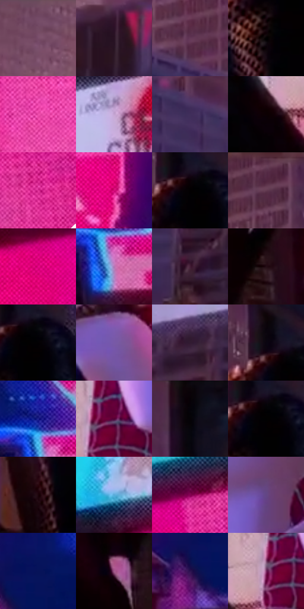

# 电影参考 402

- 状态：常规／活跃；来源世界：miles-home。
- 视角：low-angle；景别：medium；场景：portrait。
- 时段：twilight-appearance（外观依据，中置信度；具体时间／晨昏未知）；光照：dusk。
- 材质候选：fabric, stone, glass, screen, sky（帧级，不是像素分割）。
- 明暗组：dark；L* P5/P50/P95：0.1364 / 22.83704 / 65.59881。
- 资格门禁：无附加门禁。
- 原截图 SHA-256：`91e1a80fa5260cdc8394e8a182b240fe61905652c6eea77af574d57a79dac0d8`；尺寸：2880 × 1200。
- sRGB 像素 SHA-256：`9443c00657d468d65fb856d98ad4abf5d0de6254c47427c570d669d7bfcf15ec`。

## 观察与迁移

日暮衣料和背景广告，主体明暗层级优先。

402  /  暮色偏紫，白面出现淡蓝／紫粉分区，黑衣仅局部残留暖亮纹，楼面暗下  /  混合光可以在同一表面形成冷暖分面；减弱日光不等于立刻抹掉所有暖亮边

本公开版保存32个128×128原像素色卡上下文；图集格子并非原场景相邻位置。原rect、图集tile和像素SHA见 `data/palette-crops.json`。上下文不足时不得批准替色，不能以小样推断完整构图。

## 实测色卡

颜色比例分母为保留采样像素，不是材料面积；全部 32 色参与全库匹配。表内四舍五入仅用于阅读，原精度在 JSON。

| ID | HEX | Lab | 原图 xy | 像素数 | 比例 | 明度角色 |
| --- | --- | --- | --- | ---: | ---: | --- |
| 402-S01 | #7B4F6C | [39.388233, 23.23027, -9.076493] | [248, 60] | 10261 | 5.326295% | shadow |
| 402-S02 | #281122 | [8.718444, 14.967198, -6.651846] | [520, 316] | 10191 | 5.289959% | deep-shadow |
| 402-S03 | #643957 | [30.215956, 23.85125, -9.917877] | [852, 312] | 9519 | 4.941136% | shadow |
| 402-S04 | #000000 | [0.0, 0.0, 0.0] | [1180, 452] | 9012 | 4.677962% | deep-shadow |
| 402-S05 | #EC4BAA | [57.819739, 69.667797, -16.744698] | [2036, 468] | 8894 | 4.616710% | midtone |
| 402-S06 | #C3A4D1 | [71.389651, 19.511333, -18.646146] | [1428, 100] | 8492 | 4.408040% | light |
| 402-S07 | #402E5B | [22.996316, 18.998061, -24.087167] | [1024, 464] | 8160 | 4.235704% | shadow |
| 402-S08 | #0C0003 | [0.765632, 3.584574, -0.019232] | [1372, 484] | 7833 | 4.065965% | deep-shadow |
| 402-S09 | #DE3198 | [51.834169, 72.336385, -15.480214] | [2792, 524] | 7631 | 3.961110% | midtone |
| 402-S10 | #D40878 | [46.35288, 74.038117, -4.548669] | [2284, 824] | 7630 | 3.960591% | midtone |
| 402-S11 | #020001 | [0.136404, 0.662042, -0.194147] | [1208, 336] | 7578 | 3.933599% | deep-shadow |
| 402-S12 | #542A45 | [23.574573, 23.495241, -8.305504] | [980, 40] | 6935 | 3.599830% | shadow |
| 402-S13 | #E80589 | [50.775347, 80.034567, -7.905482] | [2460, 216] | 6664 | 3.459159% | midtone |
| 402-S14 | #B375B4 | [57.657947, 34.598113, -23.466078] | [2732, 1044] | 6480 | 3.363648% | midtone |
| 402-S15 | #40243C | [18.705824, 17.708833, -9.834763] | [44, 688] | 6430 | 3.337694% | deep-shadow |
| 402-S16 | #230D14 | [6.284753, 12.151332, 0.177012] | [1868, 936] | 6356 | 3.299282% | deep-shadow |
| 402-S17 | #020003 | [0.175978, 0.94013, -0.950994] | [1236, 344] | 6237 | 3.237511% | deep-shadow |
| 402-S18 | #7859A7 | [44.128898, 29.494511, -37.477816] | [1884, 540] | 6234 | 3.235954% | midtone |
| 402-S19 | #321B32 | [13.782051, 15.892442, -10.520225] | [276, 512] | 6191 | 3.213633% | deep-shadow |
| 402-S20 | #0A0510 | [1.901259, 2.985811, -4.107102] | [1180, 296] | 5586 | 2.899589% | deep-shadow |
| 402-S21 | #20238F | [21.913604, 37.338542, -59.232431] | [2712, 964] | 5558 | 2.885055% | shadow |
| 402-S22 | #540235 | [16.433536, 38.646487, -8.042403] | [1500, 396] | 5203 | 2.700781% | deep-shadow |
| 402-S23 | #060208 | [0.900303, 1.880225, -1.901921] | [1184, 40] | 5019 | 2.605270% | deep-shadow |
| 402-S24 | #010101 | [0.274173, -1.7e-05, 3.3e-05] | [1216, 344] | 4242 | 2.201943% | deep-shadow |
| 402-S25 | #1B030A | [2.89158, 9.631268, 0.40176] | [1188, 780] | 3901 | 2.024937% | deep-shadow |
| 402-S26 | #58ACDA | [67.00499, -12.036224, -30.909551] | [1932, 196] | 3834 | 1.990158% | light |
| 402-S27 | #870054 | [28.882639, 54.501134, -9.389849] | [2696, 128] | 3027 | 1.571259% | shadow |
| 402-S28 | #634685 | [35.451964, 26.011065, -30.846126] | [1688, 432] | 2569 | 1.333520% | shadow |
| 402-S29 | #061359 | [10.743504, 25.25891, -42.825208] | [2468, 900] | 2222 | 1.153399% | deep-shadow |
| 402-S30 | #A55A8C | [48.519255, 37.5188, -14.202105] | [1756, 1072] | 2194 | 1.138865% | midtone |
| 402-S31 | #2B124F | [12.675429, 27.503276, -32.719771] | [2412, 952] | 1509 | 0.783294% | deep-shadow |
| 402-S32 | #7E3268 | [33.386894, 39.64317, -15.645504] | [1460, 420] | 1056 | 0.548150% | shadow |

## 色阶与空间分布

- 采样 ROI：`[0.01, 0.02, 0.98, 0.94]`；步长：4；样本数：192648。
- 排除区：`[]`。
- 深暗、暗、中、亮、高光五段计数：`[88139, 42766, 46796, 14661, 286]`。
- RGB 各 256 箱、L* 100 箱、13×5 色相明度表和 3×3 空间统计全部保存在 [总数据](../film-library.json)。
- [可视化档案](../../references/library.html)按需绘制直方图，不存 2,094 张重复图表图片。

## 纹理特征占比

**这是分块图像特征的面积占比，不是波点／排线／丝网／错版的精确语义覆盖率。** 窗格、发丝、织物也会产生方向或周期特征。
原图 ROI 像素 3084576；已测块覆盖 3084576（100.0000%）；未测 0。

| 特征 | 块覆盖像素 | 占已测面积 | 阈值敏感范围 |
| --- | ---: | ---: | --- |
| low-contrast | 399360 | 12.9470% | 10.4904% ~ 13.4782% |
| directional-structure | 184320 | 5.9755% | 2.1246% ~ 16.2003% |
| periodic-structure | 2441504 | 79.1520% | 73.3093% ~ 79.1520% |
| mixed-detail | 59392 | 1.9255% | 0.0000% ~ 5.6436% |

阈值敏感范围不是统计置信区间。逐块坐标、尺度、对比、方向一致性、频谱集中度、频率与角度见 [全量特征记录](../texture-features.jsonl)，以帧号定位。
四种印刷层的真实像素覆盖仍标为 `null`，不能填 0，也不能拿上表代替。不得据这些代理测量删除唯一证据。

[测量方法与保留策略](../../references/library-retention.md) · [分类索引](../archive/README.md)
