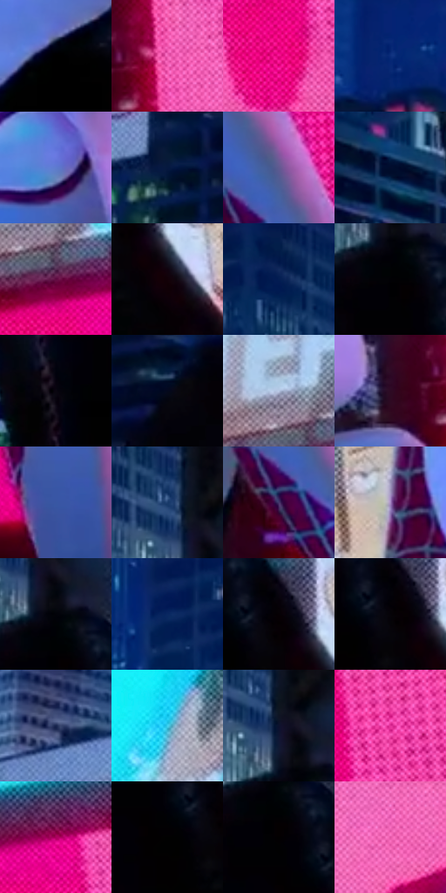

# 电影参考 403

- 状态：常规／活跃；来源世界：miles-home。
- 视角：low-angle；景别：medium；场景：portrait。
- 时段：night-appearance（外观依据，中置信度；具体时间／晨昏未知）；光照：night-mixed。
- 材质候选：fabric, stone, glass, screen, sky（帧级，不是像素分割）。
- 明暗组：very-dark；L* P5/P50/P95：0.0 / 17.276 / 68.47134。
- 资格门禁：无附加门禁。
- 原截图 SHA-256：`907f6acec9661e85aae7e4831550d56e912b5a73c53c1b50115239f1a1bad047`；尺寸：2880 × 1204。
- sRGB 像素 SHA-256：`6c8daa6b99f48f4846eee6b1d82cae64c012248d74b641de41dea5794e01140d`。

## 观察与迁移

夜间白布承接环境蓝粉，屏幕二次图像单列。

403  /  蓝色夜楼群与局部窗灯，右侧高彩粉屏；白兜帽蓝冷面与粉色边并存，黑衣深暗内仅局部彩亮  /  白衣明显承接彩光而仍读作白色材料，黑衣靠窄幅彩色亮区保持体积；不把衣服画成霓虹自发光体

本公开版保存32个128×128原像素色卡上下文；图集格子并非原场景相邻位置。原rect、图集tile和像素SHA见 `data/palette-crops.json`。上下文不足时不得批准替色，不能以小样推断完整构图。

## 实测色卡

颜色比例分母为保留采样像素，不是材料面积；全部 32 色参与全库匹配。表内四舍五入仅用于阅读，原精度在 JSON。

| ID | HEX | Lab | 原图 xy | 像素数 | 比例 | 明度角色 |
| --- | --- | --- | --- | ---: | ---: | --- |
| 403-S01 | #000000 | [0.0, 0.0, 0.0] | [1700, 664] | 13753 | 7.138927% | deep-shadow |
| 403-S02 | #F463B8 | [63.029155, 64.11849, -16.780445] | [2016, 448] | 11668 | 6.056642% | light |
| 403-S03 | #E80983 | [50.681224, 79.221298, -4.418496] | [2724, 532] | 10744 | 5.577011% | midtone |
| 403-S04 | #0B2E7B | [21.77922, 20.532685, -46.925077] | [584, 248] | 10259 | 5.325256% | shadow |
| 403-S05 | #5E7BCE | [52.949409, 13.635527, -46.199384] | [1700, 220] | 9340 | 4.848221% | midtone |
| 403-S06 | #06193F | [9.740822, 9.218926, -26.479758] | [424, 504] | 7830 | 4.064408% | deep-shadow |
| 403-S07 | #605A91 | [40.965503, 15.908339, -29.494964] | [2016, 720] | 7578 | 3.933599% | midtone |
| 403-S08 | #020D2D | [4.427235, 7.232573, -21.946819] | [1032, 488] | 7218 | 3.746730% | deep-shadow |
| 403-S09 | #5F0B41 | [20.260971, 40.476041, -10.432483] | [2492, 176] | 6706 | 3.480960% | shadow |
| 403-S10 | #120007 | [1.300513, 6.184592, -0.812784] | [1368, 492] | 6560 | 3.405174% | deep-shadow |
| 403-S11 | #021E52 | [12.924571, 13.630684, -34.498623] | [1096, 72] | 6546 | 3.397907% | deep-shadow |
| 403-S12 | #010104 | [0.333534, 0.417114, -1.135238] | [1212, 364] | 6097 | 3.164840% | deep-shadow |
| 403-S13 | #0A0610 | [2.097336, 2.58525, -3.820784] | [1200, 788] | 6061 | 3.146153% | deep-shadow |
| 403-S14 | #04091C | [2.754935, 2.76045, -11.395968] | [540, 616] | 6046 | 3.138366% | deep-shadow |
| 403-S15 | #B5C4E2 | [78.922065, 1.147811, -16.616261] | [2456, 100] | 5924 | 3.075038% | light |
| 403-S16 | #2D0A24 | [8.150984, 21.572197, -8.960543] | [1908, 472] | 5831 | 3.026764% | deep-shadow |
| 403-S17 | #3857A3 | [38.376, 13.970385, -44.56356] | [2144, 1116] | 5309 | 2.755803% | shadow |
| 403-S18 | #1B3C6C | [25.402719, 6.013664, -31.470216] | [1172, 232] | 5273 | 2.737116% | shadow |
| 403-S19 | #45366B | [26.634527, 19.924812, -28.685433] | [1980, 804] | 5024 | 2.607865% | shadow |
| 403-S20 | #A484C3 | [60.190364, 24.459857, -28.230758] | [1468, 372] | 4890 | 2.538308% | light |
| 403-S21 | #020309 | [0.882933, 0.572711, -2.362581] | [1220, 320] | 4796 | 2.489515% | deep-shadow |
| 403-S22 | #0A2761 | [17.358596, 14.357814, -37.314896] | [800, 148] | 4568 | 2.371164% | deep-shadow |
| 403-S23 | #060104 | [0.625078, 1.724611, -0.674545] | [1320, 416] | 4424 | 2.296416% | deep-shadow |
| 403-S24 | #060309 | [1.116168, 1.618709, -1.994027] | [1308, 432] | 4242 | 2.201943% | deep-shadow |
| 403-S25 | #17254D | [15.700295, 9.103596, -26.552589] | [144, 376] | 3833 | 1.989639% | deep-shadow |
| 403-S26 | #42D2F1 | [78.226388, -27.857756, -26.186175] | [1996, 120] | 3729 | 1.935655% | light |
| 403-S27 | #0D122E | [6.46174, 7.982816, -19.421267] | [1196, 268] | 3562 | 1.848968% | deep-shadow |
| 403-S28 | #E23199 | [52.58595, 73.402281, -14.866474] | [2796, 332] | 3379 | 1.753976% | midtone |
| 403-S29 | #AC005D | [37.047449, 63.651446, -2.245261] | [2696, 164] | 3287 | 1.706221% | shadow |
| 403-S30 | #010101 | [0.274173, -1.7e-05, 3.3e-05] | [1256, 456] | 2797 | 1.451871% | deep-shadow |
| 403-S31 | #020001 | [0.136404, 0.662042, -0.194147] | [1228, 388] | 2777 | 1.441489% | deep-shadow |
| 403-S32 | #E154A4 | [57.106952, 62.439761, -14.503156] | [2404, 592] | 2597 | 1.348054% | midtone |

## 色阶与空间分布

- 采样 ROI：`[0.01, 0.02, 0.98, 0.94]`；步长：4；样本数：192648。
- 排除区：`[]`。
- 深暗、暗、中、亮、高光五段计数：`[102513, 30068, 37062, 17904, 5101]`。
- RGB 各 256 箱、L* 100 箱、13×5 色相明度表和 3×3 空间统计全部保存在 [总数据](../film-library.json)。
- [可视化档案](../../references/library.html)按需绘制直方图，不存 2,094 张重复图表图片。

## 纹理特征占比

**这是分块图像特征的面积占比，不是波点／排线／丝网／错版的精确语义覆盖率。** 窗格、发丝、织物也会产生方向或周期特征。
原图 ROI 像素 3092958；已测块覆盖 3092958（100.0000%）；未测 0。

| 特征 | 块覆盖像素 | 占已测面积 | 阈值敏感范围 |
| --- | ---: | ---: | --- |
| low-contrast | 478208 | 15.4612% | 13.8720% ~ 15.9909% |
| directional-structure | 119552 | 3.8653% | 1.5892% ~ 15.4902% |
| periodic-structure | 2337118 | 75.5626% | 69.0487% ~ 75.5626% |
| mixed-detail | 158080 | 5.1110% | 1.5892% ~ 8.7280% |

阈值敏感范围不是统计置信区间。逐块坐标、尺度、对比、方向一致性、频谱集中度、频率与角度见 [全量特征记录](../texture-features.jsonl)，以帧号定位。
四种印刷层的真实像素覆盖仍标为 `null`，不能填 0，也不能拿上表代替。不得据这些代理测量删除唯一证据。

[测量方法与保留策略](../../references/library-retention.md) · [分类索引](../archive/README.md)
