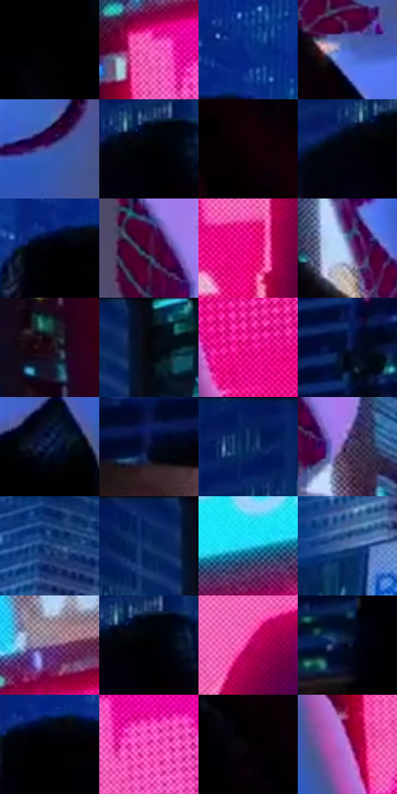

# 电影参考 404

- 状态：常规／活跃；来源世界：miles-home。
- 视角：low-angle；景别：medium；场景：portrait。
- 时段：night-appearance（外观依据，中置信度；具体时间／晨昏未知）；光照：night-mixed。
- 材质候选：fabric, stone, glass, screen, sky（帧级，不是像素分割）。
- 明暗组：very-dark；L* P5/P50/P95：0.0 / 16.52192 / 65.56535。
- 资格门禁：无附加门禁。
- 原截图 SHA-256：`6a1e6f7d0f130a9a2fc12414c1feeb8f3db630756e61ed9768c65d0d1ec518e9`；尺寸：2880 × 1194。
- sRGB 像素 SHA-256：`e94f64b366fed8adbb4292f59b300e4c395587a61c89e24b172f25a6007e2593`。

## 观察与迁移

夜间白布承接环境蓝粉，屏幕二次图像单列。

404  /  相近蓝夜光下头部与双膝位置改变，白帽与黑衣剪影继续可辨  /  姿态和观察角度也改变亮纹与遮挡，不能据高光位置移动判断粗糙度变化；不复制参考姿势到原照

本公开版保存32个128×128原像素色卡上下文；图集格子并非原场景相邻位置。原rect、图集tile和像素SHA见 `data/palette-crops.json`。上下文不足时不得批准替色，不能以小样推断完整构图。

## 实测色卡

颜色比例分母为保留采样像素，不是材料面积；全部 32 色参与全库匹配。表内四舍五入仅用于阅读，原精度在 JSON。

| ID | HEX | Lab | 原图 xy | 像素数 | 比例 | 明度角色 |
| --- | --- | --- | --- | ---: | ---: | --- |
| 404-S01 | #000000 | [0.0, 0.0, 0.0] | [740, 400] | 20133 | 10.488669% | deep-shadow |
| 404-S02 | #F159B5 | [60.945555, 67.033356, -18.27006] | [2036, 332] | 12461 | 6.491795% | light |
| 404-S03 | #0A2F8C | [23.638702, 26.817789, -54.555915] | [684, 160] | 10894 | 5.675436% | shadow |
| 404-S04 | #5070CC | [49.070654, 16.903167, -51.287685] | [1520, 480] | 9407 | 4.900755% | midtone |
| 404-S05 | #49529E | [37.696214, 18.923249, -42.604878] | [1572, 260] | 8841 | 4.605887% | shadow |
| 404-S06 | #010103 | [0.313747, 0.27807, -0.756814] | [1016, 212] | 7455 | 3.883824% | deep-shadow |
| 404-S07 | #0E0005 | [0.942548, 4.478603, -0.559053] | [1332, 520] | 7002 | 3.647825% | deep-shadow |
| 404-S08 | #05030A | [1.077646, 1.496253, -2.464589] | [968, 224] | 6919 | 3.604585% | deep-shadow |
| 404-S09 | #010108 | [0.412681, 0.973289, -2.648932] | [604, 248] | 6901 | 3.595207% | deep-shadow |
| 404-S10 | #53073C | [17.07311, 37.773866, -12.055238] | [1736, 320] | 6600 | 3.438395% | deep-shadow |
| 404-S11 | #E4067A | [49.537645, 77.846036, -0.721483] | [2332, 840] | 6378 | 3.322740% | midtone |
| 404-S12 | #9EAADB | [70.268059, 6.733865, -26.118723] | [1412, 352] | 6361 | 3.313884% | light |
| 404-S13 | #240F1C | [7.231993, 13.232673, -4.384307] | [1916, 960] | 6357 | 3.311800% | deep-shadow |
| 404-S14 | #070814 | [2.432813, 1.830565, -5.786043] | [1228, 24] | 5983 | 3.116958% | deep-shadow |
| 404-S15 | #F11095 | [53.218304, 82.144652, -11.26236] | [2132, 756] | 5942 | 3.095598% | midtone |
| 404-S16 | #131D49 | [12.595381, 12.680644, -28.822943] | [92, 788] | 5860 | 3.052878% | deep-shadow |
| 404-S17 | #07173A | [8.681906, 8.644643, -24.626075] | [1780, 572] | 5281 | 2.751237% | deep-shadow |
| 404-S18 | #090E32 | [5.440935, 11.169518, -24.027441] | [268, 984] | 4914 | 2.560042% | deep-shadow |
| 404-S19 | #061D5C | [13.767013, 19.300934, -39.864118] | [1024, 28] | 4803 | 2.502214% | deep-shadow |
| 404-S20 | #47345F | [25.628774, 18.444015, -22.50407] | [1816, 372] | 4660 | 2.427716% | shadow |
| 404-S21 | #163972 | [24.674371, 9.877962, -36.483848] | [136, 280] | 4559 | 2.375098% | shadow |
| 404-S22 | #0D2C63 | [19.171193, 11.808311, -35.684604] | [1160, 60] | 4277 | 2.228184% | deep-shadow |
| 404-S23 | #26D4F4 | [78.476535, -30.47083, -27.444398] | [2704, 104] | 3936 | 2.050534% | light |
| 404-S24 | #2A5494 | [35.926274, 7.961262, -39.50739] | [36, 432] | 3830 | 1.995311% | shadow |
| 404-S25 | #8F6999 | [49.789639, 24.012169, -20.208558] | [2228, 200] | 3559 | 1.854129% | midtone |
| 404-S26 | #020001 | [0.136404, 0.662042, -0.194147] | [1028, 216] | 3230 | 1.682730% | deep-shadow |
| 404-S27 | #A80256 | [36.066229, 61.915208, 0.731891] | [2404, 692] | 3114 | 1.622297% | shadow |
| 404-S28 | #040C22 | [3.651046, 3.521962, -14.758544] | [456, 908] | 3105 | 1.617609% | deep-shadow |
| 404-S29 | #010101 | [0.274173, -1.7e-05, 3.3e-05] | [632, 256] | 2651 | 1.381089% | deep-shadow |
| 404-S30 | #DA2C9B | [50.777415, 73.028686, -18.940278] | [2116, 376] | 2457 | 1.280021% | midtone |
| 404-S31 | #050306 | [0.998498, 0.940078, -0.950895] | [1208, 432] | 2054 | 1.070070% | deep-shadow |
| 404-S32 | #CC77D1 | [62.199182, 46.786928, -32.666434] | [2000, 552] | 2026 | 1.055483% | light |

## 色阶与空间分布

- 采样 ROI：`[0.01, 0.02, 0.98, 0.94]`；步长：4；样本数：191950。
- 排除区：`[]`。
- 深暗、暗、中、亮、高光五段计数：`[101868, 34638, 37413, 13754, 4277]`。
- RGB 各 256 箱、L* 100 箱、13×5 色相明度表和 3×3 空间统计全部保存在 [总数据](../film-library.json)。
- [可视化档案](../../references/library.html)按需绘制直方图，不存 2,094 张重复图表图片。

## 纹理特征占比

**这是分块图像特征的面积占比，不是波点／排线／丝网／错版的精确语义覆盖率。** 窗格、发丝、织物也会产生方向或周期特征。
原图 ROI 像素 3070606；已测块覆盖 3070606（100.0000%）；未测 0。

| 特征 | 块覆盖像素 | 占已测面积 | 阈值敏感范围 |
| --- | ---: | ---: | --- |
| low-contrast | 562688 | 18.3250% | 16.7243% ~ 18.8586% |
| directional-structure | 113536 | 3.6975% | 1.3798% ~ 10.1921% |
| periodic-structure | 2266126 | 73.8006% | 69.4028% ~ 73.8006% |
| mixed-detail | 128256 | 4.1769% | 1.6007% ~ 10.3589% |

阈值敏感范围不是统计置信区间。逐块坐标、尺度、对比、方向一致性、频谱集中度、频率与角度见 [全量特征记录](../texture-features.jsonl)，以帧号定位。
四种印刷层的真实像素覆盖仍标为 `null`，不能填 0，也不能拿上表代替。不得据这些代理测量删除唯一证据。

[测量方法与保留策略](../../references/library-retention.md) · [分类索引](../archive/README.md)
