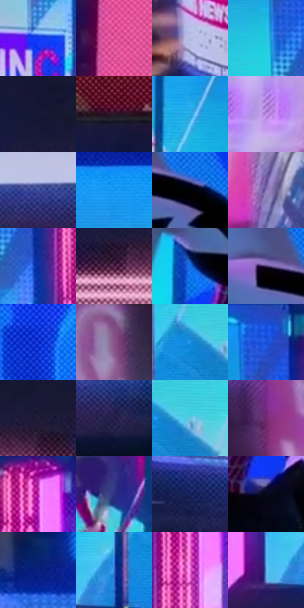

# 电影参考 405

- 状态：常规／活跃；来源世界：miles-home。
- 视角：high-angle；景别：environment-wide；场景：portrait。
- 时段：night-appearance（外观依据，中置信度；具体时间／晨昏未知）；光照：night-mixed。
- 材质候选：fabric, stone, glass, screen, sky（帧级，不是像素分割）。
- 明暗组：dark；L* P5/P50/P95：3.05127 / 39.06599 / 76.52767。
- 资格门禁：无附加门禁。
- 原截图 SHA-256：`a697e5752cb97c9a04e83dcb93eb950106a48efc398d63ce13ceaa2f069bedc0`；尺寸：2880 × 1210。
- sRGB 像素 SHA-256：`d809a2bafee27bb0f479f285610eb2949037458801af87adb7a7129dced62f06`。

## 观察与迁移

夜间白布承接环境蓝粉，屏幕二次图像单列。

405  /  夜景：屏幕青蓝亮面、暗前景与局部粉亮边  /  多屏同脸是显示内容，不是现场残影

本公开版保存32个128×128原像素色卡上下文；图集格子并非原场景相邻位置。原rect、图集tile和像素SHA见 `data/palette-crops.json`。上下文不足时不得批准替色，不能以小样推断完整构图。

## 实测色卡

颜色比例分母为保留采样像素，不是材料面积；全部 32 色参与全库匹配。表内四舍五入仅用于阅读，原精度在 JSON。

| ID | HEX | Lab | 原图 xy | 像素数 | 比例 | 明度角色 |
| --- | --- | --- | --- | ---: | ---: | --- |
| 405-S01 | #0D3AF1 | [36.85469, 56.893588, -92.370952] | [1140, 864] | 9164 | 4.722640% | shadow |
| 405-S02 | #DA4F97 | [54.798803, 60.887975, -10.47985] | [2636, 700] | 9015 | 4.645854% | midtone |
| 405-S03 | #B7BEE3 | [77.542701, 5.219345, -19.223817] | [476, 896] | 8711 | 4.489188% | light |
| 405-S04 | #22C7E1 | [73.945189, -30.453162, -24.170029] | [1108, 560] | 8541 | 4.401579% | light |
| 405-S05 | #141733 | [8.99514, 8.435553, -19.017001] | [2708, 204] | 8401 | 4.329430% | deep-shadow |
| 405-S06 | #2D1728 | [11.44209, 14.283933, -6.903583] | [2504, 84] | 8176 | 4.213477% | deep-shadow |
| 405-S07 | #27AAE4 | [65.575735, -14.208323, -38.726799] | [1776, 536] | 7921 | 4.082064% | light |
| 405-S08 | #C294EA | [68.453046, 33.278251, -36.911107] | [300, 116] | 7825 | 4.032591% | light |
| 405-S09 | #4554A4 | [38.349343, 18.796854, -45.161643] | [1864, 1068] | 7659 | 3.947043% | shadow |
| 405-S10 | #1093EF | [59.164322, 1.504474, -54.926697] | [1592, 388] | 7248 | 3.735235% | midtone |
| 405-S11 | #010104 | [0.333534, 0.417114, -1.135238] | [2244, 480] | 7201 | 3.711014% | deep-shadow |
| 405-S12 | #8B77BA | [54.267413, 22.132137, -32.484327] | [476, 560] | 7039 | 3.627528% | midtone |
| 405-S13 | #092C9D | [24.616204, 35.472187, -63.418345] | [1204, 636] | 6880 | 3.545588% | shadow |
| 405-S14 | #461B3D | [17.567316, 25.680212, -12.199879] | [2704, 320] | 6650 | 3.427058% | deep-shadow |
| 405-S15 | #1371E8 | [49.218125, 19.870584, -67.012042] | [2136, 636] | 6332 | 3.263177% | midtone |
| 405-S16 | #422E5F | [23.466697, 20.770352, -25.955014] | [2144, 444] | 6142 | 3.165261% | shadow |
| 405-S17 | #0C2FD0 | [31.02758, 51.891979, -83.143091] | [1744, 84] | 6116 | 3.151862% | shadow |
| 405-S18 | #8A568A | [44.081212, 30.249759, -20.093802] | [612, 68] | 5944 | 3.063223% | midtone |
| 405-S19 | #1D94E6 | [59.113503, -1.820897, -50.015776] | [1552, 916] | 5884 | 3.032302% | midtone |
| 405-S20 | #1750D9 | [39.456947, 35.540486, -74.417216] | [1156, 392] | 5735 | 2.955515% | shadow |
| 405-S21 | #231F3B | [13.549381, 10.029516, -17.432535] | [2800, 260] | 5390 | 2.777721% | deep-shadow |
| 405-S22 | #241C4B | [13.905241, 18.036897, -28.01534] | [1948, 1136] | 5059 | 2.607141% | deep-shadow |
| 405-S23 | #62C7E2 | [75.408214, -21.879749, -22.350437] | [1608, 916] | 4672 | 2.407701% | light |
| 405-S24 | #702770 | [29.578875, 42.164375, -26.84901] | [316, 292] | 4629 | 2.385541% | shadow |
| 405-S25 | #B020A8 | [42.901682, 68.544319, -39.527788] | [1304, 384] | 4437 | 2.286595% | midtone |
| 405-S26 | #2E2F7F | [24.147067, 25.733198, -45.518653] | [1664, 704] | 4361 | 2.247428% | shadow |
| 405-S27 | #15215C | [15.589298, 17.968052, -36.856966] | [728, 1060] | 4150 | 2.138690% | deep-shadow |
| 405-S28 | #07091A | [2.84626, 2.957478, -9.643044] | [2244, 784] | 3809 | 1.962957% | deep-shadow |
| 405-S29 | #0A1E7E | [17.912985, 32.723582, -55.191927] | [728, 284] | 3113 | 1.604275% | deep-shadow |
| 405-S30 | #3D76D2 | [50.215569, 12.135206, -52.922957] | [1468, 996] | 3053 | 1.573354% | midtone |
| 405-S31 | #E668CD | [62.621072, 60.946231, -29.492595] | [1292, 540] | 2989 | 1.540372% | light |
| 405-S32 | #63A1E0 | [64.58085, -1.906675, -37.94773] | [1384, 1032] | 1798 | 0.926594% | light |

## 色阶与空间分布

- 采样 ROI：`[0.01, 0.02, 0.98, 0.94]`；步长：4；样本数：194044。
- 排除区：`[]`。
- 深暗、暗、中、亮、高光五段计数：`[52463, 46403, 47331, 46544, 1303]`。
- RGB 各 256 箱、L* 100 箱、13×5 色相明度表和 3×3 空间统计全部保存在 [总数据](../film-library.json)。
- [可视化档案](../../references/library.html)按需绘制直方图，不存 2,094 张重复图表图片。

## 纹理特征占比

**这是分块图像特征的面积占比，不是波点／排线／丝网／错版的精确语义覆盖率。** 窗格、发丝、织物也会产生方向或周期特征。
原图 ROI 像素 3109722；已测块覆盖 3109722（100.0000%）；未测 0。

| 特征 | 块覆盖像素 | 占已测面积 | 阈值敏感范围 |
| --- | ---: | ---: | --- |
| low-contrast | 55770 | 1.7934% | 0.5269% ~ 2.3203% |
| directional-structure | 760064 | 24.4415% | 14.9580% ~ 32.9166% |
| periodic-structure | 2199168 | 70.7191% | 66.0296% ~ 77.5231% |
| mixed-detail | 94720 | 3.0459% | 0.5269% ~ 5.1987% |

阈值敏感范围不是统计置信区间。逐块坐标、尺度、对比、方向一致性、频谱集中度、频率与角度见 [全量特征记录](../texture-features.jsonl)，以帧号定位。
四种印刷层的真实像素覆盖仍标为 `null`，不能填 0，也不能拿上表代替。不得据这些代理测量删除唯一证据。

[测量方法与保留策略](../../references/library-retention.md) · [分类索引](../archive/README.md)
