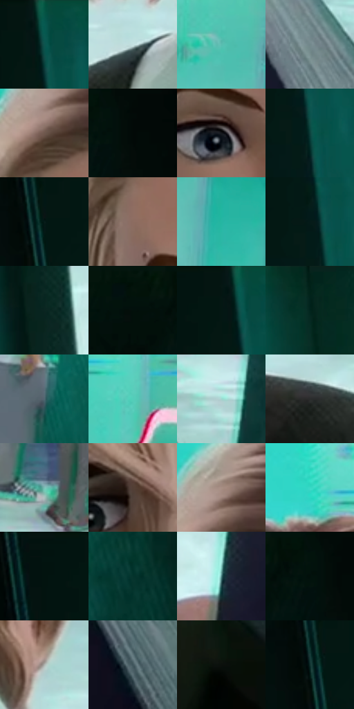

# 电影参考 406

- 状态：条件／活跃；来源世界：miles-home。
- 视角：high-angle；景别：medium；场景：portrait。
- 时段：daylight-time-unspecified（外观依据，中置信度；具体时间／晨昏未知）；光照：neutral-day。
- 材质候选：skin, hair, fabric, paint（帧级，不是像素分割）。
- 明暗组：dark；L* P5/P50/P95：3.44219 / 31.56267 / 83.88251。
- 资格门禁：sense。
- 原截图 SHA-256：`f5f75348347a7035e66fbe0fc262f23cce1fda1860205083cc4eac88138309fd`；尺寸：2878 × 1210。
- sRGB 像素 SHA-256：`51e742315c39216fa89975209807db6cf5f18861f602ea75b080f98455c01a71`。

## 观察与迁移

近景脸清楚、背景人群概括，头周感应条件不默认开启。

406  /  室内／感应：清楚近脸，背景同学与柜面减细节、分色  /  粉色波浪不作为默认景深特效

本公开版保存32个128×128原像素色卡上下文；图集格子并非原场景相邻位置。原rect、图集tile和像素SHA见 `data/palette-crops.json`。上下文不足时不得批准替色，不能以小样推断完整构图。

## 实测色卡

颜色比例分母为保留采样像素，不是材料面积；全部 32 色参与全库匹配。表内四舍五入仅用于阅读，原精度在 JSON。

| ID | HEX | Lab | 原图 xy | 像素数 | 比例 | 明度角色 |
| --- | --- | --- | --- | ---: | ---: | --- |
| 406-S01 | #0A564F | [32.444949, -23.188183, -2.100687] | [456, 60] | 10122 | 5.216343% | shadow |
| 406-S02 | #C5E0E0 | [87.271826, -8.882475, -3.011274] | [1004, 904] | 8790 | 4.529900% | highlight |
| 406-S03 | #5ABDB0 | [70.664134, -32.189235, -2.282337] | [1956, 284] | 7750 | 3.993940% | light |
| 406-S04 | #72878B | [54.833452, -6.628359, -4.671271] | [2112, 812] | 7650 | 3.942405% | midtone |
| 406-S05 | #70584D | [39.513936, 8.097375, 10.141476] | [1012, 288] | 7548 | 3.889839% | shadow |
| 406-S06 | #020907 | [2.019827, -2.108739, 0.112174] | [208, 28] | 7436 | 3.832121% | deep-shadow |
| 406-S07 | #15171D | [7.776541, 0.781805, -4.530462] | [1116, 540] | 7386 | 3.806353% | deep-shadow |
| 406-S08 | #0B3F3A | [23.443154, -17.851788, -1.74941] | [492, 388] | 7282 | 3.752757% | shadow |
| 406-S09 | #061B19 | [8.063647, -8.441103, -1.187639] | [356, 336] | 7218 | 3.719775% | deep-shadow |
| 406-S10 | #8C6C61 | [48.466681, 11.031809, 11.044395] | [1016, 408] | 7076 | 3.646596% | midtone |
| 406-S11 | #25B6A2 | [66.866114, -41.113124, -0.299905] | [2040, 392] | 6956 | 3.584754% | light |
| 406-S12 | #041B18 | [7.908884, -9.233638, -0.674256] | [472, 352] | 6947 | 3.580116% | deep-shadow |
| 406-S13 | #092621 | [12.947339, -12.359749, 0.104299] | [732, 948] | 6841 | 3.525489% | deep-shadow |
| 406-S14 | #02100E | [3.750145, -4.303288, -0.40303] | [36, 28] | 6686 | 3.445610% | deep-shadow |
| 406-S15 | #041713 | [6.192751, -7.278096, 0.331919] | [428, 48] | 6139 | 3.163715% | deep-shadow |
| 406-S16 | #02241D | [11.710934, -14.550139, 1.158861] | [608, 64] | 6094 | 3.140525% | deep-shadow |
| 406-S17 | #506872 | [42.491532, -6.299715, -8.499154] | [2372, 240] | 6055 | 3.120426% | midtone |
| 406-S18 | #52CEB9 | [75.721684, -39.3633, 0.203162] | [1616, 168] | 5875 | 3.027664% | light |
| 406-S19 | #A1D6D0 | [81.958791, -18.271816, -2.594621] | [2284, 808] | 5657 | 2.915318% | highlight |
| 406-S20 | #2B2C2C | [17.904115, -0.446415, -0.154776] | [1564, 904] | 5576 | 2.873575% | deep-shadow |
| 406-S21 | #7EBFB8 | [72.994381, -22.225048, -3.051918] | [2216, 672] | 5552 | 2.861207% | light |
| 406-S22 | #533F35 | [28.515266, 7.071324, 9.483409] | [1392, 496] | 5366 | 2.765352% | shadow |
| 406-S23 | #A88F84 | [61.339451, 7.584584, 9.333206] | [1032, 220] | 5279 | 2.720517% | light |
| 406-S24 | #39D8C6 | [78.49356, -44.099225, -2.783079] | [1224, 76] | 5270 | 2.715879% | light |
| 406-S25 | #02130F | [4.634825, -5.882629, 0.371467] | [344, 28] | 4734 | 2.439653% | deep-shadow |
| 406-S26 | #04342D | [18.67516, -17.396247, 0.021592] | [2576, 260] | 4670 | 2.406671% | deep-shadow |
| 406-S27 | #4B8282 | [50.771033, -18.135671, -5.704768] | [1924, 1020] | 4394 | 2.264435% | midtone |
| 406-S28 | #02100C | [3.703539, -4.630795, 0.488318] | [168, 28] | 4216 | 2.172703% | deep-shadow |
| 406-S29 | #B0B4B1 | [72.922727, -1.967905, 1.04006] | [1488, 768] | 3858 | 1.988209% | light |
| 406-S30 | #3F545B | [34.298311, -6.149138, -6.690811] | [2204, 1080] | 3768 | 1.941828% | shadow |
| 406-S31 | #0B100C | [4.229804, -2.270634, 1.319914] | [2504, 1020] | 3114 | 1.604791% | deep-shadow |
| 406-S32 | #10312E | [17.936102, -12.880768, -1.708856] | [336, 348] | 2739 | 1.411536% | deep-shadow |

## 色阶与空间分布

- 采样 ROI：`[0.01, 0.02, 0.98, 0.94]`；步长：4；样本数：194044。
- 排除区：`[]`。
- 深暗、暗、中、亮、高光五段计数：`[76836, 33762, 29717, 38966, 14763]`。
- RGB 各 256 箱、L* 100 箱、13×5 色相明度表和 3×3 空间统计全部保存在 [总数据](../film-library.json)。
- [可视化档案](../../references/library.html)按需绘制直方图，不存 2,094 张重复图表图片。

## 纹理特征占比

**这是分块图像特征的面积占比，不是波点／排线／丝网／错版的精确语义覆盖率。** 窗格、发丝、织物也会产生方向或周期特征。
原图 ROI 像素 3107496；已测块覆盖 3107496（100.0000%）；未测 0。

| 特征 | 块覆盖像素 | 占已测面积 | 阈值敏感范围 |
| --- | ---: | ---: | --- |
| low-contrast | 374272 | 12.0442% | 10.1947% ~ 13.7948% |
| directional-structure | 1600384 | 51.5008% | 25.9254% ~ 63.3060% |
| periodic-structure | 1067304 | 34.3461% | 25.4448% ~ 55.0074% |
| mixed-detail | 65536 | 2.1090% | 1.0545% ~ 5.2724% |

阈值敏感范围不是统计置信区间。逐块坐标、尺度、对比、方向一致性、频谱集中度、频率与角度见 [全量特征记录](../texture-features.jsonl)，以帧号定位。
四种印刷层的真实像素覆盖仍标为 `null`，不能填 0，也不能拿上表代替。不得据这些代理测量删除唯一证据。

[测量方法与保留策略](../../references/library-retention.md) · [分类索引](../archive/README.md)
