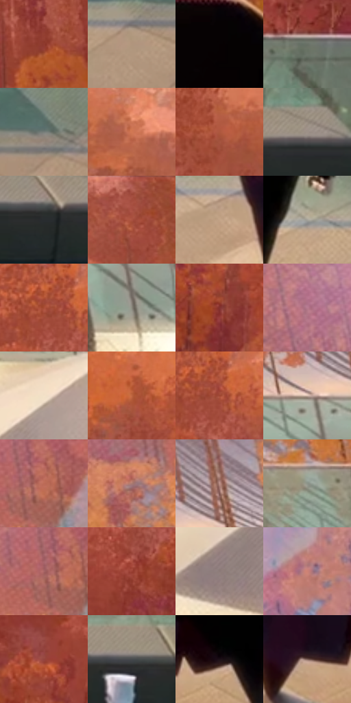

# 电影参考 407

- 状态：常规／活跃；来源世界：miles-home。
- 视角：high-angle；景别：environment-wide；场景：landscape。
- 时段：daylight-time-unspecified（外观依据，中置信度；具体时间／晨昏未知）；光照：warm-day。
- 材质候选：skin, hair, fabric, glass, metal, stone, foliage, sky（帧级，不是像素分割）。
- 明暗组：middle；L* P5/P50/P95：5.67125 / 51.97563 / 76.19541。
- 资格门禁：无附加门禁。
- 原截图 SHA-256：`d78d8e292c281987c4b2eccbe2ac14dcbdbc8f4047c830aba251b5f316d202fb`；尺寸：2880 × 1206。
- sRGB 像素 SHA-256：`8b62918fc4eb8299368d2e632ea31b79575867e9ecde167e7ee18afc471c5c6a`。

## 观察与迁移

暖林逆光、玻璃护栏与少量眩光，光晕必须有源。

407  /  日光：透明多边形眩光、地面亮区、树冠层次  /  多边形不是悬浮物，远林不逐叶描画

本公开版保存32个128×128原像素色卡上下文；图集格子并非原场景相邻位置。原rect、图集tile和像素SHA见 `data/palette-crops.json`。上下文不足时不得批准替色，不能以小样推断完整构图。

## 实测色卡

颜色比例分母为保留采样像素，不是材料面积；全部 32 色参与全库匹配。表内四舍五入仅用于阅读，原精度在 JSON。

| ID | HEX | Lab | 原图 xy | 像素数 | 比例 | 明度角色 |
| --- | --- | --- | --- | ---: | ---: | --- |
| 407-S01 | #8F3A2E | [36.108577, 35.203806, 25.464269] | [1276, 188] | 9337 | 4.829166% | shadow |
| 407-S02 | #B0957D | [63.513527, 6.381732, 16.432499] | [2324, 972] | 8819 | 4.561253% | light |
| 407-S03 | #060102 | [0.585504, 1.446523, 0.082302] | [1556, 620] | 8368 | 4.327992% | deep-shadow |
| 407-S04 | #687166 | [46.595056, -5.6744, 4.947942] | [2252, 608] | 8350 | 4.318683% | midtone |
| 407-S05 | #767D79 | [51.722976, -3.427472, 1.277876] | [2480, 916] | 7724 | 3.994911% | midtone |
| 407-S06 | #D17852 | [59.526506, 31.247323, 35.709436] | [2716, 152] | 7637 | 3.949914% | midtone |
| 407-S07 | #AE583E | [47.402404, 32.852759, 30.913582] | [2236, 196] | 7288 | 3.769408% | midtone |
| 407-S08 | #9E9088 | [60.776105, 3.796737, 6.135274] | [2236, 724] | 7240 | 3.744582% | light |
| 407-S09 | #292D30 | [18.194712, -0.985297, -2.532792] | [2140, 756] | 7146 | 3.695965% | deep-shadow |
| 407-S10 | #A04B3D | [42.528353, 34.091805, 25.004731] | [988, 28] | 7085 | 3.664415% | midtone |
| 407-S11 | #C4A488 | [69.516461, 7.596129, 18.930242] | [1244, 976] | 7032 | 3.637003% | light |
| 407-S12 | #A4A299 | [66.545349, -0.936835, 4.933927] | [1632, 932] | 6943 | 3.590972% | light |
| 407-S13 | #A94E37 | [44.464402, 35.667358, 31.199468] | [1732, 84] | 6942 | 3.590454% | midtone |
| 407-S14 | #8A897E | [56.881118, -1.700244, 6.033127] | [260, 712] | 6941 | 3.589937% | midtone |
| 407-S15 | #82312F | [32.143871, 34.795855, 19.422462] | [1612, 352] | 6687 | 3.458567% | shadow |
| 407-S16 | #B87B8F | [58.359503, 26.623583, -1.044995] | [132, 180] | 6621 | 3.424431% | midtone |
| 407-S17 | #F3E1C7 | [90.335521, 2.036165, 14.954586] | [600, 800] | 6561 | 3.393398% | highlight |
| 407-S18 | #BE653F | [52.527056, 32.446865, 37.012893] | [2000, 120] | 6490 | 3.356677% | midtone |
| 407-S19 | #9E4631 | [41.013969, 35.112861, 30.141398] | [1764, 92] | 6369 | 3.294095% | midtone |
| 407-S20 | #D0B6A9 | [75.904311, 7.221882, 10.038812] | [228, 588] | 6118 | 3.164275% | light |
| 407-S21 | #BB6A57 | [53.560925, 30.344773, 24.754244] | [644, 308] | 5589 | 2.890673% | midtone |
| 407-S22 | #AA7A71 | [55.744681, 17.472811, 12.352477] | [476, 420] | 5380 | 2.782576% | midtone |
| 407-S23 | #BE938C | [64.731497, 15.126694, 9.93407] | [300, 512] | 5016 | 2.594313% | light |
| 407-S24 | #8C9389 | [60.112984, -4.486767, 4.417558] | [560, 616] | 4944 | 2.557074% | light |
| 407-S25 | #A66464 | [49.669379, 26.630589, 11.406404] | [608, 308] | 4685 | 2.423117% | midtone |
| 407-S26 | #9A4033 | [39.203713, 36.735358, 26.64266] | [2176, 340] | 4603 | 2.380706% | shadow |
| 407-S27 | #8C7B78 | [53.056496, 5.989038, 4.034336] | [392, 1008] | 3745 | 1.936942% | midtone |
| 407-S28 | #CD8275 | [61.853578, 27.42875, 19.147381] | [864, 488] | 3568 | 1.845396% | light |
| 407-S29 | #94453D | [39.395912, 32.527817, 20.62247] | [2032, 360] | 3085 | 1.595585% | shadow |
| 407-S30 | #474B4E | [31.62807, -0.935605, -2.341362] | [1948, 736] | 3072 | 1.588861% | shadow |
| 407-S31 | #1B1017 | [6.011282, 6.529538, -2.467563] | [1492, 976] | 2006 | 1.037518% | deep-shadow |
| 407-S32 | #775B52 | [41.238259, 10.049992, 9.605157] | [1372, 992] | 1955 | 1.011141% | midtone |

## 色阶与空间分布

- 采样 ROI：`[0.01, 0.02, 0.98, 0.94]`；步长：4；样本数：193346。
- 排除区：`[]`。
- 深暗、暗、中、亮、高光五段计数：`[15441, 28786, 93851, 47899, 7369]`。
- RGB 各 256 箱、L* 100 箱、13×5 色相明度表和 3×3 空间统计全部保存在 [总数据](../film-library.json)。
- [可视化档案](../../references/library.html)按需绘制直方图，不存 2,094 张重复图表图片。

## 纹理特征占比

**这是分块图像特征的面积占比，不是波点／排线／丝网／错版的精确语义覆盖率。** 窗格、发丝、织物也会产生方向或周期特征。
原图 ROI 像素 3098546；已测块覆盖 3098546（100.0000%）；未测 0。

| 特征 | 块覆盖像素 | 占已测面积 | 阈值敏感范围 |
| --- | ---: | ---: | --- |
| low-contrast | 65536 | 2.1151% | 1.5863% ~ 2.1151% |
| directional-structure | 395776 | 12.7730% | 5.9899% ~ 23.1706% |
| periodic-structure | 1862194 | 60.0990% | 47.6771% ~ 63.7962% |
| mixed-detail | 775040 | 25.0130% | 11.4469% ~ 44.2179% |

阈值敏感范围不是统计置信区间。逐块坐标、尺度、对比、方向一致性、频谱集中度、频率与角度见 [全量特征记录](../texture-features.jsonl)，以帧号定位。
四种印刷层的真实像素覆盖仍标为 `null`，不能填 0，也不能拿上表代替。不得据这些代理测量删除唯一证据。

[测量方法与保留策略](../../references/library-retention.md) · [分类索引](../archive/README.md)
