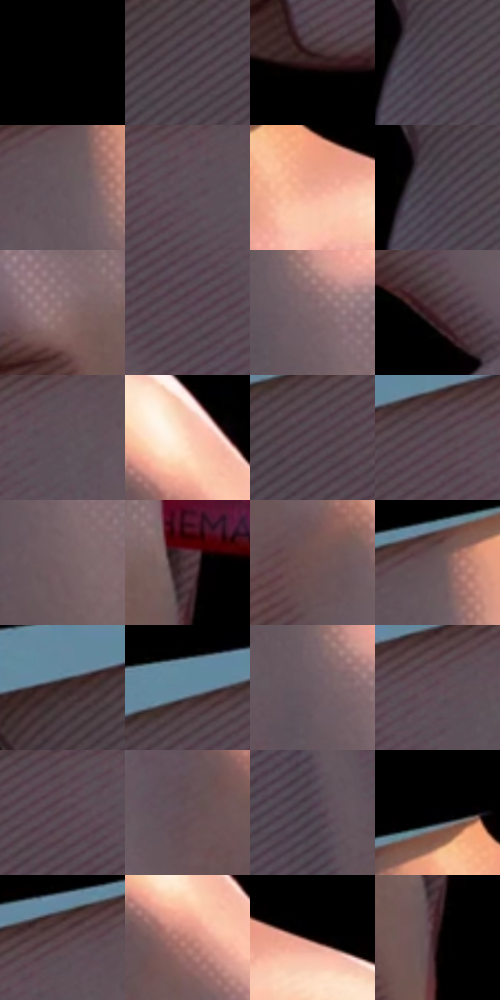

# 电影参考 408

- 状态：条件／活跃；来源世界：miles-home。
- 视角：near-level；景别：detail；场景：detail。
- 时段：interior-time-unknown（外观依据，中置信度；具体时间／晨昏未知）；光照：interior-mixed。
- 材质候选：skin, fabric, plastic（帧级，不是像素分割）。
- 明暗组：very-dark；L* P5/P50/P95：0.0 / 0.0 / 44.96113。
- 资格门禁：impact。
- 原截图 SHA-256：`92af2d4e00059ab2469b39c01d7ec5b40e486e5d121d141b60e8f109f31bef96`；尺寸：2880 × 1218。
- sRGB 像素 SHA-256：`2e02bb12036785eda31d941f132a0102fd0d122136fd1d27d18a87319ebe0cdd`。

## 观察与迁移

拳手孤立暗场与局部碎片，接触力度不自动迁移到日常手势。

408  /  近景材质：手背暖高光、点阵与阴影排线  /  单条暖边不是双彩错版

本公开版保存32个128×128原像素色卡上下文；图集格子并非原场景相邻位置。原rect、图集tile和像素SHA见 `data/palette-crops.json`。上下文不足时不得批准替色，不能以小样推断完整构图。

## 实测色卡

颜色比例分母为保留采样像素，不是材料面积；全部 32 色参与全库匹配。表内四舍五入仅用于阅读，原精度在 JSON。

| ID | HEX | Lab | 原图 xy | 像素数 | 比例 | 明度角色 |
| --- | --- | --- | --- | ---: | ---: | --- |
| 408-S01 | #000000 | [0.0, 0.0, 0.0] | [32, 28] | 141421 | 72.360315% | deep-shadow |
| 408-S02 | #483B45 | [26.549976, 7.741723, -3.999426] | [1040, 412] | 2547 | 1.303213% | shadow |
| 408-S03 | #371E20 | [14.653133, 12.50856, 3.851667] | [1156, 952] | 2445 | 1.251023% | deep-shadow |
| 408-S04 | #4C414C | [29.002519, 7.02694, -4.890808] | [956, 488] | 2311 | 1.182460% | shadow |
| 408-S05 | #65565E | [38.253221, 7.686565, -2.341125] | [1468, 272] | 2289 | 1.171203% | shadow |
| 408-S06 | #5A4D57 | [34.333768, 7.428714, -3.868014] | [1316, 328] | 2171 | 1.110827% | shadow |
| 408-S07 | #F0AB95 | [75.961498, 22.591987, 21.423783] | [1628, 236] | 2061 | 1.054544% | light |
| 408-S08 | #514751 | [31.462882, 6.305677, -4.404829] | [944, 480] | 2035 | 1.041240% | shadow |
| 408-S09 | #8F6F70 | [49.952823, 12.80141, 4.308402] | [1636, 876] | 1986 | 1.016169% | midtone |
| 408-S10 | #554953 | [32.526835, 7.086314, -4.060807] | [1332, 460] | 1977 | 1.011564% | shadow |
| 408-S11 | #7B666B | [45.325374, 9.266996, 0.330957] | [1540, 356] | 1952 | 0.998772% | midtone |
| 408-S12 | #4B3035 | [23.227031, 13.146212, 1.867902] | [1900, 688] | 1879 | 0.961420% | shadow |
| 408-S13 | #5F525B | [36.410081, 7.145464, -3.257456] | [1364, 308] | 1791 | 0.916394% | shadow |
| 408-S14 | #FACFB8 | [86.212614, 11.796703, 17.110148] | [1860, 336] | 1791 | 0.916394% | highlight |
| 408-S15 | #52414C | [29.654378, 9.494456, -3.851076] | [1152, 348] | 1781 | 0.911277% | shadow |
| 408-S16 | #594752 | [32.346513, 9.77701, -3.64188] | [1236, 300] | 1764 | 0.902579% | shadow |
| 408-S17 | #746064 | [42.762075, 8.779904, 0.751422] | [1564, 460] | 1761 | 0.901044% | midtone |
| 408-S18 | #523B40 | [27.551524, 11.020759, 0.906203] | [1732, 880] | 1753 | 0.896950% | shadow |
| 408-S19 | #725654 | [39.366803, 11.255964, 5.651322] | [1904, 548] | 1715 | 0.877507% | shadow |
| 408-S20 | #69565A | [38.546303, 8.539377, 0.62252] | [1484, 216] | 1704 | 0.871879% | shadow |
| 408-S21 | #3F2C2E | [20.265009, 9.135284, 2.170308] | [960, 336] | 1667 | 0.852947% | shadow |
| 408-S22 | #64899E | [55.142426, -7.429099, -15.274621] | [1140, 268] | 1666 | 0.852436% | midtone |
| 408-S23 | #6B5C64 | [40.735957, 7.600802, -2.323675] | [1504, 352] | 1665 | 0.851924% | midtone |
| 408-S24 | #5E4D57 | [34.753508, 9.046983, -3.20013] | [1328, 288] | 1637 | 0.837597% | shadow |
| 408-S25 | #55434E | [30.630484, 9.863427, -3.661796] | [1256, 340] | 1550 | 0.793082% | shadow |
| 408-S26 | #665156 | [36.709331, 9.642871, 0.401774] | [1788, 464] | 1541 | 0.788477% | shadow |
| 408-S27 | #554D58 | [33.865306, 5.64815, -5.252014] | [1248, 604] | 1416 | 0.724519% | shadow |
| 408-S28 | #010102 | [0.29396, 0.139026, -0.378391] | [1560, 144] | 1362 | 0.696889% | deep-shadow |
| 408-S29 | #60484D | [33.259565, 11.100741, 0.987209] | [1360, 244] | 1145 | 0.585858% | shadow |
| 408-S30 | #C4877B | [62.079936, 21.847881, 15.897045] | [1860, 404] | 1107 | 0.566414% | light |
| 408-S31 | #060101 | [0.565717, 1.307479, 0.460726] | [1716, 212] | 823 | 0.421101% | deep-shadow |
| 408-S32 | #1F0D0F | [5.543594, 8.68176, 2.000241] | [1732, 960] | 727 | 0.371981% | deep-shadow |

## 色阶与空间分布

- 采样 ROI：`[0.01, 0.02, 0.98, 0.94]`；步长：4；样本数：195440。
- 排除区：`[]`。
- 深暗、暗、中、亮、高光五段计数：`[147609, 33152, 10097, 2433, 2149]`。
- RGB 各 256 箱、L* 100 箱、13×5 色相明度表和 3×3 空间统计全部保存在 [总数据](../film-library.json)。
- [可视化档案](../../references/library.html)按需绘制直方图，不存 2,094 张重复图表图片。

## 纹理特征占比

**这是分块图像特征的面积占比，不是波点／排线／丝网／错版的精确语义覆盖率。** 窗格、发丝、织物也会产生方向或周期特征。
原图 ROI 像素 3129280；已测块覆盖 3129280（100.0000%）；未测 0。

| 特征 | 块覆盖像素 | 占已测面积 | 阈值敏感范围 |
| --- | ---: | ---: | --- |
| low-contrast | 1978304 | 63.2191% | 63.2191% ~ 63.2191% |
| directional-structure | 651264 | 20.8119% | 15.7071% ~ 24.8696% |
| periodic-structure | 417792 | 13.3511% | 10.8641% ~ 16.8852% |
| mixed-detail | 81920 | 2.6179% | 1.0471% ~ 4.1886% |

阈值敏感范围不是统计置信区间。逐块坐标、尺度、对比、方向一致性、频谱集中度、频率与角度见 [全量特征记录](../texture-features.jsonl)，以帧号定位。
四种印刷层的真实像素覆盖仍标为 `null`，不能填 0，也不能拿上表代替。不得据这些代理测量删除唯一证据。

[测量方法与保留策略](../../references/library-retention.md) · [分类索引](../archive/README.md)
