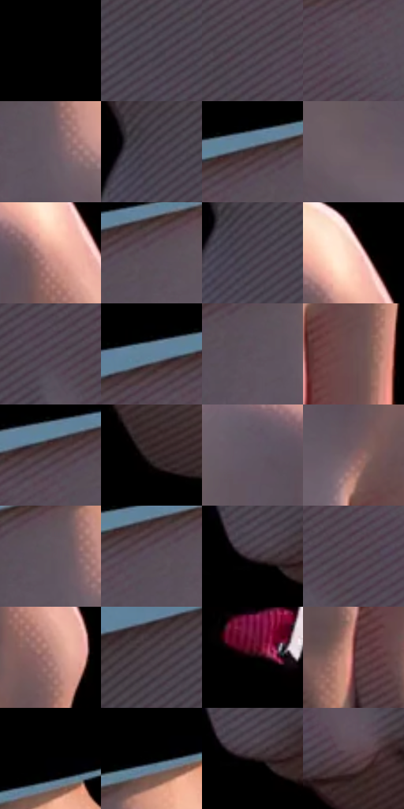

# 电影参考 409

- 状态：条件／活跃；来源世界：miles-home。
- 视角：near-level；景别：detail；场景：detail。
- 时段：interior-time-unknown（外观依据，中置信度；具体时间／晨昏未知）；光照：interior-mixed。
- 材质候选：skin, fabric, plastic（帧级，不是像素分割）。
- 明暗组：very-dark；L* P5/P50/P95：0.0 / 0.0 / 40.52346。
- 资格门禁：impact。
- 原截图 SHA-256：`d774f5955d17bf794e6901d04e94c42f86d793b433524ea5bfc9dc3167c784ca`；尺寸：2862 × 1274。
- sRGB 像素 SHA-256：`e7a3eefabeb723c58f41cb0a5332837b864d0cdaa99d88469d1d09706be89b32`。

## 观察与迁移

拳手孤立暗场与局部碎片，接触力度不自动迁移到日常手势。

409  /  动作：手与破碎小物、局部皮肤高光  /  碎片是实体破损，不是失焦彩噪

本公开版保存32个128×128原像素色卡上下文；图集格子并非原场景相邻位置。原rect、图集tile和像素SHA见 `data/palette-crops.json`。上下文不足时不得批准替色，不能以小样推断完整构图。

## 实测色卡

颜色比例分母为保留采样像素，不是材料面积；全部 32 色参与全库匹配。表内四舍五入仅用于阅读，原精度在 JSON。

| ID | HEX | Lab | 原图 xy | 像素数 | 比例 | 明度角色 |
| --- | --- | --- | --- | ---: | ---: | --- |
| 409-S01 | #000000 | [0.0, 0.0, 0.0] | [32, 28] | 150970 | 74.244376% | deep-shadow |
| 409-S02 | #453E4A | [27.310691, 5.680783, -6.188429] | [1080, 504] | 2919 | 1.435513% | shadow |
| 409-S03 | #514753 | [31.533082, 6.750548, -5.58395] | [1148, 396] | 2760 | 1.357319% | shadow |
| 409-S04 | #554955 | [32.59596, 7.520108, -5.235192] | [1272, 308] | 2512 | 1.235357% | shadow |
| 409-S05 | #675A63 | [39.74322, 7.036753, -3.217036] | [1464, 284] | 2284 | 1.123231% | shadow |
| 409-S06 | #4B434F | [29.600177, 6.009098, -5.957107] | [928, 444] | 2227 | 1.095199% | shadow |
| 409-S07 | #3E2B2E | [19.839713, 9.34954, 1.53964] | [1340, 204] | 2201 | 1.082413% | deep-shadow |
| 409-S08 | #6D5E66 | [41.557617, 7.57342, -2.317983] | [1624, 540] | 2053 | 1.009629% | midtone |
| 409-S09 | #D8998C | [68.951899, 21.916422, 16.262953] | [1796, 384] | 1954 | 0.960943% | light |
| 409-S10 | #5C4F5A | [35.213551, 7.60942, -4.435378] | [1384, 232] | 1904 | 0.936354% | shadow |
| 409-S11 | #4D4652 | [30.800871, 5.568362, -6.077448] | [940, 472] | 1841 | 0.905371% | shadow |
| 409-S12 | #FACEBD | [86.078138, 13.000681, 14.281605] | [1808, 320] | 1805 | 0.887667% | highlight |
| 409-S13 | #514A56 | [32.521909, 5.516769, -6.026122] | [1220, 444] | 1790 | 0.880290% | shadow |
| 409-S14 | #618299 | [52.735995, -5.677162, -16.050669] | [1240, 212] | 1763 | 0.867012% | midtone |
| 409-S15 | #5D525D | [36.275613, 6.770994, -4.732367] | [1404, 276] | 1743 | 0.857177% | shadow |
| 409-S16 | #6B4F50 | [36.550762, 11.924743, 4.006441] | [1796, 660] | 1732 | 0.851767% | shadow |
| 409-S17 | #48393F | [25.75223, 7.788177, -1.203883] | [1300, 228] | 1662 | 0.817342% | shadow |
| 409-S18 | #2F2224 | [14.821758, 6.614721, 1.066056] | [1552, 1080] | 1643 | 0.807998% | deep-shadow |
| 409-S19 | #615762 | [38.269253, 6.313692, -4.846474] | [1680, 396] | 1639 | 0.806031% | shadow |
| 409-S20 | #806164 | [44.317915, 13.044438, 3.167519] | [1740, 548] | 1630 | 0.801605% | midtone |
| 409-S21 | #62545D | [37.349408, 7.517461, -3.086077] | [1440, 248] | 1608 | 0.790786% | shadow |
| 409-S22 | #584E5A | [34.522155, 6.648449, -5.507371] | [1344, 244] | 1572 | 0.773082% | shadow |
| 409-S23 | #4B3D47 | [27.541082, 8.120053, -3.808061] | [984, 876] | 1507 | 0.741116% | shadow |
| 409-S24 | #50404C | [29.143977, 9.3148, -4.633956] | [1280, 428] | 1458 | 0.717019% | shadow |
| 409-S25 | #A77772 | [54.684509, 18.104508, 10.234666] | [1836, 472] | 1394 | 0.685545% | midtone |
| 409-S26 | #3F353D | [23.471936, 6.141268, -3.347765] | [1000, 336] | 1303 | 0.640792% | shadow |
| 409-S27 | #090203 | [0.976295, 1.969504, 0.266612] | [2048, 900] | 1082 | 0.532108% | deep-shadow |
| 409-S28 | #6C333A | [29.061823, 26.091859, 7.509824] | [1708, 928] | 1046 | 0.514404% | shadow |
| 409-S29 | #000002 | [0.039574, 0.278088, -0.756847] | [1536, 108] | 1044 | 0.513421% | deep-shadow |
| 409-S30 | #020203 | [0.568134, 0.139009, -0.378358] | [1508, 136] | 840 | 0.413097% | deep-shadow |
| 409-S31 | #1D1013 | [6.132056, 6.730417, 0.498447] | [1000, 884] | 821 | 0.403753% | deep-shadow |
| 409-S32 | #5E474D | [32.749562, 10.885049, 0.21618] | [1360, 928] | 635 | 0.312282% | shadow |

## 色阶与空间分布

- 采样 ROI：`[0.01, 0.02, 0.98, 0.94]`；步长：4；样本数：203342。
- 排除区：`[]`。
- 深暗、暗、中、亮、高光五段计数：`[157600, 34744, 7100, 2502, 1396]`。
- RGB 各 256 箱、L* 100 箱、13×5 色相明度表和 3×3 空间统计全部保存在 [总数据](../film-library.json)。
- [可视化档案](../../references/library.html)按需绘制直方图，不存 2,094 张重复图表图片。

## 纹理特征占比

**这是分块图像特征的面积占比，不是波点／排线／丝网／错版的精确语义覆盖率。** 窗格、发丝、织物也会产生方向或周期特征。
原图 ROI 像素 3253472；已测块覆盖 3253472（100.0000%）；未测 0。

| 特征 | 块覆盖像素 | 占已测面积 | 阈值敏感范围 |
| --- | ---: | ---: | --- |
| low-contrast | 2090208 | 64.2455% | 62.7347% ~ 65.2526% |
| directional-structure | 720896 | 22.1577% | 17.6255% ~ 27.1936% |
| periodic-structure | 409600 | 12.5896% | 9.0645% ~ 16.1147% |
| mixed-detail | 32768 | 1.0072% | 1.0072% ~ 1.0072% |

阈值敏感范围不是统计置信区间。逐块坐标、尺度、对比、方向一致性、频谱集中度、频率与角度见 [全量特征记录](../texture-features.jsonl)，以帧号定位。
四种印刷层的真实像素覆盖仍标为 `null`，不能填 0，也不能拿上表代替。不得据这些代理测量删除唯一证据。

[测量方法与保留策略](../../references/library-retention.md) · [分类索引](../archive/README.md)
