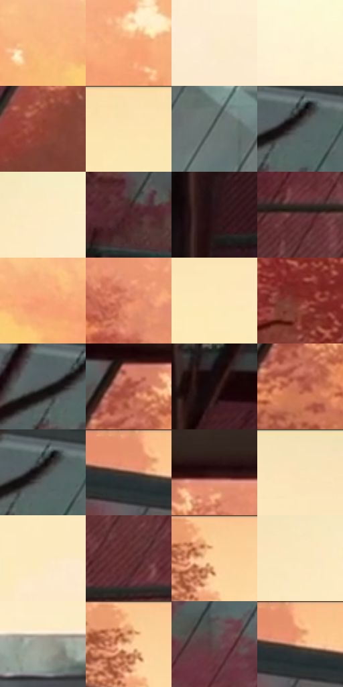

# 电影参考 410

- 状态：常规／活跃；来源世界：miles-home。
- 视角：low-angle；景别：environment-wide；场景：landscape。
- 时段：daylight-time-unspecified（外观依据，中置信度；具体时间／晨昏未知）；光照：warm-day。
- 材质候选：skin, hair, fabric, glass, metal, stone, foliage, sky（帧级，不是像素分割）。
- 明暗组：light；L* P5/P50/P95：11.43042 / 62.50871 / 94.13175。
- 资格门禁：无附加门禁。
- 原截图 SHA-256：`85bc7ab1033c521ff61c91f030629918447b9c404d4bb39af9973cfca1a6739f`；尺寸：2880 × 1202。
- sRGB 像素 SHA-256：`fa0271e3108f3a4cb27727b2aa00b8ff36b8e8d0212c2dcfee873e451a46c718`。

## 观察与迁移

暖林逆光、玻璃护栏与少量眩光，光晕必须有源。

410  /  日光建筑：玻璃斜面、清楚悬挑、远林大色层  /  不移植建筑形状或暖林

本公开版保存32个128×128原像素色卡上下文；图集格子并非原场景相邻位置。原rect、图集tile和像素SHA见 `data/palette-crops.json`。上下文不足时不得批准替色，不能以小样推断完整构图。

## 实测色卡

颜色比例分母为保留采样像素，不是材料面积；全部 32 色参与全库匹配。表内四舍五入仅用于阅读，原精度在 JSON。

| ID | HEX | Lab | 原图 xy | 像素数 | 比例 | 明度角色 |
| --- | --- | --- | --- | ---: | ---: | --- |
| 410-S01 | #F9B77D | [79.323578, 17.335394, 38.758099] | [2044, 684] | 11333 | 5.882750% | light |
| 410-S02 | #F7A776 | [75.279358, 24.342335, 37.207972] | [2548, 684] | 10136 | 5.261409% | light |
| 410-S03 | #FCEACA | [93.366672, 1.124042, 17.767385] | [2596, 344] | 8719 | 4.525871% | highlight |
| 410-S04 | #FDF4D4 | [96.137126, -2.117644, 16.519962] | [2772, 248] | 8234 | 4.274117% | highlight |
| 410-S05 | #914335 | [38.362831, 31.781607, 24.075473] | [780, 988] | 7891 | 4.096072% | shadow |
| 410-S06 | #FCE4B1 | [91.396491, 0.808591, 27.932191] | [1188, 64] | 7867 | 4.083614% | highlight |
| 410-S07 | #717C79 | [51.043611, -4.706926, 0.240732] | [768, 284] | 7692 | 3.992774% | midtone |
| 410-S08 | #5A6362 | [41.182772, -3.687884, -0.620189] | [492, 220] | 7680 | 3.986545% | midtone |
| 410-S09 | #FCEAC5 | [93.265247, 0.41506, 20.207444] | [2368, 120] | 7661 | 3.976683% | highlight |
| 410-S10 | #492225 | [18.776121, 18.850817, 6.516577] | [144, 296] | 7487 | 3.886363% | deep-shadow |
| 410-S11 | #341E1F | [14.16051, 10.916566, 3.810811] | [36, 992] | 7321 | 3.800195% | deep-shadow |
| 410-S12 | #5E3437 | [27.051613, 19.256989, 6.351819] | [492, 824] | 7175 | 3.724409% | shadow |
| 410-S13 | #F69F75 | [73.336147, 28.067072, 35.232186] | [2188, 708] | 6663 | 3.458640% | light |
| 410-S14 | #D3795A | [60.127718, 32.109987, 32.135959] | [1180, 756] | 6662 | 3.458121% | light |
| 410-S15 | #FDE9BA | [92.886376, -0.202422, 25.358319] | [1488, 144] | 6577 | 3.413999% | highlight |
| 410-S16 | #85352B | [33.368525, 33.662553, 23.569885] | [1196, 1092] | 6114 | 3.173664% | shadow |
| 410-S17 | #464A4B | [31.131748, -1.402751, -1.159101] | [436, 224] | 5961 | 3.094244% | shadow |
| 410-S18 | #A6503C | [44.479739, 33.761424, 28.222418] | [916, 684] | 5814 | 3.017939% | midtone |
| 410-S19 | #1E0C0C | [5.10878, 8.017692, 2.825484] | [76, 588] | 5811 | 3.016382% | deep-shadow |
| 410-S20 | #BD664D | [52.796188, 32.469091, 29.537967] | [920, 760] | 5336 | 2.769819% | midtone |
| 410-S21 | #323231 | [20.754936, -0.232104, 0.636499] | [488, 212] | 5159 | 2.677941% | shadow |
| 410-S22 | #E9936D | [68.96755, 28.58906, 33.599035] | [120, 48] | 4949 | 2.568934% | light |
| 410-S23 | #2E1515 | [10.345113, 12.698948, 5.610066] | [1016, 640] | 4679 | 2.428782% | deep-shadow |
| 410-S24 | #F8E2BA | [90.732626, 1.511438, 22.327495] | [1804, 32] | 4676 | 2.427225% | highlight |
| 410-S25 | #FCE9BF | [92.899128, 0.09617, 22.791884] | [1948, 264] | 4643 | 2.410095% | highlight |
| 410-S26 | #5B2A2C | [23.876985, 22.644841, 9.221583] | [560, 964] | 3676 | 1.908143% | shadow |
| 410-S27 | #FCCF98 | [85.801793, 8.668195, 33.296153] | [656, 36] | 3453 | 1.792388% | highlight |
| 410-S28 | #FCE6BD | [92.116278, 1.35157, 22.740917] | [2264, 136] | 3274 | 1.699473% | highlight |
| 410-S29 | #9FA094 | [65.47588, -2.583507, 6.132518] | [1776, 484] | 3188 | 1.654832% | light |
| 410-S30 | #F5C090 | [81.362384, 12.894762, 31.452701] | [636, 64] | 2920 | 1.515718% | highlight |
| 410-S31 | #604B4A | [34.0114, 8.693173, 3.981609] | [696, 720] | 2743 | 1.423840% | shadow |
| 410-S32 | #EFAC80 | [75.710694, 19.442775, 32.319923] | [152, 60] | 1154 | 0.599020% | light |

## 色阶与空间分布

- 采样 ROI：`[0.01, 0.02, 0.98, 0.94]`；步长：4；样本数：192648。
- 排除区：`[]`。
- 深暗、暗、中、亮、高光五段计数：`[25268, 40041, 29055, 37591, 60693]`。
- RGB 各 256 箱、L* 100 箱、13×5 色相明度表和 3×3 空间统计全部保存在 [总数据](../film-library.json)。
- [可视化档案](../../references/library.html)按需绘制直方图，不存 2,094 张重复图表图片。

## 纹理特征占比

**这是分块图像特征的面积占比，不是波点／排线／丝网／错版的精确语义覆盖率。** 窗格、发丝、织物也会产生方向或周期特征。
原图 ROI 像素 3087370；已测块覆盖 3087370（100.0000%）；未测 0。

| 特征 | 块覆盖像素 | 占已测面积 | 阈值敏感范围 |
| --- | ---: | ---: | --- |
| low-contrast | 686848 | 22.2470% | 20.8498% ~ 23.2172% |
| directional-structure | 636160 | 20.6052% | 14.3283% ~ 30.0662% |
| periodic-structure | 1554698 | 50.3567% | 46.8202% ~ 50.3567% |
| mixed-detail | 209664 | 6.7910% | 2.2637% ~ 13.7769% |

阈值敏感范围不是统计置信区间。逐块坐标、尺度、对比、方向一致性、频谱集中度、频率与角度见 [全量特征记录](../texture-features.jsonl)，以帧号定位。
四种印刷层的真实像素覆盖仍标为 `null`，不能填 0，也不能拿上表代替。不得据这些代理测量删除唯一证据。

[测量方法与保留策略](../../references/library-retention.md) · [分类索引](../archive/README.md)
