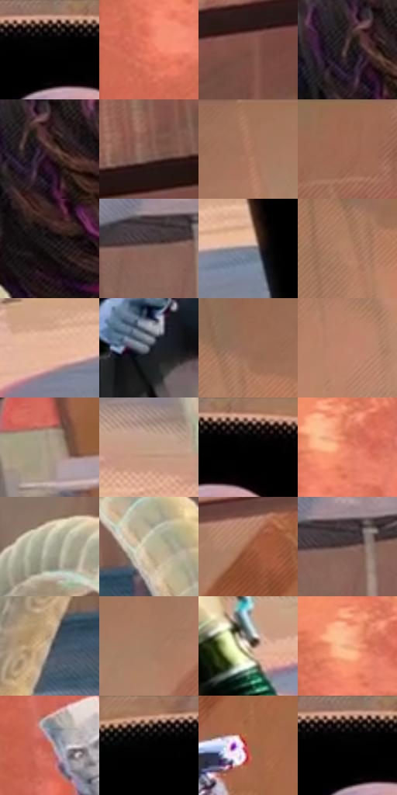

# 电影参考 411

- 状态：常规／活跃；来源世界：miles-home。
- 视角：low-angle；景别：medium；场景：landscape。
- 时段：daylight-time-unspecified（外观依据，中置信度；具体时间／晨昏未知）；光照：warm-day。
- 材质候选：skin, hair, fabric, glass, metal, stone, foliage, sky（帧级，不是像素分割）。
- 明暗组：dark；L* P5/P50/P95：0.0 / 27.38426 / 71.72809。
- 资格门禁：无附加门禁。
- 原截图 SHA-256：`1347768a31c5946867a3c0a9bd0499512070c02c6e18e40d830a44a3e132ec2e`；尺寸：2880 × 1202。
- sRGB 像素 SHA-256：`13b38476470f30b69c2196640eeb6a74b1adf770226cb9032732928e6d2c8610`。

## 观察与迁移

暖林逆光、玻璃护栏与少量眩光，光晕必须有源。

411  /  稳定光照：黑肩轮廓的点阵亮带  /  大黑衣不可全面铺亮纹理

本公开版保存32个128×128原像素色卡上下文；图集格子并非原场景相邻位置。原rect、图集tile和像素SHA见 `data/palette-crops.json`。上下文不足时不得批准替色，不能以小样推断完整构图。

## 实测色卡

颜色比例分母为保留采样像素，不是材料面积；全部 32 色参与全库匹配。表内四舍五入仅用于阅读，原精度在 JSON。

| ID | HEX | Lab | 原图 xy | 像素数 | 比例 | 明度角色 |
| --- | --- | --- | --- | ---: | ---: | --- |
| 411-S01 | #000000 | [0.0, 0.0, 0.0] | [1524, 40] | 74460 | 38.650804% | deep-shadow |
| 411-S02 | #D26A57 | [56.783445, 39.307902, 29.545251] | [36, 360] | 7629 | 3.960072% | midtone |
| 411-S03 | #7C4E42 | [38.071486, 17.908321, 15.16316] | [2536, 232] | 6673 | 3.463830% | shadow |
| 411-S04 | #2F2223 | [14.788734, 6.41687, 1.735422] | [2084, 572] | 5856 | 3.039741% | deep-shadow |
| 411-S05 | #4B312E | [23.304503, 11.374699, 6.707695] | [2116, 580] | 5848 | 3.035588% | shadow |
| 411-S06 | #825C4F | [42.711286, 13.759333, 13.665871] | [2812, 116] | 5834 | 3.028321% | midtone |
| 411-S07 | #A4745A | [53.083958, 15.604792, 21.869087] | [708, 28] | 5387 | 2.796292% | midtone |
| 411-S08 | #9C6850 | [48.944823, 18.002074, 21.993459] | [2488, 28] | 4956 | 2.572568% | midtone |
| 411-S09 | #1B1516 | [7.472869, 3.213096, 0.397954] | [2112, 704] | 4944 | 2.566339% | deep-shadow |
| 411-S10 | #84685D | [46.441558, 9.451252, 10.461355] | [2760, 508] | 4755 | 2.468232% | midtone |
| 411-S11 | #7F7D85 | [52.809859, 2.371571, -4.062511] | [692, 1056] | 4722 | 2.451103% | midtone |
| 411-S12 | #B07F63 | [57.377723, 15.403952, 22.705304] | [476, 156] | 4575 | 2.374798% | midtone |
| 411-S13 | #E1B093 | [75.555419, 13.894038, 21.696674] | [508, 1060] | 4270 | 2.216478% | light |
| 411-S14 | #4A4F57 | [33.426503, -0.124272, -5.378845] | [320, 788] | 4136 | 2.146921% | shadow |
| 411-S15 | #986D59 | [49.900237, 14.43524, 17.938659] | [512, 96] | 3897 | 2.022860% | midtone |
| 411-S16 | #C0866C | [61.082015, 19.069542, 22.910488] | [476, 320] | 3869 | 2.008326% | light |
| 411-S17 | #A69680 | [62.909938, 2.289989, 13.772909] | [456, 860] | 3804 | 1.974586% | light |
| 411-S18 | #BF9E84 | [67.425049, 8.356672, 18.172951] | [2668, 1060] | 3733 | 1.937731% | light |
| 411-S19 | #0C0707 | [2.217325, 1.336825, 0.4713] | [1596, 44] | 3532 | 1.833396% | deep-shadow |
| 411-S20 | #E88066 | [64.610132, 37.5629, 31.80087] | [120, 260] | 3316 | 1.721274% | light |
| 411-S21 | #ACAD9B | [70.193151, -3.593672, 9.138191] | [2472, 644] | 3235 | 1.679228% | light |
| 411-S22 | #BDB69C | [73.98187, -1.902692, 14.144752] | [2640, 772] | 3197 | 1.659503% | light |
| 411-S23 | #9C5D41 | [46.015383, 22.875229, 26.915734] | [512, 528] | 3012 | 1.563473% | midtone |
| 411-S24 | #6B514D | [37.016751, 10.209384, 6.549043] | [2796, 500] | 2939 | 1.525580% | shadow |
| 411-S25 | #968F87 | [59.778845, 1.125258, 5.179939] | [2420, 852] | 2903 | 1.506893% | midtone |
| 411-S26 | #A47F66 | [56.11976, 10.766066, 19.08473] | [804, 92] | 2721 | 1.412421% | midtone |
| 411-S27 | #E0CEBB | [83.746116, 3.178831, 11.718503] | [2408, 1088] | 2419 | 1.255658% | highlight |
| 411-S28 | #E7A37B | [72.638962, 20.562885, 30.797553] | [92, 248] | 1564 | 0.811843% | light |
| 411-S29 | #C06450 | [52.84315, 34.943043, 27.978671] | [176, 624] | 1558 | 0.808729% | midtone |
| 411-S30 | #020303 | [0.764212, -0.261552, -0.09204] | [1392, 56] | 1264 | 0.656119% | deep-shadow |
| 411-S31 | #AF5F49 | [49.230374, 30.301854, 26.909403] | [596, 644] | 861 | 0.446929% | midtone |
| 411-S32 | #010002 | [0.097882, 0.539587, -0.664709] | [1508, 44] | 779 | 0.404364% | deep-shadow |

## 色阶与空间分布

- 采样 ROI：`[0.01, 0.02, 0.98, 0.94]`；步长：4；样本数：192648。
- 排除区：`[]`。
- 深暗、暗、中、亮、高光五段计数：`[91801, 16268, 54672, 27251, 2656]`。
- RGB 各 256 箱、L* 100 箱、13×5 色相明度表和 3×3 空间统计全部保存在 [总数据](../film-library.json)。
- [可视化档案](../../references/library.html)按需绘制直方图，不存 2,094 张重复图表图片。

## 纹理特征占比

**这是分块图像特征的面积占比，不是波点／排线／丝网／错版的精确语义覆盖率。** 窗格、发丝、织物也会产生方向或周期特征。
原图 ROI 像素 3087370；已测块覆盖 3087370（100.0000%）；未测 0。

| 特征 | 块覆盖像素 | 占已测面积 | 阈值敏感范围 |
| --- | ---: | ---: | --- |
| low-contrast | 891776 | 28.8846% | 28.3540% ~ 31.5380% |
| directional-structure | 585344 | 18.9593% | 11.7247% ~ 27.8357% |
| periodic-structure | 1511946 | 48.9720% | 42.7489% ~ 49.5027% |
| mixed-detail | 98304 | 3.1841% | 1.0614% ~ 7.2346% |

阈值敏感范围不是统计置信区间。逐块坐标、尺度、对比、方向一致性、频谱集中度、频率与角度见 [全量特征记录](../texture-features.jsonl)，以帧号定位。
四种印刷层的真实像素覆盖仍标为 `null`，不能填 0，也不能拿上表代替。不得据这些代理测量删除唯一证据。

[测量方法与保留策略](../../references/library-retention.md) · [分类索引](../archive/README.md)
