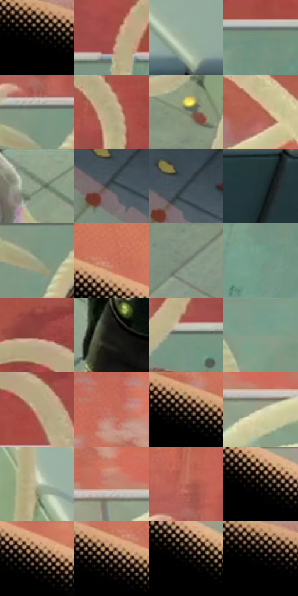

# 电影参考 412

- 状态：常规／活跃；来源世界：miles-home。
- 视角：high-angle；景别：medium；场景：landscape。
- 时段：daylight-time-unspecified（外观依据，中置信度；具体时间／晨昏未知）；光照：warm-day。
- 材质候选：skin, hair, fabric, glass, metal, stone, foliage, sky（帧级，不是像素分割）。
- 明暗组：dark；L* P5/P50/P95：0.0 / 36.13625 / 73.84493。
- 资格门禁：无附加门禁。
- 原截图 SHA-256：`f1424fa3e08df33a3e0f3a521ecaa6d3daf9155e77f3fe789efdb39267f83454`；尺寸：2880 × 1206。
- sRGB 像素 SHA-256：`14f457b5cd73bb2a976d5caf5fb27fb626a41daae5e35fd083d43a1b1dc91c4d`。

## 观察与迁移

暖林逆光、玻璃护栏与少量眩光，光晕必须有源。

412  /  轮廓光：左侧黑衣边缘渐变网点尤其清楚  /  管道是实体，不是动作拖尾

本公开版保存32个128×128原像素色卡上下文；图集格子并非原场景相邻位置。原rect、图集tile和像素SHA见 `data/palette-crops.json`。上下文不足时不得批准替色，不能以小样推断完整构图。

## 实测色卡

颜色比例分母为保留采样像素，不是材料面积；全部 32 色参与全库匹配。表内四舍五入仅用于阅读，原精度在 JSON。

| ID | HEX | Lab | 原图 xy | 像素数 | 比例 | 明度角色 |
| --- | --- | --- | --- | ---: | ---: | --- |
| 412-S01 | #000000 | [0.0, 0.0, 0.0] | [52, 44] | 71960 | 37.218251% | deep-shadow |
| 412-S02 | #A44F48 | [44.167579, 34.423608, 20.647584] | [2160, 184] | 6729 | 3.480289% | midtone |
| 412-S03 | #97AC9B | [68.3513, -10.642774, 6.294456] | [2664, 592] | 6692 | 3.461153% | light |
| 412-S04 | #70917F | [57.296132, -15.412476, 5.803521] | [2340, 240] | 5734 | 2.965668% | midtone |
| 412-S05 | #809884 | [60.525873, -12.538535, 7.725637] | [1708, 236] | 5649 | 2.921705% | light |
| 412-S06 | #BAB08A | [71.775482, -2.520469, 20.79963] | [1888, 48] | 5552 | 2.871536% | light |
| 412-S07 | #7F8D7C | [57.091817, -8.454512, 7.364022] | [2136, 824] | 5472 | 2.830159% | midtone |
| 412-S08 | #C9B991 | [75.551437, -0.504575, 22.404177] | [1420, 40] | 5263 | 2.722063% | light |
| 412-S09 | #8C9D86 | [62.852559, -10.492669, 10.025074] | [2016, 688] | 5088 | 2.631552% | light |
| 412-S10 | #4D585A | [36.546615, -3.821341, -2.612427] | [2508, 1020] | 4740 | 2.451564% | shadow |
| 412-S11 | #314044 | [25.971795, -4.946573, -4.426581] | [2524, 992] | 4559 | 2.357949% | shadow |
| 412-S12 | #213437 | [20.262848, -6.730773, -4.343892] | [2624, 716] | 4489 | 2.321744% | shadow |
| 412-S13 | #99A38A | [65.593967, -8.189922, 11.805461] | [1704, 292] | 4488 | 2.321227% | light |
| 412-S14 | #CB755F | [58.272164, 31.486569, 26.753586] | [532, 140] | 4439 | 2.295884% | midtone |
| 412-S15 | #74796C | [50.061834, -4.446436, 6.488561] | [2076, 980] | 4414 | 2.282954% | midtone |
| 412-S16 | #759C89 | [61.101666, -17.458181, 5.634001] | [2304, 340] | 4324 | 2.236405% | light |
| 412-S17 | #8D3F3D | [37.033845, 32.958767, 17.31964] | [2356, 40] | 4132 | 2.137101% | shadow |
| 412-S18 | #191915 | [8.620115, -0.976834, 2.743783] | [1756, 868] | 4032 | 2.085381% | deep-shadow |
| 412-S19 | #7C9483 | [59.069665, -12.009442, 6.17318] | [1892, 232] | 3869 | 2.001076% | midtone |
| 412-S20 | #809F8A | [62.692749, -15.092338, 7.442884] | [1408, 300] | 3736 | 1.932287% | light |
| 412-S21 | #BBA181 | [67.755138, 4.729166, 20.216289] | [2416, 148] | 3692 | 1.909530% | light |
| 412-S22 | #C56B5B | [55.220446, 34.104067, 24.888516] | [888, 84] | 3633 | 1.879015% | midtone |
| 412-S23 | #0D0B06 | [3.053742, -0.114679, 2.107998] | [416, 160] | 3101 | 1.603860% | deep-shadow |
| 412-S24 | #D2CEAF | [82.346571, -3.7793, 15.946769] | [1028, 248] | 3015 | 1.559381% | highlight |
| 412-S25 | #B7B79B | [73.740592, -4.837703, 14.277777] | [2200, 568] | 2955 | 1.528348% | light |
| 412-S26 | #C6836F | [61.123129, 23.465124, 21.401358] | [956, 204] | 2782 | 1.438871% | light |
| 412-S27 | #B66355 | [51.298365, 31.956207, 22.816867] | [1700, 136] | 2106 | 1.089239% | midtone |
| 412-S28 | #312A25 | [17.65671, 2.19402, 4.450783] | [704, 296] | 1961 | 1.014244% | deep-shadow |
| 412-S29 | #9D8071 | [55.886704, 8.804452, 12.345284] | [568, 216] | 1890 | 0.977522% | midtone |
| 412-S30 | #574134 | [29.55111, 7.505186, 11.624387] | [488, 184] | 1239 | 0.640820% | shadow |
| 412-S31 | #030402 | [0.998812, -0.539657, 0.664841] | [800, 352] | 942 | 0.487209% | deep-shadow |
| 412-S32 | #020101 | [0.332482, 0.261482, 0.092172] | [36, 44] | 669 | 0.346012% | deep-shadow |

## 色阶与空间分布

- 采样 ROI：`[0.01, 0.02, 0.98, 0.94]`；步长：4；样本数：193346。
- 排除区：`[]`。
- 深暗、暗、中、亮、高光五段计数：`[83703, 15751, 42733, 48857, 2302]`。
- RGB 各 256 箱、L* 100 箱、13×5 色相明度表和 3×3 空间统计全部保存在 [总数据](../film-library.json)。
- [可视化档案](../../references/library.html)按需绘制直方图，不存 2,094 张重复图表图片。

## 纹理特征占比

**这是分块图像特征的面积占比，不是波点／排线／丝网／错版的精确语义覆盖率。** 窗格、发丝、织物也会产生方向或周期特征。
原图 ROI 像素 3098546；已测块覆盖 3098546（100.0000%）；未测 0。

| 特征 | 块覆盖像素 | 占已测面积 | 阈值敏感范围 |
| --- | ---: | ---: | --- |
| low-contrast | 1080832 | 34.8819% | 34.3531% ~ 35.9394% |
| directional-structure | 665856 | 21.4893% | 12.1492% ~ 30.2965% |
| periodic-structure | 1289138 | 41.6046% | 34.2928% ~ 47.1302% |
| mixed-detail | 62720 | 2.0242% | 1.0575% ~ 4.7811% |

阈值敏感范围不是统计置信区间。逐块坐标、尺度、对比、方向一致性、频谱集中度、频率与角度见 [全量特征记录](../texture-features.jsonl)，以帧号定位。
四种印刷层的真实像素覆盖仍标为 `null`，不能填 0，也不能拿上表代替。不得据这些代理测量删除唯一证据。

[测量方法与保留策略](../../references/library-retention.md) · [分类索引](../archive/README.md)
