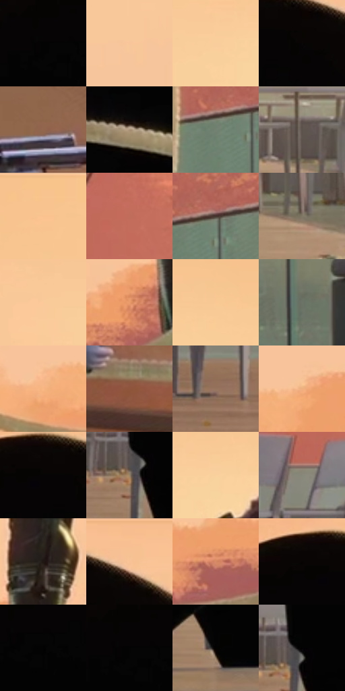

# 电影参考 413

- 状态：常规／活跃；来源世界：miles-home。
- 视角：near-level；景别：full-body；场景：landscape。
- 时段：daylight-time-unspecified（外观依据，中置信度；具体时间／晨昏未知）；光照：warm-day。
- 材质候选：skin, hair, fabric, glass, metal, stone, foliage, sky（帧级，不是像素分割）。
- 明暗组：middle；L* P5/P50/P95：0.82252 / 53.83732 / 85.21236。
- 资格门禁：无附加门禁。
- 原截图 SHA-256：`3788b8ce0fc3b837b70ec8551923e923ac3160857a27123f48aa484581032c99`；尺寸：2880 × 1208。
- sRGB 像素 SHA-256：`1fbc2803ac5d3196426446f35a0ee47ab7d10686706e54d2b14ca49948c73ed1`。

## 观察与迁移

暖林逆光、玻璃护栏与少量眩光，光晕必须有源。

413  /  日光：大黑剪影、远林低细节与暖空气  /  不给整条黑轮廓均匀霓虹描边

本公开版保存32个128×128原像素色卡上下文；图集格子并非原场景相邻位置。原rect、图集tile和像素SHA见 `data/palette-crops.json`。上下文不足时不得批准替色，不能以小样推断完整构图。

## 实测色卡

颜色比例分母为保留采样像素，不是材料面积；全部 32 色参与全库匹配。表内四舍五入仅用于阅读，原精度在 JSON。

| ID | HEX | Lab | 原图 xy | 像素数 | 比例 | 明度角色 |
| --- | --- | --- | --- | ---: | ---: | --- |
| 413-S01 | #030303 | [0.82252, -5.2e-05, 9.9e-05] | [736, 172] | 18783 | 9.714708% | deep-shadow |
| 413-S02 | #F8C59A | [83.033187, 12.543036, 28.497836] | [1404, 480] | 12304 | 6.363721% | highlight |
| 413-S03 | #FACD9C | [85.195087, 9.372577, 30.385714] | [1808, 160] | 10424 | 5.391371% | highlight |
| 413-S04 | #090606 | [1.819967, 0.784393, 0.276614] | [936, 116] | 10368 | 5.362407% | deep-shadow |
| 413-S05 | #93654E | [47.055436, 15.671254, 20.465569] | [152, 268] | 8968 | 4.638317% | midtone |
| 413-S06 | #A99277 | [61.93431, 4.398785, 17.505741] | [616, 420] | 8932 | 4.619697% | light |
| 413-S07 | #728272 | [52.682907, -9.136137, 6.704844] | [2168, 792] | 8359 | 4.323337% | midtone |
| 413-S08 | #5D524C | [35.759525, 3.401316, 5.17854] | [1340, 964] | 8238 | 4.260755% | shadow |
| 413-S09 | #F8C490 | [82.62195, 11.976745, 33.170218] | [2792, 36] | 8173 | 4.227137% | highlight |
| 413-S10 | #C06D5B | [54.97113, 31.071403, 24.433272] | [348, 632] | 8161 | 4.220930% | midtone |
| 413-S11 | #43342E | [23.15805, 5.651656, 6.352174] | [2216, 764] | 7974 | 4.124213% | shadow |
| 413-S12 | #807764 | [50.338313, 0.117843, 11.7164] | [1484, 1044] | 6861 | 3.548561% | midtone |
| 413-S13 | #FACA9A | [84.43299, 10.708618, 30.406959] | [1340, 144] | 6795 | 3.514425% | highlight |
| 413-S14 | #EA9C6B | [71.101242, 24.049207, 37.393783] | [1840, 676] | 6767 | 3.499943% | light |
| 413-S15 | #F9C994 | [83.994197, 10.184148, 32.922625] | [2232, 128] | 6418 | 3.319438% | highlight |
| 413-S16 | #6C7366 | [47.506432, -5.268953, 6.29461] | [2632, 968] | 5828 | 3.014285% | midtone |
| 413-S17 | #F8B783 | [79.309042, 17.492048, 35.608114] | [1416, 732] | 5713 | 2.954806% | light |
| 413-S18 | #8F553C | [42.253058, 21.448494, 24.721817] | [164, 416] | 5562 | 2.876708% | midtone |
| 413-S19 | #97755E | [51.962681, 10.020899, 17.807042] | [116, 1048] | 4719 | 2.440702% | midtone |
| 413-S20 | #F0B07F | [76.746822, 17.625219, 34.217012] | [1512, 692] | 4495 | 2.324848% | light |
| 413-S21 | #060405 | [1.233098, 0.661973, -0.194015] | [868, 96] | 4415 | 2.283471% | deep-shadow |
| 413-S22 | #978369 | [55.91988, 3.502233, 16.885415] | [576, 1012] | 4203 | 2.173823% | midtone |
| 413-S23 | #FAD09E | [85.96021, 8.04282, 30.371658] | [1900, 152] | 4172 | 2.157790% | highlight |
| 413-S24 | #88877A | [56.055242, -2.062841, 7.128812] | [304, 900] | 4168 | 2.155721% | midtone |
| 413-S25 | #1F1713 | [8.577761, 3.220158, 4.098661] | [1932, 560] | 3547 | 1.834535% | deep-shadow |
| 413-S26 | #F5C293 | [81.895801, 12.169984, 30.591443] | [1020, 56] | 3458 | 1.788504% | highlight |
| 413-S27 | #D78B66 | [64.863231, 25.072805, 31.68977] | [1700, 732] | 2791 | 1.443526% | light |
| 413-S28 | #080403 | [1.310142, 0.906884, 0.74711] | [824, 80] | 1427 | 0.738055% | deep-shadow |
| 413-S29 | #020202 | [0.548347, -3.5e-05, 6.6e-05] | [772, 192] | 649 | 0.335668% | deep-shadow |
| 413-S30 | #040404 | [1.096694, -7e-05, 0.000132] | [744, 172] | 576 | 0.297912% | deep-shadow |
| 413-S31 | #030201 | [0.586869, 0.122421, 0.470628] | [840, 1108] | 66 | 0.034136% | deep-shadow |
| 413-S32 | #040103 | [0.488673, 1.062568, -0.480399] | [596, 980] | 32 | 0.016551% | deep-shadow |

## 色阶与空间分布

- 采样 ROI：`[0.01, 0.02, 0.98, 0.94]`；步长：4；样本数：193346。
- 排除区：`[]`。
- 深暗、暗、中、亮、高光五段计数：`[41985, 13858, 58818, 25507, 53178]`。
- RGB 各 256 箱、L* 100 箱、13×5 色相明度表和 3×3 空间统计全部保存在 [总数据](../film-library.json)。
- [可视化档案](../../references/library.html)按需绘制直方图，不存 2,094 张重复图表图片。

## 纹理特征占比

**这是分块图像特征的面积占比，不是波点／排线／丝网／错版的精确语义覆盖率。** 窗格、发丝、织物也会产生方向或周期特征。
原图 ROI 像素 3104134；已测块覆盖 3104134（100.0000%）；未测 0。

| 特征 | 块覆盖像素 | 占已测面积 | 阈值敏感范围 |
| --- | ---: | ---: | --- |
| low-contrast | 907526 | 29.2360% | 26.0692% ~ 29.2360% |
| directional-structure | 905728 | 29.1781% | 20.1435% ~ 41.2477% |
| periodic-structure | 1263360 | 40.6993% | 31.2688% ~ 46.0392% |
| mixed-detail | 27520 | 0.8866% | 0.8866% ~ 4.5812% |

阈值敏感范围不是统计置信区间。逐块坐标、尺度、对比、方向一致性、频谱集中度、频率与角度见 [全量特征记录](../texture-features.jsonl)，以帧号定位。
四种印刷层的真实像素覆盖仍标为 `null`，不能填 0，也不能拿上表代替。不得据这些代理测量删除唯一证据。

[测量方法与保留策略](../../references/library-retention.md) · [分类索引](../archive/README.md)
