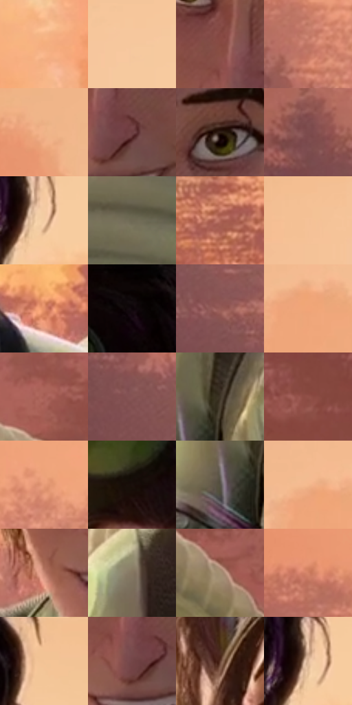

# 电影参考 414

- 状态：常规／活跃；来源世界：miles-home。
- 视角：near-level；景别：medium；场景：landscape。
- 时段：daylight-time-unspecified（外观依据，中置信度；具体时间／晨昏未知）；光照：warm-day。
- 材质候选：skin, hair, fabric, glass, metal, stone, foliage, sky（帧级，不是像素分割）。
- 明暗组：middle；L* P5/P50/P95：5.88232 / 52.03485 / 83.88129。
- 资格门禁：无附加门禁。
- 原截图 SHA-256：`34e6d62f1e35bba31ba9eaaf25d95ea0d8b02a23ae80e8971360210ed5df7ee7`；尺寸：2880 × 1202。
- sRGB 像素 SHA-256：`4a888691e59ecc4205a3952512c9778eb51b67946492b2a326b80b12d5be7381`。

## 观察与迁移

暖林逆光、玻璃护栏与少量眩光，光晕必须有源。

414  /  人物近景：背光发束、面部阴影、服装光泽  /  青粉衣纹不全是色版偏移

本公开版保存32个128×128原像素色卡上下文；图集格子并非原场景相邻位置。原rect、图集tile和像素SHA见 `data/palette-crops.json`。上下文不足时不得批准替色，不能以小样推断完整构图。

## 实测色卡

颜色比例分母为保留采样像素，不是材料面积；全部 32 色参与全库匹配。表内四舍五入仅用于阅读，原精度在 JSON。

| ID | HEX | Lab | 原图 xy | 像素数 | 比例 | 明度角色 |
| --- | --- | --- | --- | ---: | ---: | --- |
| 414-S01 | #F4AE7E | [76.688483, 20.17672, 34.750385] | [2292, 436] | 9345 | 4.850816% | light |
| 414-S02 | #F5C79D | [83.282594, 10.682759, 27.211585] | [940, 116] | 8627 | 4.478116% | highlight |
| 414-S03 | #864940 | [38.207606, 24.884666, 16.821498] | [1612, 496] | 8343 | 4.330696% | shadow |
| 414-S04 | #C17765 | [57.533732, 26.994215, 22.138803] | [304, 564] | 7847 | 4.073232% | midtone |
| 414-S05 | #EFB387 | [77.485942, 16.438462, 30.948182] | [200, 200] | 7347 | 3.813691% | light |
| 414-S06 | #6D3F42 | [32.258591, 20.456727, 6.823201] | [1680, 560] | 7337 | 3.808500% | shadow |
| 414-S07 | #2D1D15 | [12.549931, 6.586761, 8.625135] | [1736, 412] | 7273 | 3.775279% | deep-shadow |
| 414-S08 | #7D4C4D | [37.959937, 20.879432, 8.199332] | [132, 584] | 7063 | 3.666272% | shadow |
| 414-S09 | #F4CDA4 | [84.781166, 8.00635, 25.559919] | [2096, 220] | 6733 | 3.494975% | highlight |
| 414-S10 | #6F6955 | [44.431357, -1.245481, 12.12005] | [1676, 976] | 6724 | 3.490304% | midtone |
| 414-S11 | #B1695B | [52.071374, 27.257945, 20.226906] | [2616, 240] | 6676 | 3.465388% | midtone |
| 414-S12 | #F5C197 | [81.723999, 13.137188, 28.26339] | [772, 80] | 6350 | 3.296167% | highlight |
| 414-S13 | #E6926B | [68.348278, 27.761454, 33.809459] | [1960, 684] | 6312 | 3.276442% | light |
| 414-S14 | #0E0707 | [2.354667, 1.952767, 0.688326] | [1896, 32] | 6271 | 3.255160% | deep-shadow |
| 414-S15 | #955C56 | [45.24434, 22.625313, 13.301816] | [400, 816] | 6243 | 3.240625% | midtone |
| 414-S16 | #F2A578 | [74.284207, 23.58952, 34.767703] | [516, 216] | 6243 | 3.240625% | light |
| 414-S17 | #A76056 | [48.579874, 27.700596, 18.241525] | [2296, 992] | 6073 | 3.152382% | midtone |
| 414-S18 | #865454 | [41.295693, 20.828899, 8.725367] | [256, 684] | 5866 | 3.044932% | midtone |
| 414-S19 | #3E3426 | [22.373866, 1.957148, 10.523361] | [1364, 1016] | 5675 | 2.945787% | shadow |
| 414-S20 | #915148 | [41.804401, 25.707242, 17.006404] | [2700, 580] | 5437 | 2.822246% | midtone |
| 414-S21 | #E89C78 | [71.072202, 24.402112, 30.377994] | [448, 460] | 5419 | 2.812902% | light |
| 414-S22 | #1B0F0C | [5.431052, 4.822614, 3.249457] | [1592, 192] | 5374 | 2.789544% | deep-shadow |
| 414-S23 | #565145 | [34.586017, -0.25963, 7.806792] | [1304, 1080] | 5292 | 2.746979% | shadow |
| 414-S24 | #F4B88C | [79.277545, 16.286008, 30.772678] | [492, 184] | 5171 | 2.684170% | light |
| 414-S25 | #C68672 | [61.889406, 22.147205, 20.749229] | [1536, 624] | 5098 | 2.646277% | light |
| 414-S26 | #867760 | [50.812278, 1.989173, 14.792986] | [1336, 808] | 5074 | 2.633819% | midtone |
| 414-S27 | #A38F73 | [60.489478, 3.080972, 17.674305] | [2376, 1128] | 5058 | 2.625514% | light |
| 414-S28 | #D48467 | [62.912583, 27.725765, 28.549225] | [184, 420] | 4540 | 2.356630% | light |
| 414-S29 | #EFBE94 | [80.358629, 12.040483, 27.908188] | [2124, 32] | 4305 | 2.234646% | highlight |
| 414-S30 | #734647 | [34.964923, 19.457303, 7.564274] | [1640, 572] | 4116 | 2.136539% | shadow |
| 414-S31 | #5C382A | [27.494273, 14.29564, 15.411218] | [1444, 332] | 2947 | 1.529733% | shadow |
| 414-S32 | #D7B293 | [75.074382, 8.932736, 20.880817] | [2080, 204] | 2469 | 1.281612% | light |

## 色阶与空间分布

- 采样 ROI：`[0.01, 0.02, 0.98, 0.94]`；步长：4；样本数：192648。
- 排除区：`[]`。
- 深暗、暗、中、亮、高光五段计数：`[20764, 40601, 53294, 52340, 25649]`。
- RGB 各 256 箱、L* 100 箱、13×5 色相明度表和 3×3 空间统计全部保存在 [总数据](../film-library.json)。
- [可视化档案](../../references/library.html)按需绘制直方图，不存 2,094 张重复图表图片。

## 纹理特征占比

**这是分块图像特征的面积占比，不是波点／排线／丝网／错版的精确语义覆盖率。** 窗格、发丝、织物也会产生方向或周期特征。
原图 ROI 像素 3087370；已测块覆盖 3087370（100.0000%）；未测 0。

| 特征 | 块覆盖像素 | 占已测面积 | 阈值敏感范围 |
| --- | ---: | ---: | --- |
| low-contrast | 558464 | 18.0887% | 12.4461% ~ 19.1500% |
| directional-structure | 548224 | 17.7570% | 6.8076% ~ 30.8788% |
| periodic-structure | 1718538 | 55.6635% | 49.7763% ~ 58.4081% |
| mixed-detail | 262144 | 8.4909% | 6.8988% ~ 15.6343% |

阈值敏感范围不是统计置信区间。逐块坐标、尺度、对比、方向一致性、频谱集中度、频率与角度见 [全量特征记录](../texture-features.jsonl)，以帧号定位。
四种印刷层的真实像素覆盖仍标为 `null`，不能填 0，也不能拿上表代替。不得据这些代理测量删除唯一证据。

[测量方法与保留策略](../../references/library-retention.md) · [分类索引](../archive/README.md)
