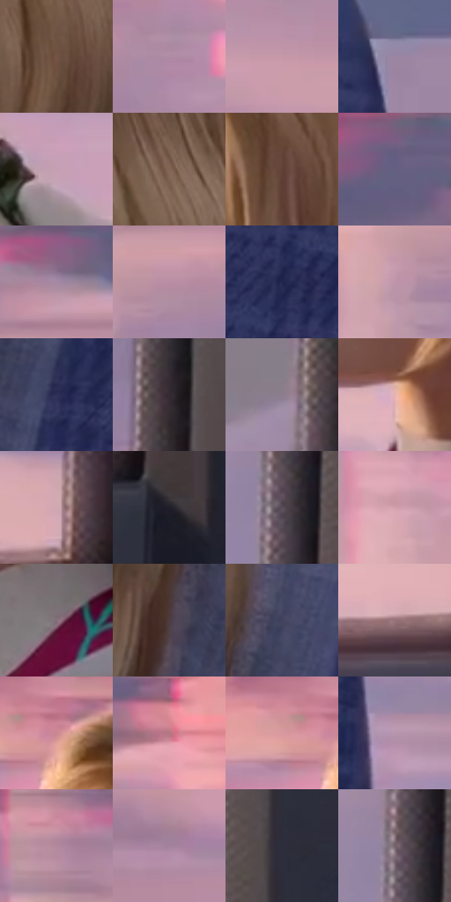

# 电影参考 415

- 状态：常规／活跃；来源世界：miles-home。
- 视角：near-level；景别：medium；场景：vehicle。
- 时段：daylight-time-unspecified（外观依据，中置信度；具体时间／晨昏未知）；光照：warm-day。
- 材质候选：skin, hair, fabric, plastic, glass（帧级，不是像素分割）。
- 明暗组：middle；L* P5/P50/P95：16.93392 / 56.32924 / 72.84959。
- 资格门禁：无附加门禁。
- 原截图 SHA-256：`f6dc7e7df769353ec4706e4a2528bfb170c97a0e3ba125f6becff82e6b59bff8`；尺寸：2880 × 1210。
- sRGB 像素 SHA-256：`a61b4e2fe41b85e834d1659adb100796ff5220931e44c5a534e2748bab1807fb`。

## 观察与迁移

车厢柔暖人像与冷座椅纹理，窗外退后而不抹平空间。

415  /  交通室内：清楚人物、蓝座椅、窗外横向色带  /  背景运动不要求人物同时模糊

本公开版保存32个128×128原像素色卡上下文；图集格子并非原场景相邻位置。原rect、图集tile和像素SHA见 `data/palette-crops.json`。上下文不足时不得批准替色，不能以小样推断完整构图。

## 实测色卡

颜色比例分母为保留采样像素，不是材料面积；全部 32 色参与全库匹配。表内四舍五入仅用于阅读，原精度在 JSON。

| ID | HEX | Lab | 原图 xy | 像素数 | 比例 | 明度角色 |
| --- | --- | --- | --- | ---: | ---: | --- |
| 415-S01 | #735445 | [38.578636, 10.713472, 13.816699] | [1644, 536] | 9219 | 4.750984% | shadow |
| 415-S02 | #B18CA6 | [62.387022, 18.417618, -8.340461] | [728, 276] | 8850 | 4.560821% | light |
| 415-S03 | #C598A9 | [67.421457, 19.486023, -2.359733] | [2340, 680] | 8451 | 4.355198% | light |
| 415-S04 | #9985A3 | [58.218748, 13.312779, -13.11172] | [2168, 372] | 8199 | 4.225330% | midtone |
| 415-S05 | #C5A0B3 | [69.659819, 16.779997, -4.635791] | [648, 928] | 7944 | 4.093917% | light |
| 415-S06 | #836554 | [45.322486, 9.519352, 14.263925] | [1644, 384] | 7845 | 4.042897% | midtone |
| 415-S07 | #614134 | [30.808305, 12.127168, 13.536672] | [1444, 544] | 7655 | 3.944982% | shadow |
| 415-S08 | #646081 | [42.246116, 9.167428, -17.818398] | [624, 84] | 7367 | 3.796562% | midtone |
| 415-S09 | #A689A4 | [60.49746, 15.81106, -10.13764] | [492, 168] | 7363 | 3.794500% | light |
| 415-S10 | #B98EA3 | [63.594873, 19.653096, -4.760197] | [452, 288] | 7329 | 3.776978% | light |
| 415-S11 | #23284F | [17.641442, 10.559382, -24.757761] | [2048, 492] | 7304 | 3.764095% | deep-shadow |
| 415-S12 | #BF94A9 | [65.843564, 19.520479, -4.752941] | [372, 332] | 7059 | 3.637835% | light |
| 415-S13 | #2E3258 | [22.182788, 9.743011, -23.509867] | [1880, 724] | 6866 | 3.538373% | shadow |
| 415-S14 | #362A33 | [18.710759, 7.458378, -3.702968] | [2632, 524] | 6737 | 3.471893% | deep-shadow |
| 415-S15 | #8D7E8F | [54.624344, 8.968044, -7.064588] | [2584, 96] | 6558 | 3.379646% | midtone |
| 415-S16 | #E4B3B2 | [77.251443, 17.596196, 7.329124] | [1352, 864] | 6508 | 3.353879% | light |
| 415-S17 | #D1A8B2 | [72.744489, 16.569248, 0.577316] | [2568, 980] | 6270 | 3.231226% | light |
| 415-S18 | #211F2B | [12.465598, 4.182577, -7.676861] | [2672, 1100] | 5990 | 3.086929% | deep-shadow |
| 415-S19 | #594D56 | [34.197742, 6.813973, -3.447538] | [2620, 272] | 5471 | 2.819464% | shadow |
| 415-S20 | #D29FAB | [70.483177, 20.718396, 1.160861] | [352, 572] | 5446 | 2.806580% | light |
| 415-S21 | #83717A | [49.545844, 8.682309, -2.36005] | [1552, 960] | 5086 | 2.621055% | midtone |
| 415-S22 | #4D3C40 | [27.241133, 8.195893, 0.381513] | [1764, 668] | 5055 | 2.605079% | shadow |
| 415-S23 | #41425D | [28.928935, 6.562939, -16.114104] | [1856, 488] | 4971 | 2.561790% | shadow |
| 415-S24 | #987479 | [52.450769, 14.921451, 2.727519] | [2372, 1040] | 4727 | 2.436045% | midtone |
| 415-S25 | #CB8793 | [63.45299, 27.671517, 4.339109] | [1100, 156] | 4696 | 2.420070% | light |
| 415-S26 | #B37782 | [56.476999, 25.042901, 3.675846] | [776, 144] | 4528 | 2.333491% | midtone |
| 415-S27 | #D8999E | [69.364387, 24.277673, 6.846824] | [1036, 156] | 4367 | 2.250521% | light |
| 415-S28 | #B695AD | [65.324434, 16.445074, -7.867313] | [2236, 824] | 4029 | 2.076333% | light |
| 415-S29 | #B2899B | [61.415349, 18.519268, -3.514489] | [356, 168] | 3748 | 1.931521% | light |
| 415-S30 | #A3829D | [58.213915, 17.382067, -9.577834] | [188, 764] | 3627 | 1.869164% | midtone |
| 415-S31 | #2D2D3D | [19.104594, 4.2518, -10.115697] | [2732, 232] | 2588 | 1.333718% | deep-shadow |
| 415-S32 | #726169 | [42.983901, 8.321975, -1.993715] | [2608, 236] | 2191 | 1.129125% | midtone |

## 色阶与空间分布

- 采样 ROI：`[0.01, 0.02, 0.98, 0.94]`；步长：4；样本数：194044。
- 排除区：`[]`。
- 深暗、暗、中、亮、高光五段计数：`[20435, 40665, 52861, 79588, 495]`。
- RGB 各 256 箱、L* 100 箱、13×5 色相明度表和 3×3 空间统计全部保存在 [总数据](../film-library.json)。
- [可视化档案](../../references/library.html)按需绘制直方图，不存 2,094 张重复图表图片。

## 纹理特征占比

**这是分块图像特征的面积占比，不是波点／排线／丝网／错版的精确语义覆盖率。** 窗格、发丝、织物也会产生方向或周期特征。
原图 ROI 像素 3109722；已测块覆盖 3109722（100.0000%）；未测 0。

| 特征 | 块覆盖像素 | 占已测面积 | 阈值敏感范围 |
| --- | ---: | ---: | --- |
| low-contrast | 350170 | 11.2605% | 8.0993% ~ 14.3311% |
| directional-structure | 1328512 | 42.7212% | 25.4253% ~ 56.2592% |
| periodic-structure | 1431040 | 46.0183% | 35.6415% ~ 58.6630% |
| mixed-detail | 0 | 0.0000% | 0.0000% ~ 1.5806% |

阈值敏感范围不是统计置信区间。逐块坐标、尺度、对比、方向一致性、频谱集中度、频率与角度见 [全量特征记录](../texture-features.jsonl)，以帧号定位。
四种印刷层的真实像素覆盖仍标为 `null`，不能填 0，也不能拿上表代替。不得据这些代理测量删除唯一证据。

[测量方法与保留策略](../../references/library-retention.md) · [分类索引](../archive/README.md)
