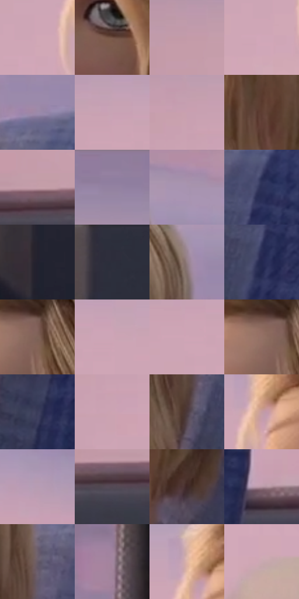

# 电影参考 416

- 状态：常规／活跃；来源世界：miles-home。
- 视角：near-level；景别：medium；场景：vehicle。
- 时段：daylight-time-unspecified（外观依据，中置信度；具体时间／晨昏未知）；光照：warm-day。
- 材质候选：skin, hair, fabric, plastic, glass（帧级，不是像素分割）。
- 明暗组：light；L* P5/P50/P95：16.81878 / 60.18007 / 72.85203。
- 资格门禁：无附加门禁。
- 原截图 SHA-256：`f4ce97f0e0009bd6d02fd8905425c9234b32719510ff2d6f48e32b367fdf39c3`；尺寸：2880 × 1202。
- sRGB 像素 SHA-256：`e79ee8723001c5e85e0a05a8ae85c18b9201a64369cada3e6af4b14a4114f862`。

## 观察与迁移

车厢柔暖人像与冷座椅纹理，窗外退后而不抹平空间。

416  /  交通室内：窗外低细节大色面与清楚五官  /  不从静帧推算速度或曝光时间

本公开版保存32个128×128原像素色卡上下文；图集格子并非原场景相邻位置。原rect、图集tile和像素SHA见 `data/palette-crops.json`。上下文不足时不得批准替色，不能以小样推断完整构图。

## 实测色卡

颜色比例分母为保留采样像素，不是材料面积；全部 32 色参与全库匹配。表内四舍五入仅用于阅读，原精度在 JSON。

| ID | HEX | Lab | 原图 xy | 像素数 | 比例 | 明度角色 |
| --- | --- | --- | --- | ---: | ---: | --- |
| 416-S01 | #D1A8B6 | [72.852028, 17.224023, -1.466379] | [1084, 372] | 11974 | 6.215481% | light |
| 416-S02 | #6F5043 | [36.971814, 11.109738, 12.778514] | [1488, 608] | 9764 | 5.068311% | shadow |
| 416-S03 | #C39AA8 | [67.681564, 17.488731, -1.442496] | [324, 244] | 9041 | 4.693015% | light |
| 416-S04 | #D0A7B8 | [72.567719, 17.742449, -2.995677] | [1060, 408] | 8477 | 4.400253% | light |
| 416-S05 | #9D8AAA | [60.111654, 13.296681, -14.220415] | [1924, 236] | 8410 | 4.365475% | light |
| 416-S06 | #C9A3B4 | [70.807753, 16.739914, -3.454329] | [720, 248] | 8381 | 4.350421% | light |
| 416-S07 | #C8A0B0 | [69.864361, 17.344827, -2.636487] | [504, 260] | 8268 | 4.291765% | light |
| 416-S08 | #5E3E33 | [29.574483, 12.505843, 12.445613] | [1624, 696] | 7904 | 4.102820% | shadow |
| 416-S09 | #C59FAA | [69.162306, 15.80034, -0.366863] | [396, 1076] | 6709 | 3.482517% | light |
| 416-S10 | #9481A1 | [56.653776, 13.456546, -14.369533] | [236, 40] | 6602 | 3.426976% | midtone |
| 416-S11 | #A793B0 | [63.522442, 12.877706, -12.39462] | [1904, 84] | 6591 | 3.421266% | light |
| 416-S12 | #2B3057 | [21.265088, 9.935842, -24.316365] | [1976, 348] | 6514 | 3.381296% | shadow |
| 416-S13 | #22212F | [13.429728, 4.328197, -9.078127] | [2724, 1052] | 6409 | 3.326793% | deep-shadow |
| 416-S14 | #2D2D3B | [19.015086, 3.674025, -8.876231] | [2756, 44] | 6150 | 3.192351% | deep-shadow |
| 416-S15 | #937F83 | [55.093962, 8.347788, 0.66424] | [1840, 164] | 6110 | 3.171588% | midtone |
| 416-S16 | #23284F | [17.641442, 10.559382, -24.757761] | [1944, 476] | 6055 | 3.143038% | deep-shadow |
| 416-S17 | #7E6257 | [44.031196, 9.585868, 10.592879] | [1368, 288] | 6009 | 3.119160% | midtone |
| 416-S18 | #CDA5B6 | [71.736614, 17.421017, -3.148633] | [824, 276] | 5948 | 3.087496% | light |
| 416-S19 | #CFA6B6 | [72.172776, 17.593254, -2.485309] | [724, 300] | 5879 | 3.051680% | light |
| 416-S20 | #937165 | [50.633218, 11.598421, 11.825184] | [1332, 284] | 5548 | 2.879864% | midtone |
| 416-S21 | #3B3C5A | [26.446566, 7.632508, -18.058275] | [1852, 772] | 5515 | 2.862734% | shadow |
| 416-S22 | #CCA4B2 | [71.285411, 16.935924, -1.613343] | [532, 328] | 5461 | 2.834704% | light |
| 416-S23 | #4B393C | [26.006034, 8.512469, 1.200798] | [1828, 476] | 5282 | 2.741788% | shadow |
| 416-S24 | #C49CA2 | [68.111024, 15.778827, 2.54475] | [1164, 300] | 5136 | 2.666002% | light |
| 416-S25 | #B79CB2 | [67.321435, 13.828793, -7.687947] | [2336, 424] | 4656 | 2.416843% | light |
| 416-S26 | #544954 | [32.458379, 6.899575, -4.812476] | [304, 1124] | 4352 | 2.259042% | shadow |
| 416-S27 | #3E2726 | [18.432285, 10.681585, 5.085427] | [1712, 808] | 4134 | 2.145883% | deep-shadow |
| 416-S28 | #B494A2 | [64.557865, 14.306473, -2.83223] | [2232, 1036] | 3277 | 1.701030% | light |
| 416-S29 | #665A66 | [39.742597, 7.268844, -5.07962] | [1852, 332] | 3205 | 1.663656% | shadow |
| 416-S30 | #A2859E | [58.905426, 15.502329, -9.128422] | [2592, 136] | 2904 | 1.507412% | midtone |
| 416-S31 | #E0B6A9 | [77.382352, 13.209394, 12.341117] | [1148, 264] | 1419 | 0.736577% | light |
| 416-S32 | #C9A9B0 | [72.181179, 12.787032, 0.765358] | [1120, 988] | 564 | 0.292762% | light |

## 色阶与空间分布

- 采样 ROI：`[0.01, 0.02, 0.98, 0.94]`；步长：4；样本数：192648。
- 排除区：`[]`。
- 深暗、暗、中、亮、高光五段计数：`[21462, 40993, 33453, 96429, 311]`。
- RGB 各 256 箱、L* 100 箱、13×5 色相明度表和 3×3 空间统计全部保存在 [总数据](../film-library.json)。
- [可视化档案](../../references/library.html)按需绘制直方图，不存 2,094 张重复图表图片。

## 纹理特征占比

**这是分块图像特征的面积占比，不是波点／排线／丝网／错版的精确语义覆盖率。** 窗格、发丝、织物也会产生方向或周期特征。
原图 ROI 像素 3087370；已测块覆盖 3087370（100.0000%）；未测 0。

| 特征 | 块覆盖像素 | 占已测面积 | 阈值敏感范围 |
| --- | ---: | ---: | --- |
| low-contrast | 1051018 | 34.0425% | 32.9811% ~ 35.6345% |
| directional-structure | 896128 | 29.0256% | 19.8631% ~ 41.5670% |
| periodic-structure | 1140224 | 36.9319% | 25.4518% ~ 40.9825% |
| mixed-detail | 0 | 0.0000% | 0.0000% ~ 3.5199% |

阈值敏感范围不是统计置信区间。逐块坐标、尺度、对比、方向一致性、频谱集中度、频率与角度见 [全量特征记录](../texture-features.jsonl)，以帧号定位。
四种印刷层的真实像素覆盖仍标为 `null`，不能填 0，也不能拿上表代替。不得据这些代理测量删除唯一证据。

[测量方法与保留策略](../../references/library-retention.md) · [分类索引](../archive/README.md)
