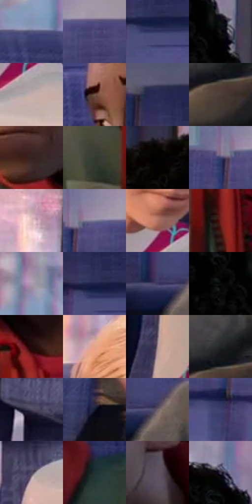

# 电影参考 417

- 状态：常规／活跃；来源世界：miles-home。
- 视角：near-level；景别：medium；场景：vehicle。
- 时段：daylight-time-unspecified（外观依据，中置信度；具体时间／晨昏未知）；光照：warm-day。
- 材质候选：skin, hair, fabric, plastic, glass（帧级，不是像素分割）。
- 明暗组：dark；L* P5/P50/P95：2.43118 / 28.93217 / 74.78706。
- 资格门禁：无附加门禁。
- 原截图 SHA-256：`ea8fdebd4484c341c2045c1da089726497745111b7d353e6f67369c978a93d70`；尺寸：2880 × 1210。
- sRGB 像素 SHA-256：`931fd6012ee64b3d1f8b30614b4f858cffb26c60648f92b9104e82258a513000`。

## 观察与迁移

车厢柔暖人像与冷座椅纹理，窗外退后而不抹平空间。

417  /  局部动作：前方人脸稳定、中央腿部动作区域  /  不复制腿的姿势或整个人

本公开版保存32个128×128原像素色卡上下文；图集格子并非原场景相邻位置。原rect、图集tile和像素SHA见 `data/palette-crops.json`。上下文不足时不得批准替色，不能以小样推断完整构图。

## 实测色卡

颜色比例分母为保留采样像素，不是材料面积；全部 32 色参与全库匹配。表内四舍五入仅用于阅读，原精度在 JSON。

| ID | HEX | Lab | 原图 xy | 像素数 | 比例 | 明度角色 |
| --- | --- | --- | --- | ---: | ---: | --- |
| 417-S01 | #55547C | [37.347652, 10.372762, -22.435125] | [2736, 304] | 14161 | 7.297829% | shadow |
| 417-S02 | #484878 | [32.630692, 12.91271, -27.4137] | [1136, 200] | 11962 | 6.164581% | shadow |
| 417-S03 | #333564 | [24.225067, 13.182127, -28.102403] | [1660, 304] | 11549 | 5.951743% | shadow |
| 417-S04 | #151517 | [6.84351, 0.489315, -1.332082] | [2476, 232] | 10161 | 5.236441% | deep-shadow |
| 417-S05 | #C4ADAD | [72.654866, 8.285788, 3.047539] | [612, 824] | 9897 | 5.100390% | light |
| 417-S06 | #705145 | [37.408037, 11.211536, 12.157796] | [2028, 416] | 9441 | 4.865391% | shadow |
| 417-S07 | #2B2D55 | [20.227289, 11.353957, -24.633005] | [1604, 196] | 9171 | 4.726248% | shadow |
| 417-S08 | #4C3D38 | [27.185028, 5.633492, 5.546543] | [1440, 848] | 8090 | 4.169158% | shadow |
| 417-S09 | #36221E | [15.603422, 8.979373, 6.590166] | [2164, 672] | 7749 | 3.993424% | deep-shadow |
| 417-S10 | #333A31 | [23.510921, -5.035226, 4.610776] | [2176, 920] | 7333 | 3.779040% | shadow |
| 417-S11 | #030202 | [0.606656, 0.261464, 0.092205] | [2128, 104] | 6884 | 3.547649% | deep-shadow |
| 417-S12 | #42416F | [29.628967, 12.959195, -26.516901] | [1008, 192] | 6575 | 3.388407% | shadow |
| 417-S13 | #DFBDBF | [79.526289, 12.424726, 3.513004] | [548, 68] | 6417 | 3.306982% | light |
| 417-S14 | #7F7C96 | [53.09049, 6.674917, -13.563684] | [1060, 176] | 6375 | 3.285337% | midtone |
| 417-S15 | #AD7362 | [54.058236, 20.799873, 18.757319] | [568, 732] | 5879 | 3.029725% | midtone |
| 417-S16 | #701E1C | [25.131793, 35.792224, 22.222801] | [2292, 968] | 5782 | 2.979737% | shadow |
| 417-S17 | #A79BAC | [65.46498, 7.588984, -7.243904] | [2812, 176] | 5768 | 2.972522% | light |
| 417-S18 | #1D2146 | [14.349603, 10.712243, -23.885221] | [1640, 276] | 5384 | 2.774628% | deep-shadow |
| 417-S19 | #3C3B62 | [26.649688, 11.08633, -22.923666] | [1368, 592] | 5134 | 2.645792% | shadow |
| 417-S20 | #090A0C | [2.725228, 0.032074, -0.891274] | [2396, 240] | 4976 | 2.564367% | deep-shadow |
| 417-S21 | #1E0A08 | [4.613166, 8.29209, 3.776916] | [2296, 792] | 4841 | 2.494795% | deep-shadow |
| 417-S22 | #E6A58A | [73.266664, 20.671252, 23.528161] | [396, 280] | 4243 | 2.186617% | light |
| 417-S23 | #A68D90 | [60.93237, 9.898828, 1.905207] | [72, 1088] | 4146 | 2.136629% | light |
| 417-S24 | #222526 | [14.418251, -1.101243, -1.131974] | [1452, 776] | 4138 | 2.132506% | deep-shadow |
| 417-S25 | #484359 | [29.696335, 7.316414, -12.303524] | [64, 680] | 3015 | 1.553771% | shadow |
| 417-S26 | #161A30 | [9.974317, 5.543577, -15.266761] | [1096, 1004] | 2992 | 1.541918% | deep-shadow |
| 417-S27 | #6E636D | [43.275489, 6.354013, -4.039984] | [1428, 596] | 2981 | 1.536250% | midtone |
| 417-S28 | #3B3E6D | [28.057566, 12.292073, -27.767081] | [1000, 312] | 2690 | 1.386284% | shadow |
| 417-S29 | #524D61 | [33.909034, 6.619175, -10.910228] | [108, 812] | 2435 | 1.254870% | shadow |
| 417-S30 | #223133 | [19.121862, -5.615647, -3.294249] | [2576, 592] | 1517 | 0.781781% | deep-shadow |
| 417-S31 | #5D5462 | [37.021792, 6.620626, -6.746879] | [2360, 584] | 1308 | 0.674074% | shadow |
| 417-S32 | #3D3547 | [23.649054, 7.736684, -9.812743] | [2408, 124] | 1050 | 0.541114% | shadow |

## 色阶与空间分布

- 采样 ROI：`[0.01, 0.02, 0.98, 0.94]`；步长：4；样本数：194044。
- 排除区：`[]`。
- 深暗、暗、中、亮、高光五段计数：`[54515, 90595, 18949, 27667, 2318]`。
- RGB 各 256 箱、L* 100 箱、13×5 色相明度表和 3×3 空间统计全部保存在 [总数据](../film-library.json)。
- [可视化档案](../../references/library.html)按需绘制直方图，不存 2,094 张重复图表图片。

## 纹理特征占比

**这是分块图像特征的面积占比，不是波点／排线／丝网／错版的精确语义覆盖率。** 窗格、发丝、织物也会产生方向或周期特征。
原图 ROI 像素 3109722；已测块覆盖 3109722（100.0000%）；未测 0。

| 特征 | 块覆盖像素 | 占已测面积 | 阈值敏感范围 |
| --- | ---: | ---: | --- |
| low-contrast | 81920 | 2.6343% | 0.5269% ~ 2.6343% |
| directional-structure | 763866 | 24.5638% | 10.9036% ~ 38.4928% |
| periodic-structure | 2214784 | 71.2213% | 59.9266% ~ 82.5682% |
| mixed-detail | 49152 | 1.5806% | 1.0537% ~ 3.8939% |

阈值敏感范围不是统计置信区间。逐块坐标、尺度、对比、方向一致性、频谱集中度、频率与角度见 [全量特征记录](../texture-features.jsonl)，以帧号定位。
四种印刷层的真实像素覆盖仍标为 `null`，不能填 0，也不能拿上表代替。不得据这些代理测量删除唯一证据。

[测量方法与保留策略](../../references/library-retention.md) · [分类索引](../archive/README.md)
