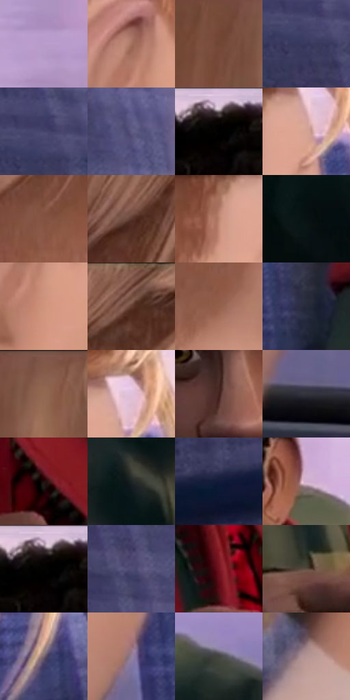

# 电影参考 418

- 状态：常规／活跃；来源世界：miles-home。
- 视角：near-level；景别：medium；场景：vehicle。
- 时段：daylight-time-unspecified（外观依据，中置信度；具体时间／晨昏未知）；光照：warm-day。
- 材质候选：skin, hair, fabric, plastic, glass（帧级，不是像素分割）。
- 明暗组：dark；L* P5/P50/P95：1.155 / 35.38948 / 74.12483。
- 资格门禁：无附加门禁。
- 原截图 SHA-256：`98118da3819745b2ad086cc6caa4ad7e9610bf209cd6cd130b5fb6e22f0557fd`；尺寸：2880 × 1206。
- sRGB 像素 SHA-256：`6e5c9eaf0eed3bb8773dce092706f4f54d5c330f4f39813902abd16d2befbd0c`。

## 观察与迁移

车厢柔暖人像与冷座椅纹理，窗外退后而不抹平空间。

418  /  面部：暖肤色、冷座椅、前后人物遮挡  /  不以全图模糊制造景深

本公开版保存32个128×128原像素色卡上下文；图集格子并非原场景相邻位置。原rect、图集tile和像素SHA见 `data/palette-crops.json`。上下文不足时不得批准替色，不能以小样推断完整构图。

## 实测色卡

颜色比例分母为保留采样像素，不是材料面积；全部 32 色参与全库匹配。表内四舍五入仅用于阅读，原精度在 JSON。

| ID | HEX | Lab | 原图 xy | 像素数 | 比例 | 明度角色 |
| --- | --- | --- | --- | ---: | ---: | --- |
| 418-S01 | #BA9DCA | [68.618948, 18.99502, -19.060977] | [2676, 232] | 11914 | 6.162010% | light |
| 418-S02 | #A4705D | [52.144271, 18.215996, 18.880877] | [1360, 444] | 9821 | 5.079495% | midtone |
| 418-S03 | #724535 | [34.172803, 17.48168, 17.781321] | [568, 72] | 9252 | 4.785204% | shadow |
| 418-S04 | #37385D | [25.046938, 9.979889, -22.226514] | [96, 124] | 9023 | 4.666763% | shadow |
| 418-S05 | #43436C | [30.132678, 11.011559, -23.816777] | [104, 84] | 8596 | 4.445916% | shadow |
| 418-S06 | #5E5A84 | [40.176392, 11.693098, -22.874612] | [308, 172] | 8075 | 4.176451% | midtone |
| 418-S07 | #020101 | [0.332482, 0.261482, 0.092172] | [2060, 60] | 7671 | 3.967499% | deep-shadow |
| 418-S08 | #D4A393 | [71.077487, 15.84642, 15.299649] | [1596, 204] | 7548 | 3.903882% | light |
| 418-S09 | #845341 | [40.368965, 18.31694, 19.022097] | [1292, 256] | 7413 | 3.834059% | midtone |
| 418-S10 | #5A372C | [26.98509, 14.219798, 13.396099] | [980, 168] | 7400 | 3.827335% | shadow |
| 418-S11 | #BA8370 | [59.747205, 18.752724, 18.736471] | [1520, 212] | 6761 | 3.496840% | midtone |
| 418-S12 | #081111 | [4.452957, -2.737572, -0.963853] | [2624, 860] | 6742 | 3.487013% | deep-shadow |
| 418-S13 | #CF937C | [66.206004, 19.748636, 21.19647] | [1392, 528] | 6737 | 3.484427% | light |
| 418-S14 | #744F40 | [37.254357, 13.556764, 15.117343] | [1232, 48] | 6671 | 3.450291% | shadow |
| 418-S15 | #94614D | [46.153702, 18.309127, 19.881376] | [1164, 560] | 6287 | 3.251684% | midtone |
| 418-S16 | #25293A | [16.915021, 3.150653, -11.466814] | [1632, 816] | 6245 | 3.229961% | deep-shadow |
| 418-S17 | #865E4C | [43.648708, 13.928225, 16.824127] | [664, 36] | 6236 | 3.225306% | midtone |
| 418-S18 | #E0C0DB | [81.105467, 15.943281, -9.234567] | [1620, 160] | 6062 | 3.135312% | highlight |
| 418-S19 | #421F1B | [16.590365, 16.385194, 10.360713] | [1992, 604] | 5700 | 2.948083% | deep-shadow |
| 418-S20 | #33343D | [21.932314, 1.813328, -5.775143] | [1432, 936] | 5667 | 2.931015% | shadow |
| 418-S21 | #220D0C | [5.912583, 10.141664, 4.068656] | [2364, 1036] | 5451 | 2.819298% | deep-shadow |
| 418-S22 | #1E2424 | [13.621425, -2.691966, -0.910816] | [1888, 880] | 5342 | 2.762922% | deep-shadow |
| 418-S23 | #101D39 | [11.164229, 5.222174, -19.895831] | [180, 956] | 5087 | 2.631035% | deep-shadow |
| 418-S24 | #CFAECD | [74.790936, 17.297879, -11.226648] | [2304, 496] | 4601 | 2.379672% | light |
| 418-S25 | #060404 | [1.213311, 0.522929, 0.184409] | [2052, 56] | 4443 | 2.297953% | deep-shadow |
| 418-S26 | #4F4D74 | [34.458779, 10.651811, -22.013191] | [200, 240] | 4359 | 2.254507% | shadow |
| 418-S27 | #6F121D | [23.344422, 39.938889, 19.395671] | [2212, 944] | 4325 | 2.236922% | shadow |
| 418-S28 | #5F4E40 | [34.502674, 4.75874, 10.961546] | [2060, 1016] | 3867 | 2.000041% | shadow |
| 418-S29 | #766470 | [44.427373, 9.452921, -4.067397] | [1684, 388] | 2276 | 1.177164% | midtone |
| 418-S30 | #937F9B | [55.835155, 13.002395, -12.151331] | [1488, 736] | 1695 | 0.876667% | midtone |
| 418-S31 | #434441 | [28.666601, -1.078065, 1.670693] | [2708, 684] | 1238 | 0.640303% | shadow |
| 418-S32 | #B49394 | [63.925411, 12.509017, 4.14154] | [752, 868] | 841 | 0.434972% | light |

## 色阶与空间分布

- 采样 ROI：`[0.01, 0.02, 0.98, 0.94]`；步长：4；样本数：193346。
- 排除区：`[]`。
- 深暗、暗、中、亮、高光五段计数：`[47490, 66913, 37782, 38678, 2483]`。
- RGB 各 256 箱、L* 100 箱、13×5 色相明度表和 3×3 空间统计全部保存在 [总数据](../film-library.json)。
- [可视化档案](../../references/library.html)按需绘制直方图，不存 2,094 张重复图表图片。

## 纹理特征占比

**这是分块图像特征的面积占比，不是波点／排线／丝网／错版的精确语义覆盖率。** 窗格、发丝、织物也会产生方向或周期特征。
原图 ROI 像素 3098546；已测块覆盖 3098546（100.0000%）；未测 0。

| 特征 | 块覆盖像素 | 占已测面积 | 阈值敏感范围 |
| --- | ---: | ---: | --- |
| low-contrast | 134450 | 4.3391% | 2.4017% ~ 5.3967% |
| directional-structure | 837888 | 27.0413% | 9.8689% ~ 43.3380% |
| periodic-structure | 2093440 | 67.5620% | 53.2028% ~ 83.1482% |
| mixed-detail | 32768 | 1.0575% | 1.0575% ~ 1.5863% |

阈值敏感范围不是统计置信区间。逐块坐标、尺度、对比、方向一致性、频谱集中度、频率与角度见 [全量特征记录](../texture-features.jsonl)，以帧号定位。
四种印刷层的真实像素覆盖仍标为 `null`，不能填 0，也不能拿上表代替。不得据这些代理测量删除唯一证据。

[测量方法与保留策略](../../references/library-retention.md) · [分类索引](../archive/README.md)
