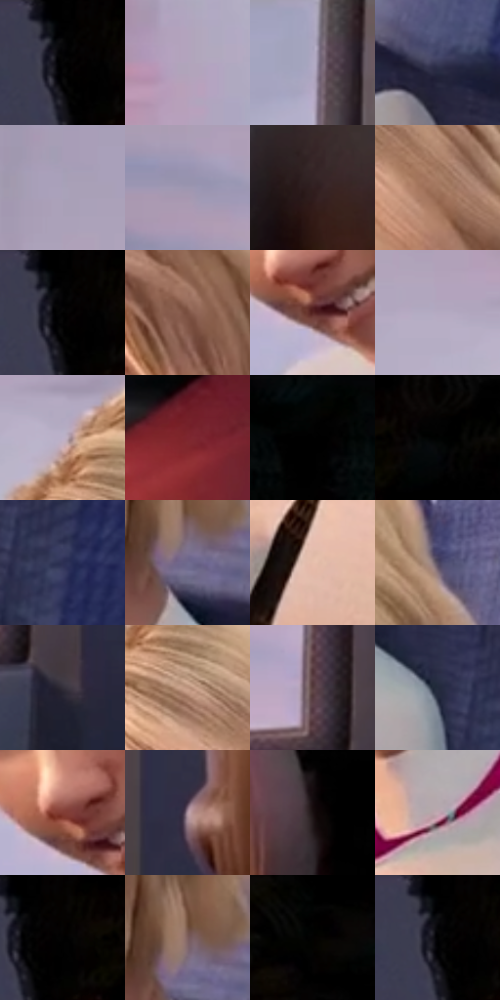

# 电影参考 419

- 状态：常规／活跃；来源世界：miles-home。
- 视角：near-level；景别：medium；场景：vehicle。
- 时段：daylight-time-unspecified（外观依据，中置信度；具体时间／晨昏未知）；光照：warm-day。
- 材质候选：skin, hair, fabric, plastic, glass（帧级，不是像素分割）。
- 明暗组：dark；L* P5/P50/P95：0.0 / 33.14666 / 73.6739。
- 资格门禁：无附加门禁。
- 原截图 SHA-256：`50a434fe045dfb44004da4b41920afb29f035f452efbd2f77462a98870ffd758`；尺寸：2880 × 1208。
- sRGB 像素 SHA-256：`9b5f1f2fd4e6f6d53cbba2d64390867bc7d676d7c65e06574c84a91d9be4fe55`。

## 观察与迁移

车厢柔暖人像与冷座椅纹理，窗外退后而不抹平空间。

419  /  面部：发束亮边、清楚侧脸与大窗外色面  /  耳颊细线不是多只耳朵

本公开版保存32个128×128原像素色卡上下文；图集格子并非原场景相邻位置。原rect、图集tile和像素SHA见 `data/palette-crops.json`。上下文不足时不得批准替色，不能以小样推断完整构图。

## 实测色卡

颜色比例分母为保留采样像素，不是材料面积；全部 32 色参与全库匹配。表内四舍五入仅用于阅读，原精度在 JSON。

| ID | HEX | Lab | 原图 xy | 像素数 | 比例 | 明度角色 |
| --- | --- | --- | --- | ---: | ---: | --- |
| 419-S01 | #000000 | [0.0, 0.0, 0.0] | [1728, 28] | 11894 | 6.151666% | deep-shadow |
| 419-S02 | #B0A4BC | [69.048592, 8.899375, -10.740387] | [952, 80] | 9802 | 5.069668% | light |
| 419-S03 | #AFAAC3 | [70.735082, 6.681996, -12.093338] | [1548, 68] | 9774 | 5.055186% | light |
| 419-S04 | #393C59 | [26.223384, 6.661209, -17.76707] | [1060, 840] | 8562 | 4.428331% | shadow |
| 419-S05 | #A8A1B9 | [67.514333, 7.225656, -11.438799] | [720, 104] | 8065 | 4.171278% | light |
| 419-S06 | #A098B2 | [64.277555, 8.071997, -12.446939] | [52, 544] | 7767 | 4.017151% | light |
| 419-S07 | #312021 | [14.377558, 8.414956, 2.617272] | [2140, 960] | 7746 | 4.006289% | deep-shadow |
| 419-S08 | #A1755D | [53.049425, 14.1121, 20.03928] | [592, 540] | 7704 | 3.984567% | midtone |
| 419-S09 | #010101 | [0.274173, -1.7e-05, 3.3e-05] | [1732, 28] | 7467 | 3.861988% | deep-shadow |
| 419-S10 | #7B5041 | [38.429793, 16.163449, 16.235931] | [688, 704] | 7140 | 3.692862% | shadow |
| 419-S11 | #572523 | [21.840269, 22.931492, 12.455551] | [576, 860] | 7059 | 3.650968% | shadow |
| 419-S12 | #B4AAC1 | [71.079312, 7.959454, -10.434255] | [328, 324] | 6824 | 3.529424% | light |
| 419-S13 | #BCB1C9 | [73.773809, 8.43466, -10.732224] | [428, 364] | 6774 | 3.503564% | light |
| 419-S14 | #7E252F | [29.324778, 38.930969, 15.632617] | [2484, 824] | 6628 | 3.428051% | shadow |
| 419-S15 | #030505 | [1.25425, -0.523086, -0.184112] | [2624, 36] | 6555 | 3.390295% | deep-shadow |
| 419-S16 | #090706 | [2.016045, 0.383833, 0.562932] | [1868, 32] | 6395 | 3.307542% | deep-shadow |
| 419-S17 | #2C2F54 | [20.859849, 9.885541, -22.95827] | [1228, 1064] | 6071 | 3.139967% | shadow |
| 419-S18 | #6F6A8D | [46.459126, 9.792185, -18.480095] | [888, 760] | 5961 | 3.083074% | midtone |
| 419-S19 | #E5BDAB | [79.611397, 11.642072, 14.475404] | [584, 1112] | 5951 | 3.077902% | light |
| 419-S20 | #524B62 | [33.366723, 8.143536, -12.36648] | [896, 480] | 5729 | 2.963082% | shadow |
| 419-S21 | #332F39 | [20.172554, 4.179289, -5.692576] | [1612, 972] | 5709 | 2.952738% | shadow |
| 419-S22 | #BD947F | [64.589942, 12.397041, 17.004148] | [488, 452] | 5669 | 2.932049% | light |
| 419-S23 | #563C3D | [28.240636, 11.614717, 3.935098] | [1540, 876] | 5344 | 2.763957% | shadow |
| 419-S24 | #222B3C | [17.43208, 1.327823, -12.078595] | [1144, 1024] | 4911 | 2.540006% | deep-shadow |
| 419-S25 | #823C34 | [34.450777, 29.425926, 19.230214] | [552, 824] | 4832 | 2.499147% | shadow |
| 419-S26 | #B298A4 | [65.438041, 11.699721, -2.685012] | [1680, 760] | 3628 | 1.876429% | light |
| 419-S27 | #191012 | [5.609057, 4.308129, 0.297303] | [2152, 520] | 3276 | 1.694372% | deep-shadow |
| 419-S28 | #C2A8B2 | [71.343947, 11.141225, -1.637193] | [804, 964] | 3194 | 1.651961% | light |
| 419-S29 | #050201 | [0.703486, 0.645419, 0.654905] | [1764, 32] | 2535 | 1.311121% | deep-shadow |
| 419-S30 | #7E605F | [43.695, 12.007435, 5.276705] | [884, 720] | 2250 | 1.163717% | midtone |
| 419-S31 | #000201 | [0.411943, -0.662077, 0.194212] | [2100, 28] | 1391 | 0.719436% | deep-shadow |
| 419-S32 | #000002 | [0.039574, 0.278088, -0.756847] | [1724, 36] | 739 | 0.382216% | deep-shadow |

## 色阶与空间分布

- 采样 ROI：`[0.01, 0.02, 0.98, 0.94]`；步长：4；样本数：193346。
- 排除区：`[]`。
- 深暗、暗、中、亮、高光五段计数：`[56978, 50403, 19200, 64195, 2570]`。
- RGB 各 256 箱、L* 100 箱、13×5 色相明度表和 3×3 空间统计全部保存在 [总数据](../film-library.json)。
- [可视化档案](../../references/library.html)按需绘制直方图，不存 2,094 张重复图表图片。

## 纹理特征占比

**这是分块图像特征的面积占比，不是波点／排线／丝网／错版的精确语义覆盖率。** 窗格、发丝、织物也会产生方向或周期特征。
原图 ROI 像素 3104134；已测块覆盖 3104134（100.0000%）；未测 0。

| 特征 | 块覆盖像素 | 占已测面积 | 阈值敏感范围 |
| --- | ---: | ---: | --- |
| low-contrast | 560384 | 18.0528% | 9.7893% ~ 24.2959% |
| directional-structure | 1114118 | 35.8914% | 21.6609% ~ 46.2869% |
| periodic-structure | 1380480 | 44.4723% | 42.3404% ~ 51.0454% |
| mixed-detail | 49152 | 1.5834% | 1.5834% ~ 2.9978% |

阈值敏感范围不是统计置信区间。逐块坐标、尺度、对比、方向一致性、频谱集中度、频率与角度见 [全量特征记录](../texture-features.jsonl)，以帧号定位。
四种印刷层的真实像素覆盖仍标为 `null`，不能填 0，也不能拿上表代替。不得据这些代理测量删除唯一证据。

[测量方法与保留策略](../../references/library-retention.md) · [分类索引](../archive/README.md)
