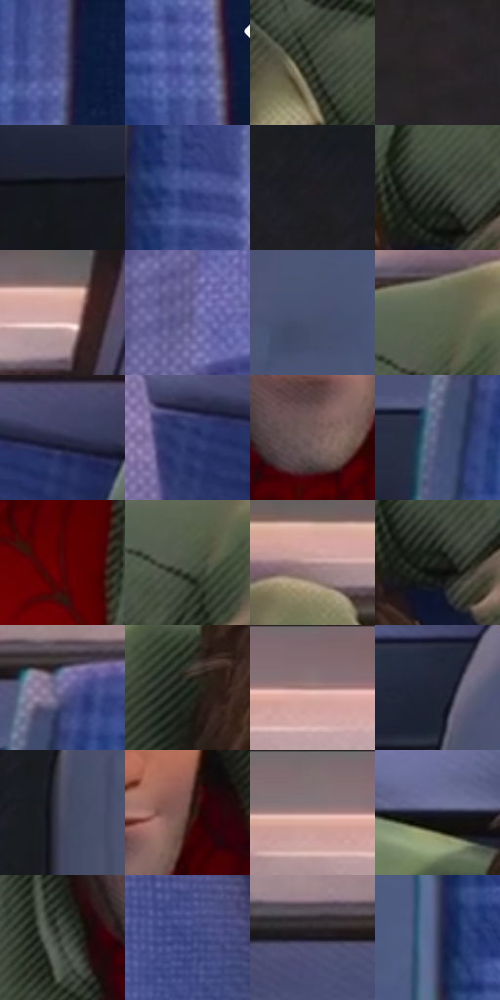

# 电影参考 420

- 状态：常规／活跃；来源世界：miles-home。
- 视角：high-angle；景别：medium；场景：vehicle。
- 时段：daylight-time-unspecified（外观依据，中置信度；具体时间／晨昏未知）；光照：warm-day。
- 材质候选：skin, hair, fabric, plastic, glass（帧级，不是像素分割）。
- 明暗组：dark；L* P5/P50/P95：9.44346 / 32.63151 / 62.66561。
- 资格门禁：无附加门禁。
- 原截图 SHA-256：`603d1dec62b51a0bda79d0d63d39a9754a1f6b078152376e30dd099c106009cf`；尺寸：2880 × 1200。
- sRGB 像素 SHA-256：`67d48180bfe753300117959f8a1109f2982a71e1d311300dc8d296ad2777a18a`。

## 观察与迁移

车厢柔暖人像与冷座椅纹理，窗外退后而不抹平空间。

420  /  静态材质：绿色衣物方向排线、蓝座椅织纹  /  织纹、排线、窄分色分别看

本公开版保存32个128×128原像素色卡上下文；图集格子并非原场景相邻位置。原rect、图集tile和像素SHA见 `data/palette-crops.json`。上下文不足时不得批准替色，不能以小样推断完整构图。

## 实测色卡

颜色比例分母为保留采样像素，不是材料面积；全部 32 色参与全库匹配。表内四舍五入仅用于阅读，原精度在 JSON。

| ID | HEX | Lab | 原图 xy | 像素数 | 比例 | 明度角色 |
| --- | --- | --- | --- | ---: | ---: | --- |
| 420-S01 | #545989 | [39.301459, 10.655408, -27.337389] | [2808, 888] | 11255 | 5.842262% | shadow |
| 420-S02 | #5563A7 | [43.717914, 13.875866, -38.320239] | [2776, 636] | 10698 | 5.553133% | midtone |
| 420-S03 | #33382C | [22.702472, -4.801301, 6.804346] | [1736, 676] | 10471 | 5.435302% | shadow |
| 420-S04 | #2C2528 | [15.549302, 3.938641, -0.774692] | [2164, 996] | 10041 | 5.212097% | deep-shadow |
| 420-S05 | #191A21 | [9.44346, 1.500828, -4.98696] | [152, 384] | 9569 | 4.967090% | deep-shadow |
| 420-S06 | #3E4C8C | [34.160743, 14.213977, -37.395527] | [2720, 324] | 9105 | 4.726236% | shadow |
| 420-S07 | #201E22 | [11.628393, 1.958353, -2.378438] | [2096, 596] | 8354 | 4.336406% | deep-shadow |
| 420-S08 | #3C4238 | [27.137207, -4.715761, 5.254387] | [1628, 316] | 8086 | 4.197292% | shadow |
| 420-S09 | #D2A7A3 | [72.218677, 15.156485, 8.084688] | [1484, 92] | 7452 | 3.868195% | light |
| 420-S10 | #646090 | [42.895926, 13.123589, -25.852834] | [676, 1056] | 7321 | 3.800195% | midtone |
| 420-S11 | #4A5171 | [35.068355, 5.610352, -19.230952] | [2444, 388] | 7140 | 3.706241% | shadow |
| 420-S12 | #5C6350 | [40.861396, -6.533951, 9.905126] | [1736, 176] | 6730 | 3.493418% | midtone |
| 420-S13 | #272C4A | [18.91537, 7.040987, -19.331102] | [812, 244] | 6656 | 3.455006% | deep-shadow |
| 420-S14 | #2E3B70 | [26.38473, 12.030408, -32.398046] | [716, 268] | 6613 | 3.432686% | shadow |
| 420-S15 | #745D5B | [41.685116, 9.005836, 4.690734] | [1484, 788] | 6557 | 3.403617% | midtone |
| 420-S16 | #50577A | [37.710353, 6.313371, -20.674973] | [260, 288] | 6180 | 3.207923% | shadow |
| 420-S17 | #4F0807 | [14.689521, 31.653179, 19.862795] | [1592, 940] | 5387 | 2.796292% | deep-shadow |
| 420-S18 | #4A5445 | [34.449421, -7.192035, 7.460998] | [1728, 232] | 5242 | 2.721025% | shadow |
| 420-S19 | #B08E8E | [62.109078, 12.81597, 4.866797] | [1836, 108] | 5230 | 2.714796% | light |
| 420-S20 | #1C1E19 | [10.889665, -2.172178, 3.113693] | [1636, 352] | 5205 | 2.701819% | deep-shadow |
| 420-S21 | #746F9F | [48.988365, 12.962128, -25.185624] | [304, 196] | 5191 | 2.694552% | midtone |
| 420-S22 | #262D22 | [17.480242, -5.668652, 6.12126] | [1300, 388] | 4925 | 2.556476% | deep-shadow |
| 420-S23 | #9D807D | [56.175799, 10.639915, 5.829237] | [1072, 60] | 4202 | 2.181180% | midtone |
| 420-S24 | #202435 | [14.545113, 3.294339, -11.652899] | [2312, 312] | 3859 | 2.003135% | deep-shadow |
| 420-S25 | #494C63 | [32.888637, 4.524824, -13.802042] | [2308, 476] | 3665 | 1.902433% | shadow |
| 420-S26 | #5C403A | [30.029756, 11.287729, 8.521089] | [1564, 704] | 3594 | 1.865579% | shadow |
| 420-S27 | #7D7071 | [48.437038, 5.24145, 1.293658] | [920, 24] | 3489 | 1.811075% | midtone |
| 420-S28 | #191B2E | [10.466591, 5.057245, -13.015835] | [1264, 264] | 2902 | 1.506374% | deep-shadow |
| 420-S29 | #424941 | [30.169145, -4.639922, 3.823957] | [1348, 776] | 2395 | 1.243200% | shadow |
| 420-S30 | #4B568F | [38.081645, 11.913208, -32.940546] | [788, 636] | 1857 | 0.963934% | shadow |
| 420-S31 | #16131D | [6.549039, 3.94671, -6.367509] | [44, 184] | 1856 | 0.963415% | deep-shadow |
| 420-S32 | #39405B | [27.550269, 4.59816, -17.008448] | [2656, 1004] | 1421 | 0.737615% | shadow |

## 色阶与空间分布

- 采样 ROI：`[0.01, 0.02, 0.98, 0.94]`；步长：4；样本数：192648。
- 排除区：`[]`。
- 深暗、暗、中、亮、高光五段计数：`[56325, 83395, 41595, 11093, 240]`。
- RGB 各 256 箱、L* 100 箱、13×5 色相明度表和 3×3 空间统计全部保存在 [总数据](../film-library.json)。
- [可视化档案](../../references/library.html)按需绘制直方图，不存 2,094 张重复图表图片。

## 纹理特征占比

**这是分块图像特征的面积占比，不是波点／排线／丝网／错版的精确语义覆盖率。** 窗格、发丝、织物也会产生方向或周期特征。
原图 ROI 像素 3084576；已测块覆盖 3084576（100.0000%）；未测 0。

| 特征 | 块覆盖像素 | 占已测面积 | 阈值敏感范围 |
| --- | ---: | ---: | --- |
| low-contrast | 342016 | 11.0879% | 8.9633% ~ 11.9511% |
| directional-structure | 1309184 | 42.4429% | 29.4544% ~ 54.5351% |
| periodic-structure | 1400608 | 45.4068% | 36.5016% ~ 54.8764% |
| mixed-detail | 32768 | 1.0623% | 0.0000% ~ 3.7181% |

阈值敏感范围不是统计置信区间。逐块坐标、尺度、对比、方向一致性、频谱集中度、频率与角度见 [全量特征记录](../texture-features.jsonl)，以帧号定位。
四种印刷层的真实像素覆盖仍标为 `null`，不能填 0，也不能拿上表代替。不得据这些代理测量删除唯一证据。

[测量方法与保留策略](../../references/library-retention.md) · [分类索引](../archive/README.md)
