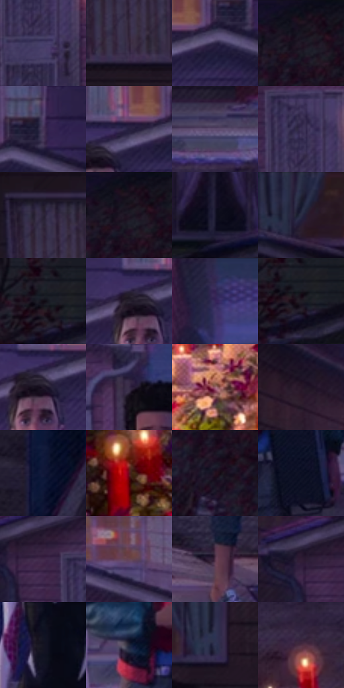

# 电影参考 421

- 状态：常规／活跃；来源世界：miles-home。
- 视角：near-level；景别：environment-wide；场景：street。
- 时段：twilight-appearance（外观依据，中置信度；具体时间／晨昏未知）；光照：dusk。
- 材质候选：skin, hair, fabric, wood, glass, metal, foliage, sky（帧级，不是像素分割）。
- 明暗组：very-dark；L* P5/P50/P95：4.75811 / 15.60811 / 36.14932。
- 资格门禁：无附加门禁。
- 原截图 SHA-256：`df82a7b73b85cbab154d417c15dc56b8dbcbbd4225468b1af2378aae45075b42`；尺寸：2880 × 1206。
- sRGB 像素 SHA-256：`366eeb42cee6154abce2cd3e276e1df5b13532dcd609fcefbefc53189a2d7a34`。

## 观察与迁移

住宅蓝暮、暖门灯与近脸层次，远楼人群可低对比柔化。

421  /  暮色街景：冷建筑、暖烛光、前方人物  /  不把所有暖光当太阳眩光

本公开版保存32个128×128原像素色卡上下文；图集格子并非原场景相邻位置。原rect、图集tile和像素SHA见 `data/palette-crops.json`。上下文不足时不得批准替色，不能以小样推断完整构图。

## 实测色卡

颜色比例分母为保留采样像素，不是材料面积；全部 32 色参与全库匹配。表内四舍五入仅用于阅读，原精度在 JSON。

| ID | HEX | Lab | 原图 xy | 像素数 | 比例 | 明度角色 |
| --- | --- | --- | --- | ---: | ---: | --- |
| 421-S01 | #453E69 | [28.721241, 14.046199, -24.10924] | [772, 380] | 9846 | 5.092425% | shadow |
| 421-S02 | #34263C | [17.656825, 11.608826, -11.582849] | [92, 376] | 9057 | 4.684348% | deep-shadow |
| 421-S03 | #2C2545 | [16.932344, 11.994698, -19.005348] | [1940, 116] | 8989 | 4.649178% | deep-shadow |
| 421-S04 | #1B1622 | [8.32681, 5.701607, -7.41755] | [2340, 52] | 8038 | 4.157314% | deep-shadow |
| 421-S05 | #443356 | [24.539848, 15.641526, -18.337031] | [1992, 68] | 7976 | 4.125247% | shadow |
| 421-S06 | #261F3F | [14.121353, 12.362753, -19.321956] | [1872, 108] | 7842 | 4.055941% | deep-shadow |
| 421-S07 | #5F4D70 | [35.811433, 15.03185, -17.302885] | [780, 664] | 7449 | 3.852679% | shadow |
| 421-S08 | #3A3055 | [22.5463, 13.940339, -20.874971] | [760, 300] | 7330 | 3.791131% | shadow |
| 421-S09 | #2C2438 | [15.915573, 8.777405, -11.551877] | [68, 280] | 7203 | 3.725446% | deep-shadow |
| 421-S10 | #180F1C | [5.597592, 6.884732, -6.997304] | [2348, 28] | 6834 | 3.534596% | deep-shadow |
| 421-S11 | #1A182E | [9.562183, 7.701003, -14.428194] | [2780, 72] | 6786 | 3.509770% | deep-shadow |
| 421-S12 | #211C36 | [12.091009, 9.884503, -16.19058] | [52, 48] | 6531 | 3.377882% | deep-shadow |
| 421-S13 | #0F0A13 | [3.302972, 3.093058, -3.805706] | [2532, 148] | 6428 | 3.324610% | deep-shadow |
| 421-S14 | #27202E | [13.600676, 6.816847, -8.050105] | [1808, 144] | 6425 | 3.323058% | deep-shadow |
| 421-S15 | #322850 | [19.118327, 15.316683, -22.998765] | [1384, 36] | 6375 | 3.297198% | deep-shadow |
| 421-S16 | #211D26 | [11.566125, 4.220001, -5.396612] | [2552, 168] | 6315 | 3.266165% | deep-shadow |
| 421-S17 | #201729 | [9.64057, 9.121765, -10.569775] | [1836, 152] | 6028 | 3.117727% | deep-shadow |
| 421-S18 | #372A47 | [19.733127, 12.963616, -15.898504] | [1332, 284] | 5648 | 2.921188% | deep-shadow |
| 421-S19 | #9E6571 | [49.216082, 24.654365, 2.872121] | [584, 1052] | 5330 | 2.756716% | midtone |
| 421-S20 | #281728 | [10.683365, 12.17173, -8.130709] | [608, 88] | 5259 | 2.719994% | deep-shadow |
| 421-S21 | #111737 | [9.055304, 9.291841, -21.833048] | [2660, 812] | 5197 | 2.687927% | deep-shadow |
| 421-S22 | #60131E | [20.231322, 34.751066, 14.127353] | [396, 1056] | 5146 | 2.661550% | shadow |
| 421-S23 | #25111F | [8.068119, 13.029447, -5.409032] | [2324, 160] | 4903 | 2.535868% | deep-shadow |
| 421-S24 | #0C0F22 | [4.834969, 4.191162, -12.901665] | [1480, 696] | 4626 | 2.392602% | deep-shadow |
| 421-S25 | #3F2849 | [20.264597, 17.764044, -16.355156] | [680, 252] | 4611 | 2.384844% | shadow |
| 421-S26 | #674353 | [32.968785, 18.183168, -3.176066] | [1048, 84] | 4604 | 2.381223% | shadow |
| 421-S27 | #58374D | [27.691024, 18.530987, -7.362999] | [1868, 1032] | 4503 | 2.328985% | shadow |
| 421-S28 | #301D36 | [14.250652, 14.731964, -12.676196] | [636, 236] | 4475 | 2.314504% | deep-shadow |
| 421-S29 | #141421 | [6.854308, 3.761971, -8.98469] | [1156, 572] | 4104 | 2.122620% | deep-shadow |
| 421-S30 | #212639 | [15.512785, 3.541908, -12.965285] | [1340, 636] | 3548 | 1.835052% | deep-shadow |
| 421-S31 | #2E3351 | [22.096916, 6.686363, -19.001496] | [232, 84] | 3076 | 1.590930% | shadow |
| 421-S32 | #4F2E42 | [23.704076, 18.488626, -6.158691] | [748, 828] | 2864 | 1.481282% | shadow |

## 色阶与空间分布

- 采样 ROI：`[0.01, 0.02, 0.98, 0.94]`；步长：4；样本数：193346。
- 排除区：`[]`。
- 深暗、暗、中、亮、高光五段计数：`[130901, 56717, 4854, 763, 111]`。
- RGB 各 256 箱、L* 100 箱、13×5 色相明度表和 3×3 空间统计全部保存在 [总数据](../film-library.json)。
- [可视化档案](../../references/library.html)按需绘制直方图，不存 2,094 张重复图表图片。

## 纹理特征占比

**这是分块图像特征的面积占比，不是波点／排线／丝网／错版的精确语义覆盖率。** 窗格、发丝、织物也会产生方向或周期特征。
原图 ROI 像素 3098546；已测块覆盖 3098546（100.0000%）；未测 0。

| 特征 | 块覆盖像素 | 占已测面积 | 阈值敏感范围 |
| --- | ---: | ---: | --- |
| low-contrast | 16384 | 0.5288% | 0.0000% ~ 0.5288% |
| directional-structure | 319360 | 10.3068% | 0.5288% ~ 22.9062% |
| periodic-structure | 2609970 | 84.2321% | 76.2139% ~ 89.9617% |
| mixed-detail | 152832 | 4.9324% | 0.8799% ~ 8.9807% |

阈值敏感范围不是统计置信区间。逐块坐标、尺度、对比、方向一致性、频谱集中度、频率与角度见 [全量特征记录](../texture-features.jsonl)，以帧号定位。
四种印刷层的真实像素覆盖仍标为 `null`，不能填 0，也不能拿上表代替。不得据这些代理测量删除唯一证据。

[测量方法与保留策略](../../references/library-retention.md) · [分类索引](../archive/README.md)
