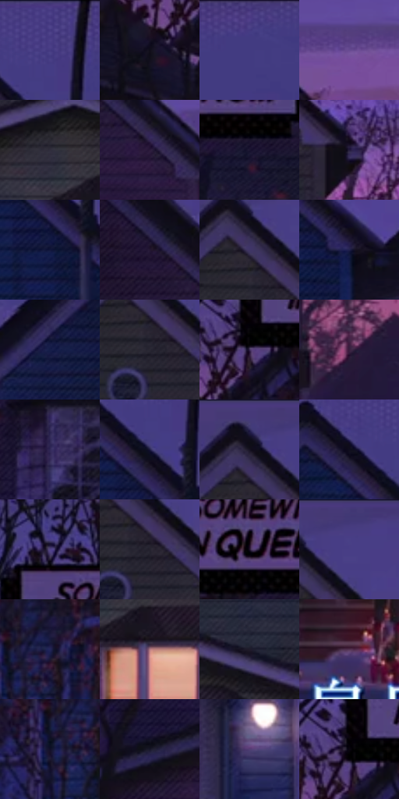

# 电影参考 422

- 状态：常规／活跃；来源世界：miles-home。
- 视角：near-level；景别：environment-wide；场景：street。
- 时段：twilight-appearance（外观依据，中置信度；具体时间／晨昏未知）；光照：dusk。
- 材质候选：skin, hair, fabric, wood, glass, metal, foliage, sky（帧级，不是像素分割）。
- 明暗组：very-dark；L* P5/P50/P95：4.80453 / 15.07272 / 36.22073。
- 资格门禁：无附加门禁。
- 原截图 SHA-256：`25754144632ab2d25ab44e50530ee6627b21b5659e892d4b538e522275e5b182`；尺寸：2880 × 1204。
- sRGB 像素 SHA-256：`08c1333968f9880d702ecfb34f04ea89b9e35ae2d4de8079afb5e675589df6dc`。

## 观察与迁移

住宅蓝暮、暖门灯与近脸层次，远楼人群可低对比柔化。

422  /  建筑主景：三栋房屋可清楚，暖窗为焦点  /  建筑是主体时不默认全部糊掉；不移植字幕

本公开版保存32个128×128原像素色卡上下文；图集格子并非原场景相邻位置。原rect、图集tile和像素SHA见 `data/palette-crops.json`。上下文不足时不得批准替色，不能以小样推断完整构图。

## 实测色卡

颜色比例分母为保留采样像素，不是材料面积；全部 32 色参与全库匹配。表内四舍五入仅用于阅读，原精度在 JSON。

| ID | HEX | Lab | 原图 xy | 像素数 | 比例 | 明度角色 |
| --- | --- | --- | --- | ---: | ---: | --- |
| 422-S01 | #4A3F86 | [31.188001, 23.678875, -38.401628] | [2548, 32] | 11682 | 6.063909% | shadow |
| 422-S02 | #14111A | [5.638318, 3.361462, -5.423109] | [32, 384] | 9079 | 4.712740% | deep-shadow |
| 422-S03 | #423B83 | [29.220879, 23.342668, -39.735403] | [2768, 44] | 8618 | 4.473444% | shadow |
| 422-S04 | #664A91 | [37.419988, 27.604138, -35.047322] | [928, 324] | 7872 | 4.086209% | shadow |
| 422-S05 | #312D3D | [19.501651, 5.81242, -9.473526] | [1400, 640] | 7550 | 3.919065% | deep-shadow |
| 422-S06 | #2A1A3B | [12.902442, 16.020707, -18.401362] | [752, 344] | 7327 | 3.803310% | deep-shadow |
| 422-S07 | #1B1531 | [8.916628, 11.383321, -17.641142] | [432, 308] | 7213 | 3.744134% | deep-shadow |
| 422-S08 | #231C3C | [12.696849, 12.567529, -19.489168] | [1804, 388] | 7133 | 3.702608% | deep-shadow |
| 422-S09 | #11173C | [9.466143, 11.405129, -24.759702] | [2532, 232] | 7072 | 3.670944% | deep-shadow |
| 422-S10 | #241732 | [10.690534, 13.351513, -15.489574] | [648, 256] | 6947 | 3.606059% | deep-shadow |
| 422-S11 | #3F3566 | [25.448818, 17.286122, -27.385909] | [1460, 104] | 6747 | 3.502242% | shadow |
| 422-S12 | #21214C | [15.129874, 14.02088, -26.745161] | [2748, 380] | 6646 | 3.449815% | deep-shadow |
| 422-S13 | #151D49 | [12.728317, 13.066566, -28.601399] | [2256, 240] | 6476 | 3.361571% | deep-shadow |
| 422-S14 | #292834 | [16.684374, 3.591431, -7.593591] | [1472, 164] | 6360 | 3.301358% | deep-shadow |
| 422-S15 | #382A50 | [20.344978, 15.890542, -21.016432] | [144, 296] | 6224 | 3.230763% | shadow |
| 422-S16 | #3A1E3E | [16.384963, 19.791203, -14.884213] | [996, 564] | 6213 | 3.225053% | deep-shadow |
| 422-S17 | #302857 | [19.366065, 16.976619, -27.311967] | [384, 440] | 6186 | 3.211038% | deep-shadow |
| 422-S18 | #1D1B40 | [12.057981, 12.917356, -23.368661] | [2528, 140] | 6118 | 3.175740% | deep-shadow |
| 422-S19 | #161222 | [6.491617, 6.257504, -10.28628] | [1448, 64] | 5521 | 2.865849% | deep-shadow |
| 422-S20 | #100D1D | [4.396303, 4.781059, -9.65473] | [2464, 92] | 5486 | 2.847681% | deep-shadow |
| 422-S21 | #514286 | [32.62736, 23.599951, -36.06254] | [196, 124] | 5462 | 2.835223% | shadow |
| 422-S22 | #24222E | [13.922219, 4.116207, -7.589485] | [1492, 160] | 5005 | 2.598003% | deep-shadow |
| 422-S23 | #1D1227 | [7.590425, 11.040507, -12.304654] | [284, 236] | 4848 | 2.516507% | deep-shadow |
| 422-S24 | #443A7B | [28.602747, 21.927102, -35.711474] | [1520, 32] | 4734 | 2.457332% | shadow |
| 422-S25 | #222559 | [17.386675, 16.249401, -31.895685] | [2764, 772] | 4616 | 2.396080% | deep-shadow |
| 422-S26 | #B27A84 | [57.125716, 23.2749, 3.43778] | [1472, 728] | 4562 | 2.368049% | midtone |
| 422-S27 | #1F1B2B | [10.91812, 6.331591, -10.072992] | [1652, 624] | 4553 | 2.363378% | deep-shadow |
| 422-S28 | #523250 | [25.726714, 19.978973, -12.399934] | [1264, 1100] | 4037 | 2.095532% | shadow |
| 422-S29 | #100F27 | [5.403899, 7.454043, -15.82116] | [2712, 812] | 3702 | 1.921639% | deep-shadow |
| 422-S30 | #171628 | [8.21039, 6.044391, -12.134539] | [196, 636] | 3551 | 1.843258% | deep-shadow |
| 422-S31 | #523D73 | [30.324989, 21.63319, -27.845103] | [2132, 820] | 2670 | 1.385947% | shadow |
| 422-S32 | #0A060F | [2.070963, 2.399923, -3.316394] | [136, 276] | 2438 | 1.265521% | deep-shadow |

## 色阶与空间分布

- 采样 ROI：`[0.01, 0.02, 0.98, 0.94]`；步长：4；样本数：192648。
- 排除区：`[]`。
- 深暗、暗、中、亮、高光五段计数：`[128666, 58340, 3678, 1850, 114]`。
- RGB 各 256 箱、L* 100 箱、13×5 色相明度表和 3×3 空间统计全部保存在 [总数据](../film-library.json)。
- [可视化档案](../../references/library.html)按需绘制直方图，不存 2,094 张重复图表图片。

## 纹理特征占比

**这是分块图像特征的面积占比，不是波点／排线／丝网／错版的精确语义覆盖率。** 窗格、发丝、织物也会产生方向或周期特征。
原图 ROI 像素 3092958；已测块覆盖 3092958（100.0000%）；未测 0。

| 特征 | 块覆盖像素 | 占已测面积 | 阈值敏感范围 |
| --- | ---: | ---: | --- |
| low-contrast | 174592 | 5.6448% | 5.1151% ~ 6.7043% |
| directional-structure | 484864 | 15.6764% | 7.0436% ~ 28.5469% |
| periodic-structure | 2047710 | 66.2056% | 61.2560% ~ 66.4508% |
| mixed-detail | 385792 | 12.4732% | 5.0820% ~ 19.8013% |

阈值敏感范围不是统计置信区间。逐块坐标、尺度、对比、方向一致性、频谱集中度、频率与角度见 [全量特征记录](../texture-features.jsonl)，以帧号定位。
四种印刷层的真实像素覆盖仍标为 `null`，不能填 0，也不能拿上表代替。不得据这些代理测量删除唯一证据。

[测量方法与保留策略](../../references/library-retention.md) · [分类索引](../archive/README.md)
