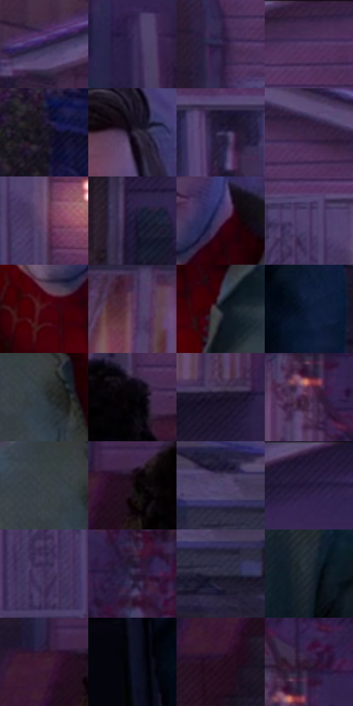

# 电影参考 423

- 状态：常规／活跃；来源世界：miles-home。
- 视角：near-level；景别：medium；场景：street。
- 时段：twilight-appearance（外观依据，中置信度；具体时间／晨昏未知）；光照：dusk。
- 材质候选：skin, hair, fabric, wood, glass, metal, foliage, sky（帧级，不是像素分割）。
- 明暗组：very-dark；L* P5/P50/P95：4.63024 / 16.74967 / 31.83243。
- 资格门禁：无附加门禁。
- 原截图 SHA-256：`8b41ca63d9da834319806ff169c8bdb0ce82ba7cfd3065f1e97decb508c9d140`；尺寸：2880 × 1214。
- sRGB 像素 SHA-256：`70f0a5ddeeb69bdadac0888d38937b0e67c10ae4bb15feb5090fa364a08943ef`。

## 观察与迁移

住宅蓝暮、暖门灯与近脸层次，远楼人群可低对比柔化。

423  /  人物中景：脸衣清楚、后方门窗较弱  /  不让背景排线与面部等强

本公开版保存32个128×128原像素色卡上下文；图集格子并非原场景相邻位置。原rect、图集tile和像素SHA见 `data/palette-crops.json`。上下文不足时不得批准替色，不能以小样推断完整构图。

## 实测色卡

颜色比例分母为保留采样像素，不是材料面积；全部 32 色参与全库匹配。表内四舍五入仅用于阅读，原精度在 JSON。

| ID | HEX | Lab | 原图 xy | 像素数 | 比例 | 明度角色 |
| --- | --- | --- | --- | ---: | ---: | --- |
| 423-S01 | #271D41 | [13.777949, 14.783393, -21.261153] | [64, 116] | 9702 | 4.981976% | deep-shadow |
| 423-S02 | #322650 | [18.555213, 16.701208, -23.892772] | [1740, 500] | 9693 | 4.977355% | deep-shadow |
| 423-S03 | #302045 | [15.957943, 16.842963, -20.514822] | [104, 304] | 8786 | 4.511610% | deep-shadow |
| 423-S04 | #452A51 | [21.999556, 20.600064, -18.976392] | [576, 40] | 8126 | 4.172700% | shadow |
| 423-S05 | #1F1A27 | [10.383402, 5.870426, -7.954226] | [2652, 752] | 8116 | 4.167565% | deep-shadow |
| 423-S06 | #282032 | [13.910982, 8.351901, -10.431247] | [1516, 216] | 7941 | 4.077703% | deep-shadow |
| 423-S07 | #3F355C | [24.876055, 14.279119, -21.789006] | [792, 276] | 7716 | 3.962165% | shadow |
| 423-S08 | #3D2647 | [19.363592, 17.857057, -16.418902] | [1104, 148] | 7484 | 3.843033% | deep-shadow |
| 423-S09 | #6D4D71 | [37.392682, 20.277194, -15.366076] | [408, 288] | 7324 | 3.760873% | shadow |
| 423-S10 | #1E1738 | [10.366192, 13.293666, -20.383749] | [2032, 364] | 7303 | 3.750090% | deep-shadow |
| 423-S11 | #4A345D | [25.868771, 18.918387, -20.799576] | [1520, 492] | 7027 | 3.608364% | shadow |
| 423-S12 | #4F3C69 | [29.19404, 18.597186, -23.295317] | [332, 220] | 6906 | 3.546230% | shadow |
| 423-S13 | #470312 | [12.278888, 31.429992, 11.051487] | [1424, 580] | 6803 | 3.493340% | deep-shadow |
| 423-S14 | #59355B | [27.914501, 23.063401, -16.170011] | [2448, 288] | 6748 | 3.465097% | shadow |
| 423-S15 | #121A22 | [8.847602, -1.029614, -6.699889] | [1564, 612] | 6153 | 3.159565% | deep-shadow |
| 423-S16 | #0F1937 | [9.581619, 7.247888, -20.995849] | [832, 1128] | 6012 | 3.087161% | deep-shadow |
| 423-S17 | #31383D | [23.060912, -1.658853, -4.105867] | [1304, 668] | 5827 | 2.992164% | shadow |
| 423-S18 | #050408 | [1.23415, 0.817605, -1.421424] | [412, 548] | 5788 | 2.972137% | deep-shadow |
| 423-S19 | #191328 | [7.457545, 9.05605, -13.299059] | [2572, 504] | 5494 | 2.821169% | deep-shadow |
| 423-S20 | #502D4F | [24.151521, 22.158939, -14.180848] | [2596, 292] | 5430 | 2.788305% | shadow |
| 423-S21 | #394047 | [26.710453, -1.126316, -5.232118] | [1252, 644] | 5369 | 2.756981% | shadow |
| 423-S22 | #180A13 | [4.13999, 6.84686, -2.483066] | [160, 592] | 5243 | 2.692280% | deep-shadow |
| 423-S23 | #4B4469 | [30.996116, 12.058538, -20.510661] | [2236, 936] | 5070 | 2.603445% | shadow |
| 423-S24 | #261939 | [11.975678, 14.761547, -18.479615] | [2128, 44] | 4926 | 2.529501% | deep-shadow |
| 423-S25 | #3C2D55 | [21.919933, 16.64036, -21.845727] | [292, 340] | 4605 | 2.364667% | shadow |
| 423-S26 | #322844 | [18.422182, 11.675666, -15.935668] | [2756, 312] | 4349 | 2.233211% | deep-shadow |
| 423-S27 | #2A2A3C | [17.802184, 4.919504, -11.449892] | [2276, 1004] | 4211 | 2.162348% | deep-shadow |
| 423-S28 | #1E2730 | [15.171189, -1.226066, -7.165609] | [1760, 768] | 4140 | 2.125890% | deep-shadow |
| 423-S29 | #3D1C31 | [15.719313, 19.411716, -6.689677] | [96, 588] | 3311 | 1.700198% | deep-shadow |
| 423-S30 | #0F1229 | [6.270716, 6.290669, -15.979303] | [716, 1132] | 3277 | 1.682739% | deep-shadow |
| 423-S31 | #290E20 | [8.038124, 16.940978, -6.153074] | [68, 700] | 3071 | 1.576958% | deep-shadow |
| 423-S32 | #2F1837 | [12.819389, 18.021042, -15.636494] | [2620, 216] | 2791 | 1.433178% | deep-shadow |

## 色阶与空间分布

- 采样 ROI：`[0.01, 0.02, 0.98, 0.94]`；步长：4；样本数：194742。
- 排除区：`[]`。
- 深暗、暗、中、亮、高光五段计数：`[120317, 73003, 1372, 21, 29]`。
- RGB 各 256 箱、L* 100 箱、13×5 色相明度表和 3×3 空间统计全部保存在 [总数据](../film-library.json)。
- [可视化档案](../../references/library.html)按需绘制直方图，不存 2,094 张重复图表图片。

## 纹理特征占比

**这是分块图像特征的面积占比，不是波点／排线／丝网／错版的精确语义覆盖率。** 窗格、发丝、织物也会产生方向或周期特征。
原图 ROI 像素 3120898；已测块覆盖 3120898（100.0000%）；未测 0。

| 特征 | 块覆盖像素 | 占已测面积 | 阈值敏感范围 |
| --- | ---: | ---: | --- |
| low-contrast | 32768 | 1.0500% | 0.0000% ~ 1.9564% |
| directional-structure | 609152 | 19.5185% | 6.1562% ~ 36.4121% |
| periodic-structure | 2401538 | 76.9502% | 63.5879% ~ 83.1064% |
| mixed-detail | 77440 | 2.4813% | 0.0000% ~ 8.7811% |

阈值敏感范围不是统计置信区间。逐块坐标、尺度、对比、方向一致性、频谱集中度、频率与角度见 [全量特征记录](../texture-features.jsonl)，以帧号定位。
四种印刷层的真实像素覆盖仍标为 `null`，不能填 0，也不能拿上表代替。不得据这些代理测量删除唯一证据。

[测量方法与保留策略](../../references/library-retention.md) · [分类索引](../archive/README.md)
