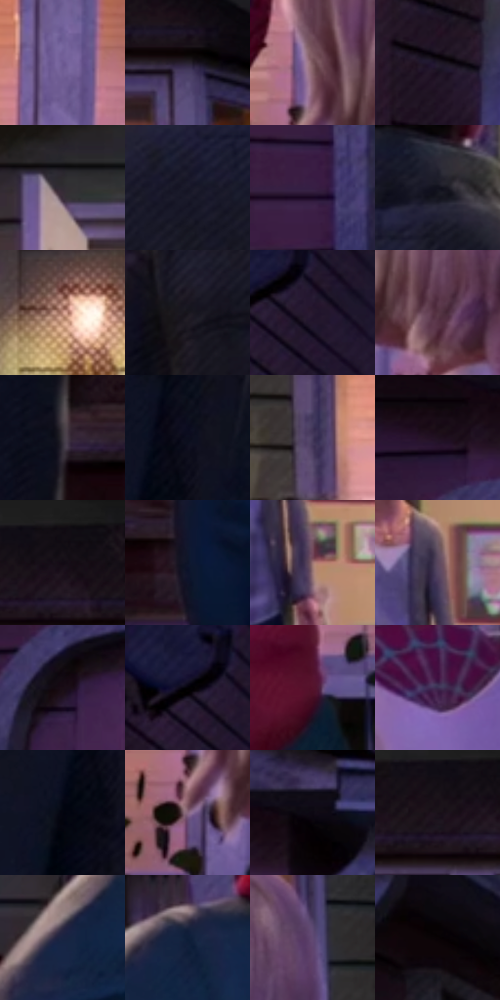

# 电影参考 424

- 状态：常规／活跃；来源世界：miles-home。
- 视角：near-level；景别：medium；场景：street。
- 时段：twilight-appearance（外观依据，中置信度；具体时间／晨昏未知）；光照：dusk。
- 材质候选：skin, hair, fabric, wood, glass, metal, foliage, sky（帧级，不是像素分割）。
- 明暗组：very-dark；L* P5/P50/P95：1.21195 / 13.57087 / 54.7225。
- 资格门禁：无附加门禁。
- 原截图 SHA-256：`d3a2a30a1b815cb04a80df2141b95d6cdeae0cf308ee45fa85f8afcef924c752`；尺寸：2880 × 1202。
- sRGB 像素 SHA-256：`9f692206cf33ed9276c33b9dc25a6abb84936ece5cdfd168e9dd0bcd899bbc69`。

## 观察与迁移

住宅蓝暮、暖门灯与近脸层次，远楼人群可低对比柔化。

424  /  门口混光：暖室内、墙灯亮区与暗前景  /  墙面光斑不同于镜头鬼影

本公开版保存32个128×128原像素色卡上下文；图集格子并非原场景相邻位置。原rect、图集tile和像素SHA见 `data/palette-crops.json`。上下文不足时不得批准替色，不能以小样推断完整构图。

## 实测色卡

颜色比例分母为保留采样像素，不是材料面积；全部 32 色参与全库匹配。表内四舍五入仅用于阅读，原精度在 JSON。

| ID | HEX | Lab | 原图 xy | 像素数 | 比例 | 明度角色 |
| --- | --- | --- | --- | ---: | ---: | --- |
| 424-S01 | #6C5992 | [41.857355, 20.476039, -28.620097] | [2496, 308] | 9179 | 4.764648% | midtone |
| 424-S02 | #28212F | [14.082392, 6.787817, -8.021876] | [2704, 136] | 8665 | 4.497841% | deep-shadow |
| 424-S03 | #77555A | [39.844906, 14.918942, 2.701488] | [2468, 568] | 7984 | 4.144346% | shadow |
| 424-S04 | #201928 | [10.225226, 7.332369, -8.925992] | [308, 448] | 7847 | 4.073232% | deep-shadow |
| 424-S05 | #312C34 | [18.809777, 4.140493, -4.308991] | [1352, 132] | 7767 | 4.031705% | deep-shadow |
| 424-S06 | #181727 | [8.597339, 5.305291, -10.776621] | [904, 532] | 7459 | 3.871828% | deep-shadow |
| 424-S07 | #372042 | [16.692851, 18.406415, -17.2176] | [32, 476] | 7255 | 3.765936% | deep-shadow |
| 424-S08 | #11111D | [5.498844, 3.060247, -7.992208] | [1020, 400] | 7134 | 3.703127% | deep-shadow |
| 424-S09 | #C38F7F | [63.983554, 17.540619, 16.263391] | [1176, 240] | 7071 | 3.670425% | light |
| 424-S10 | #18161D | [7.738611, 2.879872, -4.556426] | [708, 660] | 6620 | 3.436319% | deep-shadow |
| 424-S11 | #25172E | [10.582254, 12.552099, -12.734151] | [684, 104] | 6595 | 3.423342% | deep-shadow |
| 424-S12 | #573544 | [26.706693, 17.700348, -2.901705] | [2568, 644] | 6503 | 3.375587% | shadow |
| 424-S13 | #3B353D | [23.043194, 4.443819, -4.031472] | [1324, 1056] | 6032 | 3.131099% | shadow |
| 424-S14 | #0C0D1D | [4.107184, 3.48444, -10.117708] | [1228, 764] | 5899 | 3.062061% | deep-shadow |
| 424-S15 | #453A5C | [26.916185, 12.973235, -18.555304] | [2060, 288] | 5832 | 3.027283% | shadow |
| 424-S16 | #1F1020 | [6.921066, 11.164861, -8.003654] | [164, 148] | 5767 | 2.993543% | deep-shadow |
| 424-S17 | #100C12 | [3.764729, 2.383156, -2.500447] | [2512, 28] | 5636 | 2.925543% | deep-shadow |
| 424-S18 | #0D1427 | [6.614792, 3.529751, -13.945814] | [1672, 1104] | 5630 | 2.922428% | deep-shadow |
| 424-S19 | #A07776 | [54.001995, 15.887077, 6.827407] | [1560, 664] | 5568 | 2.890245% | midtone |
| 424-S20 | #59465D | [32.468385, 12.781885, -10.48906] | [1536, 540] | 5465 | 2.836780% | shadow |
| 424-S21 | #190C15 | [4.731362, 6.958597, -2.93042] | [176, 276] | 5422 | 2.814460% | deep-shadow |
| 424-S22 | #010103 | [0.313747, 0.27807, -0.756814] | [636, 80] | 5285 | 2.743345% | deep-shadow |
| 424-S23 | #55122C | [18.126713, 32.671841, 0.944867] | [2292, 768] | 5282 | 2.741788% | deep-shadow |
| 424-S24 | #3D2D52 | [21.864819, 16.12246, -19.926095] | [2664, 804] | 5216 | 2.707529% | shadow |
| 424-S25 | #03040F | [1.270646, 1.370548, -4.533999] | [1180, 836] | 5014 | 2.602674% | deep-shadow |
| 424-S26 | #896980 | [48.235545, 16.822866, -7.803641] | [2448, 672] | 4963 | 2.576201% | midtone |
| 424-S27 | #0C0812 | [2.669217, 2.73389, -4.134825] | [268, 104] | 4690 | 2.434492% | deep-shadow |
| 424-S28 | #191019 | [5.848459, 5.990425, -4.273603] | [2460, 80] | 4410 | 2.289149% | deep-shadow |
| 424-S29 | #1A2442 | [14.814612, 6.127713, -20.38453] | [1788, 844] | 4391 | 2.279287% | deep-shadow |
| 424-S30 | #0F1E38 | [11.383372, 3.792785, -18.836989] | [1916, 740] | 4082 | 2.118890% | deep-shadow |
| 424-S31 | #604972 | [34.936795, 18.383165, -19.892771] | [2816, 460] | 4056 | 2.105394% | shadow |
| 424-S32 | #090305 | [1.211947, 1.847031, -0.203917] | [392, 204] | 3929 | 2.039471% | deep-shadow |

## 色阶与空间分布

- 采样 ROI：`[0.01, 0.02, 0.98, 0.94]`；步长：4；样本数：192648。
- 排除区：`[]`。
- 深暗、暗、中、亮、高光五段计数：`[122784, 41732, 21352, 6613, 167]`。
- RGB 各 256 箱、L* 100 箱、13×5 色相明度表和 3×3 空间统计全部保存在 [总数据](../film-library.json)。
- [可视化档案](../../references/library.html)按需绘制直方图，不存 2,094 张重复图表图片。

## 纹理特征占比

**这是分块图像特征的面积占比，不是波点／排线／丝网／错版的精确语义覆盖率。** 窗格、发丝、织物也会产生方向或周期特征。
原图 ROI 像素 3087370；已测块覆盖 3087370（100.0000%）；未测 0。

| 特征 | 块覆盖像素 | 占已测面积 | 阈值敏感范围 |
| --- | ---: | ---: | --- |
| low-contrast | 172544 | 5.5887% | 2.9892% ~ 6.4552% |
| directional-structure | 811904 | 26.2976% | 13.4079% ~ 43.9592% |
| periodic-structure | 2023818 | 65.5515% | 52.5209% ~ 73.8600% |
| mixed-detail | 79104 | 2.5622% | 0.5307% ~ 6.2769% |

阈值敏感范围不是统计置信区间。逐块坐标、尺度、对比、方向一致性、频谱集中度、频率与角度见 [全量特征记录](../texture-features.jsonl)，以帧号定位。
四种印刷层的真实像素覆盖仍标为 `null`，不能填 0，也不能拿上表代替。不得据这些代理测量删除唯一证据。

[测量方法与保留策略](../../references/library-retention.md) · [分类索引](../archive/README.md)
