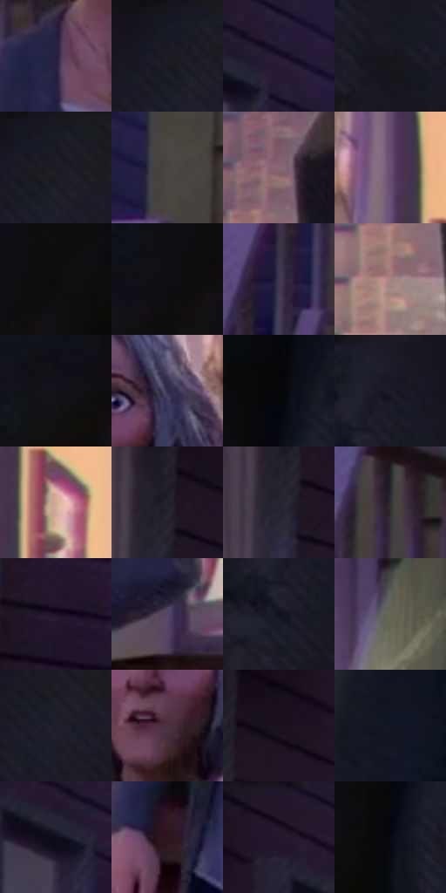

# 电影参考 425

- 状态：常规／活跃；来源世界：miles-home。
- 视角：low-angle；景别：medium；场景：street。
- 时段：twilight-appearance（外观依据，中置信度；具体时间／晨昏未知）；光照：dusk。
- 材质候选：skin, hair, fabric, wood, glass, metal, foliage, sky（帧级，不是像素分割）。
- 明暗组：very-dark；L* P5/P50/P95：3.03474 / 11.27552 / 56.77587。
- 资格门禁：无附加门禁。
- 原截图 SHA-256：`a1d907fc201ffec30297bba853913ea14a22c31f6ff46bf95e9c98e9b343d7e7`；尺寸：2880 × 1204。
- sRGB 像素 SHA-256：`fb33cbc4655617c964855fda9882d892bfa7ef1733d538d0d06e74169ff2657c`。

## 观察与迁移

住宅蓝暮、暖门灯与近脸层次，远楼人群可低对比柔化。

425  /  景深：门框、画框及桌脚彩色偏移，人物较稳  /  不据此新增画框／门框

本公开版保存32个128×128原像素色卡上下文；图集格子并非原场景相邻位置。原rect、图集tile和像素SHA见 `data/palette-crops.json`。上下文不足时不得批准替色，不能以小样推断完整构图。

## 实测色卡

颜色比例分母为保留采样像素，不是材料面积；全部 32 色参与全库匹配。表内四舍五入仅用于阅读，原精度在 JSON。

| ID | HEX | Lab | 原图 xy | 像素数 | 比例 | 明度角色 |
| --- | --- | --- | --- | ---: | ---: | --- |
| 425-S01 | #251F3E | [13.94927, 11.701509, -18.899739] | [1784, 544] | 11322 | 5.877040% | deep-shadow |
| 425-S02 | #1A1A24 | [9.686309, 2.849786, -6.845235] | [624, 48] | 11064 | 5.743117% | deep-shadow |
| 425-S03 | #1E1633 | [9.710406, 12.315606, -17.816024] | [1320, 116] | 8664 | 4.497322% | deep-shadow |
| 425-S04 | #17161D | [7.629893, 2.415653, -4.730914] | [524, 212] | 7962 | 4.132926% | deep-shadow |
| 425-S05 | #191921 | [9.088722, 2.252523, -5.52403] | [652, 44] | 7916 | 4.109049% | deep-shadow |
| 425-S06 | #49453E | [29.464371, 0.259272, 4.835404] | [1644, 300] | 7882 | 4.091400% | shadow |
| 425-S07 | #886876 | [47.551062, 15.17625, -2.855417] | [2340, 492] | 7603 | 3.946576% | midtone |
| 425-S08 | #6A4E71 | [37.308439, 18.579642, -15.525102] | [2076, 232] | 7091 | 3.680806% | shadow |
| 425-S09 | #0F0C0E | [3.578966, 1.27537, -0.556897] | [188, 264] | 6931 | 3.597753% | deep-shadow |
| 425-S10 | #100F14 | [4.537323, 1.364533, -2.642542] | [128, 288] | 6576 | 3.413480% | deep-shadow |
| 425-S11 | #403853 | [25.390379, 10.050217, -15.075571] | [1556, 724] | 6482 | 3.364686% | shadow |
| 425-S12 | #A58483 | [58.171212, 12.452944, 5.340366] | [2308, 660] | 6387 | 3.315373% | midtone |
| 425-S13 | #131218 | [5.753981, 1.812089, -3.705234] | [68, 328] | 6369 | 3.306030% | deep-shadow |
| 425-S14 | #342D4D | [20.606048, 11.574981, -18.618698] | [1940, 284] | 6357 | 3.299801% | shadow |
| 425-S15 | #070609 | [1.76271, 0.678526, -1.042934] | [312, 116] | 5924 | 3.075038% | deep-shadow |
| 425-S16 | #1D1C28 | [10.884515, 3.840815, -7.942323] | [484, 28] | 5884 | 3.054275% | deep-shadow |
| 425-S17 | #D4AA96 | [72.859373, 12.461359, 16.143426] | [2152, 352] | 5657 | 2.936444% | light |
| 425-S18 | #21212B | [13.141211, 2.720688, -6.648204] | [1028, 140] | 5503 | 2.856505% | deep-shadow |
| 425-S19 | #25252F | [15.070615, 2.659191, -6.549173] | [1012, 196] | 5459 | 2.833666% | deep-shadow |
| 425-S20 | #302E31 | [19.241721, 1.596591, -1.602818] | [1660, 456] | 5444 | 2.825879% | deep-shadow |
| 425-S21 | #1D1228 | [7.65108, 11.355281, -12.960612] | [1088, 520] | 5193 | 2.695590% | deep-shadow |
| 425-S22 | #53445E | [31.304065, 12.02256, -12.95895] | [2068, 880] | 5180 | 2.688842% | shadow |
| 425-S23 | #11111F | [5.591126, 3.708722, -9.400533] | [452, 144] | 4901 | 2.544018% | deep-shadow |
| 425-S24 | #696457 | [42.469345, -0.475138, 8.090803] | [2664, 72] | 4522 | 2.347286% | midtone |
| 425-S25 | #1D1E2A | [11.667675, 2.978536, -8.206366] | [648, 116] | 4482 | 2.326523% | deep-shadow |
| 425-S26 | #4B303D | [23.495177, 14.588401, -3.153091] | [1868, 380] | 4472 | 2.321332% | shadow |
| 425-S27 | #1B0F1C | [5.94838, 8.457926, -6.436641] | [1088, 108] | 3917 | 2.033242% | deep-shadow |
| 425-S28 | #121724 | [7.847073, 1.969223, -9.740613] | [2780, 324] | 3869 | 2.008326% | deep-shadow |
| 425-S29 | #0D0D1A | [4.046523, 2.888099, -7.835255] | [1264, 144] | 3749 | 1.946036% | deep-shadow |
| 425-S30 | #2D161F | [10.782289, 13.140111, -1.211845] | [1676, 1072] | 3622 | 1.880113% | deep-shadow |
| 425-S31 | #221629 | [9.593353, 10.674262, -10.622653] | [1188, 28] | 3183 | 1.652236% | deep-shadow |
| 425-S32 | #080912 | [2.625493, 1.257882, -4.227438] | [292, 252] | 3081 | 1.599290% | deep-shadow |

## 色阶与空间分布

- 采样 ROI：`[0.01, 0.02, 0.98, 0.94]`；步长：4；样本数：192648。
- 排除区：`[]`。
- 深暗、暗、中、亮、高光五段计数：`[131799, 36175, 16855, 7382, 437]`。
- RGB 各 256 箱、L* 100 箱、13×5 色相明度表和 3×3 空间统计全部保存在 [总数据](../film-library.json)。
- [可视化档案](../../references/library.html)按需绘制直方图，不存 2,094 张重复图表图片。

## 纹理特征占比

**这是分块图像特征的面积占比，不是波点／排线／丝网／错版的精确语义覆盖率。** 窗格、发丝、织物也会产生方向或周期特征。
原图 ROI 像素 3092958；已测块覆盖 3092958（100.0000%）；未测 0。

| 特征 | 块覆盖像素 | 占已测面积 | 阈值敏感范围 |
| --- | ---: | ---: | --- |
| low-contrast | 602718 | 19.4868% | 12.8777% ~ 25.5661% |
| directional-structure | 878080 | 28.3897% | 17.6380% ~ 43.1018% |
| periodic-structure | 1612160 | 52.1236% | 44.0205% ~ 54.6770% |
| mixed-detail | 0 | 0.0000% | 0.0000% ~ 2.1189% |

阈值敏感范围不是统计置信区间。逐块坐标、尺度、对比、方向一致性、频谱集中度、频率与角度见 [全量特征记录](../texture-features.jsonl)，以帧号定位。
四种印刷层的真实像素覆盖仍标为 `null`，不能填 0，也不能拿上表代替。不得据这些代理测量删除唯一证据。

[测量方法与保留策略](../../references/library-retention.md) · [分类索引](../archive/README.md)
