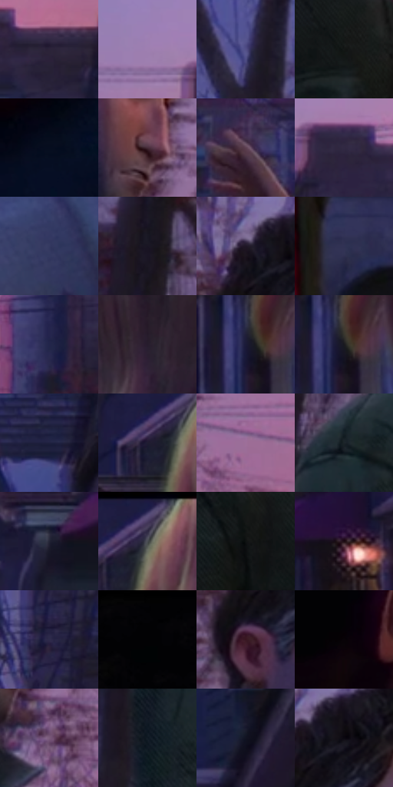

# 电影参考 426

- 状态：常规／活跃；来源世界：miles-home。
- 视角：near-level；景别：medium；场景：street。
- 时段：twilight-appearance（外观依据，中置信度；具体时间／晨昏未知）；光照：dusk。
- 材质候选：skin, hair, fabric, wood, glass, metal, foliage, sky（帧级，不是像素分割）。
- 明暗组：very-dark；L* P5/P50/P95：2.12985 / 14.17831 / 54.84632。
- 资格门禁：无附加门禁。
- 原截图 SHA-256：`fb975a7d69ba38409acf9ba79c2de0c71315d4ef88c59226e2dec196c259e3d6`；尺寸：2880 × 1210。
- sRGB 像素 SHA-256：`c570be4998891c2be7f8d104495c1349837fe31fbf4aebf318936299b3b35d37`。

## 观察与迁移

住宅蓝暮、暖门灯与近脸层次，远楼人群可低对比柔化。

426  /  景深：远楼外缘较宽蓝紫色影，近处人物稳定  /  色层错开不等于第二座楼

本公开版保存32个128×128原像素色卡上下文；图集格子并非原场景相邻位置。原rect、图集tile和像素SHA见 `data/palette-crops.json`。上下文不足时不得批准替色，不能以小样推断完整构图。

## 实测色卡

颜色比例分母为保留采样像素，不是材料面积；全部 32 色参与全库匹配。表内四舍五入仅用于阅读，原精度在 JSON。

| ID | HEX | Lab | 原图 xy | 像素数 | 比例 | 明度角色 |
| --- | --- | --- | --- | ---: | ---: | --- |
| 426-S01 | #2C233A | [15.71133, 10.066962, -13.272474] | [2136, 232] | 9371 | 4.829317% | deep-shadow |
| 426-S02 | #9E7FB1 | [57.676871, 21.430494, -21.91097] | [1652, 160] | 8900 | 4.586589% | midtone |
| 426-S03 | #534F87 | [36.328162, 16.136172, -30.795382] | [520, 216] | 8191 | 4.221208% | shadow |
| 426-S04 | #141715 | [7.367701, -1.845187, 0.856416] | [1192, 660] | 8028 | 4.137206% | deep-shadow |
| 426-S05 | #060C1D | [3.525822, 2.345522, -11.025376] | [48, 832] | 7548 | 3.889839% | deep-shadow |
| 426-S06 | #452C39 | [21.439623, 13.883234, -3.573716] | [1280, 320] | 7238 | 3.730082% | shadow |
| 426-S07 | #5C3F51 | [30.459644, 15.868171, -5.768326] | [1412, 624] | 7108 | 3.663087% | shadow |
| 426-S08 | #312943 | [18.55793, 10.318615, -15.046674] | [1760, 208] | 7093 | 3.655357% | deep-shadow |
| 426-S09 | #353961 | [25.399847, 9.994529, -24.28437] | [2788, 800] | 7058 | 3.637319% | shadow |
| 426-S10 | #181523 | [7.694719, 5.500893, -9.174729] | [840, 324] | 6921 | 3.566717% | deep-shadow |
| 426-S11 | #1F1726 | [9.353077, 7.828272, -8.795955] | [1136, 108] | 6820 | 3.514667% | deep-shadow |
| 426-S12 | #303254 | [22.122353, 9.003456, -20.944231] | [1384, 960] | 6776 | 3.491992% | shadow |
| 426-S13 | #22254A | [16.292773, 10.62242, -23.51061] | [1668, 440] | 6761 | 3.484261% | deep-shadow |
| 426-S14 | #251C2D | [12.045822, 8.622904, -9.733401] | [2768, 132] | 6456 | 3.327080% | deep-shadow |
| 426-S15 | #1A1A37 | [10.806945, 9.442044, -18.987009] | [2568, 540] | 6360 | 3.277607% | deep-shadow |
| 426-S16 | #1B1B1F | [9.921086, 1.066065, -2.756165] | [2580, 540] | 6188 | 3.188967% | deep-shadow |
| 426-S17 | #1E203F | [13.637374, 9.102999, -20.139365] | [2376, 144] | 6142 | 3.165261% | deep-shadow |
| 426-S18 | #201C31 | [11.68403, 7.877732, -13.239368] | [2516, 88] | 6067 | 3.126610% | deep-shadow |
| 426-S19 | #9E7099 | [53.122138, 25.144492, -14.978573] | [1456, 436] | 5868 | 3.024056% | midtone |
| 426-S20 | #1B2429 | [13.560129, -2.474648, -4.627496] | [904, 512] | 5730 | 2.952939% | deep-shadow |
| 426-S21 | #242536 | [15.299738, 4.374191, -11.163394] | [2272, 532] | 5471 | 2.819464% | deep-shadow |
| 426-S22 | #463C5A | [27.495857, 11.455158, -16.348643] | [2560, 44] | 5329 | 2.746284% | shadow |
| 426-S23 | #0F1212 | [5.219529, -1.096116, -0.385434] | [1040, 624] | 5282 | 2.722063% | deep-shadow |
| 426-S24 | #1E0C14 | [5.325139, 9.538061, -1.312372] | [2428, 508] | 5246 | 2.703511% | deep-shadow |
| 426-S25 | #2E2A4B | [18.990799, 11.035056, -19.847017] | [456, 464] | 5159 | 2.658675% | deep-shadow |
| 426-S26 | #020204 | [0.587921, 0.278053, -0.756781] | [76, 28] | 4808 | 2.477789% | deep-shadow |
| 426-S27 | #381621 | [12.76347, 18.349452, 0.429558] | [1128, 224] | 4674 | 2.408732% | deep-shadow |
| 426-S28 | #080307 | [1.193212, 1.86362, -1.052903] | [164, 424] | 4203 | 2.166004% | deep-shadow |
| 426-S29 | #7B5C7B | [43.205412, 18.385688, -12.51282] | [1312, 444] | 4142 | 2.134567% | midtone |
| 426-S30 | #121A24 | [8.947288, -0.314829, -8.041758] | [832, 976] | 3536 | 1.822267% | deep-shadow |
| 426-S31 | #101321 | [6.193628, 2.837067, -10.026659] | [2356, 316] | 3337 | 1.719713% | deep-shadow |
| 426-S32 | #0A0810 | [2.489492, 1.784129, -3.248148] | [1188, 124] | 2233 | 1.150770% | deep-shadow |

## 色阶与空间分布

- 采样 ROI：`[0.01, 0.02, 0.98, 0.94]`；步长：4；样本数：194044。
- 排除区：`[]`。
- 深暗、暗、中、亮、高光五段计数：`[133226, 41672, 18935, 198, 13]`。
- RGB 各 256 箱、L* 100 箱、13×5 色相明度表和 3×3 空间统计全部保存在 [总数据](../film-library.json)。
- [可视化档案](../../references/library.html)按需绘制直方图，不存 2,094 张重复图表图片。

## 纹理特征占比

**这是分块图像特征的面积占比，不是波点／排线／丝网／错版的精确语义覆盖率。** 窗格、发丝、织物也会产生方向或周期特征。
原图 ROI 像素 3109722；已测块覆盖 3109722（100.0000%）；未测 0。

| 特征 | 块覆盖像素 | 占已测面积 | 阈值敏感范围 |
| --- | ---: | ---: | --- |
| low-contrast | 296320 | 9.5288% | 8.4751% ~ 12.5295% |
| directional-structure | 490112 | 15.7606% | 8.2693% ~ 25.7258% |
| periodic-structure | 2246362 | 72.2367% | 64.7454% ~ 72.2367% |
| mixed-detail | 76928 | 2.4738% | 1.0537% ~ 10.4220% |

阈值敏感范围不是统计置信区间。逐块坐标、尺度、对比、方向一致性、频谱集中度、频率与角度见 [全量特征记录](../texture-features.jsonl)，以帧号定位。
四种印刷层的真实像素覆盖仍标为 `null`，不能填 0，也不能拿上表代替。不得据这些代理测量删除唯一证据。

[测量方法与保留策略](../../references/library-retention.md) · [分类索引](../archive/README.md)
