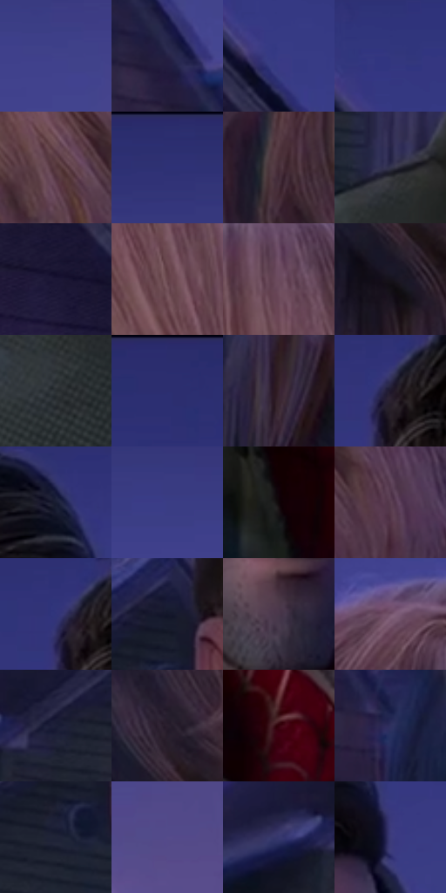

# 电影参考 427

- 状态：常规／活跃；来源世界：miles-home。
- 视角：near-level；景别：medium；场景：street。
- 时段：twilight-appearance（外观依据，中置信度；具体时间／晨昏未知）；光照：dusk。
- 材质候选：skin, hair, fabric, wood, glass, metal, foliage, sky（帧级，不是像素分割）。
- 明暗组：dark；L* P5/P50/P95：5.71442 / 23.29332 / 35.75517。
- 资格门禁：无附加门禁。
- 原截图 SHA-256：`1d77f3ea3ff3d49ed306698603afe1946dc665904624b1d95a9d74171e4b2da5`；尺寸：2880 × 1216。
- sRGB 像素 SHA-256：`c4523d942f858c3216c01f05e33134a7eebaa985d6d81f0a345e4469bfd38942`。

## 观察与迁移

住宅蓝暮、暖门灯与近脸层次，远楼人群可低对比柔化。

427  /  接触／景深：脸与手清楚，后方屋顶软化分色  /  轻触不是冲击爆点；背景可真的模糊

本公开版保存32个128×128原像素色卡上下文；图集格子并非原场景相邻位置。原rect、图集tile和像素SHA见 `data/palette-crops.json`。上下文不足时不得批准替色，不能以小样推断完整构图。

## 实测色卡

颜色比例分母为保留采样像素，不是材料面积；全部 32 色参与全库匹配。表内四舍五入仅用于阅读，原精度在 JSON。

| ID | HEX | Lab | 原图 xy | 像素数 | 比例 | 明度角色 |
| --- | --- | --- | --- | ---: | ---: | --- |
| 427-S01 | #40418A | [31.125499, 21.257615, -41.020092] | [2668, 192] | 13006 | 6.678580% | shadow |
| 427-S02 | #262245 | [15.411937, 12.205691, -21.451213] | [1624, 644] | 10716 | 5.502665% | deep-shadow |
| 427-S03 | #393B84 | [28.546149, 21.631856, -41.483455] | [128, 332] | 10059 | 5.165296% | shadow |
| 427-S04 | #33377E | [26.568817, 20.939247, -40.944152] | [72, 200] | 9407 | 4.830494% | shadow |
| 427-S05 | #57393F | [27.605042, 14.29963, 1.72197] | [2700, 968] | 8475 | 4.351912% | shadow |
| 427-S06 | #2E3174 | [23.796514, 20.39543, -39.110019] | [1768, 56] | 8431 | 4.329318% | shadow |
| 427-S07 | #452D36 | [21.610883, 12.645074, -1.267267] | [2096, 564] | 8176 | 4.198375% | shadow |
| 427-S08 | #34344C | [22.680682, 6.437069, -14.717917] | [784, 796] | 7361 | 3.779873% | shadow |
| 427-S09 | #201B3B | [12.001728, 12.000943, -19.90522] | [44, 468] | 7277 | 3.736739% | deep-shadow |
| 427-S10 | #66444B | [32.848372, 15.785225, 1.760011] | [2556, 584] | 7248 | 3.721847% | shadow |
| 427-S11 | #6B4A5D | [35.623886, 17.302964, -5.53691] | [2436, 412] | 7162 | 3.677686% | shadow |
| 427-S12 | #16131C | [6.505086, 3.637844, -5.663434] | [2056, 948] | 7118 | 3.655092% | deep-shadow |
| 427-S13 | #292E32 | [18.608387, -1.133948, -3.306482] | [756, 956] | 6822 | 3.503096% | deep-shadow |
| 427-S14 | #2B2D6D | [21.922974, 19.981692, -37.658287] | [216, 28] | 6625 | 3.401937% | shadow |
| 427-S15 | #372430 | [16.928923, 11.37373, -4.248481] | [1912, 792] | 6035 | 3.098972% | deep-shadow |
| 427-S16 | #1F192C | [10.322158, 8.142301, -11.730859] | [964, 180] | 5600 | 2.875600% | deep-shadow |
| 427-S17 | #181D30 | [11.178937, 3.91818, -13.36232] | [1260, 140] | 5596 | 2.873546% | deep-shadow |
| 427-S18 | #3A3D84 | [29.164802, 20.513409, -40.48263] | [2560, 144] | 5584 | 2.867384% | shadow |
| 427-S19 | #100408 | [1.937996, 3.97417, -0.309217] | [1032, 1044] | 5462 | 2.804737% | deep-shadow |
| 427-S20 | #593E51 | [29.821118, 15.296753, -6.762594] | [2812, 992] | 5311 | 2.727198% | shadow |
| 427-S21 | #31357B | [25.649604, 20.808844, -40.546902] | [944, 172] | 5303 | 2.723090% | shadow |
| 427-S22 | #131629 | [7.879476, 4.984695, -13.427378] | [888, 444] | 5108 | 2.622958% | deep-shadow |
| 427-S23 | #48374A | [25.57721, 11.501993, -8.768456] | [1172, 772] | 5059 | 2.597796% | shadow |
| 427-S24 | #75546D | [39.96039, 18.154203, -8.906946] | [2212, 300] | 4714 | 2.420639% | shadow |
| 427-S25 | #1C1E37 | [12.294203, 7.047543, -16.618626] | [632, 612] | 4459 | 2.289696% | deep-shadow |
| 427-S26 | #291F2D | [13.476977, 8.116296, -7.49732] | [2052, 828] | 4397 | 2.257859% | deep-shadow |
| 427-S27 | #35020B | [7.449471, 25.732294, 7.207448] | [1032, 856] | 4177 | 2.144889% | deep-shadow |
| 427-S28 | #2F305E | [22.038567, 13.492734, -27.686686] | [1748, 800] | 3320 | 1.704820% | shadow |
| 427-S29 | #202437 | [14.649518, 3.965432, -12.905191] | [856, 540] | 2527 | 1.297614% | deep-shadow |
| 427-S30 | #554B8A | [35.592434, 20.155076, -33.783737] | [2808, 388] | 2385 | 1.224697% | shadow |
| 427-S31 | #37386D | [25.993607, 15.263219, -31.066624] | [520, 624] | 1267 | 0.650604% | shadow |
| 427-S32 | #3B3B7A | [28.013516, 18.656142, -36.070414] | [1320, 256] | 555 | 0.284992% | shadow |

## 色阶与空间分布

- 采样 ROI：`[0.01, 0.02, 0.98, 0.94]`；步长：4；样本数：194742。
- 排除区：`[]`。
- 深暗、暗、中、亮、高光五段计数：`[77437, 114825, 2480, 0, 0]`。
- RGB 各 256 箱、L* 100 箱、13×5 色相明度表和 3×3 空间统计全部保存在 [总数据](../film-library.json)。
- [可视化档案](../../references/library.html)按需绘制直方图，不存 2,094 张重复图表图片。

## 纹理特征占比

**这是分块图像特征的面积占比，不是波点／排线／丝网／错版的精确语义覆盖率。** 窗格、发丝、织物也会产生方向或周期特征。
原图 ROI 像素 3126486；已测块覆盖 3126486（100.0000%）；未测 0。

| 特征 | 块覆盖像素 | 占已测面积 | 阈值敏感范围 |
| --- | ---: | ---: | --- |
| low-contrast | 530816 | 16.9780% | 13.1010% ~ 19.9872% |
| directional-structure | 1313622 | 42.0159% | 21.7463% ~ 59.9970% |
| periodic-structure | 1204352 | 38.5209% | 26.3780% ~ 50.1071% |
| mixed-detail | 77696 | 2.4851% | 0.5240% ~ 8.1594% |

阈值敏感范围不是统计置信区间。逐块坐标、尺度、对比、方向一致性、频谱集中度、频率与角度见 [全量特征记录](../texture-features.jsonl)，以帧号定位。
四种印刷层的真实像素覆盖仍标为 `null`，不能填 0，也不能拿上表代替。不得据这些代理测量删除唯一证据。

[测量方法与保留策略](../../references/library-retention.md) · [分类索引](../archive/README.md)
