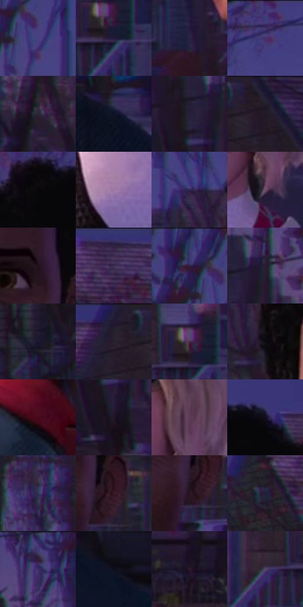

# 电影参考 428

- 状态：常规／活跃；来源世界：miles-home。
- 视角：near-level；景别：medium；场景：street。
- 时段：twilight-appearance（外观依据，中置信度；具体时间／晨昏未知）；光照：dusk。
- 材质候选：skin, hair, fabric, wood, glass, metal, foliage, sky（帧级，不是像素分割）。
- 明暗组：very-dark；L* P5/P50/P95：3.43446 / 13.97305 / 38.58403。
- 资格门禁：无附加门禁。
- 原截图 SHA-256：`3e4b3e0d4221981074970b24d730c58fc199cfbb60070c3dc91eb2226b99ed9a`；尺寸：2880 × 1202。
- sRGB 像素 SHA-256：`d39d1fbfe567d0ae26ef06c6355567411bd540ae6820cf265a0e03a930eec812`。

## 观察与迁移

住宅蓝暮、暖门灯与近脸层次，远楼人群可低对比柔化。

428  /  景深：近脸清楚、树枝与房屋青粉分色  /  不让背景所有彩边一样亮锐

本公开版保存32个128×128原像素色卡上下文；图集格子并非原场景相邻位置。原rect、图集tile和像素SHA见 `data/palette-crops.json`。上下文不足时不得批准替色，不能以小样推断完整构图。

## 实测色卡

颜色比例分母为保留采样像素，不是材料面积；全部 32 色参与全库匹配。表内四舍五入仅用于阅读，原精度在 JSON。

| ID | HEX | Lab | 原图 xy | 像素数 | 比例 | 明度角色 |
| --- | --- | --- | --- | ---: | ---: | --- |
| 428-S01 | #464182 | [31.099707, 20.086306, -36.082098] | [328, 112] | 13085 | 6.792181% | shadow |
| 428-S02 | #211B3A | [12.041407, 11.975483, -19.124552] | [2768, 596] | 11817 | 6.133985% | deep-shadow |
| 428-S03 | #282343 | [15.790459, 11.448725, -19.454409] | [1676, 624] | 10820 | 5.616461% | deep-shadow |
| 428-S04 | #3A3267 | [24.192753, 18.170494, -30.060918] | [848, 56] | 9031 | 4.687824% | shadow |
| 428-S05 | #312339 | [16.257843, 11.727476, -11.676838] | [256, 444] | 9012 | 4.677962% | deep-shadow |
| 428-S06 | #0D1324 | [6.130037, 2.955187, -12.430465] | [2352, 804] | 8895 | 4.617229% | deep-shadow |
| 428-S07 | #19141D | [7.18746, 4.756688, -5.374723] | [48, 288] | 8639 | 4.484345% | deep-shadow |
| 428-S08 | #221C27 | [11.394392, 5.672291, -6.379714] | [2748, 48] | 8414 | 4.367551% | deep-shadow |
| 428-S09 | #09070A | [2.095192, 0.940008, -0.950763] | [1824, 132] | 7778 | 4.037415% | deep-shadow |
| 428-S10 | #9C78A6 | [55.333482, 22.457733, -19.187934] | [856, 1016] | 6654 | 3.453968% | midtone |
| 428-S11 | #302652 | [18.468932, 16.729054, -25.391971] | [1612, 252] | 6302 | 3.271251% | deep-shadow |
| 428-S12 | #724F6A | [38.217453, 19.460253, -9.706728] | [1032, 776] | 6017 | 3.123313% | shadow |
| 428-S13 | #22121D | [7.78144, 10.51433, -4.360734] | [2012, 464] | 5969 | 3.098397% | deep-shadow |
| 428-S14 | #362548 | [18.255662, 16.318105, -18.901391] | [2440, 40] | 5856 | 3.039741% | deep-shadow |
| 428-S15 | #413776 | [27.196593, 21.528035, -34.824182] | [268, 40] | 5703 | 2.960321% | shadow |
| 428-S16 | #261B32 | [12.131102, 11.196068, -13.211499] | [124, 252] | 5639 | 2.927100% | deep-shadow |
| 428-S17 | #18162B | [8.501956, 7.468583, -13.900246] | [2348, 588] | 5533 | 2.872078% | deep-shadow |
| 428-S18 | #28222F | [14.402884, 6.066412, -7.533354] | [2644, 60] | 5392 | 2.798887% | deep-shadow |
| 428-S19 | #472C49 | [22.380703, 18.109261, -12.993053] | [2752, 560] | 5288 | 2.744903% | shadow |
| 428-S20 | #0F0B13 | [3.504049, 2.682285, -3.512088] | [1684, 360] | 4760 | 2.470828% | deep-shadow |
| 428-S21 | #4A0A1C | [14.157751, 30.486879, 6.615292] | [1728, 860] | 4576 | 2.375317% | deep-shadow |
| 428-S22 | #1F162A | [9.257555, 9.771832, -11.916462] | [80, 396] | 4440 | 2.304722% | deep-shadow |
| 428-S23 | #5B3B56 | [29.47354, 19.002005, -10.508759] | [1040, 656] | 4159 | 2.158860% | shadow |
| 428-S24 | #100E1C | [4.589253, 3.988231, -8.582122] | [2040, 108] | 4115 | 2.136020% | deep-shadow |
| 428-S25 | #303552 | [22.942684, 6.270558, -18.331637] | [576, 340] | 4031 | 2.092417% | shadow |
| 428-S26 | #351A27 | [13.485551, 15.483881, -2.966315] | [2080, 552] | 3935 | 2.042585% | deep-shadow |
| 428-S27 | #2A1522 | [10.138795, 13.075177, -4.466995] | [2048, 584] | 3662 | 1.900876% | deep-shadow |
| 428-S28 | #1E2535 | [14.713227, 1.854374, -11.406862] | [2344, 136] | 3306 | 1.716083% | deep-shadow |
| 428-S29 | #404275 | [30.084581, 13.625378, -29.597598] | [36, 52] | 2940 | 1.526099% | shadow |
| 428-S30 | #0F101D | [5.065875, 2.9059, -8.658298] | [2524, 908] | 2849 | 1.478863% | deep-shadow |
| 428-S31 | #2C1830 | [11.972231, 15.09827, -11.950387] | [312, 856] | 2291 | 1.189216% | deep-shadow |
| 428-S32 | #534773 | [33.099131, 15.534649, -23.480371] | [2664, 604] | 1740 | 0.903202% | shadow |

## 色阶与空间分布

- 采样 ROI：`[0.01, 0.02, 0.98, 0.94]`；步长：4；样本数：192648。
- 排除区：`[]`。
- 深暗、暗、中、亮、高光五段计数：`[132231, 51596, 6830, 1886, 105]`。
- RGB 各 256 箱、L* 100 箱、13×5 色相明度表和 3×3 空间统计全部保存在 [总数据](../film-library.json)。
- [可视化档案](../../references/library.html)按需绘制直方图，不存 2,094 张重复图表图片。

## 纹理特征占比

**这是分块图像特征的面积占比，不是波点／排线／丝网／错版的精确语义覆盖率。** 窗格、发丝、织物也会产生方向或周期特征。
原图 ROI 像素 3087370；已测块覆盖 3087370（100.0000%）；未测 0。

| 特征 | 块覆盖像素 | 占已测面积 | 阈值敏感范围 |
| --- | ---: | ---: | --- |
| low-contrast | 285568 | 9.2496% | 7.8524% ~ 9.7802% |
| directional-structure | 355968 | 11.5298% | 5.4477% ~ 25.3896% |
| periodic-structure | 2298378 | 74.4445% | 66.2273% ~ 74.4445% |
| mixed-detail | 147456 | 4.7761% | 0.5307% ~ 16.7868% |

阈值敏感范围不是统计置信区间。逐块坐标、尺度、对比、方向一致性、频谱集中度、频率与角度见 [全量特征记录](../texture-features.jsonl)，以帧号定位。
四种印刷层的真实像素覆盖仍标为 `null`，不能填 0，也不能拿上表代替。不得据这些代理测量删除唯一证据。

[测量方法与保留策略](../../references/library-retention.md) · [分类索引](../archive/README.md)
