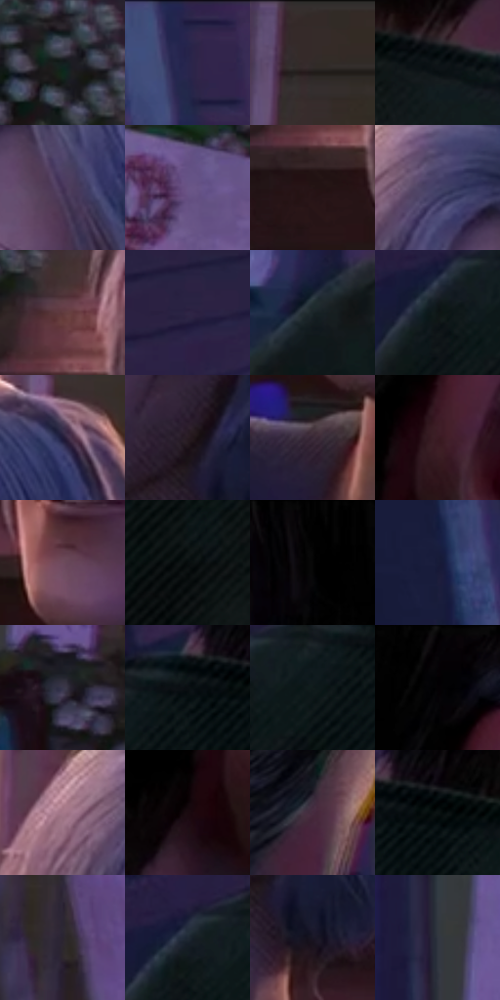

# 电影参考 429

- 状态：常规／活跃；来源世界：miles-home。
- 视角：high-angle；景别：close-up；场景：street。
- 时段：twilight-appearance（外观依据，中置信度；具体时间／晨昏未知）；光照：dusk。
- 材质候选：skin, hair, fabric, wood, glass, metal, foliage, sky（帧级，不是像素分割）。
- 明暗组：very-dark；L* P5/P50/P95：2.19339 / 14.04436 / 39.74073。
- 资格门禁：无附加门禁。
- 原截图 SHA-256：`f0cb769bf411e008d0c790ae7a7f64b1baa455f3ef37bab76f8d361f846bbb74`；尺寸：2880 × 1212。
- sRGB 像素 SHA-256：`ae059b81a447e4f052f0e573af826e7591268af70721a0614eeb200e304a31d9`。

## 观察与迁移

住宅蓝暮、暖门灯与近脸层次，远楼人群可低对比柔化。

429  /  混光近景：前景衣肩彩边、头发暖轮廓光  /  暖轮廓光和彩边可以共存，不能互代

本公开版保存32个128×128原像素色卡上下文；图集格子并非原场景相邻位置。原rect、图集tile和像素SHA见 `data/palette-crops.json`。上下文不足时不得批准替色，不能以小样推断完整构图。

## 实测色卡

颜色比例分母为保留采样像素，不是材料面积；全部 32 色参与全库匹配。表内四舍五入仅用于阅读，原精度在 JSON。

| ID | HEX | Lab | 原图 xy | 像素数 | 比例 | 明度角色 |
| --- | --- | --- | --- | ---: | ---: | --- |
| 429-S01 | #141D1E | [9.962462, -3.747404, -2.020877] | [1648, 456] | 12066 | 6.218177% | deep-shadow |
| 429-S02 | #26254C | [16.781239, 12.476059, -24.07673] | [148, 44] | 11966 | 6.166643% | deep-shadow |
| 429-S03 | #332B29 | [18.328464, 3.250871, 2.655009] | [2340, 28] | 10569 | 5.446703% | deep-shadow |
| 429-S04 | #0F1718 | [7.048113, -3.007471, -1.85446] | [948, 420] | 9717 | 5.007627% | deep-shadow |
| 429-S05 | #433155 | [23.822242, 16.35032, -18.804922] | [2068, 364] | 8647 | 4.456206% | shadow |
| 429-S06 | #695486 | [39.689807, 19.525537, -24.767592] | [2776, 1096] | 8126 | 4.187710% | shadow |
| 429-S07 | #241315 | [8.08449, 9.141609, 2.148364] | [1732, 656] | 7927 | 4.085156% | deep-shadow |
| 429-S08 | #464268 | [29.906073, 11.430837, -21.608871] | [1960, 268] | 7581 | 3.906846% | shadow |
| 429-S09 | #603A3C | [29.004319, 17.11237, 5.858513] | [1740, 552] | 6874 | 3.542496% | shadow |
| 429-S10 | #2E2444 | [16.795986, 13.072049, -18.516334] | [488, 140] | 6617 | 3.410051% | deep-shadow |
| 429-S11 | #1A2527 | [13.763379, -4.179657, -2.89475] | [240, 712] | 6536 | 3.368308% | deep-shadow |
| 429-S12 | #0E1515 | [6.176835, -2.67773, -0.942523] | [492, 432] | 6474 | 3.336357% | deep-shadow |
| 429-S13 | #211B39 | [11.974574, 11.634818, -18.51835] | [2308, 248] | 6354 | 3.274515% | deep-shadow |
| 429-S14 | #281C22 | [11.938811, 7.155344, -1.811494] | [2108, 788] | 5923 | 3.052400% | deep-shadow |
| 429-S15 | #392937 | [18.93546, 10.356661, -6.106294] | [1844, 916] | 5778 | 2.977675% | deep-shadow |
| 429-S16 | #3A1B23 | [14.428499, 16.347095, 1.424411] | [1096, 208] | 5603 | 2.887489% | deep-shadow |
| 429-S17 | #6E4A5D | [35.990769, 18.487285, -4.951473] | [1876, 792] | 5545 | 2.857599% | shadow |
| 429-S18 | #070C0D | [3.045549, -1.177645, -0.904802] | [596, 568] | 5493 | 2.830801% | deep-shadow |
| 429-S19 | #010101 | [0.274173, -1.7e-05, 3.3e-05] | [732, 28] | 5212 | 2.685989% | deep-shadow |
| 429-S20 | #171B38 | [10.931567, 8.173426, -19.521614] | [144, 528] | 5161 | 2.659706% | deep-shadow |
| 429-S21 | #38364B | [23.628423, 6.232391, -12.558688] | [1480, 640] | 5076 | 2.615902% | shadow |
| 429-S22 | #0A0F11 | [4.034405, -1.121294, -1.561044] | [644, 380] | 4701 | 2.422646% | deep-shadow |
| 429-S23 | #101A1B | [8.37701, -4.121829, -2.162296] | [580, 428] | 4521 | 2.329884% | deep-shadow |
| 429-S24 | #060507 | [1.46875, 0.5395, -0.664544] | [1076, 36] | 4466 | 2.301540% | deep-shadow |
| 429-S25 | #A47789 | [54.962397, 20.447908, -2.814647] | [1868, 264] | 4299 | 2.215477% | midtone |
| 429-S26 | #1A0B10 | [4.484038, 6.856752, -0.167563] | [1036, 292] | 4218 | 2.173734% | deep-shadow |
| 429-S27 | #472B3F | [21.676602, 16.58036, -7.289738] | [1328, 156] | 4179 | 2.153635% | shadow |
| 429-S28 | #0B1212 | [4.94474, -2.328472, -0.819651] | [708, 380] | 4122 | 2.124260% | deep-shadow |
| 429-S29 | #2A2530 | [15.637536, 5.033017, -6.350652] | [2792, 424] | 3904 | 2.011915% | deep-shadow |
| 429-S30 | #1F2834 | [15.782181, -0.266685, -9.050843] | [504, 400] | 2590 | 1.334749% | deep-shadow |
| 429-S31 | #181625 | [8.142868, 5.402799, -9.986577] | [2160, 872] | 2120 | 1.092536% | deep-shadow |
| 429-S32 | #313641 | [22.559038, 0.768682, -7.54925] | [1400, 480] | 1679 | 0.865268% | shadow |

## 色阶与空间分布

- 采样 ROI：`[0.01, 0.02, 0.98, 0.94]`；步长：4；样本数：194044。
- 排除区：`[]`。
- 深暗、暗、中、亮、高光五段计数：`[137261, 47378, 8483, 711, 211]`。
- RGB 各 256 箱、L* 100 箱、13×5 色相明度表和 3×3 空间统计全部保存在 [总数据](../film-library.json)。
- [可视化档案](../../references/library.html)按需绘制直方图，不存 2,094 张重复图表图片。

## 纹理特征占比

**这是分块图像特征的面积占比，不是波点／排线／丝网／错版的精确语义覆盖率。** 窗格、发丝、织物也会产生方向或周期特征。
原图 ROI 像素 3115310；已测块覆盖 3115310（100.0000%）；未测 0。

| 特征 | 块覆盖像素 | 占已测面积 | 阈值敏感范围 |
| --- | ---: | ---: | --- |
| low-contrast | 411392 | 13.2055% | 8.2504% ~ 17.7867% |
| directional-structure | 817664 | 26.2466% | 11.0443% ~ 43.9471% |
| periodic-structure | 1841838 | 59.1221% | 45.6989% ~ 65.5359% |
| mixed-detail | 44416 | 1.4257% | 1.4257% ~ 5.6331% |

阈值敏感范围不是统计置信区间。逐块坐标、尺度、对比、方向一致性、频谱集中度、频率与角度见 [全量特征记录](../texture-features.jsonl)，以帧号定位。
四种印刷层的真实像素覆盖仍标为 `null`，不能填 0，也不能拿上表代替。不得据这些代理测量删除唯一证据。

[测量方法与保留策略](../../references/library-retention.md) · [分类索引](../archive/README.md)
