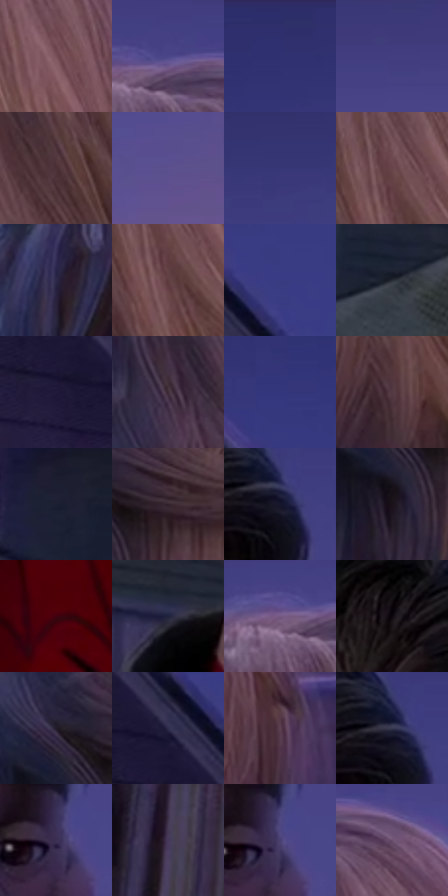

# 电影参考 430

- 状态：常规／活跃；来源世界：miles-home。
- 视角：near-level；景别：medium；场景：street。
- 时段：twilight-appearance（外观依据，中置信度；具体时间／晨昏未知）；光照：dusk。
- 材质候选：skin, hair, fabric, wood, glass, metal, foliage, sky（帧级，不是像素分割）。
- 明暗组：dark；L* P5/P50/P95：6.83667 / 25.17849 / 39.78881。
- 资格门禁：无附加门禁。
- 原截图 SHA-256：`76dc501330cf5ad9d550e96830110dc7835ceaeab5fbcb136be7f09cb43f7b89`；尺寸：2880 × 1200。
- sRGB 像素 SHA-256：`edaca059d2a34812258f7c68d63c3bf304cc2be1b0c5c5b2d382b04c626a84e7`。

## 观察与迁移

住宅蓝暮、暖门灯与近脸层次，远楼人群可低对比柔化。

430  /  接触／景深：主体稳定，屋顶软边  /  不必恢复背景逐根线条

本公开版保存32个128×128原像素色卡上下文；图集格子并非原场景相邻位置。原rect、图集tile和像素SHA见 `data/palette-crops.json`。上下文不足时不得批准替色，不能以小样推断完整构图。

## 实测色卡

颜色比例分母为保留采样像素，不是材料面积；全部 32 色参与全库匹配。表内四舍五入仅用于阅读，原精度在 JSON。

| ID | HEX | Lab | 原图 xy | 像素数 | 比例 | 明度角色 |
| --- | --- | --- | --- | ---: | ---: | --- |
| 430-S01 | #775059 | [38.518088, 17.774414, 1.400911] | [2320, 444] | 9940 | 5.159669% | shadow |
| 430-S02 | #494589 | [32.871899, 20.482778, -37.564245] | [2132, 148] | 9683 | 5.026266% | shadow |
| 430-S03 | #303170 | [23.653054, 19.388342, -36.774613] | [752, 60] | 8405 | 4.362879% | shadow |
| 430-S04 | #423E80 | [29.816406, 20.391183, -36.90924] | [2560, 92] | 8325 | 4.321353% | shadow |
| 430-S05 | #4C3137 | [23.701941, 13.279915, 1.220014] | [1980, 524] | 8147 | 4.228956% | shadow |
| 430-S06 | #5C508F | [37.834156, 20.43995, -33.240767] | [2664, 384] | 7945 | 4.124102% | shadow |
| 430-S07 | #383776 | [26.392147, 19.259097, -36.15836] | [1352, 80] | 7910 | 4.105934% | shadow |
| 430-S08 | #68454A | [33.337824, 15.849517, 3.13947] | [2120, 440] | 7520 | 3.903492% | shadow |
| 430-S09 | #2B2647 | [17.24809, 11.593664, -19.887967] | [1556, 640] | 7332 | 3.805905% | deep-shadow |
| 430-S10 | #5F3E41 | [30.059794, 14.93122, 4.081791] | [2124, 496] | 7054 | 3.661600% | shadow |
| 430-S11 | #3A3B81 | [28.411401, 20.813379, -39.825293] | [164, 332] | 7024 | 3.646028% | shadow |
| 430-S12 | #272C34 | [17.830502, -0.014392, -5.877877] | [628, 884] | 6960 | 3.612807% | deep-shadow |
| 430-S13 | #231C3B | [12.630527, 12.232387, -18.886043] | [36, 468] | 6957 | 3.611250% | deep-shadow |
| 430-S14 | #3E2B37 | [20.155087, 11.136495, -4.212487] | [1760, 564] | 6575 | 3.412960% | shadow |
| 430-S15 | #35377C | [26.574542, 20.654296, -39.668935] | [36, 168] | 6350 | 3.296167% | shadow |
| 430-S16 | #533942 | [27.182711, 13.1055, -0.936475] | [1936, 924] | 6236 | 3.236992% | shadow |
| 430-S17 | #1B1F32 | [12.242294, 4.16791, -13.125064] | [328, 788] | 6024 | 3.126947% | deep-shadow |
| 430-S18 | #32222C | [15.508736, 9.682784, -3.602489] | [1816, 760] | 5943 | 3.084901% | deep-shadow |
| 430-S19 | #17172C | [8.796224, 6.702364, -14.18351] | [1272, 184] | 5782 | 3.001329% | deep-shadow |
| 430-S20 | #1B131B | [7.026763, 5.843117, -4.055485] | [1724, 836] | 5264 | 2.732445% | deep-shadow |
| 430-S21 | #3F020D | [10.02733, 29.098917, 10.340213] | [1168, 1092] | 5211 | 2.704933% | deep-shadow |
| 430-S22 | #21223B | [14.30495, 7.145396, -16.256633] | [884, 652] | 5104 | 2.649392% | deep-shadow |
| 430-S23 | #765A85 | [42.547723, 19.984882, -19.627466] | [2084, 164] | 4978 | 2.583987% | midtone |
| 430-S24 | #0D070D | [2.40808, 2.507211, -1.791865] | [1100, 144] | 4870 | 2.527927% | deep-shadow |
| 430-S25 | #221B2B | [11.264008, 7.550942, -9.510662] | [1708, 728] | 4863 | 2.524293% | deep-shadow |
| 430-S26 | #302E4E | [20.566105, 9.844542, -19.381857] | [88, 384] | 4838 | 2.511316% | shadow |
| 430-S27 | #5C4153 | [31.068719, 15.001179, -6.150185] | [2624, 952] | 4137 | 2.147440% | shadow |
| 430-S28 | #393B52 | [25.583936, 5.236903, -14.174522] | [1260, 164] | 3327 | 1.726984% | shadow |
| 430-S29 | #3B3053 | [22.542608, 13.690811, -19.545243] | [1304, 464] | 3298 | 1.711931% | shadow |
| 430-S30 | #46395C | [26.737592, 13.984678, -18.825212] | [120, 1080] | 2908 | 1.509489% | shadow |
| 430-S31 | #484072 | [30.057078, 16.337553, -27.703442] | [1316, 460] | 1909 | 0.990926% | shadow |
| 430-S32 | #6C506F | [37.973871, 17.639719, -13.247641] | [2260, 192] | 1829 | 0.949400% | shadow |

## 色阶与空间分布

- 采样 ROI：`[0.01, 0.02, 0.98, 0.94]`；步长：4；样本数：192648。
- 排除区：`[]`。
- 深暗、暗、中、亮、高光五段计数：`[68329, 115406, 8912, 1, 0]`。
- RGB 各 256 箱、L* 100 箱、13×5 色相明度表和 3×3 空间统计全部保存在 [总数据](../film-library.json)。
- [可视化档案](../../references/library.html)按需绘制直方图，不存 2,094 张重复图表图片。

## 纹理特征占比

**这是分块图像特征的面积占比，不是波点／排线／丝网／错版的精确语义覆盖率。** 窗格、发丝、织物也会产生方向或周期特征。
原图 ROI 像素 3084576；已测块覆盖 3084576（100.0000%）；未测 0。

| 特征 | 块覆盖像素 | 占已测面积 | 阈值敏感范围 |
| --- | ---: | ---: | --- |
| low-contrast | 536832 | 17.4038% | 14.2168% ~ 18.4661% |
| directional-structure | 1518848 | 49.2401% | 27.2634% ~ 59.9463% |
| periodic-structure | 966176 | 31.3228% | 25.3058% ~ 47.1912% |
| mixed-detail | 62720 | 2.0333% | 0.5312% ~ 7.0794% |

阈值敏感范围不是统计置信区间。逐块坐标、尺度、对比、方向一致性、频谱集中度、频率与角度见 [全量特征记录](../texture-features.jsonl)，以帧号定位。
四种印刷层的真实像素覆盖仍标为 `null`，不能填 0，也不能拿上表代替。不得据这些代理测量删除唯一证据。

[测量方法与保留策略](../../references/library-retention.md) · [分类索引](../archive/README.md)
