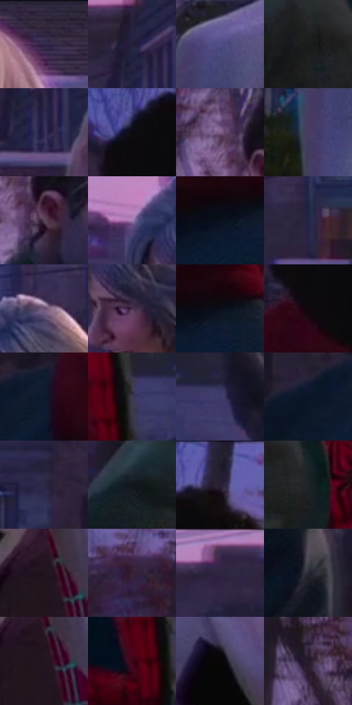

# 电影参考 431

- 状态：常规／活跃；来源世界：miles-home。
- 视角：near-level；景别：medium；场景：street。
- 时段：twilight-appearance（外观依据，中置信度；具体时间／晨昏未知）；光照：dusk。
- 材质候选：skin, hair, fabric, wood, glass, metal, foliage, sky（帧级，不是像素分割）。
- 明暗组：very-dark；L* P5/P50/P95：2.78354 / 15.47145 / 47.18563。
- 资格门禁：无附加门禁。
- 原截图 SHA-256：`7bafbea66c3132772e3f0c4fbae827fee129adfe2ee3d968355e5c5719a16631`；尺寸：2880 × 1208。
- sRGB 像素 SHA-256：`569f88c7bf7ba04f4829f8b1c9844e73e779291b06d780dd13c9e2ce766c3367`。

## 观察与迁移

住宅蓝暮、暖门灯与近脸层次，远楼人群可低对比柔化。

431  /  群像：关键人物清楚，远楼退后  /  主要群像人物不当无关远处人群抹去

本公开版保存32个128×128原像素色卡上下文；图集格子并非原场景相邻位置。原rect、图集tile和像素SHA见 `data/palette-crops.json`。上下文不足时不得批准替色，不能以小样推断完整构图。

## 实测色卡

颜色比例分母为保留采样像素，不是材料面积；全部 32 色参与全库匹配。表内四舍五入仅用于阅读，原精度在 JSON。

| ID | HEX | Lab | 原图 xy | 像素数 | 比例 | 明度角色 |
| --- | --- | --- | --- | ---: | ---: | --- |
| 431-S01 | #32283D | [18.065457, 9.696679, -11.666356] | [2720, 44] | 9290 | 4.804858% | deep-shadow |
| 431-S02 | #231F38 | [13.368137, 9.032846, -15.59319] | [2232, 104] | 8688 | 4.493499% | deep-shadow |
| 431-S03 | #504C84 | [35.082834, 16.29838, -30.937257] | [2276, 672] | 8355 | 4.321269% | shadow |
| 431-S04 | #191D1C | [10.328388, -2.133564, 0.052609] | [1152, 492] | 8020 | 4.148004% | deep-shadow |
| 431-S05 | #322C53 | [20.455153, 13.487389, -22.895296] | [2264, 176] | 7683 | 3.973705% | shadow |
| 431-S06 | #0B0C10 | [3.355682, 0.404942, -1.976143] | [412, 148] | 7625 | 3.943707% | deep-shadow |
| 431-S07 | #816389 | [46.173535, 19.298957, -16.376655] | [1144, 168] | 7449 | 3.852679% | midtone |
| 431-S08 | #483E60 | [28.557341, 12.472465, -18.569239] | [2216, 812] | 7144 | 3.694930% | shadow |
| 431-S09 | #5B4258 | [31.406029, 15.002854, -8.87417] | [1196, 236] | 6738 | 3.484944% | shadow |
| 431-S10 | #A985BD | [60.679558, 24.186553, -24.042444] | [1596, 352] | 6697 | 3.463739% | light |
| 431-S11 | #0A111F | [5.097395, 1.494471, -10.195747] | [532, 576] | 6661 | 3.445119% | deep-shadow |
| 431-S12 | #232345 | [15.429027, 10.561913, -21.441829] | [2020, 264] | 6181 | 3.196860% | deep-shadow |
| 431-S13 | #6C5371 | [38.84161, 16.228575, -13.165748] | [1756, 284] | 6127 | 3.168930% | shadow |
| 431-S14 | #493049 | [23.709621, 16.272241, -10.932006] | [1688, 456] | 6108 | 3.159103% | shadow |
| 431-S15 | #0A0E18 | [4.015398, 1.003921, -6.324079] | [584, 556] | 5943 | 3.073764% | deep-shadow |
| 431-S16 | #10070C | [2.607606, 3.344323, -1.006576] | [412, 320] | 5880 | 3.041180% | deep-shadow |
| 431-S17 | #0C1A2E | [9.108424, 1.84224, -15.220476] | [232, 464] | 5687 | 2.941359% | deep-shadow |
| 431-S18 | #3B394E | [24.970742, 6.159681, -12.464976] | [1392, 752] | 5605 | 2.898948% | shadow |
| 431-S19 | #3D3B6B | [27.245073, 14.235674, -27.765698] | [1520, 740] | 5604 | 2.898431% | shadow |
| 431-S20 | #0A1525 | [6.633473, 1.193455, -12.422597] | [136, 484] | 5575 | 2.883432% | deep-shadow |
| 431-S21 | #2C2846 | [17.896689, 10.179566, -18.174648] | [76, 172] | 5465 | 2.826539% | deep-shadow |
| 431-S22 | #11171B | [7.326298, -1.457246, -3.719347] | [884, 612] | 5445 | 2.816195% | deep-shadow |
| 431-S23 | #1D1B2C | [10.754284, 5.86061, -11.075991] | [668, 36] | 5365 | 2.774818% | deep-shadow |
| 431-S24 | #1E2427 | [13.734256, -1.85242, -2.902426] | [1244, 536] | 5056 | 2.615001% | deep-shadow |
| 431-S25 | #1E0F19 | [6.21372, 9.309477, -3.664496] | [2696, 980] | 4803 | 2.484148% | deep-shadow |
| 431-S26 | #362034 | [15.826393, 14.575421, -8.758051] | [824, 160] | 4801 | 2.483113% | deep-shadow |
| 431-S27 | #392B49 | [20.356119, 13.561355, -16.268262] | [2048, 40] | 4645 | 2.402429% | shadow |
| 431-S28 | #272A33 | [17.113783, 1.089133, -6.26113] | [744, 928] | 4512 | 2.333640% | deep-shadow |
| 431-S29 | #221521 | [8.876402, 9.275337, -5.741904] | [2708, 1008] | 4386 | 2.268472% | deep-shadow |
| 431-S30 | #3E0418 | [10.388267, 28.645553, 3.957656] | [1332, 788] | 4004 | 2.070899% | deep-shadow |
| 431-S31 | #070606 | [1.70335, 0.261395, 0.092336] | [2452, 716] | 3933 | 2.034177% | deep-shadow |
| 431-S32 | #281B2C | [12.069432, 10.320198, -8.937459] | [1000, 192] | 3871 | 2.002110% | deep-shadow |

## 色阶与空间分布

- 采样 ROI：`[0.01, 0.02, 0.98, 0.94]`；步长：4；样本数：193346。
- 排除区：`[]`。
- 深暗、暗、中、亮、高光五段计数：`[124437, 52620, 11944, 4338, 7]`。
- RGB 各 256 箱、L* 100 箱、13×5 色相明度表和 3×3 空间统计全部保存在 [总数据](../film-library.json)。
- [可视化档案](../../references/library.html)按需绘制直方图，不存 2,094 张重复图表图片。

## 纹理特征占比

**这是分块图像特征的面积占比，不是波点／排线／丝网／错版的精确语义覆盖率。** 窗格、发丝、织物也会产生方向或周期特征。
原图 ROI 像素 3104134；已测块覆盖 3104134（100.0000%）；未测 0。

| 特征 | 块覆盖像素 | 占已测面积 | 阈值敏感范围 |
| --- | ---: | ---: | --- |
| low-contrast | 312576 | 10.0697% | 7.2409% ~ 11.6531% |
| directional-structure | 636672 | 20.5105% | 8.2058% ~ 31.7842% |
| periodic-structure | 2078214 | 66.9499% | 59.9193% ~ 70.6198% |
| mixed-detail | 76672 | 2.4700% | 1.0556% ~ 9.5212% |

阈值敏感范围不是统计置信区间。逐块坐标、尺度、对比、方向一致性、频谱集中度、频率与角度见 [全量特征记录](../texture-features.jsonl)，以帧号定位。
四种印刷层的真实像素覆盖仍标为 `null`，不能填 0，也不能拿上表代替。不得据这些代理测量删除唯一证据。

[测量方法与保留策略](../../references/library-retention.md) · [分类索引](../archive/README.md)
