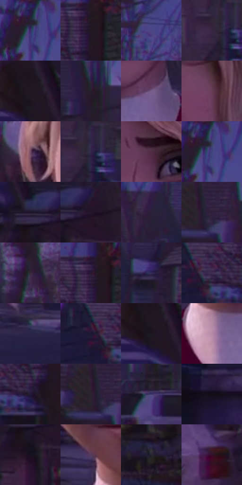

# 电影参考 432

- 状态：常规／活跃；来源世界：miles-home。
- 视角：near-level；景别：close-up；场景：street。
- 时段：twilight-appearance（外观依据，中置信度；具体时间／晨昏未知）；光照：dusk。
- 材质候选：skin, hair, fabric, wood, glass, metal, foliage, sky（帧级，不是像素分割）。
- 明暗组：very-dark；L* P5/P50/P95：6.47827 / 15.5255 / 41.98536。
- 资格门禁：无附加门禁。
- 原截图 SHA-256：`0457b34495adc5877f1258098262c0e7455d47e7630839e099f08dabbb83d80d`；尺寸：2874 × 1202。
- sRGB 像素 SHA-256：`fdf561b9dd62c9446b72cbf8fefe9ba42adccbc7e459fa2337ba7b09318c1621`。

## 观察与迁移

住宅蓝暮、暖门灯与近脸层次，远楼人群可低对比柔化。

432  /  人像景深核心：脸最稳定，背后房屋树干色偏失焦  /  柔化后不要再叠锐利大点和密排线

本公开版保存32个128×128原像素色卡上下文；图集格子并非原场景相邻位置。原rect、图集tile和像素SHA见 `data/palette-crops.json`。上下文不足时不得批准替色，不能以小样推断完整构图。

## 实测色卡

颜色比例分母为保留采样像素，不是材料面积；全部 32 色参与全库匹配。表内四舍五入仅用于阅读，原精度在 JSON。

| ID | HEX | Lab | 原图 xy | 像素数 | 比例 | 明度角色 |
| --- | --- | --- | --- | ---: | ---: | --- |
| 432-S01 | #251E3F | [13.713373, 12.762047, -19.975767] | [680, 32] | 12394 | 6.442726% | deep-shadow |
| 432-S02 | #221923 | [10.234133, 6.821209, -5.182463] | [2712, 92] | 9524 | 4.950824% | deep-shadow |
| 432-S03 | #4C4686 | [33.216401, 19.674559, -35.151268] | [1120, 100] | 9008 | 4.682594% | shadow |
| 432-S04 | #392742 | [18.861257, 14.417872, -13.816228] | [1964, 396] | 7744 | 4.025534% | deep-shadow |
| 432-S05 | #1B1319 | [6.946001, 5.296488, -2.633896] | [32, 56] | 7358 | 3.824881% | deep-shadow |
| 432-S06 | #261F2D | [13.117104, 6.846585, -8.078902] | [436, 168] | 7245 | 3.766141% | deep-shadow |
| 432-S07 | #775C87 | [43.249849, 19.575166, -19.746508] | [1556, 892] | 7164 | 3.724035% | midtone |
| 432-S08 | #683F57 | [32.228163, 21.747564, -6.831424] | [1584, 616] | 7062 | 3.671012% | shadow |
| 432-S09 | #734A65 | [36.89719, 21.902729, -8.56036] | [1132, 408] | 6999 | 3.638263% | shadow |
| 432-S10 | #33274C | [18.69908, 15.098439, -20.950104] | [1992, 392] | 6974 | 3.625268% | deep-shadow |
| 432-S11 | #512D43 | [23.775819, 20.110773, -6.69632] | [1496, 496] | 6716 | 3.491153% | shadow |
| 432-S12 | #443978 | [28.143448, 21.63876, -34.557069] | [696, 36] | 6674 | 3.469320% | shadow |
| 432-S13 | #1B1429 | [8.069845, 9.426102, -13.069148] | [176, 236] | 6597 | 3.429293% | deep-shadow |
| 432-S14 | #24162A | [9.923233, 11.761827, -10.829319] | [252, 244] | 6526 | 3.392386% | deep-shadow |
| 432-S15 | #2A1F39 | [14.217114, 11.883176, -14.914942] | [2116, 240] | 6500 | 3.378870% | deep-shadow |
| 432-S16 | #331F3E | [15.652273, 16.589519, -16.102248] | [296, 60] | 6221 | 3.233839% | deep-shadow |
| 432-S17 | #322637 | [17.179954, 9.50553, -8.849617] | [668, 348] | 5421 | 2.817978% | deep-shadow |
| 432-S18 | #251930 | [11.289304, 11.679623, -13.08772] | [2696, 68] | 5413 | 2.813819% | deep-shadow |
| 432-S19 | #372C5B | [21.46407, 17.556478, -26.579849] | [2228, 304] | 5326 | 2.768594% | shadow |
| 432-S20 | #412E53 | [22.661916, 17.108704, -19.309701] | [2600, 168] | 5144 | 2.673986% | shadow |
| 432-S21 | #2A2648 | [17.20843, 11.598787, -20.642268] | [1872, 720] | 5143 | 2.673466% | deep-shadow |
| 432-S22 | #1C1836 | [10.307284, 11.213279, -19.051253] | [2552, 164] | 4922 | 2.558584% | deep-shadow |
| 432-S23 | #1C1720 | [8.687502, 4.801987, -5.348781] | [64, 96] | 4863 | 2.527915% | deep-shadow |
| 432-S24 | #B78CA7 | [63.023053, 20.746404, -7.895628] | [1420, 952] | 4669 | 2.427068% | light |
| 432-S25 | #221B37 | [11.955879, 11.302399, -17.112293] | [2668, 196] | 4635 | 2.409394% | deep-shadow |
| 432-S26 | #2F1B35 | [13.503421, 15.468681, -13.135922] | [264, 28] | 4589 | 2.385482% | deep-shadow |
| 432-S27 | #3B3668 | [25.464786, 16.070386, -28.675312] | [2536, 588] | 4463 | 2.319984% | shadow |
| 432-S28 | #130E17 | [4.646416, 3.740075, -4.563077] | [2304, 864] | 4303 | 2.236812% | deep-shadow |
| 432-S29 | #191020 | [6.156325, 8.153583, -9.23856] | [188, 320] | 3819 | 1.985216% | deep-shadow |
| 432-S30 | #553B5D | [29.029978, 18.301043, -15.786815] | [1364, 832] | 3206 | 1.666563% | shadow |
| 432-S31 | #262631 | [15.591913, 2.931498, -7.167414] | [376, 964] | 2900 | 1.507496% | deep-shadow |
| 432-S32 | #37112A | [11.827017, 22.419249, -7.633679] | [232, 780] | 2850 | 1.481505% | deep-shadow |

## 色阶与空间分布

- 采样 ROI：`[0.01, 0.02, 0.98, 0.94]`；步长：4；样本数：192372。
- 排除区：`[]`。
- 深暗、暗、中、亮、高光五段计数：`[123768, 56623, 9003, 2820, 158]`。
- RGB 各 256 箱、L* 100 箱、13×5 色相明度表和 3×3 空间统计全部保存在 [总数据](../film-library.json)。
- [可视化档案](../../references/library.html)按需绘制直方图，不存 2,094 张重复图表图片。

## 纹理特征占比

**这是分块图像特征的面积占比，不是波点／排线／丝网／错版的精确语义覆盖率。** 窗格、发丝、织物也会产生方向或周期特征。
原图 ROI 像素 3080740；已测块覆盖 3080740（100.0000%）；未测 0。

| 特征 | 块覆盖像素 | 占已测面积 | 阈值敏感范围 |
| --- | ---: | ---: | --- |
| low-contrast | 82688 | 2.6840% | 1.7367% ~ 3.5524% |
| directional-structure | 562176 | 18.2481% | 5.4595% ~ 33.7634% |
| periodic-structure | 2308388 | 74.9297% | 63.9680% ~ 81.8433% |
| mixed-detail | 127488 | 4.1382% | 0.5318% ~ 9.1448% |

阈值敏感范围不是统计置信区间。逐块坐标、尺度、对比、方向一致性、频谱集中度、频率与角度见 [全量特征记录](../texture-features.jsonl)，以帧号定位。
四种印刷层的真实像素覆盖仍标为 `null`，不能填 0，也不能拿上表代替。不得据这些代理测量删除唯一证据。

[测量方法与保留策略](../../references/library-retention.md) · [分类索引](../archive/README.md)
