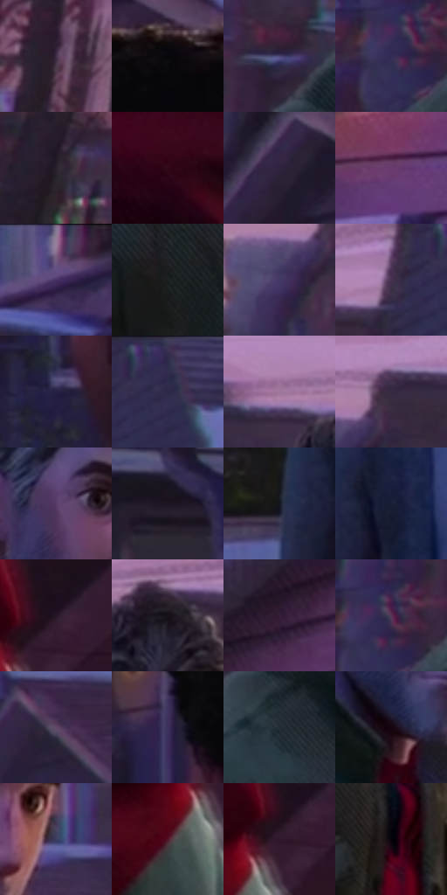

# 电影参考 433

- 状态：常规／活跃；来源世界：miles-home。
- 视角：near-level；景别：medium；场景：street。
- 时段：twilight-appearance（外观依据，中置信度；具体时间／晨昏未知）；光照：dusk。
- 材质候选：skin, hair, fabric, wood, glass, metal, foliage, sky（帧级，不是像素分割）。
- 明暗组：very-dark；L* P5/P50/P95：2.08334 / 18.66911 / 41.38597。
- 资格门禁：无附加门禁。
- 原截图 SHA-256：`958078fc19baf549b58f3404bc02212f47e4be9912e57150f30e512f5dc3a06d`；尺寸：2880 × 1210。
- sRGB 像素 SHA-256：`c653864e218924dfd9db967dc20ee25eeea8f7bfe03662660bbe57b57d425012`。

## 观察与迁移

住宅蓝暮、暖门灯与近脸层次，远楼人群可低对比柔化。

433  /  混光：墙灯柔亮、远树与房屋分色  /  灯晕只在有源区域

本公开版保存32个128×128原像素色卡上下文；图集格子并非原场景相邻位置。原rect、图集tile和像素SHA见 `data/palette-crops.json`。上下文不足时不得批准替色，不能以小样推断完整构图。

## 实测色卡

颜色比例分母为保留采样像素，不是材料面积；全部 32 色参与全库匹配。表内四舍五入仅用于阅读，原精度在 JSON。

| ID | HEX | Lab | 原图 xy | 像素数 | 比例 | 明度角色 |
| --- | --- | --- | --- | ---: | ---: | --- |
| 433-S01 | #402E45 | [21.849162, 13.138023, -11.185712] | [80, 120] | 10783 | 5.556987% | shadow |
| 433-S02 | #070609 | [1.76271, 0.678526, -1.042934] | [1684, 280] | 10538 | 5.430727% | deep-shadow |
| 433-S03 | #494474 | [31.373565, 14.615841, -26.881527] | [524, 428] | 9839 | 5.070499% | shadow |
| 433-S04 | #332C55 | [20.677098, 14.439502, -23.872745] | [388, 540] | 9235 | 4.759230% | shadow |
| 433-S05 | #27222D | [14.201413, 5.096237, -6.418456] | [132, 432] | 8499 | 4.379934% | deep-shadow |
| 433-S06 | #300818 | [7.842056, 21.827156, -0.125122] | [1848, 960] | 7892 | 4.067119% | deep-shadow |
| 433-S07 | #2F243F | [16.626062, 11.933908, -15.313007] | [1472, 188] | 7857 | 4.049082% | deep-shadow |
| 433-S08 | #683C6D | [32.434308, 27.937576, -20.555633] | [2580, 436] | 7710 | 3.973326% | shadow |
| 433-S09 | #6C577F | [40.470368, 16.9682, -19.267783] | [2004, 44] | 7290 | 3.756880% | midtone |
| 433-S10 | #1B1F20 | [11.395576, -1.573719, -1.310716] | [624, 748] | 7187 | 3.703799% | deep-shadow |
| 433-S11 | #443A67 | [27.391701, 15.790497, -24.926325] | [424, 152] | 7042 | 3.629074% | shadow |
| 433-S12 | #473251 | [24.369673, 16.09663, -15.268977] | [1044, 76] | 6931 | 3.571870% | shadow |
| 433-S13 | #262143 | [14.980221, 12.249353, -20.750843] | [1516, 748] | 6706 | 3.455917% | deep-shadow |
| 433-S14 | #2C2B4A | [19.045341, 9.346833, -19.096181] | [1140, 28] | 6565 | 3.383253% | deep-shadow |
| 433-S15 | #A0779D | [55.177522, 22.607919, -14.175121] | [648, 68] | 6377 | 3.286368% | midtone |
| 433-S16 | #362B42 | [19.66085, 10.52249, -12.609028] | [492, 76] | 6141 | 3.164746% | deep-shadow |
| 433-S17 | #563C67 | [29.885568, 20.433739, -20.878081] | [716, 316] | 5808 | 2.993136% | shadow |
| 433-S18 | #1E1523 | [8.426537, 8.046572, -7.985689] | [2072, 320] | 5555 | 2.862753% | deep-shadow |
| 433-S19 | #131620 | [7.375557, 1.638932, -7.435627] | [1000, 1104] | 5299 | 2.730824% | deep-shadow |
| 433-S20 | #171F36 | [12.145202, 4.349098, -16.167855] | [1092, 1064] | 5246 | 2.703511% | deep-shadow |
| 433-S21 | #271627 | [10.196063, 12.216097, -8.150365] | [2148, 968] | 5141 | 2.649399% | deep-shadow |
| 433-S22 | #171118 | [5.862491, 4.16864, -3.499405] | [792, 100] | 5119 | 2.638061% | deep-shadow |
| 433-S23 | #341F38 | [15.464281, 15.414282, -12.167885] | [2360, 68] | 4998 | 2.575704% | deep-shadow |
| 433-S24 | #563557 | [27.333131, 21.100498, -14.490515] | [412, 516] | 4971 | 2.561790% | shadow |
| 433-S25 | #624969 | [34.765788, 16.978692, -14.496451] | [1080, 344] | 4613 | 2.377296% | shadow |
| 433-S26 | #3D305D | [23.325245, 17.297568, -24.903181] | [1516, 564] | 4568 | 2.354105% | shadow |
| 433-S27 | #212C34 | [17.332046, -2.32116, -6.67888] | [580, 548] | 4543 | 2.341222% | deep-shadow |
| 433-S28 | #16040C | [2.56527, 6.99421, -1.002912] | [720, 492] | 4200 | 2.164458% | deep-shadow |
| 433-S29 | #393D60 | [26.881308, 8.169636, -21.285996] | [864, 372] | 3558 | 1.833605% | shadow |
| 433-S30 | #4D1525 | [16.738942, 27.771874, 3.75747] | [2064, 1080] | 2311 | 1.190967% | deep-shadow |
| 433-S31 | #30182B | [12.326611, 15.515477, -7.712708] | [2124, 1004] | 1502 | 0.774051% | deep-shadow |
| 433-S32 | #05030A | [1.077646, 1.496253, -2.464589] | [812, 872] | 20 | 0.010307% | deep-shadow |

## 色阶与空间分布

- 采样 ROI：`[0.01, 0.02, 0.98, 0.94]`；步长：4；样本数：194044。
- 排除区：`[]`。
- 深暗、暗、中、亮、高光五段计数：`[106167, 77094, 9378, 1293, 112]`。
- RGB 各 256 箱、L* 100 箱、13×5 色相明度表和 3×3 空间统计全部保存在 [总数据](../film-library.json)。
- [可视化档案](../../references/library.html)按需绘制直方图，不存 2,094 张重复图表图片。

## 纹理特征占比

**这是分块图像特征的面积占比，不是波点／排线／丝网／错版的精确语义覆盖率。** 窗格、发丝、织物也会产生方向或周期特征。
原图 ROI 像素 3109722；已测块覆盖 3109722（100.0000%）；未测 0。

| 特征 | 块覆盖像素 | 占已测面积 | 阈值敏感范围 |
| --- | ---: | ---: | --- |
| low-contrast | 205824 | 6.6187% | 6.2524% ~ 7.1456% |
| directional-structure | 627162 | 20.1678% | 9.6058% ~ 35.8132% |
| periodic-structure | 2265344 | 72.8472% | 57.5681% ~ 79.7211% |
| mixed-detail | 11392 | 0.3663% | 0.3663% ~ 3.5275% |

阈值敏感范围不是统计置信区间。逐块坐标、尺度、对比、方向一致性、频谱集中度、频率与角度见 [全量特征记录](../texture-features.jsonl)，以帧号定位。
四种印刷层的真实像素覆盖仍标为 `null`，不能填 0，也不能拿上表代替。不得据这些代理测量删除唯一证据。

[测量方法与保留策略](../../references/library-retention.md) · [分类索引](../archive/README.md)
