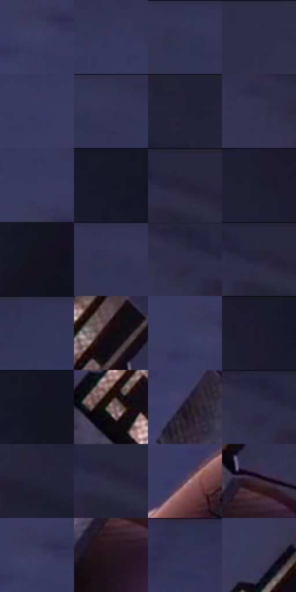

# 电影参考 434

- 状态：常规／活跃；来源世界：miles-home。
- 视角：high-angle；景别：detail；场景：detail。
- 时段：twilight-appearance（外观依据，中置信度；具体时间／晨昏未知）；光照：dusk。
- 材质候选：skin, plastic, metal（帧级，不是像素分割）。
- 明暗组：dark；L* P5/P50/P95：6.38601 / 21.20408 / 28.3028。
- 资格门禁：无附加门禁。
- 原截图 SHA-256：`172acc297f349c4eed3e9e246fb99ddd9452a05a9bec501ea635a88fd66e012a`；尺寸：2880 × 1212。
- sRGB 像素 SHA-256：`c46d45213997835dacd554c1b40c9aa438960a95bd65ad37eb53bff6c5b23cb3`。

## 观察与迁移

手持电子构件，金属导体亮条与黑壳分开。

434  /  物件近景：金属触点、细网目、后方低细节  /  伸出的线材不是运动线

本公开版保存32个128×128原像素色卡上下文；图集格子并非原场景相邻位置。原rect、图集tile和像素SHA见 `data/palette-crops.json`。上下文不足时不得批准替色，不能以小样推断完整构图。

## 实测色卡

颜色比例分母为保留采样像素，不是材料面积；全部 32 色参与全库匹配。表内四舍五入仅用于阅读，原精度在 JSON。

| ID | HEX | Lab | 原图 xy | 像素数 | 比例 | 明度角色 |
| --- | --- | --- | --- | ---: | ---: | --- |
| 434-S01 | #3E3E65 | [27.868822, 10.628664, -22.930141] | [1012, 256] | 11442 | 5.896601% | shadow |
| 434-S02 | #37375B | [24.638557, 10.025343, -21.561467] | [972, 88] | 10325 | 5.320958% | shadow |
| 434-S03 | #363659 | [24.140854, 9.75703, -21.037989] | [1224, 44] | 9566 | 4.929810% | shadow |
| 434-S04 | #302F4A | [20.656989, 7.882035, -16.546594] | [216, 40] | 9529 | 4.910742% | shadow |
| 434-S05 | #3A3B61 | [26.419895, 10.148394, -22.650171] | [884, 208] | 8832 | 4.551545% | shadow |
| 434-S06 | #343353 | [22.730558, 9.27538, -19.301005] | [1296, 28] | 8499 | 4.379934% | shadow |
| 434-S07 | #212036 | [13.367358, 6.92131, -14.187304] | [2180, 28] | 8045 | 4.145967% | deep-shadow |
| 434-S08 | #32314E | [21.670136, 8.423566, -17.640104] | [1772, 92] | 7951 | 4.097524% | shadow |
| 434-S09 | #39395E | [25.575531, 10.24348, -22.035447] | [1008, 164] | 7646 | 3.940343% | shadow |
| 434-S10 | #171727 | [8.493398, 4.921495, -10.946354] | [2704, 28] | 7553 | 3.892416% | deep-shadow |
| 434-S11 | #27243C | [15.588023, 8.107272, -14.906756] | [1936, 52] | 7460 | 3.844489% | deep-shadow |
| 434-S12 | #1D1C2F | [11.253835, 6.100604, -12.485215] | [2484, 28] | 7304 | 3.764095% | deep-shadow |
| 434-S13 | #13121E | [6.004894, 3.57528, -7.986235] | [2804, 172] | 6242 | 3.216796% | deep-shadow |
| 434-S14 | #343456 | [23.195486, 9.536119, -20.558378] | [1224, 32] | 6207 | 3.198759% | shadow |
| 434-S15 | #2C2B47 | [18.877358, 8.372037, -17.320126] | [1836, 68] | 5988 | 3.085898% | deep-shadow |
| 434-S16 | #282741 | [16.910808, 7.911278, -16.30841] | [1912, 40] | 5813 | 2.995712% | deep-shadow |
| 434-S17 | #323254 | [22.29963, 9.63596, -20.653325] | [772, 28] | 5578 | 2.874606% | shadow |
| 434-S18 | #120C10 | [3.874804, 2.733068, -1.155835] | [1800, 484] | 5222 | 2.691142% | deep-shadow |
| 434-S19 | #3C3B61 | [26.595942, 10.775164, -22.361476] | [972, 240] | 5133 | 2.645276% | shadow |
| 434-S20 | #1B1A2C | [10.210628, 5.852669, -11.937811] | [2556, 44] | 5123 | 2.640123% | deep-shadow |
| 434-S21 | #151522 | [7.327749, 3.882868, -9.009658] | [2784, 64] | 4847 | 2.497887% | deep-shadow |
| 434-S22 | #86656B | [46.228285, 14.252829, 1.787691] | [1508, 596] | 4609 | 2.375234% | midtone |
| 434-S23 | #261F31 | [13.313847, 7.987843, -10.655514] | [1368, 632] | 4569 | 2.354621% | deep-shadow |
| 434-S24 | #2E2D48 | [19.742549, 7.964547, -16.6339] | [1836, 60] | 3951 | 2.036136% | deep-shadow |
| 434-S25 | #232339 | [14.705597, 6.428934, -14.207402] | [2096, 96] | 3935 | 2.027891% | deep-shadow |
| 434-S26 | #2D2942 | [18.085302, 8.564904, -15.127633] | [1936, 84] | 3708 | 1.910907% | deep-shadow |
| 434-S27 | #5A475A | [32.741205, 11.868289, -8.153327] | [1148, 840] | 3645 | 1.878440% | shadow |
| 434-S28 | #3C2A38 | [19.647954, 11.174773, -5.688404] | [1724, 828] | 3621 | 1.866072% | deep-shadow |
| 434-S29 | #3D3A5E | [26.2337, 10.850078, -20.978014] | [1020, 240] | 3544 | 1.826390% | shadow |
| 434-S30 | #23161D | [9.156141, 8.052644, -2.287355] | [1692, 908] | 3010 | 1.551195% | deep-shadow |
| 434-S31 | #2F304F | [21.141876, 8.441279, -19.15594] | [1620, 28] | 2791 | 1.438334% | shadow |
| 434-S32 | #3B3755 | [24.695846, 9.51709, -17.507348] | [1668, 340] | 2356 | 1.214158% | shadow |

## 色阶与空间分布

- 采样 ROI：`[0.01, 0.02, 0.98, 0.94]`；步长：4；样本数：194044。
- 排除区：`[]`。
- 深暗、暗、中、亮、高光五段计数：`[85562, 105359, 2647, 460, 16]`。
- RGB 各 256 箱、L* 100 箱、13×5 色相明度表和 3×3 空间统计全部保存在 [总数据](../film-library.json)。
- [可视化档案](../../references/library.html)按需绘制直方图，不存 2,094 张重复图表图片。

## 纹理特征占比

**这是分块图像特征的面积占比，不是波点／排线／丝网／错版的精确语义覆盖率。** 窗格、发丝、织物也会产生方向或周期特征。
原图 ROI 像素 3115310；已测块覆盖 3115310（100.0000%）；未测 0。

| 特征 | 块覆盖像素 | 占已测面积 | 阈值敏感范围 |
| --- | ---: | ---: | --- |
| low-contrast | 2219310 | 71.2388% | 65.9796% ~ 75.4462% |
| directional-structure | 175488 | 5.6331% | 4.0553% ~ 10.0623% |
| periodic-structure | 671360 | 21.5503% | 17.8689% ~ 23.4321% |
| mixed-detail | 49152 | 1.5778% | 0.5259% ~ 2.6296% |

阈值敏感范围不是统计置信区间。逐块坐标、尺度、对比、方向一致性、频谱集中度、频率与角度见 [全量特征记录](../texture-features.jsonl)，以帧号定位。
四种印刷层的真实像素覆盖仍标为 `null`，不能填 0，也不能拿上表代替。不得据这些代理测量删除唯一证据。

[测量方法与保留策略](../../references/library-retention.md) · [分类索引](../archive/README.md)
