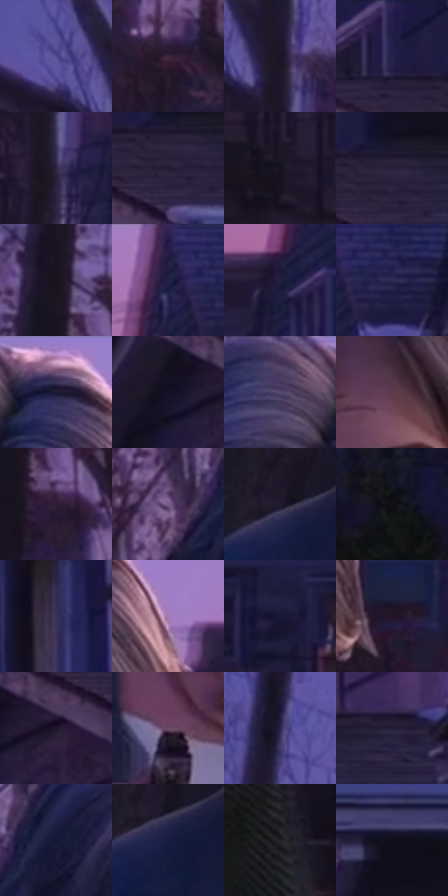

# 电影参考 435

- 状态：常规／活跃；来源世界：miles-home。
- 视角：near-level；景别：medium；场景：street。
- 时段：twilight-appearance（外观依据，中置信度；具体时间／晨昏未知）；光照：dusk。
- 材质候选：skin, hair, fabric, wood, glass, metal, foliage, sky（帧级，不是像素分割）。
- 明暗组：very-dark；L* P5/P50/P95：5.3173 / 13.16231 / 42.26995。
- 资格门禁：无附加门禁。
- 原截图 SHA-256：`7472bc6d93dab841d09c773d54a1d0f618ee5bc989025095559e10cf8a4440c4`；尺寸：2880 × 1206。
- sRGB 像素 SHA-256：`e02883efd057c851f86b4e43148ec5638894940b2106c05729df4fce653a2bca`。

## 观察与迁移

住宅蓝暮、暖门灯与近脸层次，远楼人群可低对比柔化。

435  /  面部景深：前脸与手持物清楚，后街退后  /  不把人脸统一染成紫色平面

本公开版保存32个128×128原像素色卡上下文；图集格子并非原场景相邻位置。原rect、图集tile和像素SHA见 `data/palette-crops.json`。上下文不足时不得批准替色，不能以小样推断完整构图。

## 实测色卡

颜色比例分母为保留采样像素，不是材料面积；全部 32 色参与全库匹配。表内四舍五入仅用于阅读，原精度在 JSON。

| ID | HEX | Lab | 原图 xy | 像素数 | 比例 | 明度角色 |
| --- | --- | --- | --- | ---: | ---: | --- |
| 435-S01 | #4F498F | [34.822491, 21.329966, -38.096746] | [520, 216] | 9536 | 4.932091% | shadow |
| 435-S02 | #3D273D | [19.14106, 14.751616, -9.898063] | [1020, 464] | 8551 | 4.422641% | deep-shadow |
| 435-S03 | #1B1526 | [8.211539, 7.696909, -10.603347] | [616, 256] | 8481 | 4.386437% | deep-shadow |
| 435-S04 | #23204A | [14.869659, 14.544413, -25.781123] | [2464, 56] | 8235 | 4.259204% | deep-shadow |
| 435-S05 | #2E2544 | [17.090255, 12.365702, -18.053415] | [628, 376] | 8136 | 4.208000% | deep-shadow |
| 435-S06 | #221B35 | [11.830249, 10.647913, -15.876702] | [2556, 132] | 7484 | 3.870781% | deep-shadow |
| 435-S07 | #140F1D | [5.230702, 5.351077, -8.367661] | [484, 452] | 7346 | 3.799406% | deep-shadow |
| 435-S08 | #2A203B | [14.629701, 11.764987, -15.680309] | [2568, 104] | 7287 | 3.768891% | deep-shadow |
| 435-S09 | #181520 | [7.540641, 4.526553, -7.138334] | [904, 164] | 7010 | 3.625625% | deep-shadow |
| 435-S10 | #1D1A3E | [11.605062, 12.922626, -22.683541] | [2168, 40] | 6843 | 3.539251% | deep-shadow |
| 435-S11 | #221E3F | [13.396181, 11.808718, -20.499259] | [2124, 204] | 6497 | 3.360297% | deep-shadow |
| 435-S12 | #2F2B56 | [20.059085, 14.261981, -25.545278] | [2248, 84] | 6410 | 3.315300% | shadow |
| 435-S13 | #1A162E | [8.91326, 9.231429, -15.452119] | [1540, 60] | 6373 | 3.296163% | deep-shadow |
| 435-S14 | #151124 | [6.211741, 7.144992, -12.250421] | [2404, 212] | 6344 | 3.281164% | deep-shadow |
| 435-S15 | #45375E | [26.173763, 15.519155, -21.014169] | [1420, 60] | 6309 | 3.263062% | shadow |
| 435-S16 | #5D3B4C | [29.355037, 17.838352, -4.150081] | [1516, 312] | 6242 | 3.228409% | shadow |
| 435-S17 | #2C1C31 | [13.155493, 12.557022, -10.838899] | [948, 268] | 5833 | 3.016871% | deep-shadow |
| 435-S18 | #765D89 | [43.487275, 19.088635, -20.595122] | [1168, 232] | 5818 | 3.009113% | midtone |
| 435-S19 | #201C2C | [11.410567, 6.295571, -10.033723] | [1192, 728] | 5618 | 2.905672% | deep-shadow |
| 435-S20 | #111113 | [5.122413, 0.415032, -1.129822] | [2364, 820] | 5570 | 2.880846% | deep-shadow |
| 435-S21 | #39325A | [23.301346, 13.765306, -22.996446] | [2532, 468] | 5542 | 2.866364% | shadow |
| 435-S22 | #A47AB5 | [57.219535, 27.115028, -24.851107] | [1660, 144] | 5524 | 2.857054% | midtone |
| 435-S23 | #191736 | [9.686107, 11.053169, -20.060781] | [140, 332] | 5440 | 2.813609% | deep-shadow |
| 435-S24 | #231626 | [9.570322, 10.264934, -8.417029] | [1796, 408] | 5343 | 2.763440% | deep-shadow |
| 435-S25 | #21172C | [9.937895, 10.415133, -12.311943] | [2488, 212] | 5148 | 2.662584% | deep-shadow |
| 435-S26 | #6B4A66 | [35.951593, 19.067094, -10.710622] | [1356, 948] | 4990 | 2.580865% | shadow |
| 435-S27 | #2A254A | [17.035009, 12.980097, -22.2849] | [640, 68] | 4882 | 2.525007% | deep-shadow |
| 435-S28 | #241F38 | [13.474821, 9.388528, -15.418261] | [2752, 104] | 4161 | 2.152100% | deep-shadow |
| 435-S29 | #131634 | [8.654594, 9.344085, -20.294303] | [1272, 200] | 3556 | 1.839190% | deep-shadow |
| 435-S30 | #171D42 | [12.31309, 10.632781, -24.391506] | [1204, 760] | 3344 | 1.729542% | deep-shadow |
| 435-S31 | #161719 | [7.710005, 0.058254, -1.57406] | [36, 612] | 2780 | 1.437837% | deep-shadow |
| 435-S32 | #100D1A | [4.268748, 3.884723, -7.482557] | [2712, 252] | 2713 | 1.403184% | deep-shadow |

## 色阶与空间分布

- 采样 ROI：`[0.01, 0.02, 0.98, 0.94]`；步长：4；样本数：193346。
- 排除区：`[]`。
- 深暗、暗、中、亮、高光五段计数：`[143221, 38247, 11450, 415, 13]`。
- RGB 各 256 箱、L* 100 箱、13×5 色相明度表和 3×3 空间统计全部保存在 [总数据](../film-library.json)。
- [可视化档案](../../references/library.html)按需绘制直方图，不存 2,094 张重复图表图片。

## 纹理特征占比

**这是分块图像特征的面积占比，不是波点／排线／丝网／错版的精确语义覆盖率。** 窗格、发丝、织物也会产生方向或周期特征。
原图 ROI 像素 3098546；已测块覆盖 3098546（100.0000%）；未测 0。

| 特征 | 块覆盖像素 | 占已测面积 | 阈值敏感范围 |
| --- | ---: | ---: | --- |
| low-contrast | 98304 | 3.1726% | 2.1151% ~ 7.0433% |
| directional-structure | 747776 | 24.1331% | 12.2442% ~ 39.5499% |
| periodic-structure | 2077746 | 67.0555% | 58.3350% ~ 68.1775% |
| mixed-detail | 174720 | 5.6388% | 0.0000% ~ 12.5350% |

阈值敏感范围不是统计置信区间。逐块坐标、尺度、对比、方向一致性、频谱集中度、频率与角度见 [全量特征记录](../texture-features.jsonl)，以帧号定位。
四种印刷层的真实像素覆盖仍标为 `null`，不能填 0，也不能拿上表代替。不得据这些代理测量删除唯一证据。

[测量方法与保留策略](../../references/library-retention.md) · [分类索引](../archive/README.md)
