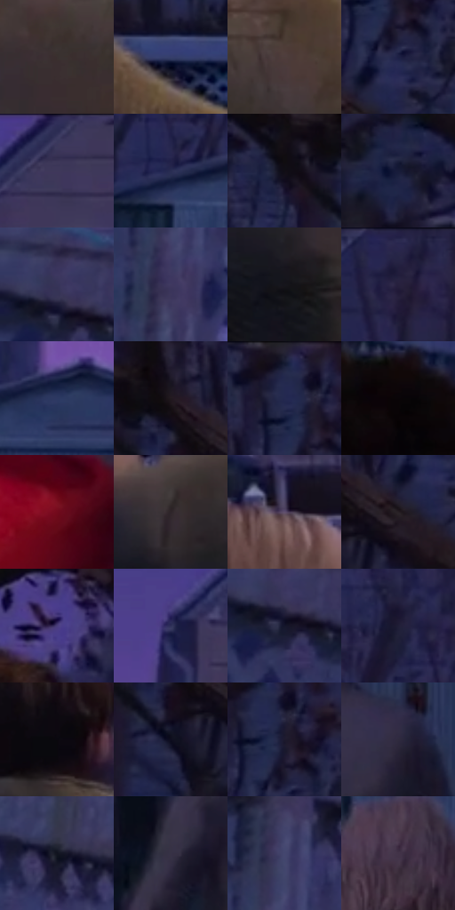

# 电影参考 436

- 状态：常规／活跃；来源世界：miles-home。
- 视角：near-level；景别：medium；场景：street。
- 时段：twilight-appearance（外观依据，中置信度；具体时间／晨昏未知）；光照：dusk。
- 材质候选：skin, hair, fabric, wood, glass, metal, foliage, sky（帧级，不是像素分割）。
- 明暗组：very-dark；L* P5/P50/P95：2.88062 / 18.57365 / 31.3494。
- 资格门禁：无附加门禁。
- 原截图 SHA-256：`ca0995492bce075d634ba7cc365ce355cf59f46f78c5c86490b275b47cd9bfbf`；尺寸：2880 × 1212。
- sRGB 像素 SHA-256：`cd690d8ebdee072af51c5aa75c940632267c42892a38133e5ead6a697d263217`。

## 观察与迁移

住宅蓝暮、暖门灯与近脸层次，远楼人群可低对比柔化。

436  /  后院中景：白栅栏、棚屋、前后人物关系  /  保留走向与遮挡，不逐孔强化栅栏

本公开版保存32个128×128原像素色卡上下文；图集格子并非原场景相邻位置。原rect、图集tile和像素SHA见 `data/palette-crops.json`。上下文不足时不得批准替色，不能以小样推断完整构图。

## 实测色卡

颜色比例分母为保留采样像素，不是材料面积；全部 32 色参与全库匹配。表内四舍五入仅用于阅读，原精度在 JSON。

| ID | HEX | Lab | 原图 xy | 像素数 | 比例 | 明度角色 |
| --- | --- | --- | --- | ---: | ---: | --- |
| 436-S01 | #3A302F | [20.899591, 4.310833, 2.319203] | [2148, 592] | 11847 | 6.105316% | shadow |
| 436-S02 | #373E6B | [27.623919, 10.50841, -27.197878] | [2416, 496] | 9264 | 4.774175% | shadow |
| 436-S03 | #4D3E3B | [27.679517, 5.967874, 4.298938] | [2276, 544] | 9036 | 4.656676% | shadow |
| 436-S04 | #1D2145 | [14.278717, 10.329429, -23.305911] | [2768, 152] | 8920 | 4.596896% | deep-shadow |
| 436-S05 | #3A385D | [25.314914, 10.926809, -21.786967] | [1688, 32] | 8812 | 4.541238% | shadow |
| 436-S06 | #292D53 | [19.933451, 10.080055, -23.774026] | [1260, 364] | 8335 | 4.295418% | deep-shadow |
| 436-S07 | #100E15 | [4.321114, 2.103993, -3.634089] | [2544, 192] | 8277 | 4.265527% | deep-shadow |
| 436-S08 | #171C39 | [11.331049, 7.800204, -19.600022] | [2768, 368] | 8198 | 4.224815% | deep-shadow |
| 436-S09 | #373458 | [23.580717, 11.133631, -21.253316] | [68, 240] | 8003 | 4.124322% | shadow |
| 436-S10 | #403860 | [26.047735, 13.771814, -22.547742] | [212, 488] | 7671 | 3.953227% | shadow |
| 436-S11 | #16151D | [7.186602, 2.644257, -5.408564] | [2016, 728] | 7298 | 3.761003% | deep-shadow |
| 436-S12 | #262545 | [16.329147, 10.032257, -19.997458] | [952, 36] | 7257 | 3.739873% | deep-shadow |
| 436-S13 | #2D3862 | [24.53749, 8.793269, -26.337007] | [1408, 356] | 7118 | 3.668240% | shadow |
| 436-S14 | #22191F | [10.063604, 5.822824, -2.455666] | [2636, 160] | 6678 | 3.441487% | deep-shadow |
| 436-S15 | #242950 | [18.098187, 10.474045, -24.700828] | [2736, 52] | 6245 | 3.218342% | deep-shadow |
| 436-S16 | #090508 | [1.663463, 1.463042, -0.766552] | [764, 480] | 6154 | 3.171446% | deep-shadow |
| 436-S17 | #720A1C | [23.268928, 42.868087, 20.136893] | [868, 948] | 5692 | 2.933355% | shadow |
| 436-S18 | #2E2529 | [15.820228, 5.088692, -1.060543] | [1920, 600] | 5657 | 2.915318% | deep-shadow |
| 436-S19 | #604F6E | [36.375243, 13.65068, -15.181965] | [1788, 476] | 5409 | 2.787512% | shadow |
| 436-S20 | #272025 | [13.217735, 4.488898, -2.123383] | [2724, 216] | 5404 | 2.784935% | deep-shadow |
| 436-S21 | #4A3D7D | [30.092659, 22.196785, -34.551333] | [2232, 76] | 5367 | 2.765868% | shadow |
| 436-S22 | #2E3159 | [21.93894, 10.785649, -24.556543] | [1540, 136] | 5145 | 2.651460% | shadow |
| 436-S23 | #14162B | [8.101255, 6.087013, -14.558966] | [76, 280] | 4884 | 2.516955% | deep-shadow |
| 436-S24 | #201E37 | [12.68029, 8.389186, -15.98429] | [1160, 92] | 4645 | 2.393787% | deep-shadow |
| 436-S25 | #0A080F | [2.463119, 1.598801, -2.743758] | [2212, 308] | 4380 | 2.257220% | deep-shadow |
| 436-S26 | #0E0E1F | [4.573712, 4.264895, -10.964478] | [2640, 272] | 3814 | 1.965534% | deep-shadow |
| 436-S27 | #1D1A2E | [10.53683, 7.272666, -12.876552] | [2764, 88] | 3519 | 1.813506% | deep-shadow |
| 436-S28 | #2F2A3E | [18.400282, 7.412207, -11.868692] | [1420, 764] | 3222 | 1.660448% | deep-shadow |
| 436-S29 | #10131F | [6.095424, 2.14698, -8.643297] | [372, 340] | 2589 | 1.334233% | deep-shadow |
| 436-S30 | #373145 | [21.720756, 7.592282, -11.470657] | [1176, 832] | 2549 | 1.313620% | shadow |
| 436-S31 | #44466F | [31.246328, 10.259252, -23.963288] | [224, 372] | 2023 | 1.042547% | shadow |
| 436-S32 | #423348 | [23.651056, 11.302273, -10.428577] | [1316, 536] | 632 | 0.325699% | shadow |

## 色阶与空间分布

- 采样 ROI：`[0.01, 0.02, 0.98, 0.94]`；步长：4；样本数：194044。
- 排除区：`[]`。
- 深暗、暗、中、亮、高光五段计数：`[107008, 85115, 1921, 0, 0]`。
- RGB 各 256 箱、L* 100 箱、13×5 色相明度表和 3×3 空间统计全部保存在 [总数据](../film-library.json)。
- [可视化档案](../../references/library.html)按需绘制直方图，不存 2,094 张重复图表图片。

## 纹理特征占比

**这是分块图像特征的面积占比，不是波点／排线／丝网／错版的精确语义覆盖率。** 窗格、发丝、织物也会产生方向或周期特征。
原图 ROI 像素 3115310；已测块覆盖 3115310（100.0000%）；未测 0。

| 特征 | 块覆盖像素 | 占已测面积 | 阈值敏感范围 |
| --- | ---: | ---: | --- |
| low-contrast | 60800 | 1.9517% | 1.0518% ~ 4.0553% |
| directional-structure | 463662 | 14.8833% | 9.3145% ~ 27.4848% |
| periodic-structure | 2546432 | 81.7393% | 71.4633% ~ 81.8558% |
| mixed-detail | 44416 | 1.4257% | 0.0000% ~ 4.7744% |

阈值敏感范围不是统计置信区间。逐块坐标、尺度、对比、方向一致性、频谱集中度、频率与角度见 [全量特征记录](../texture-features.jsonl)，以帧号定位。
四种印刷层的真实像素覆盖仍标为 `null`，不能填 0，也不能拿上表代替。不得据这些代理测量删除唯一证据。

[测量方法与保留策略](../../references/library-retention.md) · [分类索引](../archive/README.md)
