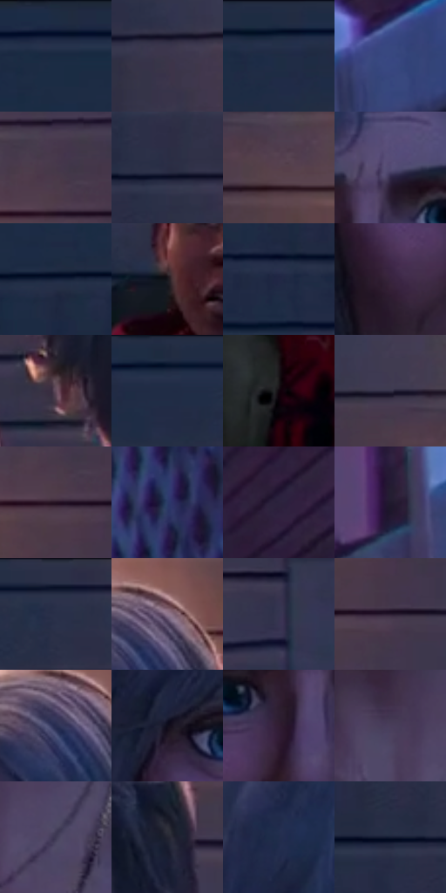

# 电影参考 437

- 状态：常规／活跃；来源世界：miles-home。
- 视角：near-level；景别：medium；场景：street。
- 时段：twilight-appearance（外观依据，中置信度；具体时间／晨昏未知）；光照：dusk。
- 材质候选：skin, hair, fabric, wood, glass, metal, foliage, sky（帧级，不是像素分割）。
- 明暗组：very-dark；L* P5/P50/P95：4.79276 / 17.82672 / 35.66559。
- 资格门禁：无附加门禁。
- 原截图 SHA-256：`26950cfdf250ca6f3a8672a352a8e0b939c14030e98a8d68d385a80e0d0ed28b`；尺寸：2880 × 1210。
- sRGB 像素 SHA-256：`3c4e80d3eef795a3277325052361e1686bc580f07a6499e5c80f5495413db944`。

## 观察与迁移

住宅蓝暮、暖门灯与近脸层次，远楼人群可低对比柔化。

437  /  背光：灯下暖发缘与冷环境，前后人物层次  /  背后灯不是头部附属发光物

本公开版保存32个128×128原像素色卡上下文；图集格子并非原场景相邻位置。原rect、图集tile和像素SHA见 `data/palette-crops.json`。上下文不足时不得批准替色，不能以小样推断完整构图。

## 实测色卡

颜色比例分母为保留采样像素，不是材料面积；全部 32 色参与全库匹配。表内四舍五入仅用于阅读，原精度在 JSON。

| ID | HEX | Lab | 原图 xy | 像素数 | 比例 | 明度角色 |
| --- | --- | --- | --- | ---: | ---: | --- |
| 437-S01 | #1D2B43 | [17.432418, 2.24112, -16.934487] | [260, 28] | 8724 | 4.495888% | deep-shadow |
| 437-S02 | #3B354B | [23.618352, 8.03044, -12.548882] | [908, 152] | 8345 | 4.300571% | shadow |
| 437-S03 | #111F36 | [11.725111, 2.671627, -16.858613] | [512, 40] | 8065 | 4.156274% | deep-shadow |
| 437-S04 | #38477F | [31.529632, 11.604368, -33.595271] | [2448, 600] | 8027 | 4.136691% | shadow |
| 437-S05 | #463749 | [25.307532, 10.468062, -8.535403] | [1912, 164] | 7960 | 4.102162% | shadow |
| 437-S06 | #292D44 | [19.078813, 4.962717, -14.980575] | [776, 212] | 7642 | 3.938282% | deep-shadow |
| 437-S07 | #57414C | [30.227472, 11.568308, -2.938841] | [1136, 196] | 7466 | 3.847581% | shadow |
| 437-S08 | #524A72 | [33.786568, 13.001346, -21.789431] | [1524, 444] | 7237 | 3.729566% | shadow |
| 437-S09 | #17213B | [13.141617, 4.796994, -18.146185] | [372, 144] | 6901 | 3.556410% | deep-shadow |
| 437-S10 | #18171D | [8.090334, 2.130059, -4.026765] | [1944, 1004] | 6822 | 3.515697% | deep-shadow |
| 437-S11 | #212745 | [16.522775, 7.040988, -19.720129] | [476, 340] | 6763 | 3.485292% | deep-shadow |
| 437-S12 | #37243D | [17.511026, 14.418294, -12.471531] | [1364, 620] | 6728 | 3.467255% | deep-shadow |
| 437-S13 | #654C5C | [35.417072, 13.491267, -5.289136] | [1164, 688] | 6643 | 3.423450% | shadow |
| 437-S14 | #1A263E | [15.241225, 3.107554, -16.926827] | [632, 40] | 6552 | 3.376554% | deep-shadow |
| 437-S15 | #11050D | [2.319578, 4.67014, -1.884673] | [544, 1020] | 6285 | 3.238956% | deep-shadow |
| 437-S16 | #323045 | [20.910417, 6.39256, -12.758923] | [1040, 124] | 5989 | 3.086413% | shadow |
| 437-S17 | #221020 | [7.361793, 12.593976, -7.291833] | [1908, 216] | 5984 | 3.083837% | deep-shadow |
| 437-S18 | #2C3B68 | [25.750609, 8.632633, -28.294026] | [2556, 880] | 5772 | 2.974583% | shadow |
| 437-S19 | #2B223D | [15.458517, 11.300989, -15.777442] | [2468, 320] | 5769 | 2.973037% | deep-shadow |
| 437-S20 | #20192D | [10.496603, 8.84395, -12.183103] | [2284, 644] | 5650 | 2.911711% | deep-shadow |
| 437-S21 | #0E152B | [7.262804, 4.923995, -15.916677] | [808, 32] | 5158 | 2.658160% | deep-shadow |
| 437-S22 | #8F768D | [52.641673, 13.950543, -8.835725] | [1672, 196] | 5042 | 2.598380% | midtone |
| 437-S23 | #353551 | [23.328052, 7.615727, -17.03485] | [2080, 604] | 5037 | 2.595803% | shadow |
| 437-S24 | #2A1C31 | [12.888348, 11.756751, -11.273698] | [1956, 304] | 5010 | 2.581889% | deep-shadow |
| 437-S25 | #292E53 | [20.241931, 9.369983, -23.285028] | [1632, 228] | 4697 | 2.420585% | shadow |
| 437-S26 | #100D1C | [4.352349, 4.472193, -8.935414] | [1336, 480] | 4506 | 2.322154% | deep-shadow |
| 437-S27 | #311D32 | [14.185471, 14.125182, -9.911079] | [1460, 532] | 4378 | 2.256189% | deep-shadow |
| 437-S28 | #493D5A | [28.093142, 11.878914, -15.401044] | [1480, 1052] | 4378 | 2.256189% | shadow |
| 437-S29 | #3F3A54 | [25.93019, 8.623869, -14.907513] | [1572, 1100] | 4305 | 2.218569% | shadow |
| 437-S30 | #232431 | [14.62848, 3.15839, -8.662231] | [1836, 552] | 4268 | 2.199501% | deep-shadow |
| 437-S31 | #222D4C | [18.964375, 5.567549, -20.634611] | [1376, 320] | 4225 | 2.177341% | deep-shadow |
| 437-S32 | #121B30 | [9.998091, 3.54051, -15.250857] | [680, 220] | 3716 | 1.915030% | deep-shadow |

## 色阶与空间分布

- 采样 ROI：`[0.01, 0.02, 0.98, 0.94]`；步长：4；样本数：194044。
- 排除区：`[]`。
- 深暗、暗、中、亮、高光五段计数：`[113416, 74425, 5549, 378, 276]`。
- RGB 各 256 箱、L* 100 箱、13×5 色相明度表和 3×3 空间统计全部保存在 [总数据](../film-library.json)。
- [可视化档案](../../references/library.html)按需绘制直方图，不存 2,094 张重复图表图片。

## 纹理特征占比

**这是分块图像特征的面积占比，不是波点／排线／丝网／错版的精确语义覆盖率。** 窗格、发丝、织物也会产生方向或周期特征。
原图 ROI 像素 3109722；已测块覆盖 3109722（100.0000%）；未测 0。

| 特征 | 块覆盖像素 | 占已测面积 | 阈值敏感范围 |
| --- | ---: | ---: | --- |
| low-contrast | 55552 | 1.7864% | 0.8932% ~ 1.7864% |
| directional-structure | 1324288 | 42.5854% | 32.6656% ~ 54.1558% |
| periodic-structure | 1697114 | 54.5745% | 44.9510% ~ 63.9675% |
| mixed-detail | 32768 | 1.0537% | 0.0000% ~ 1.5806% |

阈值敏感范围不是统计置信区间。逐块坐标、尺度、对比、方向一致性、频谱集中度、频率与角度见 [全量特征记录](../texture-features.jsonl)，以帧号定位。
四种印刷层的真实像素覆盖仍标为 `null`，不能填 0，也不能拿上表代替。不得据这些代理测量删除唯一证据。

[测量方法与保留策略](../../references/library-retention.md) · [分类索引](../archive/README.md)
