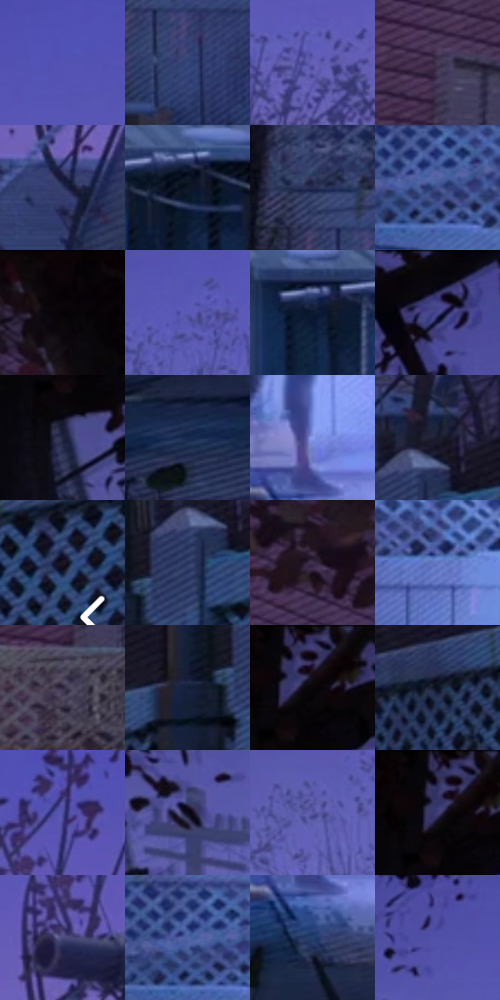

# 电影参考 438

- 状态：常规／活跃；来源世界：miles-home。
- 视角：near-level；景别：environment-wide；场景：street。
- 时段：twilight-appearance（外观依据，中置信度；具体时间／晨昏未知）；光照：dusk。
- 材质候选：skin, hair, fabric, wood, glass, metal, foliage, sky（帧级，不是像素分割）。
- 明暗组：dark；L* P5/P50/P95：1.95879 / 23.7057 / 49.41157。
- 资格门禁：无附加门禁。
- 原截图 SHA-256：`fa5143eade96d20a97419886a43644530a7ed9580c2483683d9204fcfec8f3df`；尺寸：2880 × 1212。
- sRGB 像素 SHA-256：`441d19f1868c4718d437656a64925ea3a834ea93e4dede7dd85cf0c87e7398f1`。

## 观察与迁移

住宅蓝暮、暖门灯与近脸层次，远楼人群可低对比柔化。

438  /  局部强光：蓝白门口与附近网点／柔光过渡  /  光局限在有源区域，不整图发光或新增门

本公开版保存32个128×128原像素色卡上下文；图集格子并非原场景相邻位置。原rect、图集tile和像素SHA见 `data/palette-crops.json`。上下文不足时不得批准替色，不能以小样推断完整构图。

## 实测色卡

颜色比例分母为保留采样像素，不是材料面积；全部 32 色参与全库匹配。表内四舍五入仅用于阅读，原精度在 JSON。

| ID | HEX | Lab | 原图 xy | 像素数 | 比例 | 明度角色 |
| --- | --- | --- | --- | ---: | ---: | --- |
| 438-S01 | #5452B3 | [39.870286, 28.217123, -51.548814] | [1472, 84] | 10052 | 5.180268% | shadow |
| 438-S02 | #36467B | [30.864295, 10.390298, -32.16888] | [716, 808] | 9287 | 4.786028% | shadow |
| 438-S03 | #6661B5 | [45.233575, 23.680159, -44.047838] | [2016, 248] | 8537 | 4.399518% | midtone |
| 438-S04 | #473C57 | [27.461372, 11.022174, -14.441896] | [156, 504] | 7861 | 4.051143% | shadow |
| 438-S05 | #333A66 | [25.829349, 10.429547, -26.849688] | [2372, 352] | 7848 | 4.044444% | shadow |
| 438-S06 | #0E1525 | [6.893999, 2.361846, -11.997665] | [1900, 548] | 7806 | 4.022799% | deep-shadow |
| 438-S07 | #262D51 | [19.567865, 8.515898, -23.02883] | [656, 712] | 7713 | 3.974872% | deep-shadow |
| 438-S08 | #43518F | [36.100593, 13.136167, -36.115806] | [1028, 680] | 7701 | 3.968688% | shadow |
| 438-S09 | #050306 | [0.998498, 0.940078, -0.950895] | [368, 40] | 7049 | 3.632681% | deep-shadow |
| 438-S10 | #5D59B5 | [42.471074, 26.463539, -48.504545] | [1316, 172] | 6972 | 3.593000% | midtone |
| 438-S11 | #0C1A30 | [9.240899, 2.712034, -16.474143] | [1772, 552] | 6727 | 3.466740% | deep-shadow |
| 438-S12 | #08070D | [2.101385, 1.131769, -2.276499] | [908, 32] | 6659 | 3.431696% | deep-shadow |
| 438-S13 | #22253D | [15.487422, 5.97492, -15.797808] | [632, 164] | 6649 | 3.426542% | deep-shadow |
| 438-S14 | #152A4D | [17.230487, 4.989368, -24.11214] | [820, 1064] | 6581 | 3.391499% | deep-shadow |
| 438-S15 | #8D9EEE | [66.738907, 13.759594, -42.101848] | [1516, 956] | 6530 | 3.365216% | light |
| 438-S16 | #191B2D | [10.408588, 4.702553, -12.376044] | [2684, 396] | 6318 | 3.255963% | deep-shadow |
| 438-S17 | #1B1520 | [7.89143, 5.875385, -6.571457] | [2816, 548] | 6086 | 3.136402% | deep-shadow |
| 438-S18 | #27355F | [23.010581, 8.26206, -26.831666] | [2656, 464] | 5955 | 3.068892% | shadow |
| 438-S19 | #3C2E4B | [21.662732, 13.159885, -15.559815] | [292, 248] | 5936 | 3.059100% | shadow |
| 438-S20 | #6474C1 | [50.744387, 15.167964, -42.251399] | [1236, 728] | 5327 | 2.745254% | midtone |
| 438-S21 | #30273D | [17.535872, 9.622579, -12.502196] | [140, 636] | 5261 | 2.711241% | deep-shadow |
| 438-S22 | #15203B | [12.659335, 5.007642, -18.919108] | [2572, 500] | 5244 | 2.702480% | deep-shadow |
| 438-S23 | #130D13 | [4.27548, 3.282181, -2.34564] | [660, 52] | 5115 | 2.636000% | deep-shadow |
| 438-S24 | #0A101D | [4.731291, 1.405378, -9.194366] | [2420, 572] | 4886 | 2.517986% | deep-shadow |
| 438-S25 | #4D4D9A | [36.400405, 21.757321, -42.25693] | [2416, 96] | 4819 | 2.483457% | shadow |
| 438-S26 | #0A0B14 | [3.200973, 1.403168, -4.643374] | [872, 252] | 4661 | 2.402033% | deep-shadow |
| 438-S27 | #5958A5 | [40.927086, 21.165064, -41.552943] | [1080, 276] | 4504 | 2.321123% | midtone |
| 438-S28 | #3E3E74 | [28.720651, 15.419523, -31.141846] | [640, 64] | 3859 | 1.988724% | shadow |
| 438-S29 | #474B78 | [33.408582, 10.658584, -26.196554] | [2376, 208] | 3643 | 1.877409% | shadow |
| 438-S30 | #4F63A5 | [43.213985, 11.779407, -37.963048] | [1008, 668] | 3250 | 1.674878% | midtone |
| 438-S31 | #25406E | [27.256398, 5.879514, -29.766643] | [1512, 1060] | 2913 | 1.501206% | shadow |
| 438-S32 | #5151AA | [38.786817, 25.296268, -47.983645] | [1160, 108] | 2295 | 1.182721% | shadow |

## 色阶与空间分布

- 采样 ROI：`[0.01, 0.02, 0.98, 0.94]`；步长：4；样本数：194044。
- 排除区：`[]`。
- 深暗、暗、中、亮、高光五段计数：`[83564, 70588, 34786, 4397, 709]`。
- RGB 各 256 箱、L* 100 箱、13×5 色相明度表和 3×3 空间统计全部保存在 [总数据](../film-library.json)。
- [可视化档案](../../references/library.html)按需绘制直方图，不存 2,094 张重复图表图片。

## 纹理特征占比

**这是分块图像特征的面积占比，不是波点／排线／丝网／错版的精确语义覆盖率。** 窗格、发丝、织物也会产生方向或周期特征。
原图 ROI 像素 3115310；已测块覆盖 3115310（100.0000%）；未测 0。

| 特征 | 块覆盖像素 | 占已测面积 | 阈值敏感范围 |
| --- | ---: | ---: | --- |
| low-contrast | 191872 | 6.1590% | 3.5294% ~ 8.7886% |
| directional-structure | 374446 | 12.0195% | 0.8998% ~ 31.6511% |
| periodic-structure | 2017792 | 64.7702% | 57.0827% ~ 64.7702% |
| mixed-detail | 531200 | 17.0513% | 7.7368% ~ 26.5877% |

阈值敏感范围不是统计置信区间。逐块坐标、尺度、对比、方向一致性、频谱集中度、频率与角度见 [全量特征记录](../texture-features.jsonl)，以帧号定位。
四种印刷层的真实像素覆盖仍标为 `null`，不能填 0，也不能拿上表代替。不得据这些代理测量删除唯一证据。

[测量方法与保留策略](../../references/library-retention.md) · [分类索引](../archive/README.md)
