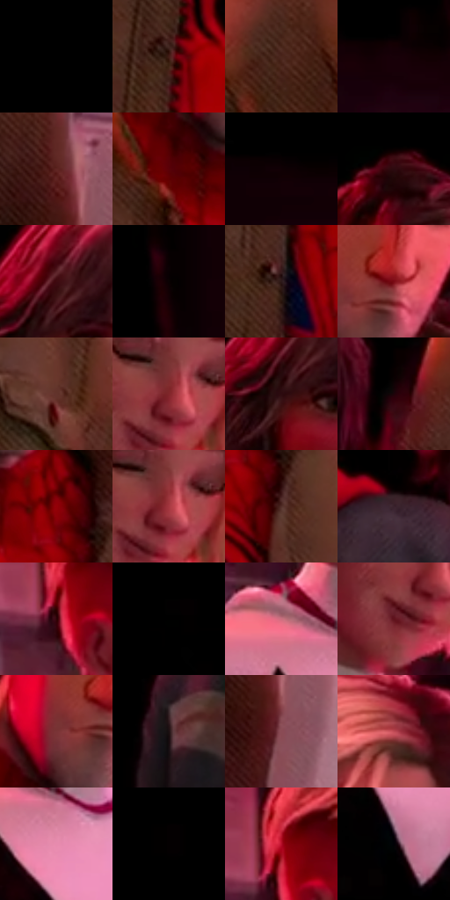

# 电影参考 439

- 状态：常规／活跃；来源世界：miles-home。
- 视角：low-angle；景别：medium；场景：interior。
- 时段：interior-time-unknown（外观依据，中置信度；具体时间／晨昏未知）；光照：dark-interior。
- 材质候选：skin, hair, fabric, metal, glass, plastic（帧级，不是像素分割）。
- 明暗组：very-dark；L* P5/P50/P95：0.0 / 0.4491 / 41.67588。
- 资格门禁：无附加门禁。
- 原截图 SHA-256：`ca031d6928c1499bb5e2bada9c5626c0e917c0f1beacd4ad093c75ebed0d0bca`；尺寸：2880 × 1242。
- sRGB 像素 SHA-256：`350aeb2ec776e1888b37f8c9fed646dfe9e1df4667cd576ae40592b9daaa5cad`。

## 观察与迁移

大暗面与红侧光，远处主要群像仍可清楚，暗不等于模糊。

439  /  暗室群像／彩光材质：四人面部及发缘有强红粉受光；绿外套偏暖但仍有排线塑形，灰衣和白衣响应不同；人物后方只留少量板面，其余接近黑  /  彩色照明塑造体积，不等于整图红滤镜或红描边。暗部可以少交代表面，主要四人仍保持辨识与遮挡；不把白衣、肤色和织物画成同一发光塑料

本公开版保存32个128×128原像素色卡上下文；图集格子并非原场景相邻位置。原rect、图集tile和像素SHA见 `data/palette-crops.json`。上下文不足时不得批准替色，不能以小样推断完整构图。

## 实测色卡

颜色比例分母为保留采样像素，不是材料面积；全部 32 色参与全库匹配。表内四舍五入仅用于阅读，原精度在 JSON。

| ID | HEX | Lab | 原图 xy | 像素数 | 比例 | 明度角色 |
| --- | --- | --- | --- | ---: | ---: | --- |
| 439-S01 | #000000 | [0.0, 0.0, 0.0] | [32, 28] | 89713 | 45.097773% | deep-shadow |
| 439-S02 | #441D16 | [16.335029, 18.081075, 13.580969] | [1716, 872] | 6100 | 3.066405% | deep-shadow |
| 439-S03 | #4C271D | [20.348253, 16.194823, 14.207712] | [1468, 652] | 5760 | 2.895491% | shadow |
| 439-S04 | #170108 | [2.000344, 8.093535, -0.140134] | [2036, 348] | 5385 | 2.706982% | deep-shadow |
| 439-S05 | #5E2422 | [22.853336, 26.346149, 14.691559] | [2092, 1012] | 4558 | 2.291258% | shadow |
| 439-S06 | #5A0108 | [16.570576, 37.378542, 22.390484] | [1680, 528] | 4511 | 2.267632% | deep-shadow |
| 439-S07 | #100004 | [1.074537, 5.020237, 0.059205] | [1512, 272] | 4416 | 2.219876% | deep-shadow |
| 439-S08 | #040000 | [0.233235, 1.045997, 0.368554] | [1780, 40] | 4323 | 2.173126% | deep-shadow |
| 439-S09 | #3F0A10 | [11.356226, 25.697592, 10.645169] | [984, 696] | 4232 | 2.127381% | deep-shadow |
| 439-S10 | #0A0102 | [0.818739, 2.49252, 0.450856] | [1356, 404] | 4095 | 2.058513% | deep-shadow |
| 439-S11 | #2D1A19 | [11.736095, 9.310822, 4.616843] | [1704, 1076] | 3810 | 1.915247% | deep-shadow |
| 439-S12 | #7A0B15 | [25.052337, 44.718223, 27.171034] | [1792, 392] | 3604 | 1.811693% | shadow |
| 439-S13 | #63332C | [27.304972, 20.750087, 14.062266] | [1996, 844] | 3601 | 1.810184% | shadow |
| 439-S14 | #81262A | [29.96561, 39.208062, 19.830051] | [2504, 784] | 3574 | 1.796612% | shadow |
| 439-S15 | #2C0A0F | [7.110684, 17.886694, 4.553206] | [964, 756] | 3531 | 1.774996% | deep-shadow |
| 439-S16 | #1E030A | [3.280195, 11.374101, 1.015842] | [1224, 832] | 3493 | 1.755894% | deep-shadow |
| 439-S17 | #940007 | [30.189609, 53.487751, 40.973799] | [1816, 556] | 3464 | 1.741316% | shadow |
| 439-S18 | #A4373F | [39.557049, 45.382559, 20.121291] | [2512, 788] | 3372 | 1.695069% | shadow |
| 439-S19 | #532F2A | [23.802014, 15.810967, 10.258045] | [1860, 648] | 3371 | 1.694566% | shadow |
| 439-S20 | #39222C | [16.483499, 12.809408, -2.048853] | [796, 908] | 3321 | 1.669431% | deep-shadow |
| 439-S21 | #2C0306 | [5.545452, 20.375378, 6.234125] | [2304, 704] | 3283 | 1.650329% | deep-shadow |
| 439-S22 | #020101 | [0.332482, 0.261482, 0.092172] | [1588, 56] | 3243 | 1.630222% | deep-shadow |
| 439-S23 | #CB6E7F | [57.447316, 38.479864, 7.212356] | [2320, 944] | 3039 | 1.527673% | midtone |
| 439-S24 | #5F121C | [19.842941, 34.654467, 14.979544] | [2464, 840] | 2993 | 1.504549% | deep-shadow |
| 439-S25 | #7A3436 | [31.488424, 30.724522, 13.816382] | [1728, 420] | 2958 | 1.486955% | shadow |
| 439-S26 | #1D1012 | [6.101856, 6.518201, 1.076015] | [412, 1164] | 2890 | 1.452772% | deep-shadow |
| 439-S27 | #8A4B55 | [39.735907, 27.766098, 5.975362] | [2120, 1108] | 2767 | 1.390942% | shadow |
| 439-S28 | #C04A55 | [47.960132, 48.170147, 18.656354] | [2508, 588] | 2561 | 1.287388% | midtone |
| 439-S29 | #E78BAE | [68.397372, 39.382323, -3.288407] | [2388, 1016] | 2433 | 1.223043% | light |
| 439-S30 | #010000 | [0.058309, 0.261499, 0.092139] | [200, 40] | 2270 | 1.141105% | deep-shadow |
| 439-S31 | #B30C27 | [37.83571, 60.765573, 33.484675] | [2312, 656] | 1945 | 0.977731% | shadow |
| 439-S32 | #010105 | [0.353321, 0.556158, -1.513661] | [2420, 1160] | 314 | 0.157844% | deep-shadow |

## 色阶与空间分布

- 采样 ROI：`[0.01, 0.02, 0.98, 0.94]`；步长：4；样本数：198930。
- 排除区：`[]`。
- 深暗、暗、中、亮、高光五段计数：`[152386, 35246, 8133, 3161, 4]`。
- RGB 各 256 箱、L* 100 箱、13×5 色相明度表和 3×3 空间统计全部保存在 [总数据](../film-library.json)。
- [可视化档案](../../references/library.html)按需绘制直方图，不存 2,094 张重复图表图片。

## 纹理特征占比

**这是分块图像特征的面积占比，不是波点／排线／丝网／错版的精确语义覆盖率。** 窗格、发丝、织物也会产生方向或周期特征。
原图 ROI 像素 3193542；已测块覆盖 3193542（100.0000%）；未测 0。

| 特征 | 块覆盖像素 | 占已测面积 | 阈值敏感范围 |
| --- | ---: | ---: | --- |
| low-contrast | 1413190 | 44.2515% | 42.1994% ~ 45.2776% |
| directional-structure | 548992 | 17.1907% | 6.5612% ~ 31.3753% |
| periodic-structure | 1231360 | 38.5578% | 26.4253% ~ 47.1351% |
| mixed-detail | 0 | 0.0000% | 0.0000% ~ 1.0261% |

阈值敏感范围不是统计置信区间。逐块坐标、尺度、对比、方向一致性、频谱集中度、频率与角度见 [全量特征记录](../texture-features.jsonl)，以帧号定位。
四种印刷层的真实像素覆盖仍标为 `null`，不能填 0，也不能拿上表代替。不得据这些代理测量删除唯一证据。

[测量方法与保留策略](../../references/library-retention.md) · [分类索引](../archive/README.md)
