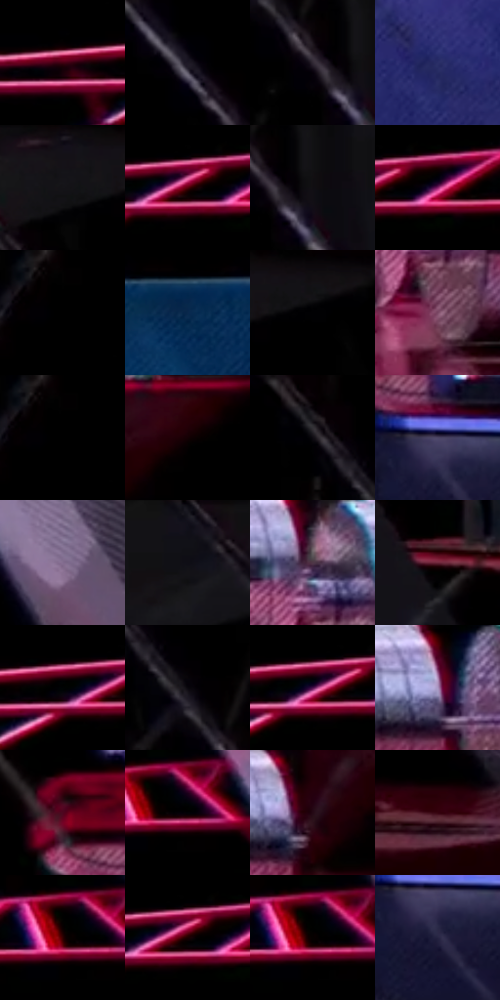

# 电影参考 440

- 状态：常规／活跃；来源世界：miles-home。
- 视角：near-level；景别：environment-wide；场景：interior。
- 时段：interior-time-unknown（外观依据，中置信度；具体时间／晨昏未知）；光照：dark-interior。
- 材质候选：skin, hair, fabric, metal, glass, plastic（帧级，不是像素分割）。
- 明暗组：very-dark；L* P5/P50/P95：0.0 / 0.72086 / 36.17686。
- 资格门禁：无附加门禁。
- 原截图 SHA-256：`5ff2f57a9e3fca627eee5ae6cc5311e61051424b14df20e2dd845ea848704e7a`；尺寸：2880 × 1200。
- sRGB 像素 SHA-256：`8d3dfcaeeed6319ab206e87093e8ae84a09874f3e4eb47a2c879ec85dea90c12`。

## 观察与迁移

大暗面与红侧光，远处主要群像仍可清楚，暗不等于模糊。

440  /  暗室远景／空间主次：四人位于中央较小平台，周围大黑空间；左侧蓝屏面、银色圆柱与红平台，右侧紫蓝设备面，斜构件和细线交叠；部分设备边可见青粉分色  /  远处四人仍是焦点，不因距离远自动糊掉。近处设备可保留足够材质与定位信息，但不强化每件小物；分开留黑、投影尺度导致细节不可读与失焦。斜构件／线缆不是运动线，不添加电影设备

本公开版保存32个128×128原像素色卡上下文；图集格子并非原场景相邻位置。原rect、图集tile和像素SHA见 `data/palette-crops.json`。上下文不足时不得批准替色，不能以小样推断完整构图。

## 实测色卡

颜色比例分母为保留采样像素，不是材料面积；全部 32 色参与全库匹配。表内四舍五入仅用于阅读，原精度在 JSON。

| ID | HEX | Lab | 原图 xy | 像素数 | 比例 | 明度角色 |
| --- | --- | --- | --- | ---: | ---: | --- |
| 440-S01 | #000000 | [0.0, 0.0, 0.0] | [32, 24] | 70097 | 36.386051% | deep-shadow |
| 440-S02 | #1D1825 | [9.385425, 5.934491, -8.021402] | [2320, 276] | 8279 | 4.297475% | deep-shadow |
| 440-S03 | #302834 | [17.431882, 6.501145, -6.390163] | [1928, 260] | 7438 | 3.860928% | deep-shadow |
| 440-S04 | #292E67 | [21.595359, 16.644478, -34.306767] | [2688, 688] | 7195 | 3.734791% | shadow |
| 440-S05 | #151218 | [5.943576, 2.662374, -3.405639] | [2236, 40] | 7032 | 3.650181% | deep-shadow |
| 440-S06 | #010101 | [0.274173, -1.7e-05, 3.3e-05] | [248, 24] | 6066 | 3.148748% | deep-shadow |
| 440-S07 | #100F12 | [4.475616, 0.930912, -1.462393] | [1980, 268] | 6032 | 3.131099% | deep-shadow |
| 440-S08 | #1A0003 | [2.043761, 9.316642, 2.000446] | [308, 44] | 5608 | 2.911009% | deep-shadow |
| 440-S09 | #030202 | [0.606656, 0.261464, 0.092205] | [988, 24] | 5222 | 2.710643% | deep-shadow |
| 440-S10 | #0A274D | [15.75316, 5.403676, -26.500858] | [408, 356] | 4564 | 2.369088% | deep-shadow |
| 440-S11 | #050407 | [1.214363, 0.678561, -1.043] | [2348, 56] | 4398 | 2.282920% | deep-shadow |
| 440-S12 | #7B4965 | [37.691902, 25.521107, -7.262476] | [116, 780] | 4162 | 2.160417% | shadow |
| 440-S13 | #020001 | [0.136404, 0.662042, -0.194147] | [992, 24] | 4133 | 2.145364% | deep-shadow |
| 440-S14 | #140003 | [1.403207, 6.443927, 0.988253] | [648, 608] | 4080 | 2.117852% | deep-shadow |
| 440-S15 | #0D0B12 | [3.329342, 1.821991, -3.162868] | [1796, 104] | 3986 | 2.069059% | deep-shadow |
| 440-S16 | #4D4667 | [31.663589, 10.884634, -18.190743] | [2468, 892] | 3850 | 1.998464% | shadow |
| 440-S17 | #846D8F | [49.284573, 15.703821, -15.180424] | [852, 472] | 3681 | 1.910739% | midtone |
| 440-S18 | #10101A | [5.016039, 2.35811, -6.380886] | [2076, 28] | 3560 | 1.847930% | deep-shadow |
| 440-S19 | #4F3747 | [26.302434, 13.690937, -5.604819] | [100, 668] | 3393 | 1.761243% | shadow |
| 440-S20 | #692437 | [25.386896, 32.644269, 4.24678] | [1300, 744] | 3178 | 1.649641% | shadow |
| 440-S21 | #090103 | [0.780217, 2.370065, -0.019706] | [188, 56] | 3084 | 1.600847% | deep-shadow |
| 440-S22 | #09070D | [2.159694, 1.393268, -2.18436] | [1876, 172] | 3012 | 1.563473% | deep-shadow |
| 440-S23 | #000003 | [0.05936, 0.417131, -1.135271] | [220, 32] | 2880 | 1.494955% | deep-shadow |
| 440-S24 | #AA97C2 | [65.415841, 15.394978, -19.609239] | [284, 668] | 2498 | 1.296665% | light |
| 440-S25 | #4F061F | [14.909674, 33.702268, 5.616974] | [2384, 792] | 2339 | 1.214131% | deep-shadow |
| 440-S26 | #020106 | [0.431416, 0.956701, -1.799946] | [472, 68] | 2068 | 1.073460% | deep-shadow |
| 440-S27 | #240A15 | [5.838729, 14.377328, -1.130885] | [524, 668] | 1997 | 1.036606% | deep-shadow |
| 440-S28 | #37030F | [8.236555, 26.150463, 6.496604] | [888, 756] | 1967 | 1.021033% | deep-shadow |
| 440-S29 | #010100 | [0.254387, -0.139061, 0.378457] | [436, 40] | 1941 | 1.007537% | deep-shadow |
| 440-S30 | #010002 | [0.097882, 0.539587, -0.664709] | [256, 28] | 1878 | 0.974835% | deep-shadow |
| 440-S31 | #000101 | [0.215865, -0.261517, -0.092106] | [444, 44] | 1649 | 0.855965% | deep-shadow |
| 440-S32 | #262341 | [15.464625, 10.12453, -18.594515] | [2480, 940] | 1381 | 0.716851% | deep-shadow |

## 色阶与空间分布

- 采样 ROI：`[0.01, 0.02, 0.98, 0.94]`；步长：4；样本数：192648。
- 排除区：`[]`。
- 深暗、暗、中、亮、高光五段计数：`[164820, 20734, 5507, 1393, 194]`。
- RGB 各 256 箱、L* 100 箱、13×5 色相明度表和 3×3 空间统计全部保存在 [总数据](../film-library.json)。
- [可视化档案](../../references/library.html)按需绘制直方图，不存 2,094 张重复图表图片。

## 纹理特征占比

**这是分块图像特征的面积占比，不是波点／排线／丝网／错版的精确语义覆盖率。** 窗格、发丝、织物也会产生方向或周期特征。
原图 ROI 像素 3084576；已测块覆盖 3084576（100.0000%）；未测 0。

| 特征 | 块覆盖像素 | 占已测面积 | 阈值敏感范围 |
| --- | ---: | ---: | --- |
| low-contrast | 870144 | 28.2095% | 26.0849% ~ 30.4669% |
| directional-structure | 1114144 | 36.1198% | 21.0638% ~ 50.5026% |
| periodic-structure | 1067520 | 34.6083% | 23.4125% ~ 44.8425% |
| mixed-detail | 32768 | 1.0623% | 0.0000% ~ 3.6268% |

阈值敏感范围不是统计置信区间。逐块坐标、尺度、对比、方向一致性、频谱集中度、频率与角度见 [全量特征记录](../texture-features.jsonl)，以帧号定位。
四种印刷层的真实像素覆盖仍标为 `null`，不能填 0，也不能拿上表代替。不得据这些代理测量删除唯一证据。

[测量方法与保留策略](../../references/library-retention.md) · [分类索引](../archive/README.md)
