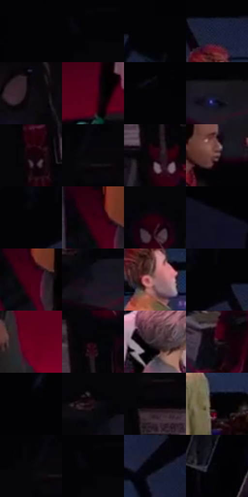

# 电影参考 441

- 状态：常规／活跃；来源世界：miles-home。
- 视角：high-angle；景别：environment-wide；场景：interior。
- 时段：interior-time-unknown（外观依据，中置信度；具体时间／晨昏未知）；光照：dark-interior。
- 材质候选：skin, hair, fabric, metal, glass, plastic（帧级，不是像素分割）。
- 明暗组：very-dark；L* P5/P50/P95：0.58792 / 2.68557 / 30.72534。
- 资格门禁：无附加门禁。
- 原截图 SHA-256：`bc13fe040f7483d17d977837d097c45f3562f4b8d4d192e22caa80b64c141b48`；尺寸：2880 × 1164。
- sRGB 像素 SHA-256：`04b4b7a4186142e159689ceff95852683443ba97fa96246eef9e9730f0b5832c`。

## 观察与迁移

大暗面与红侧光，远处主要群像仍可清楚，暗不等于模糊。

441  /  暗室俯视／大色面组织：红色地面、蓝色屏面、深暗墙面和桌面形成大块关系；人物中间色、受光发束及脚下黑暗形仍可读，墙面照片／陈列存在但细节较弱  /  保留原物件分布、桌面走向与人物站位，降低次要展示内容的对比，不强行把所有暗细节提亮。蓝色屏面不能仅凭颜色断言一定投出强蓝光；地面黑暗形不推导精确光源数量

本公开版保存32个128×128原像素色卡上下文；图集格子并非原场景相邻位置。原rect、图集tile和像素SHA见 `data/palette-crops.json`。上下文不足时不得批准替色，不能以小样推断完整构图。

## 实测色卡

颜色比例分母为保留采样像素，不是材料面积；全部 32 色参与全库匹配。表内四舍五入仅用于阅读，原精度在 JSON。

| ID | HEX | Lab | 原图 xy | 像素数 | 比例 | 明度角色 |
| --- | --- | --- | --- | ---: | ---: | --- |
| 441-S01 | #030306 | [0.881881, 0.417079, -1.135172] | [32, 24] | 20688 | 11.059317% | deep-shadow |
| 441-S02 | #050407 | [1.214363, 0.678561, -1.043] | [664, 24] | 13923 | 7.442907% | deep-shadow |
| 441-S03 | #020204 | [0.587921, 0.278053, -0.756781] | [1728, 24] | 10518 | 5.622675% | deep-shadow |
| 441-S04 | #1D233C | [14.340799, 5.465057, -16.927529] | [1500, 100] | 8787 | 4.697323% | deep-shadow |
| 441-S05 | #0C0910 | [2.808754, 1.936018, -2.767177] | [416, 300] | 8516 | 4.552453% | deep-shadow |
| 441-S06 | #550019 | [15.498244, 37.014286, 11.08004] | [1132, 864] | 8035 | 4.295321% | deep-shadow |
| 441-S07 | #010103 | [0.313747, 0.27807, -0.756814] | [1868, 24] | 7240 | 3.870333% | deep-shadow |
| 441-S08 | #191720 | [8.33929, 3.466755, -5.910112] | [1964, 504] | 7231 | 3.865522% | deep-shadow |
| 441-S09 | #14030B | [2.15024, 6.358141, -1.18983] | [752, 300] | 7108 | 3.799769% | deep-shadow |
| 441-S10 | #090609 | [1.879328, 1.201525, -0.858657] | [832, 56] | 6888 | 3.682162% | deep-shadow |
| 441-S11 | #2C0110 | [5.372356, 22.436636, 1.471953] | [956, 328] | 6599 | 3.527670% | deep-shadow |
| 441-S12 | #614142 | [31.150955, 14.077136, 5.026818] | [1720, 556] | 6376 | 3.408459% | shadow |
| 441-S13 | #07060D | [1.846999, 1.27083, -2.654955] | [1352, 32] | 6240 | 3.335757% | deep-shadow |
| 441-S14 | #390012 | [8.251686, 28.660038, 4.874293] | [1368, 756] | 6240 | 3.335757% | deep-shadow |
| 441-S15 | #20000C | [3.014391, 14.128071, -0.199134] | [996, 60] | 6186 | 3.306890% | deep-shadow |
| 441-S16 | #111022 | [5.466862, 5.319068, -11.899893] | [2484, 292] | 6088 | 3.254501% | deep-shadow |
| 441-S17 | #460116 | [11.838225, 32.224175, 7.760547] | [1392, 792] | 6019 | 3.217615% | deep-shadow |
| 441-S18 | #120F19 | [4.881632, 3.360432, -5.77391] | [724, 528] | 5441 | 2.908630% | deep-shadow |
| 441-S19 | #9A6C6D | [50.334944, 18.486519, 6.795388] | [1504, 224] | 5419 | 2.896870% | midtone |
| 441-S20 | #04040A | [1.215415, 0.834193, -2.270409] | [1408, 24] | 4782 | 2.556344% | deep-shadow |
| 441-S21 | #68011F | [20.300906, 42.259059, 13.874819] | [1688, 992] | 4777 | 2.553671% | shadow |
| 441-S22 | #0B0207 | [1.173547, 3.055345, -1.060456] | [968, 188] | 4207 | 2.248963% | deep-shadow |
| 441-S23 | #382B32 | [19.219741, 7.432048, -2.226995] | [1220, 460] | 4181 | 2.235064% | deep-shadow |
| 441-S24 | #281923 | [11.048304, 9.550439, -3.875836] | [2280, 676] | 4125 | 2.205128% | deep-shadow |
| 441-S25 | #03030A | [0.961028, 0.973255, -2.648866] | [2236, 28] | 3398 | 1.816491% | deep-shadow |
| 441-S26 | #190B13 | [4.453862, 6.941944, -2.01121] | [688, 464] | 3162 | 1.690331% | deep-shadow |
| 441-S27 | #050206 | [0.802421, 1.340638, -1.237213] | [832, 132] | 1592 | 0.851046% | deep-shadow |
| 441-S28 | #050203 | [0.74306, 0.923507, -0.101942] | [1584, 412] | 1049 | 0.560771% | deep-shadow |
| 441-S29 | #040306 | [0.94019, 0.678579, -1.043033] | [792, 24] | 970 | 0.518539% | deep-shadow |
| 441-S30 | #040406 | [1.136268, 0.278018, -0.756715] | [648, 24] | 793 | 0.423919% | deep-shadow |
| 441-S31 | #000306 | [0.706955, -0.367419, -1.411587] | [1768, 224] | 373 | 0.199397% | deep-shadow |
| 441-S32 | #000303 | [0.647594, -0.78455, -0.276317] | [2732, 504] | 113 | 0.060407% | deep-shadow |

## 色阶与空间分布

- 采样 ROI：`[0.01, 0.02, 0.98, 0.94]`；步长：4；样本数：187064。
- 排除区：`[]`。
- 深暗、暗、中、亮、高光五段计数：`[171442, 10626, 4240, 754, 2]`。
- RGB 各 256 箱、L* 100 箱、13×5 色相明度表和 3×3 空间统计全部保存在 [总数据](../film-library.json)。
- [可视化档案](../../references/library.html)按需绘制直方图，不存 2,094 张重复图表图片。

## 纹理特征占比

**这是分块图像特征的面积占比，不是波点／排线／丝网／错版的精确语义覆盖率。** 窗格、发丝、织物也会产生方向或周期特征。
原图 ROI 像素 2992374；已测块覆盖 2992374（100.0000%）；未测 0。

| 特征 | 块覆盖像素 | 占已测面积 | 阈值敏感范围 |
| --- | ---: | ---: | --- |
| low-contrast | 1082368 | 36.1709% | 30.6956% ~ 38.9085% |
| directional-structure | 275840 | 9.2181% | 4.9833% ~ 20.7161% |
| periodic-structure | 1611766 | 53.8625% | 48.0407% ~ 53.8625% |
| mixed-detail | 22400 | 0.7486% | 0.5475% ~ 4.5812% |

阈值敏感范围不是统计置信区间。逐块坐标、尺度、对比、方向一致性、频谱集中度、频率与角度见 [全量特征记录](../texture-features.jsonl)，以帧号定位。
四种印刷层的真实像素覆盖仍标为 `null`，不能填 0，也不能拿上表代替。不得据这些代理测量删除唯一证据。

[测量方法与保留策略](../../references/library-retention.md) · [分类索引](../archive/README.md)
