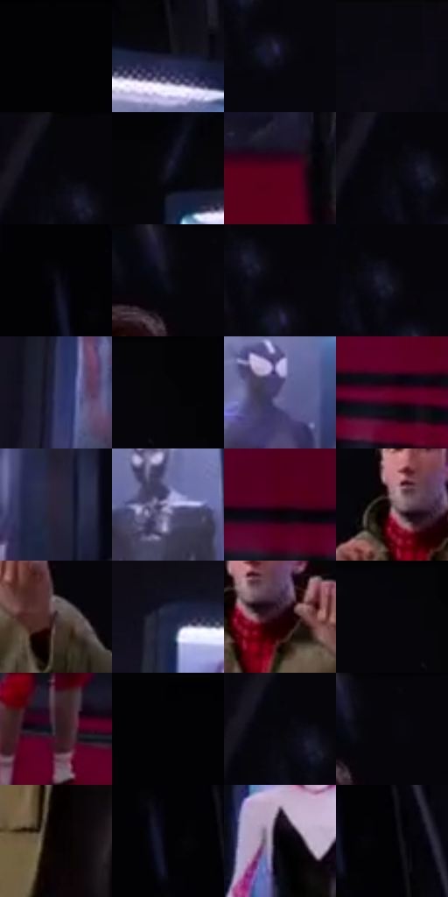

# 电影参考 442

- 状态：常规／活跃；来源世界：miles-home。
- 视角：low-angle；景别：environment-wide；场景：interior。
- 时段：interior-time-unknown（外观依据，中置信度；具体时间／晨昏未知）；光照：dark-interior。
- 材质候选：skin, hair, fabric, metal, glass, plastic（帧级，不是像素分割）。
- 明暗组：very-dark；L* P5/P50/P95：0.58792 / 5.63948 / 41.6828。
- 资格门禁：无附加门禁。
- 原截图 SHA-256：`6f94ebaf7300c8712f3f61fcd2f811c70372c604ec7084c2bc878c2697581e64`；尺寸：2880 × 1198。
- sRGB 像素 SHA-256：`063edb80180d3a0afe4439bf53fbabd0d1d463eea4686dc8d10068191cd40144`。

## 观察与迁移

大暗面与红侧光，远处主要群像仍可清楚，暗不等于模糊。

玻璃展柜弧形排列，顶部长亮条与红黑地面反光；服装陈列不算现场人物。

1  /  442  /  展柜与反射：玻璃展柜弧形排列，顶部长亮条与红黑地面反光；服装陈列不算现场人物。

本公开版保存32个128×128原像素色卡上下文；图集格子并非原场景相邻位置。原rect、图集tile和像素SHA见 `data/palette-crops.json`。上下文不足时不得批准替色，不能以小样推断完整构图。

## 实测色卡

颜色比例分母为保留采样像素，不是材料面积；全部 32 色参与全库匹配。表内四舍五入仅用于阅读，原精度在 JSON。

| ID | HEX | Lab | 原图 xy | 像素数 | 比例 | 明度角色 |
| --- | --- | --- | --- | ---: | ---: | --- |
| 442-S01 | #020204 | [0.587921, 0.278053, -0.756781] | [40, 24] | 12420 | 6.446991% | deep-shadow |
| 442-S02 | #1C1C30 | [11.210488, 6.074436, -13.285999] | [372, 324] | 10508 | 5.454508% | deep-shadow |
| 442-S03 | #14111F | [5.858154, 4.906273, -8.970395] | [1256, 180] | 9729 | 5.050143% | deep-shadow |
| 442-S04 | #090810 | [2.431184, 1.52263, -3.340287] | [828, 24] | 9618 | 4.992525% | deep-shadow |
| 442-S05 | #06050A | [1.52811, 0.956631, -1.799814] | [1184, 24] | 9584 | 4.974876% | deep-shadow |
| 442-S06 | #171625 | [8.034951, 5.007276, -10.16258] | [2092, 364] | 9033 | 4.688863% | deep-shadow |
| 442-S07 | #55001C | [15.569652, 37.206052, 8.965807] | [1780, 924] | 8930 | 4.635397% | deep-shadow |
| 442-S08 | #09080D | [2.355772, 0.992707, -1.898042] | [1176, 100] | 8419 | 4.370147% | deep-shadow |
| 442-S09 | #0C0B13 | [3.292649, 1.734211, -3.846139] | [268, 76] | 7971 | 4.137598% | deep-shadow |
| 442-S10 | #0D0C16 | [3.671211, 2.290974, -5.313147] | [1520, 52] | 7747 | 4.021324% | deep-shadow |
| 442-S11 | #09060C | [1.940917, 1.634316, -2.036546] | [1248, 128] | 7693 | 3.993293% | deep-shadow |
| 442-S12 | #10101B | [5.057126, 2.646833, -7.102867] | [1224, 104] | 7546 | 3.916988% | deep-shadow |
| 442-S13 | #383A63 | [26.061666, 10.858721, -24.519212] | [608, 636] | 7421 | 3.852103% | shadow |
| 442-S14 | #030306 | [0.881881, 0.417079, -1.135172] | [1840, 24] | 6830 | 3.545326% | deep-shadow |
| 442-S15 | #615C8B | [41.310339, 13.304113, -25.332449] | [372, 452] | 6789 | 3.524044% | midtone |
| 442-S16 | #5E0126 | [18.10779, 40.046191, 5.498631] | [2172, 1092] | 6628 | 3.440472% | deep-shadow |
| 442-S17 | #292841 | [17.322826, 7.542046, -15.657356] | [52, 556] | 6537 | 3.393235% | deep-shadow |
| 442-S18 | #9F9BC7 | [65.699212, 10.697092, -22.050691] | [2556, 500] | 5900 | 3.062580% | light |
| 442-S19 | #430117 | [11.115315, 31.433164, 5.915027] | [2536, 1072] | 5392 | 2.798887% | deep-shadow |
| 442-S20 | #644D52 | [35.255237, 10.560717, 0.772911] | [1448, 240] | 5159 | 2.677941% | shadow |
| 442-S21 | #433234 | [22.732293, 8.050515, 1.69871] | [1612, 312] | 5033 | 2.612537% | shadow |
| 442-S22 | #1E223F | [14.280946, 7.616253, -19.118945] | [940, 400] | 4885 | 2.535713% | deep-shadow |
| 442-S23 | #1F030C | [3.460129, 12.287336, 0.434652] | [1496, 264] | 4543 | 2.358187% | deep-shadow |
| 442-S24 | #050407 | [1.214363, 0.678561, -1.043] | [1784, 24] | 4483 | 2.327042% | deep-shadow |
| 442-S25 | #281B20 | [11.547808, 7.44302, -0.914352] | [1252, 928] | 4217 | 2.188966% | deep-shadow |
| 442-S26 | #010103 | [0.313747, 0.27807, -0.756814] | [2396, 24] | 3872 | 2.009883% | deep-shadow |
| 442-S27 | #070608 | [1.742923, 0.539483, -0.664511] | [1176, 84] | 2613 | 1.356360% | deep-shadow |
| 442-S28 | #05040A | [1.273724, 1.095693, -2.178271] | [1564, 24] | 1474 | 0.765126% | deep-shadow |
| 442-S29 | #090203 | [0.976295, 1.969504, 0.266612] | [1408, 732] | 1129 | 0.586043% | deep-shadow |
| 442-S30 | #020106 | [0.431416, 0.956701, -1.799946] | [288, 112] | 389 | 0.201923% | deep-shadow |
| 442-S31 | #020004 | [0.195765, 1.079174, -1.329417] | [1844, 552] | 83 | 0.043084% | deep-shadow |
| 442-S32 | #010104 | [0.333534, 0.417114, -1.135238] | [340, 116] | 73 | 0.037893% | deep-shadow |

## 色阶与空间分布

- 采样 ROI：`[0.01, 0.02, 0.98, 0.94]`；步长：4；样本数：192648。
- 排除区：`[]`。
- 深暗、暗、中、亮、高光五段计数：`[162683, 19357, 6801, 3009, 798]`。
- RGB 各 256 箱、L* 100 箱、13×5 色相明度表和 3×3 空间统计全部保存在 [总数据](../film-library.json)。
- [可视化档案](../../references/library.html)按需绘制直方图，不存 2,094 张重复图表图片。

## 纹理特征占比

**这是分块图像特征的面积占比，不是波点／排线／丝网／错版的精确语义覆盖率。** 窗格、发丝、织物也会产生方向或周期特征。
原图 ROI 像素 3081782；已测块覆盖 3081782（100.0000%）；未测 0。

| 特征 | 块覆盖像素 | 占已测面积 | 阈值敏感范围 |
| --- | ---: | ---: | --- |
| low-contrast | 567808 | 18.4247% | 16.2981% ~ 21.0829% |
| directional-structure | 1229110 | 39.8831% | 25.6866% ~ 51.7246% |
| periodic-structure | 1235712 | 40.0973% | 31.9773% ~ 50.5723% |
| mixed-detail | 49152 | 1.5949% | 0.0000% ~ 2.6582% |

阈值敏感范围不是统计置信区间。逐块坐标、尺度、对比、方向一致性、频谱集中度、频率与角度见 [全量特征记录](../texture-features.jsonl)，以帧号定位。
四种印刷层的真实像素覆盖仍标为 `null`，不能填 0，也不能拿上表代替。不得据这些代理测量删除唯一证据。

[测量方法与保留策略](../../references/library-retention.md) · [分类索引](../archive/README.md)
