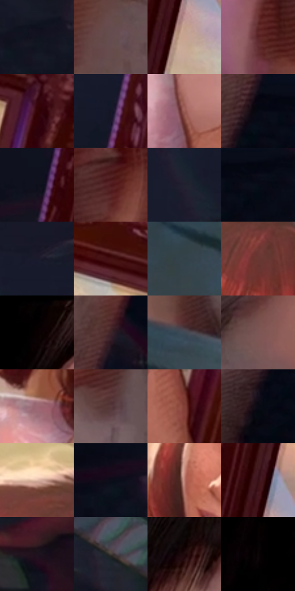

# 电影参考 443

- 状态：条件／活跃；来源世界：miles-home。
- 视角：high-angle；景别：detail；场景：detail。
- 时段：interior-time-unknown（外观依据，中置信度；具体时间／晨昏未知）；光照：interior-mixed。
- 材质候选：skin, paper, wood, glass（帧级，不是像素分割）。
- 明暗组：very-dark；L* P5/P50/P95：2.06423 / 15.92527 / 69.76854。
- 资格门禁：secondary-image。
- 原截图 SHA-256：`d088591f1f68cb52c508aad9cbc1aa0bab843b443e948628a72d472b60fc064a`；尺寸：2880 × 1216。
- sRGB 像素 SHA-256：`bdd16cd6230b00885e7e642c32ca76b527dbd1afd4c3188063d2de9a77fe6ad0`。

## 观察与迁移

相框内人像是印刷照片，不能当作镜中另一个人。

相框内女性是照片，浅斜亮形是玻璃表面反射；纸面图像、映像与真实人物分开。

2  /  443  /  展柜与反射：相框内女性是照片，浅斜亮形是玻璃表面反射；纸面图像、映像与真实人物分开。

本公开版保存32个128×128原像素色卡上下文；图集格子并非原场景相邻位置。原rect、图集tile和像素SHA见 `data/palette-crops.json`。上下文不足时不得批准替色，不能以小样推断完整构图。

## 实测色卡

颜色比例分母为保留采样像素，不是材料面积；全部 32 色参与全库匹配。表内四舍五入仅用于阅读，原精度在 JSON。

| ID | HEX | Lab | 原图 xy | 像素数 | 比例 | 明度角色 |
| --- | --- | --- | --- | ---: | ---: | --- |
| 443-S01 | #10131F | [6.095424, 2.14698, -8.643297] | [2468, 556] | 9811 | 5.037948% | deep-shadow |
| 443-S02 | #664C4F | [35.12014, 11.493425, 2.500852] | [660, 396] | 9747 | 5.005084% | shadow |
| 443-S03 | #C8A490 | [70.067644, 10.24657, 15.361205] | [1548, 748] | 8483 | 4.356020% | light |
| 443-S04 | #5A2426 | [22.216864, 25.054709, 11.010482] | [384, 412] | 8242 | 4.232266% | shadow |
| 443-S05 | #350406 | [7.742188, 24.311876, 9.681851] | [2324, 176] | 8204 | 4.212753% | deep-shadow |
| 443-S06 | #141726 | [8.141573, 3.441362, -10.76932] | [1480, 360] | 8099 | 4.158836% | deep-shadow |
| 443-S07 | #9B5D56 | [46.27233, 24.513902, 14.839837] | [1892, 996] | 7550 | 3.876924% | midtone |
| 443-S08 | #050912 | [2.450567, 0.473384, -4.503853] | [900, 716] | 7357 | 3.777819% | deep-shadow |
| 443-S09 | #0D101B | [4.8349, 1.650209, -7.456926] | [1424, 568] | 7062 | 3.626336% | deep-shadow |
| 443-S10 | #4F191B | [17.631907, 25.5565, 12.1753] | [508, 296] | 6577 | 3.377289% | deep-shadow |
| 443-S11 | #21212F | [13.328737, 3.930492, -9.241823] | [2540, 172] | 6548 | 3.362397% | deep-shadow |
| 443-S12 | #080C17 | [3.400041, 1.165161, -6.477177] | [992, 728] | 6530 | 3.353154% | deep-shadow |
| 443-S13 | #1A1A2B | [10.051898, 5.136857, -11.458552] | [2632, 112] | 6495 | 3.335182% | deep-shadow |
| 443-S14 | #441013 | [13.513099, 25.104228, 11.965591] | [2160, 88] | 6398 | 3.285372% | deep-shadow |
| 443-S15 | #334048 | [26.26905, -3.09989, -6.599904] | [220, 964] | 6172 | 3.169321% | shadow |
| 443-S16 | #6B3632 | [29.400402, 23.053999, 13.177831] | [2056, 276] | 5957 | 3.058919% | shadow |
| 443-S17 | #010000 | [0.058309, 0.261499, 0.092139] | [260, 28] | 5807 | 2.981894% | deep-shadow |
| 443-S18 | #3E2328 | [17.365148, 13.68333, 2.161544] | [928, 568] | 5569 | 2.859681% | deep-shadow |
| 443-S19 | #3F4A55 | [30.902036, -1.565272, -7.977838] | [344, 876] | 5553 | 2.851465% | shadow |
| 443-S20 | #7C5555 | [40.309822, 16.218591, 6.537385] | [820, 256] | 5478 | 2.812953% | midtone |
| 443-S21 | #9C6873 | [49.746976, 22.460461, 2.417326] | [1824, 848] | 5471 | 2.809358% | midtone |
| 443-S22 | #583A3D | [27.948182, 13.770805, 3.550448] | [508, 644] | 5443 | 2.794980% | shadow |
| 443-S23 | #834038 | [35.555055, 27.970565, 18.198378] | [2040, 1056] | 5443 | 2.794980% | shadow |
| 443-S24 | #0A0B14 | [3.200973, 1.403168, -4.643374] | [840, 844] | 5248 | 2.694848% | deep-shadow |
| 443-S25 | #DDB7A6 | [77.277463, 11.123028, 13.774405] | [1984, 164] | 4904 | 2.518204% | light |
| 443-S26 | #0C0D18 | [3.901679, 2.040332, -6.475358] | [1212, 656] | 4810 | 2.469935% | deep-shadow |
| 443-S27 | #BC7C70 | [58.300729, 23.438888, 16.793129] | [1776, 500] | 4325 | 2.220887% | midtone |
| 443-S28 | #371016 | [10.856161, 20.076853, 5.872901] | [1532, 632] | 4067 | 2.088404% | deep-shadow |
| 443-S29 | #1E121D | [7.202581, 8.572217, -5.289325] | [2688, 336] | 3891 | 1.998028% | deep-shadow |
| 443-S30 | #403A34 | [24.840429, 1.392243, 4.676566] | [2608, 512] | 3638 | 1.868113% | shadow |
| 443-S31 | #1F080C | [4.440519, 10.284534, 1.866242] | [92, 652] | 3129 | 1.606741% | deep-shadow |
| 443-S32 | #0A0507 | [1.701985, 1.585497, -0.29599] | [164, 144] | 2734 | 1.403909% | deep-shadow |

## 色阶与空间分布

- 采样 ROI：`[0.01, 0.02, 0.98, 0.94]`；步长：4；样本数：194742。
- 排除区：`[]`。
- 深暗、暗、中、亮、高光五段计数：`[108133, 52461, 19059, 13851, 1238]`。
- RGB 各 256 箱、L* 100 箱、13×5 色相明度表和 3×3 空间统计全部保存在 [总数据](../film-library.json)。
- [可视化档案](../../references/library.html)按需绘制直方图，不存 2,094 张重复图表图片。

## 纹理特征占比

**这是分块图像特征的面积占比，不是波点／排线／丝网／错版的精确语义覆盖率。** 窗格、发丝、织物也会产生方向或周期特征。
原图 ROI 像素 3126486；已测块覆盖 3126486（100.0000%）；未测 0。

| 特征 | 块覆盖像素 | 占已测面积 | 阈值敏感范围 |
| --- | ---: | ---: | --- |
| low-contrast | 688726 | 22.0288% | 19.2448% ~ 26.0860% |
| directional-structure | 1056000 | 33.7759% | 16.8880% ~ 44.1953% |
| periodic-structure | 1348992 | 43.1472% | 36.0359% ~ 52.9689% |
| mixed-detail | 32768 | 1.0481% | 0.5240% ~ 4.0572% |

阈值敏感范围不是统计置信区间。逐块坐标、尺度、对比、方向一致性、频谱集中度、频率与角度见 [全量特征记录](../texture-features.jsonl)，以帧号定位。
四种印刷层的真实像素覆盖仍标为 `null`，不能填 0，也不能拿上表代替。不得据这些代理测量删除唯一证据。

[测量方法与保留策略](../../references/library-retention.md) · [分类索引](../archive/README.md)
