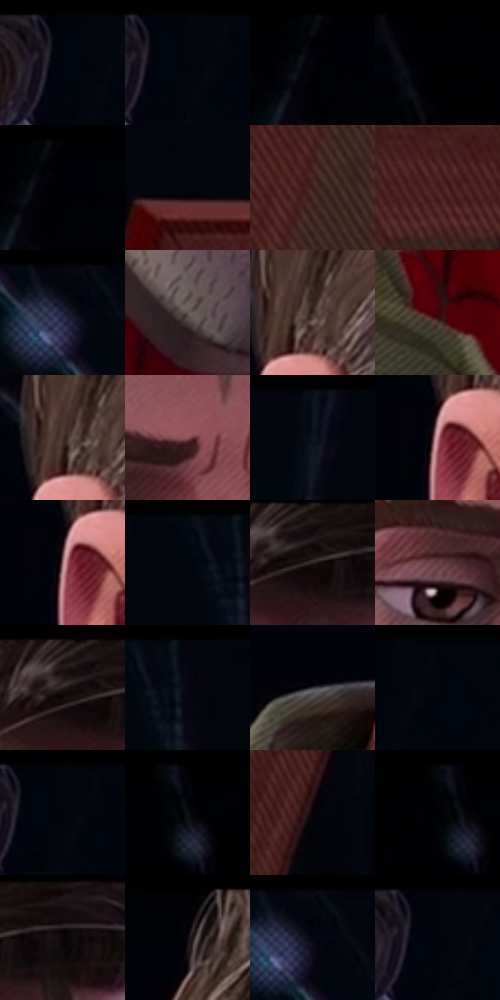

# 电影参考 444

- 状态：常规／活跃；来源世界：miles-home。
- 视角：near-level；景别：close-up；场景：portrait。
- 时段：interior-time-unknown（外观依据，中置信度；具体时间／晨昏未知）；光照：dark-interior。
- 材质候选：skin, hair, fabric, metal, glass（帧级，不是像素分割）。
- 明暗组：very-dark；L* P5/P50/P95：0.31375 / 2.39393 / 49.66758。
- 资格门禁：无附加门禁。
- 原截图 SHA-256：`0b2a98b144637ad43e5b3d1d3d11e7768c6bc3b56ea538fa80debf9249a26492`；尺寸：2880 × 1236。
- sRGB 像素 SHA-256：`372fcc10a456d44368ed12a4c3ad8ba7b4cfdbfda0cbf02a38e14f38490f219b`。

## 观察与迁移

暗室面部与展柜，局部亮边不能取代动画形体。

近脸暖冷分区，胡茬、皮肤排线与画框背面纹理不同；不移植角色疲态与身份。

3  /  444  /  展柜与反射：近脸暖冷分区，胡茬、皮肤排线与画框背面纹理不同；不移植角色疲态与身份。

本公开版保存32个128×128原像素色卡上下文；图集格子并非原场景相邻位置。原rect、图集tile和像素SHA见 `data/palette-crops.json`。上下文不足时不得批准替色，不能以小样推断完整构图。

## 实测色卡

颜色比例分母为保留采样像素，不是材料面积；全部 32 色参与全库匹配。表内四舍五入仅用于阅读，原精度在 JSON。

| ID | HEX | Lab | 原图 xy | 像素数 | 比例 | 明度角色 |
| --- | --- | --- | --- | ---: | ---: | --- |
| 444-S01 | #01050D | [1.301068, 0.102394, -3.494104] | [1412, 28] | 16726 | 8.437588% | deep-shadow |
| 444-S02 | #04060D | [1.672073, 0.486332, -2.931371] | [1440, 28] | 16673 | 8.410852% | deep-shadow |
| 444-S03 | #02030A | [0.90272, 0.711755, -2.741004] | [536, 56] | 11740 | 5.922354% | deep-shadow |
| 444-S04 | #010103 | [0.313747, 0.27807, -0.756814] | [36, 28] | 11611 | 5.857278% | deep-shadow |
| 444-S05 | #000106 | [0.314799, 0.433702, -1.984223] | [556, 28] | 9866 | 4.976997% | deep-shadow |
| 444-S06 | #00060C | [1.416138, -0.719178, -2.865793] | [1804, 616] | 9731 | 4.908895% | deep-shadow |
| 444-S07 | #3A1D19 | [14.672214, 13.658107, 8.976923] | [1792, 1028] | 8730 | 4.403931% | deep-shadow |
| 444-S08 | #4A1E1D | [17.79832, 20.827347, 10.816531] | [1920, 732] | 8524 | 4.300012% | deep-shadow |
| 444-S09 | #070912 | [2.567184, 0.996383, -4.319576] | [2620, 44] | 8490 | 4.282860% | deep-shadow |
| 444-S10 | #5E524D | [35.888466, 4.009657, 4.749877] | [988, 952] | 8029 | 4.050305% | shadow |
| 444-S11 | #3C2722 | [18.041982, 9.106891, 7.284223] | [744, 284] | 7955 | 4.012975% | deep-shadow |
| 444-S12 | #410207 | [10.43092, 29.432823, 13.531257] | [828, 1092] | 7821 | 3.945377% | deep-shadow |
| 444-S13 | #4A342D | [24.004386, 8.793759, 8.331141] | [720, 288] | 7808 | 3.938819% | shadow |
| 444-S14 | #8A5458 | [41.922019, 22.997483, 7.225137] | [1156, 360] | 7661 | 3.864664% | midtone |
| 444-S15 | #0D121C | [5.437699, 0.804369, -7.338989] | [2264, 28] | 7119 | 3.591247% | deep-shadow |
| 444-S16 | #C6868D | [62.491827, 25.508172, 6.292582] | [688, 376] | 6683 | 3.371302% | light |
| 444-S17 | #9A7176 | [51.825176, 16.960636, 3.616032] | [684, 380] | 6092 | 3.073167% | midtone |
| 444-S18 | #010610 | [1.572558, 0.231757, -4.650031] | [2356, 48] | 4679 | 2.360366% | deep-shadow |
| 444-S19 | #282021 | [13.19353, 4.04945, 0.758096] | [1140, 76] | 4596 | 2.318496% | deep-shadow |
| 444-S20 | #623D40 | [30.168891, 16.699601, 4.941626] | [1028, 408] | 4474 | 2.256951% | shadow |
| 444-S21 | #1F1413 | [7.575769, 5.429607, 2.639216] | [1112, 28] | 4373 | 2.206001% | deep-shadow |
| 444-S22 | #050610 | [1.805793, 1.277754, -4.281477] | [2420, 32] | 4317 | 2.177751% | deep-shadow |
| 444-S23 | #36343A | [22.108927, 2.28679, -3.449149] | [680, 648] | 3881 | 1.957807% | shadow |
| 444-S24 | #02070F | [1.800571, -0.092633, -3.767184] | [1484, 28] | 2349 | 1.184975% | deep-shadow |
| 444-S25 | #03050D | [1.417686, 0.625393, -3.309827] | [1444, 28] | 1796 | 0.906009% | deep-shadow |
| 444-S26 | #06040C | [1.373835, 1.650939, -2.885598] | [212, 36] | 1352 | 0.682029% | deep-shadow |
| 444-S27 | #090307 | [1.25152, 2.125119, -0.960764] | [2428, 1064] | 1137 | 0.573570% | deep-shadow |
| 444-S28 | #01050A | [1.236567, -0.350865, -2.260507] | [188, 36] | 1042 | 0.525647% | deep-shadow |
| 444-S29 | #0A0608 | [1.91785, 1.32398, -0.388095] | [1224, 72] | 1036 | 0.522620% | deep-shadow |
| 444-S30 | #020106 | [0.431416, 0.956701, -1.799946] | [728, 32] | 883 | 0.445438% | deep-shadow |
| 444-S31 | #00030D | [0.850604, 0.642016, -4.158879] | [2640, 52] | 797 | 0.402054% | deep-shadow |
| 444-S32 | #00050D | [1.24276, -0.159105, -3.586243] | [1428, 44] | 261 | 0.131664% | deep-shadow |

## 色阶与空间分布

- 采样 ROI：`[0.01, 0.02, 0.98, 0.94]`；步长：4；样本数：198232。
- 排除区：`[]`。
- 深暗、暗、中、亮、高光五段计数：`[153571, 25140, 15173, 4281, 67]`。
- RGB 各 256 箱、L* 100 箱、13×5 色相明度表和 3×3 空间统计全部保存在 [总数据](../film-library.json)。
- [可视化档案](../../references/library.html)按需绘制直方图，不存 2,094 张重复图表图片。

## 纹理特征占比

**这是分块图像特征的面积占比，不是波点／排线／丝网／错版的精确语义覆盖率。** 窗格、发丝、织物也会产生方向或周期特征。
原图 ROI 像素 3176778；已测块覆盖 3176778（100.0000%）；未测 0。

| 特征 | 块覆盖像素 | 占已测面积 | 阈值敏感范围 |
| --- | ---: | ---: | --- |
| low-contrast | 798464 | 25.1344% | 23.1923% ~ 27.5036% |
| directional-structure | 1235146 | 38.8805% | 20.8859% ~ 57.2659% |
| periodic-structure | 1077632 | 33.9222% | 18.5103% ~ 48.5161% |
| mixed-detail | 65536 | 2.0630% | 1.0315% ~ 3.0945% |

阈值敏感范围不是统计置信区间。逐块坐标、尺度、对比、方向一致性、频谱集中度、频率与角度见 [全量特征记录](../texture-features.jsonl)，以帧号定位。
四种印刷层的真实像素覆盖仍标为 `null`，不能填 0，也不能拿上表代替。不得据这些代理测量删除唯一证据。

[测量方法与保留策略](../../references/library-retention.md) · [分类索引](../archive/README.md)
