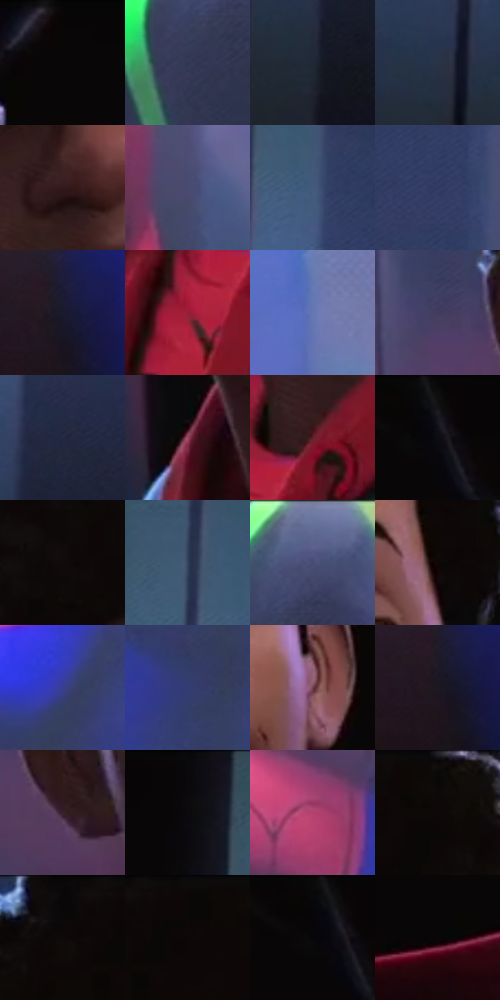

# 电影参考 445

- 状态：常规／活跃；来源世界：miles-home。
- 视角：near-level；景别：close-up；场景：portrait。
- 时段：interior-time-unknown（外观依据，中置信度；具体时间／晨昏未知）；光照：dark-interior。
- 材质候选：skin, hair, fabric, metal, glass（帧级，不是像素分割）。
- 明暗组：dark；L* P5/P50/P95：1.83975 / 21.83614 / 46.70437。
- 资格门禁：无附加门禁。
- 原截图 SHA-256：`0a6d818c1a6ce219815185352760a28b6fab4df6696b65e098c1577c5ce606b9`；尺寸：2880 × 1208。
- sRGB 像素 SHA-256：`9707abfcd8c3aa299534618e674d8407ae7cefa09cab752750953aa1ae21f3fa`。

## 观察与迁移

暗室面部与展柜，局部亮边不能取代动画形体。

清楚的眉眼与面部体块，发缘及肩侧冷亮，蓝色展柜仍透明；不是肤色满铺高对比点阵。

4  /  445  /  展柜与反射：清楚的眉眼与面部体块，发缘及肩侧冷亮，蓝色展柜仍透明；不是肤色满铺高对比点阵。

本公开版保存32个128×128原像素色卡上下文；图集格子并非原场景相邻位置。原rect、图集tile和像素SHA见 `data/palette-crops.json`。上下文不足时不得批准替色，不能以小样推断完整构图。

## 实测色卡

颜色比例分母为保留采样像素，不是材料面积；全部 32 色参与全库匹配。表内四舍五入仅用于阅读，原精度在 JSON。

| ID | HEX | Lab | 原图 xy | 像素数 | 比例 | 明度角色 |
| --- | --- | --- | --- | ---: | ---: | --- |
| 445-S01 | #090607 | [1.839754, 0.923437, -0.10181] | [1516, 28] | 16161 | 8.358590% | deep-shadow |
| 445-S02 | #313753 | [23.703401, 5.543667, -17.801065] | [2676, 164] | 12870 | 6.656460% | shadow |
| 445-S03 | #1F2835 | [15.829007, 0.063153, -9.682305] | [2160, 944] | 11199 | 5.792207% | deep-shadow |
| 445-S04 | #283346 | [21.059462, 1.103532, -13.276616] | [2064, 880] | 9726 | 5.030360% | shadow |
| 445-S05 | #32181B | [12.028466, 13.440557, 3.669214] | [1184, 580] | 9265 | 4.791927% | deep-shadow |
| 445-S06 | #494A70 | [32.883358, 9.508951, -22.003819] | [544, 568] | 8843 | 4.573666% | shadow |
| 445-S07 | #435B7C | [38.07484, 0.516409, -21.411251] | [2184, 224] | 8057 | 4.167141% | shadow |
| 445-S08 | #2F3861 | [24.624999, 8.976599, -25.539453] | [2348, 432] | 7170 | 3.708378% | shadow |
| 445-S09 | #191A2E | [10.127463, 5.818824, -13.546999] | [352, 916] | 7001 | 3.620970% | deep-shadow |
| 445-S10 | #971E36 | [33.51244, 49.974247, 17.478357] | [1136, 1100] | 6846 | 3.540802% | shadow |
| 445-S11 | #6677B1 | [50.910619, 9.032284, -32.76099] | [632, 88] | 6788 | 3.510804% | midtone |
| 445-S12 | #423D5F | [27.632592, 10.797378, -19.407205] | [872, 568] | 6567 | 3.396502% | shadow |
| 445-S13 | #242842 | [16.921166, 6.185746, -17.008934] | [2216, 756] | 6540 | 3.382537% | deep-shadow |
| 445-S14 | #A14762 | [42.713911, 40.077411, 2.632517] | [1096, 856] | 6276 | 3.245994% | midtone |
| 445-S15 | #5F212B | [22.638807, 29.160027, 8.310853] | [1224, 1012] | 5983 | 3.094452% | shadow |
| 445-S16 | #12111A | [5.456476, 2.545952, -5.712067] | [1772, 52] | 5974 | 3.089798% | deep-shadow |
| 445-S17 | #110A0A | [3.235466, 2.214077, 0.780515] | [940, 208] | 5969 | 3.087212% | deep-shadow |
| 445-S18 | #34425D | [27.889848, 2.313437, -17.805379] | [2112, 156] | 5670 | 2.932566% | shadow |
| 445-S19 | #5C638C | [42.901374, 7.681316, -23.494655] | [2724, 48] | 5513 | 2.851365% | midtone |
| 445-S20 | #100707 | [2.506443, 2.633444, 0.92816] | [1400, 368] | 5327 | 2.755164% | deep-shadow |
| 445-S21 | #374091 | [30.694266, 22.482427, -46.052681] | [312, 208] | 5217 | 2.698271% | shadow |
| 445-S22 | #333C73 | [27.221651, 13.605136, -32.948671] | [260, 324] | 5199 | 2.688962% | shadow |
| 445-S23 | #6F3E4D | [32.615622, 23.447051, 0.285784] | [1428, 544] | 4870 | 2.518800% | shadow |
| 445-S24 | #1D1821 | [9.192154, 4.77683, -5.324704] | [340, 936] | 4789 | 2.476907% | deep-shadow |
| 445-S25 | #39222C | [16.483499, 12.809408, -2.048853] | [972, 652] | 4538 | 2.347088% | deep-shadow |
| 445-S26 | #0B0A0D | [2.866032, 0.721252, -1.13878] | [1980, 48] | 2942 | 1.521624% | deep-shadow |
| 445-S27 | #B8507B | [48.710717, 46.528528, -3.437732] | [48, 268] | 2672 | 1.381978% | midtone |
| 445-S28 | #090705 | [1.996258, 0.244789, 0.941355] | [1360, 32] | 1844 | 0.953731% | deep-shadow |
| 445-S29 | #090708 | [2.055619, 0.661921, -0.193916] | [992, 28] | 1642 | 0.849255% | deep-shadow |
| 445-S30 | #0A0807 | [2.290219, 0.383816, 0.562965] | [1080, 32] | 960 | 0.496519% | deep-shadow |
| 445-S31 | #070607 | [1.723137, 0.400439, -0.286087] | [1748, 64] | 835 | 0.431868% | deep-shadow |
| 445-S32 | #0A0406 | [1.48612, 1.847014, -0.203884] | [1564, 636] | 93 | 0.048100% | deep-shadow |

## 色阶与空间分布

- 采样 ROI：`[0.01, 0.02, 0.98, 0.94]`；步长：4；样本数：193346。
- 排除区：`[]`。
- 深暗、暗、中、亮、高光五段计数：`[88477, 85308, 18668, 717, 176]`。
- RGB 各 256 箱、L* 100 箱、13×5 色相明度表和 3×3 空间统计全部保存在 [总数据](../film-library.json)。
- [可视化档案](../../references/library.html)按需绘制直方图，不存 2,094 张重复图表图片。

## 纹理特征占比

**这是分块图像特征的面积占比，不是波点／排线／丝网／错版的精确语义覆盖率。** 窗格、发丝、织物也会产生方向或周期特征。
原图 ROI 像素 3104134；已测块覆盖 3104134（100.0000%）；未测 0。

| 特征 | 块覆盖像素 | 占已测面积 | 阈值敏感范围 |
| --- | ---: | ---: | --- |
| low-contrast | 479488 | 15.4468% | 12.9768% ~ 19.8589% |
| directional-structure | 976390 | 31.4545% | 20.1641% ~ 41.1448% |
| periodic-structure | 1435264 | 46.2372% | 41.6559% ~ 51.7011% |
| mixed-detail | 212992 | 6.8616% | 4.2225% ~ 8.2759% |

阈值敏感范围不是统计置信区间。逐块坐标、尺度、对比、方向一致性、频谱集中度、频率与角度见 [全量特征记录](../texture-features.jsonl)，以帧号定位。
四种印刷层的真实像素覆盖仍标为 `null`，不能填 0，也不能拿上表代替。不得据这些代理测量删除唯一证据。

[测量方法与保留策略](../../references/library-retention.md) · [分类索引](../archive/README.md)
