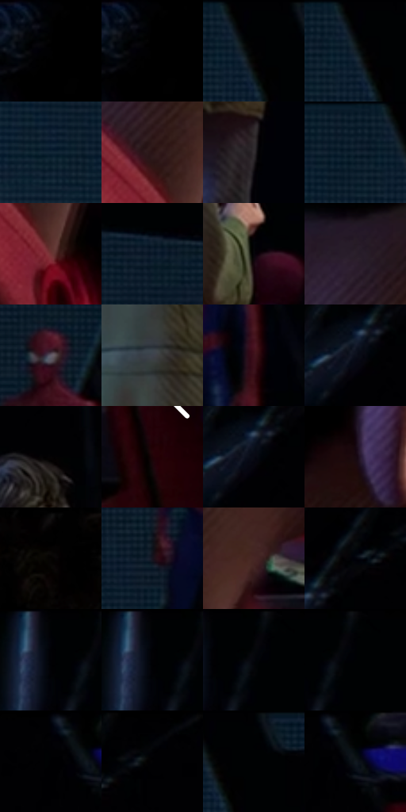

# 电影参考 446

- 状态：常规／活跃；来源世界：miles-home。
- 视角：near-level；景别：medium；场景：portrait。
- 时段：interior-time-unknown（外观依据，中置信度；具体时间／晨昏未知）；光照：dark-interior。
- 材质候选：skin, hair, fabric, metal, glass（帧级，不是像素分割）。
- 明暗组：very-dark；L* P5/P50/P95：0.0 / 1.80984 / 31.37025。
- 资格门禁：无附加门禁。
- 原截图 SHA-256：`f27c3d4a6358d62a132fbaa27da260bb124c862741a5a7957391b7554085b02d`；尺寸：2880 × 1210。
- sRGB 像素 SHA-256：`65eea5310dfc513c11458de8d1c6e09c302bc7a87f31c8e2fcb8b96df3671bf1`。

## 观察与迁移

暗室面部与展柜，局部亮边不能取代动画形体。

近处耳颈局部遮挡与中景背影分层；近大不等于视觉焦点。

5  /  446  /  展柜与反射：近处耳颈局部遮挡与中景背影分层；近大不等于视觉焦点。

本公开版保存32个128×128原像素色卡上下文；图集格子并非原场景相邻位置。原rect、图集tile和像素SHA见 `data/palette-crops.json`。上下文不足时不得批准替色，不能以小样推断完整构图。

## 实测色卡

颜色比例分母为保留采样像素，不是材料面积；全部 32 色参与全库匹配。表内四舍五入仅用于阅读，原精度在 JSON。

| ID | HEX | Lab | 原图 xy | 像素数 | 比例 | 明度角色 |
| --- | --- | --- | --- | ---: | ---: | --- |
| 446-S01 | #000106 | [0.314799, 0.433702, -1.984223] | [48, 28] | 23195 | 11.953474% | deep-shadow |
| 446-S02 | #000000 | [0.0, 0.0, 0.0] | [68, 28] | 19947 | 10.279627% | deep-shadow |
| 446-S03 | #000203 | [0.451516, -0.38399, -0.562635] | [1264, 28] | 15471 | 7.972934% | deep-shadow |
| 446-S04 | #010103 | [0.313747, 0.27807, -0.756814] | [1248, 28] | 9837 | 5.069469% | deep-shadow |
| 446-S05 | #122637 | [14.347064, -1.817788, -13.452224] | [1012, 116] | 9250 | 4.766960% | deep-shadow |
| 446-S06 | #291416 | [9.236943, 11.08407, 3.215211] | [264, 912] | 8297 | 4.275834% | deep-shadow |
| 446-S07 | #332E31 | [19.555026, 2.921806, -1.105802] | [2240, 1032] | 7941 | 4.092371% | deep-shadow |
| 446-S08 | #0D1E2C | [10.526792, -1.769277, -11.529067] | [1188, 28] | 7177 | 3.698646% | deep-shadow |
| 446-S09 | #703434 | [29.786718, 26.505801, 12.536337] | [308, 1012] | 7175 | 3.697615% | shadow |
| 446-S10 | #091829 | [7.870874, 0.457116, -13.490901] | [1548, 188] | 6637 | 3.420358% | deep-shadow |
| 446-S11 | #080509 | [1.624941, 1.340586, -1.237114] | [2388, 556] | 6017 | 3.100843% | deep-shadow |
| 446-S12 | #291F2A | [13.342926, 7.343993, -5.534093] | [308, 576] | 5958 | 3.070438% | deep-shadow |
| 446-S13 | #635D6A | [40.446034, 5.14482, -6.524131] | [1696, 272] | 5909 | 3.045186% | midtone |
| 446-S14 | #3E424C | [27.959346, 0.804987, -6.591022] | [2096, 620] | 5876 | 3.028179% | shadow |
| 446-S15 | #3C121B | [12.433221, 21.596915, 4.503545] | [1756, 452] | 5126 | 2.641669% | deep-shadow |
| 446-S16 | #0B0F1A | [4.402185, 1.311105, -7.326082] | [2452, 168] | 5071 | 2.613325% | deep-shadow |
| 446-S17 | #050204 | [0.762847, 1.062551, -0.480366] | [2244, 120] | 4936 | 2.543753% | deep-shadow |
| 446-S18 | #1D0207 | [2.890947, 10.757433, 1.653352] | [2812, 676] | 4632 | 2.387087% | deep-shadow |
| 446-S19 | #070913 | [2.597384, 1.208599, -4.897145] | [2460, 168] | 4600 | 2.370596% | deep-shadow |
| 446-S20 | #190A10 | [4.166045, 6.74319, -0.645929] | [500, 472] | 4505 | 2.321638% | deep-shadow |
| 446-S21 | #020101 | [0.332482, 0.261482, 0.092172] | [724, 28] | 4126 | 2.126322% | deep-shadow |
| 446-S22 | #17141F | [7.058229, 4.425701, -7.120876] | [1608, 516] | 4017 | 2.070149% | deep-shadow |
| 446-S23 | #462624 | [19.291378, 14.820109, 7.851114] | [412, 780] | 3920 | 2.020160% | deep-shadow |
| 446-S24 | #01020A | [0.648333, 0.850816, -3.119461] | [2520, 92] | 3705 | 1.909361% | deep-shadow |
| 446-S25 | #010208 | [0.608759, 0.572729, -2.362614] | [1764, 40] | 2952 | 1.521304% | deep-shadow |
| 446-S26 | #000104 | [0.275225, 0.155615, -1.227376] | [1764, 28] | 2751 | 1.417720% | deep-shadow |
| 446-S27 | #000002 | [0.039574, 0.278088, -0.756847] | [1816, 28] | 2009 | 1.035332% | deep-shadow |
| 446-S28 | #010205 | [0.549399, 0.155597, -1.227343] | [1836, 28] | 834 | 0.429799% | deep-shadow |
| 446-S29 | #010006 | [0.17703, 1.095762, -2.178403] | [2772, 28] | 705 | 0.363320% | deep-shadow |
| 446-S30 | #010407 | [0.981128, -0.367436, -1.411554] | [2608, 40] | 589 | 0.303539% | deep-shadow |
| 446-S31 | #000304 | [0.667381, -0.645506, -0.65474] | [1308, 28] | 522 | 0.269011% | deep-shadow |
| 446-S32 | #000201 | [0.411943, -0.662077, 0.194212] | [2816, 32] | 357 | 0.183979% | deep-shadow |

## 色阶与空间分布

- 采样 ROI：`[0.01, 0.02, 0.98, 0.94]`；步长：4；样本数：194044。
- 排除区：`[]`。
- 深暗、暗、中、亮、高光五段计数：`[169626, 21316, 3038, 63, 1]`。
- RGB 各 256 箱、L* 100 箱、13×5 色相明度表和 3×3 空间统计全部保存在 [总数据](../film-library.json)。
- [可视化档案](../../references/library.html)按需绘制直方图，不存 2,094 张重复图表图片。

## 纹理特征占比

**这是分块图像特征的面积占比，不是波点／排线／丝网／错版的精确语义覆盖率。** 窗格、发丝、织物也会产生方向或周期特征。
原图 ROI 像素 3109722；已测块覆盖 3109722（100.0000%）；未测 0。

| 特征 | 块覆盖像素 | 占已测面积 | 阈值敏感范围 |
| --- | ---: | ---: | --- |
| low-contrast | 840026 | 27.0129% | 25.9592% ~ 27.5398% |
| directional-structure | 891904 | 28.6811% | 14.7069% ~ 41.6017% |
| periodic-structure | 1377792 | 44.3060% | 31.9123% ~ 55.1190% |
| mixed-detail | 0 | 0.0000% | 0.0000% ~ 2.6343% |

阈值敏感范围不是统计置信区间。逐块坐标、尺度、对比、方向一致性、频谱集中度、频率与角度见 [全量特征记录](../texture-features.jsonl)，以帧号定位。
四种印刷层的真实像素覆盖仍标为 `null`，不能填 0，也不能拿上表代替。不得据这些代理测量删除唯一证据。

[测量方法与保留策略](../../references/library-retention.md) · [分类索引](../archive/README.md)
