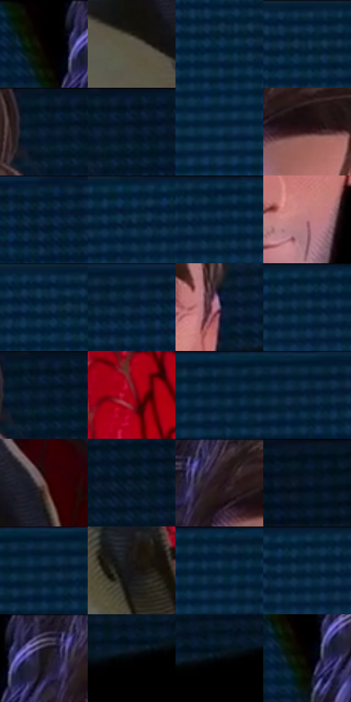

# 电影参考 447

- 状态：常规／活跃；来源世界：miles-home。
- 视角：near-level；景别：medium；场景：portrait。
- 时段：interior-time-unknown（外观依据，中置信度；具体时间／晨昏未知）；光照：dark-interior。
- 材质候选：skin, hair, fabric, metal, glass（帧级，不是像素分割）。
- 明暗组：very-dark；L* P5/P50/P95：0.0 / 13.15922 / 44.94468。
- 资格门禁：无附加门禁。
- 原截图 SHA-256：`9e5dcbb701c180406dc796147739e14616100b53dda91734b2dcc27a8054b01b`；尺寸：2880 × 1212。
- sRGB 像素 SHA-256：`ecebdc9ff6f681a54a102a670109539a2d7b9e0df35e1503d3e313b8d5696855`。

## 观察与迁移

暗室面部与展柜，局部亮边不能取代动画形体。

闭眼表情、局部眼周线与胡茬塑形，背景蓝板纹理独立；不把面部皱褶当通用身份模板。

6  /  447  /  展柜与反射：闭眼表情、局部眼周线与胡茬塑形，背景蓝板纹理独立；不把面部皱褶当通用身份模板。

本公开版保存32个128×128原像素色卡上下文；图集格子并非原场景相邻位置。原rect、图集tile和像素SHA见 `data/palette-crops.json`。上下文不足时不得批准替色，不能以小样推断完整构图。

## 实测色卡

颜色比例分母为保留采样像素，不是材料面积；全部 32 色参与全库匹配。表内四舍五入仅用于阅读，原精度在 JSON。

| ID | HEX | Lab | 原图 xy | 像素数 | 比例 | 明度角色 |
| --- | --- | --- | --- | ---: | ---: | --- |
| 447-S01 | #000000 | [0.0, 0.0, 0.0] | [1472, 28] | 16381 | 8.441900% | deep-shadow |
| 447-S02 | #5A5347 | [35.626202, 0.602597, 8.074314] | [1480, 844] | 10891 | 5.612645% | shadow |
| 447-S03 | #0B304C | [18.82806, -1.445734, -20.925939] | [300, 88] | 10551 | 5.437427% | deep-shadow |
| 447-S04 | #03223D | [12.608909, 0.735524, -20.465291] | [320, 48] | 10401 | 5.360125% | deep-shadow |
| 447-S05 | #061B2E | [9.154693, -0.346443, -15.168769] | [1996, 36] | 8804 | 4.537115% | deep-shadow |
| 447-S06 | #061728 | [7.268108, -0.01795, -13.703848] | [2044, 32] | 8434 | 4.346437% | deep-shadow |
| 447-S07 | #113555 | [21.285668, -0.223764, -23.051937] | [492, 192] | 8123 | 4.186164% | shadow |
| 447-S08 | #2F1315 | [9.987355, 14.523391, 5.130941] | [1712, 108] | 7946 | 4.094948% | deep-shadow |
| 447-S09 | #021E34 | [10.477694, -0.727382, -17.445841] | [1196, 28] | 7784 | 4.011461% | deep-shadow |
| 447-S10 | #062843 | [15.282845, -0.425916, -20.396508] | [428, 36] | 7285 | 3.754303% | deep-shadow |
| 447-S11 | #08243E | [13.59686, 0.57432, -19.585459] | [604, 28] | 7097 | 3.657418% | deep-shadow |
| 447-S12 | #BC7C82 | [58.714673, 25.704283, 7.029318] | [1860, 544] | 6679 | 3.442003% | midtone |
| 447-S13 | #021F39 | [11.192068, 0.914823, -19.891962] | [268, 28] | 6638 | 3.420874% | deep-shadow |
| 447-S14 | #062038 | [11.669102, 0.467296, -18.409953] | [1088, 64] | 6522 | 3.361093% | deep-shadow |
| 447-S15 | #6F6179 | [43.225827, 10.526854, -11.387338] | [1968, 352] | 6334 | 3.264208% | midtone |
| 447-S16 | #092C45 | [16.935445, -1.950799, -19.154415] | [536, 32] | 6178 | 3.183814% | deep-shadow |
| 447-S17 | #021525 | [6.167003, -0.898539, -13.183376] | [2020, 32] | 6149 | 3.168869% | deep-shadow |
| 447-S18 | #970217 | [31.082894, 54.277727, 34.103687] | [1840, 864] | 5643 | 2.908103% | shadow |
| 447-S19 | #07263C | [14.15908, -1.960007, -17.297217] | [828, 52] | 4825 | 2.486549% | deep-shadow |
| 447-S20 | #021A32 | [8.839306, 1.384464, -18.603973] | [956, 36] | 4643 | 2.392756% | deep-shadow |
| 447-S21 | #725653 | [39.340392, 11.096569, 6.231972] | [1552, 728] | 4251 | 2.190740% | shadow |
| 447-S22 | #0F1E31 | [10.933718, 0.829071, -14.517517] | [2228, 96] | 4140 | 2.133537% | deep-shadow |
| 447-S23 | #382B31 | [19.183906, 7.216788, -1.586478] | [1632, 36] | 4111 | 2.118592% | deep-shadow |
| 447-S24 | #02101D | [4.264821, -0.686617, -9.941616] | [2592, 28] | 3502 | 1.804745% | deep-shadow |
| 447-S25 | #0F2B47 | [16.912117, 0.582276, -20.547039] | [928, 48] | 3423 | 1.764033% | deep-shadow |
| 447-S26 | #171316 | [6.3758, 2.4632, -1.259136] | [1648, 1004] | 3398 | 1.751149% | deep-shadow |
| 447-S27 | #0C2A43 | [16.200918, -0.937138, -18.931534] | [712, 28] | 3306 | 1.703737% | deep-shadow |
| 447-S28 | #11304D | [19.092218, -0.08412, -21.16992] | [516, 60] | 3279 | 1.689823% | deep-shadow |
| 447-S29 | #453F55 | [28.050101, 7.777395, -12.254946] | [1560, 28] | 2867 | 1.477500% | shadow |
| 447-S30 | #020305 | [0.803785, 0.016536, -0.848887] | [2624, 304] | 2366 | 1.219311% | deep-shadow |
| 447-S31 | #050A0F | [2.563731, -0.509816, -2.631814] | [2660, 292] | 1212 | 0.624601% | deep-shadow |
| 447-S32 | #050302 | [0.919351, 0.383903, 0.5628] | [1488, 104] | 881 | 0.454021% | deep-shadow |

## 色阶与空间分布

- 采样 ROI：`[0.01, 0.02, 0.98, 0.94]`；步长：4；样本数：194044。
- 排除区：`[]`。
- 深暗、暗、中、亮、高光五段计数：`[147882, 30565, 13406, 2191, 0]`。
- RGB 各 256 箱、L* 100 箱、13×5 色相明度表和 3×3 空间统计全部保存在 [总数据](../film-library.json)。
- [可视化档案](../../references/library.html)按需绘制直方图，不存 2,094 张重复图表图片。

## 纹理特征占比

**这是分块图像特征的面积占比，不是波点／排线／丝网／错版的精确语义覆盖率。** 窗格、发丝、织物也会产生方向或周期特征。
原图 ROI 像素 3115310；已测块覆盖 3115310（100.0000%）；未测 0。

| 特征 | 块覆盖像素 | 占已测面积 | 阈值敏感范围 |
| --- | ---: | ---: | --- |
| low-contrast | 210176 | 6.7466% | 6.2206% ~ 9.1050% |
| directional-structure | 635520 | 20.3999% | 5.1688% ~ 50.6690% |
| periodic-structure | 2239662 | 71.8921% | 43.1104% ~ 84.0170% |
| mixed-detail | 29952 | 0.9614% | 0.0000% ~ 1.7092% |

阈值敏感范围不是统计置信区间。逐块坐标、尺度、对比、方向一致性、频谱集中度、频率与角度见 [全量特征记录](../texture-features.jsonl)，以帧号定位。
四种印刷层的真实像素覆盖仍标为 `null`，不能填 0，也不能拿上表代替。不得据这些代理测量删除唯一证据。

[测量方法与保留策略](../../references/library-retention.md) · [分类索引](../archive/README.md)
