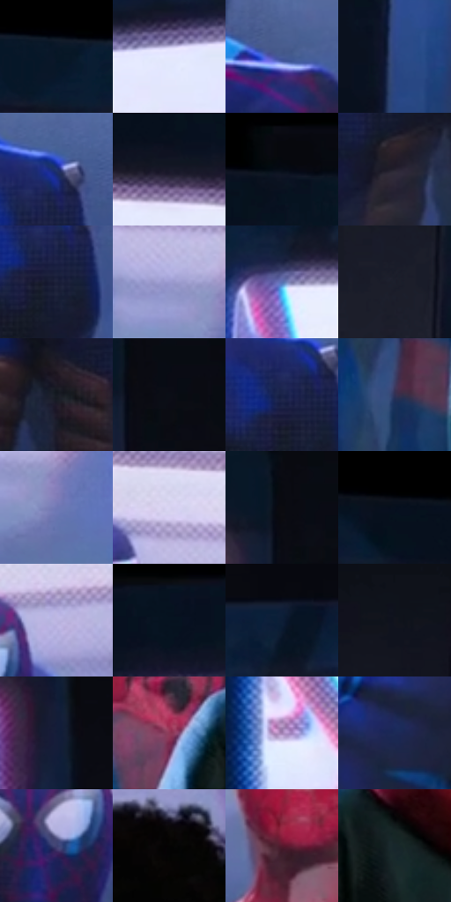

# 电影参考 448

- 状态：常规／活跃；来源世界：miles-home。
- 视角：low-angle；景别：medium；场景：portrait。
- 时段：interior-time-unknown（外观依据，中置信度；具体时间／晨昏未知）；光照：dark-interior。
- 材质候选：skin, hair, fabric, metal, glass（帧级，不是像素分割）。
- 明暗组：very-dark；L* P5/P50/P95：2.56895 / 14.74353 / 87.68299。
- 资格门禁：无附加门禁。
- 原截图 SHA-256：`a5ff5c6ce5e157f94d0591073bd97f7dead156012dc0a0ee1414fc62e6a0ba51`；尺寸：2880 × 1226。
- sRGB 像素 SHA-256：`e506850bb05c14a8eb95f70413a9ac83f66e8c87bb33c919167c7aa2541b25cb`。

## 观察与迁移

暗室面部与展柜，局部亮边不能取代动画形体。

展柜顶灯有彩色边缘，玻璃上淡人脸叠在柜内服装前；不融合为一个人体。

7  /  448  /  展柜与反射：展柜顶灯有彩色边缘，玻璃上淡人脸叠在柜内服装前；不融合为一个人体。

本公开版保存32个128×128原像素色卡上下文；图集格子并非原场景相邻位置。原rect、图集tile和像素SHA见 `data/palette-crops.json`。上下文不足时不得批准替色，不能以小样推断完整构图。

## 实测色卡

颜色比例分母为保留采样像素，不是材料面积；全部 32 色参与全库匹配。表内四舍五入仅用于阅读，原精度在 JSON。

| ID | HEX | Lab | 原图 xy | 像素数 | 比例 | 明度角色 |
| --- | --- | --- | --- | ---: | ---: | --- |
| 448-S01 | #0A1729 | [7.563591, 1.46547, -13.970145] | [140, 52] | 9256 | 4.702392% | deep-shadow |
| 448-S02 | #E5E9FE | [92.614932, 2.608397, -10.579968] | [2600, 180] | 8693 | 4.416367% | highlight |
| 448-S03 | #475B96 | [39.618939, 9.993149, -34.750581] | [2744, 636] | 8568 | 4.352862% | shadow |
| 448-S04 | #2D4585 | [30.656698, 12.799842, -38.750892] | [1092, 880] | 8172 | 4.151680% | shadow |
| 448-S05 | #20346F | [23.372414, 13.705709, -36.639894] | [532, 696] | 8133 | 4.131866% | shadow |
| 448-S06 | #171928 | [9.243612, 3.732917, -10.523349] | [452, 152] | 8062 | 4.095795% | deep-shadow |
| 448-S07 | #08090F | [2.542579, 0.675242, -2.641717] | [604, 28] | 8060 | 4.094779% | deep-shadow |
| 448-S08 | #24212E | [13.591175, 4.842285, -8.094516] | [408, 952] | 8007 | 4.067853% | deep-shadow |
| 448-S09 | #1B2039 | [12.992798, 5.963188, -16.945385] | [520, 780] | 7289 | 3.703083% | deep-shadow |
| 448-S10 | #9B9AD0 | [65.46186, 12.151049, -27.449731] | [480, 436] | 7034 | 3.573533% | light |
| 448-S11 | #5871B1 | [48.332977, 9.100168, -36.870953] | [1160, 216] | 7022 | 3.567437% | midtone |
| 448-S12 | #1B1F2C | [11.922851, 2.10394, -9.285754] | [948, 688] | 6638 | 3.372351% | deep-shadow |
| 448-S13 | #151A22 | [9.104838, 0.142708, -6.284343] | [184, 932] | 6625 | 3.365746% | deep-shadow |
| 448-S14 | #0B0E16 | [4.002776, 0.763207, -4.844615] | [820, 188] | 6520 | 3.312402% | deep-shadow |
| 448-S15 | #1A2348 | [14.895573, 9.243018, -24.405366] | [496, 744] | 6478 | 3.291065% | deep-shadow |
| 448-S16 | #303055 | [21.572017, 10.728151, -22.475514] | [1324, 1096] | 6097 | 3.097502% | shadow |
| 448-S17 | #6F78B5 | [52.003671, 12.048172, -33.314907] | [544, 488] | 6094 | 3.095978% | midtone |
| 448-S18 | #D9D4F1 | [86.100927, 7.17036, -13.569228] | [444, 340] | 6033 | 3.064988% | highlight |
| 448-S19 | #0B0B10 | [3.142521, 0.840401, -2.287406] | [780, 160] | 5416 | 2.751529% | deep-shadow |
| 448-S20 | #08101C | [4.57072, 0.573513, -8.665615] | [324, 60] | 5355 | 2.720539% | deep-shadow |
| 448-S21 | #BCB5E1 | [75.55991, 11.245465, -21.112401] | [2672, 368] | 5320 | 2.702758% | light |
| 448-S22 | #091421 | [6.03524, 0.088669, -10.310498] | [2784, 28] | 5130 | 2.606231% | deep-shadow |
| 448-S23 | #0B1D36 | [10.675461, 2.818279, -18.543696] | [1188, 112] | 5130 | 2.606231% | deep-shadow |
| 448-S24 | #12141D | [6.48198, 1.607899, -6.506369] | [940, 440] | 5110 | 2.596070% | deep-shadow |
| 448-S25 | #131D39 | [11.36231, 5.9559, -19.568458] | [1844, 256] | 5095 | 2.588449% | deep-shadow |
| 448-S26 | #8F3957 | [36.846907, 39.449, 0.654652] | [1436, 836] | 5043 | 2.562031% | shadow |
| 448-S27 | #A181B3 | [58.539092, 21.706887, -21.707709] | [2208, 296] | 4874 | 2.476173% | midtone |
| 448-S28 | #1B2A56 | [18.190139, 9.919742, -28.621764] | [2652, 816] | 4502 | 2.287183% | deep-shadow |
| 448-S29 | #3F4173 | [29.600324, 13.364367, -29.108911] | [2576, 452] | 4106 | 2.086001% | shadow |
| 448-S30 | #040303 | [0.880829, 0.261447, 0.092238] | [1680, 524] | 3325 | 1.689224% | deep-shadow |
| 448-S31 | #56192C | [19.458077, 29.90562, 2.891264] | [1424, 576] | 3207 | 1.629275% | deep-shadow |
| 448-S32 | #17272B | [14.442873, -5.393628, -4.762719] | [1564, 864] | 2442 | 1.240627% | deep-shadow |

## 色阶与空间分布

- 采样 ROI：`[0.01, 0.02, 0.98, 0.94]`；步长：4；样本数：196836。
- 排除区：`[]`。
- 深暗、暗、中、亮、高光五段计数：`[112644, 33600, 22241, 13217, 15134]`。
- RGB 各 256 箱、L* 100 箱、13×5 色相明度表和 3×3 空间统计全部保存在 [总数据](../film-library.json)。
- [可视化档案](../../references/library.html)按需绘制直方图，不存 2,094 张重复图表图片。

## 纹理特征占比

**这是分块图像特征的面积占比，不是波点／排线／丝网／错版的精确语义覆盖率。** 窗格、发丝、织物也会产生方向或周期特征。
原图 ROI 像素 3151632；已测块覆盖 3151632（100.0000%）；未测 0。

| 特征 | 块覆盖像素 | 占已测面积 | 阈值敏感范围 |
| --- | ---: | ---: | --- |
| low-contrast | 318464 | 10.1047% | 9.1625% ~ 11.6643% |
| directional-structure | 1070592 | 33.9694% | 19.1779% ~ 46.0973% |
| periodic-structure | 1697040 | 53.8464% | 43.7005% ~ 61.9773% |
| mixed-detail | 65536 | 2.0794% | 1.0397% ~ 7.1805% |

阈值敏感范围不是统计置信区间。逐块坐标、尺度、对比、方向一致性、频谱集中度、频率与角度见 [全量特征记录](../texture-features.jsonl)，以帧号定位。
四种印刷层的真实像素覆盖仍标为 `null`，不能填 0，也不能拿上表代替。不得据这些代理测量删除唯一证据。

[测量方法与保留策略](../../references/library-retention.md) · [分类索引](../archive/README.md)
