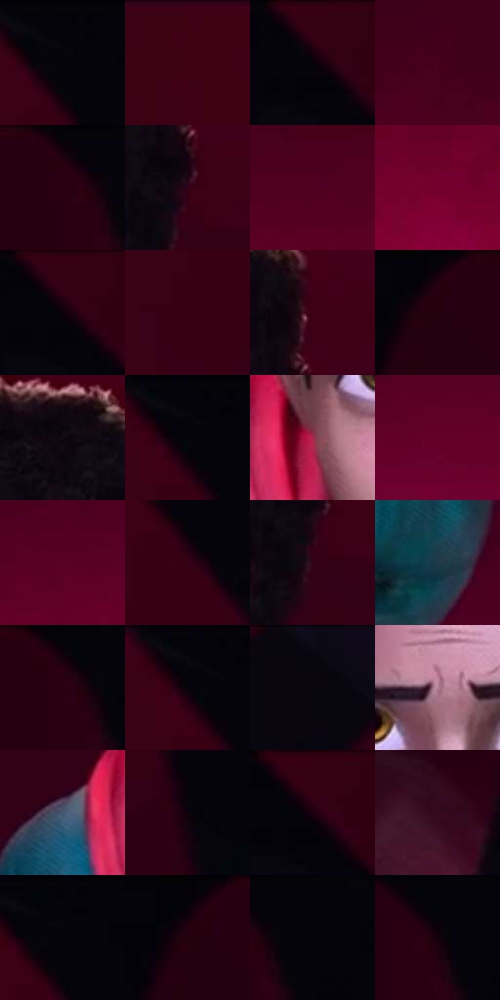

# 电影参考 449

- 状态：常规／活跃；来源世界：miles-home。
- 视角：overhead；景别：medium；场景：portrait。
- 时段：interior-time-unknown（外观依据，中置信度；具体时间／晨昏未知）；光照：dark-interior。
- 材质候选：skin, hair, fabric, metal, glass（帧级，不是像素分割）。
- 明暗组：very-dark；L* P5/P50/P95：1.07765 / 7.05284 / 39.33735。
- 资格门禁：无附加门禁。
- 原截图 SHA-256：`2254dea6a7bffb2377e9f26ab703867009d4cd85f2ef72a930490b3d178091ad`；尺寸：2880 × 1206。
- sRGB 像素 SHA-256：`c09525e48953b003954e9db70b78b3513f0bb8cc4d52d41d6844a348a785f543`。

## 观察与迁移

暗室面部与展柜，局部亮边不能取代动画形体。

俯视人物置于红色地面和黑色图形条带；大面留净突出脸，不自动替换照片地面。

8  /  449  /  展柜与反射：俯视人物置于红色地面和黑色图形条带；大面留净突出脸，不自动替换照片地面。

本公开版保存32个128×128原像素色卡上下文；图集格子并非原场景相邻位置。原rect、图集tile和像素SHA见 `data/palette-crops.json`。上下文不足时不得批准替色，不能以小样推断完整构图。

## 实测色卡

颜色比例分母为保留采样像素，不是材料面积；全部 32 色参与全库匹配。表内四舍五入仅用于阅读，原精度在 JSON。

| ID | HEX | Lab | 原图 xy | 像素数 | 比例 | 明度角色 |
| --- | --- | --- | --- | ---: | ---: | --- |
| 449-S01 | #05030A | [1.077646, 1.496253, -2.464589] | [2220, 28] | 13066 | 6.757833% | deep-shadow |
| 449-S02 | #3E0014 | [9.600913, 30.243736, 5.713329] | [956, 28] | 11162 | 5.773070% | deep-shadow |
| 449-S03 | #340014 | [7.052843, 27.226043, 1.70262] | [2372, 36] | 9977 | 5.160179% | deep-shadow |
| 449-S04 | #46011B | [11.979805, 32.609938, 4.189206] | [2044, 800] | 9933 | 5.137422% | deep-shadow |
| 449-S05 | #270010 | [4.235296, 19.73297, -0.30129] | [2724, 40] | 9750 | 5.042773% | deep-shadow |
| 449-S06 | #2F0115 | [6.145694, 24.686246, -0.434135] | [1664, 372] | 9385 | 4.853992% | deep-shadow |
| 449-S07 | #510021 | [14.732898, 36.499631, 3.957249] | [2244, 884] | 8333 | 4.309890% | deep-shadow |
| 449-S08 | #760030 | [23.888926, 47.237306, 7.319721] | [2392, 1052] | 8010 | 4.142832% | shadow |
| 449-S09 | #310013 | [6.324697, 25.877358, 1.204383] | [2376, 44] | 7670 | 3.966981% | deep-shadow |
| 449-S10 | #3A0016 | [8.634348, 29.275184, 2.811992] | [2172, 224] | 7382 | 3.818026% | deep-shadow |
| 449-S11 | #3F0018 | [9.976999, 30.84697, 3.412566] | [1676, 260] | 7323 | 3.787510% | deep-shadow |
| 449-S12 | #20000D | [3.03709, 14.287584, -0.633266] | [156, 32] | 7307 | 3.779235% | deep-shadow |
| 449-S13 | #0F0913 | [3.106894, 3.493619, -4.092025] | [1524, 172] | 7228 | 3.738376% | deep-shadow |
| 449-S14 | #03030A | [0.961028, 0.973255, -2.648866] | [2208, 32] | 6906 | 3.571835% | deep-shadow |
| 449-S15 | #A32C4B | [38.018058, 50.394473, 10.449001] | [1280, 628] | 6512 | 3.368055% | shadow |
| 449-S16 | #650029 | [19.751792, 42.37905, 5.888676] | [608, 1000] | 6145 | 3.178240% | deep-shadow |
| 449-S17 | #5C0027 | [17.564389, 39.88728, 3.939872] | [568, 956] | 5837 | 3.018940% | deep-shadow |
| 449-S18 | #360015 | [7.575471, 28.024464, 1.848696] | [2232, 144] | 5571 | 2.881363% | deep-shadow |
| 449-S19 | #2C0212 | [5.624974, 22.226269, 0.67694] | [1656, 416] | 5570 | 2.880846% | deep-shadow |
| 449-S20 | #1F3948 | [22.602074, -4.981199, -12.293359] | [1772, 868] | 5497 | 2.843090% | shadow |
| 449-S21 | #230010 | [3.566546, 16.853774, -1.358038] | [2732, 40] | 5384 | 2.784645% | deep-shadow |
| 449-S22 | #06050C | [1.569912, 1.250378, -2.59928] | [2192, 40] | 5237 | 2.708616% | deep-shadow |
| 449-S23 | #080810 | [2.372875, 1.261131, -3.432425] | [608, 28] | 4978 | 2.574659% | deep-shadow |
| 449-S24 | #B58296 | [59.881936, 22.715872, -2.877704] | [1420, 524] | 4659 | 2.409670% | midtone |
| 449-S25 | #465A70 | [37.451567, -1.611341, -14.970826] | [1160, 624] | 4377 | 2.263817% | shadow |
| 449-S26 | #0D030C | [1.601068, 3.949941, -2.503006] | [2368, 372] | 3235 | 1.673166% | deep-shadow |
| 449-S27 | #2F0011 | [5.82617, 24.680355, 1.640451] | [2384, 52] | 2505 | 1.295605% | deep-shadow |
| 449-S28 | #3D1526 | [13.642158, 21.768876, -1.850057] | [36, 920] | 2390 | 1.236126% | deep-shadow |
| 449-S29 | #05040A | [1.273724, 1.095693, -2.178271] | [2232, 28] | 1280 | 0.662026% | deep-shadow |
| 449-S30 | #06020A | [0.939877, 2.158313, -2.658768] | [140, 32] | 387 | 0.200159% | deep-shadow |
| 449-S31 | #05030C | [1.119448, 1.79, -3.264054] | [2808, 52] | 235 | 0.121544% | deep-shadow |
| 449-S32 | #050408 | [1.23415, 0.817605, -1.421424] | [2760, 28] | 115 | 0.059479% | deep-shadow |

## 色阶与空间分布

- 采样 ROI：`[0.01, 0.02, 0.98, 0.94]`；步长：4；样本数：193346。
- 排除区：`[]`。
- 深暗、暗、中、亮、高光五段计数：`[162043, 22011, 7057, 2188, 47]`。
- RGB 各 256 箱、L* 100 箱、13×5 色相明度表和 3×3 空间统计全部保存在 [总数据](../film-library.json)。
- [可视化档案](../../references/library.html)按需绘制直方图，不存 2,094 张重复图表图片。

## 纹理特征占比

**这是分块图像特征的面积占比，不是波点／排线／丝网／错版的精确语义覆盖率。** 窗格、发丝、织物也会产生方向或周期特征。
原图 ROI 像素 3098546；已测块覆盖 3098546（100.0000%）；未测 0。

| 特征 | 块覆盖像素 | 占已测面积 | 阈值敏感范围 |
| --- | ---: | ---: | --- |
| low-contrast | 2117888 | 68.3510% | 64.7406% ~ 72.5811% |
| directional-structure | 311858 | 10.0647% | 2.9950% ~ 17.9052% |
| periodic-structure | 668800 | 21.5843% | 17.3542% ~ 23.3664% |
| mixed-detail | 0 | 0.0000% | 0.0000% ~ 1.0575% |

阈值敏感范围不是统计置信区间。逐块坐标、尺度、对比、方向一致性、频谱集中度、频率与角度见 [全量特征记录](../texture-features.jsonl)，以帧号定位。
四种印刷层的真实像素覆盖仍标为 `null`，不能填 0，也不能拿上表代替。不得据这些代理测量删除唯一证据。

[测量方法与保留策略](../../references/library-retention.md) · [分类索引](../archive/README.md)
