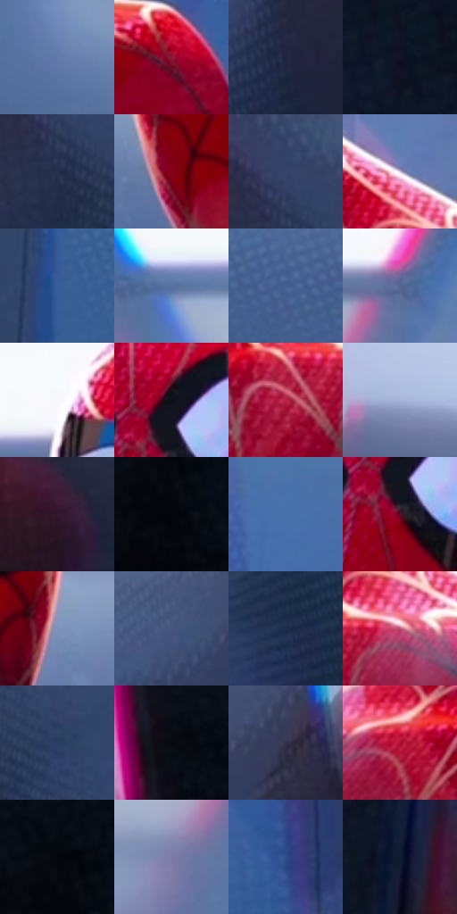

# 电影参考 450

- 状态：条件／活跃；来源世界：miles-home。
- 视角：near-level；景别：medium；场景：reflection。
- 时段：interior-time-unknown（外观依据，中置信度；具体时间／晨昏未知）；光照：cool-interior。
- 材质候选：fabric, glass, skin, metal（帧级，不是像素分割）。
- 明暗组：dark；L* P5/P50/P95：2.51064 / 31.42876 / 83.48352。
- 资格门禁：reflection。
- 原截图 SHA-256：`074678f64f3971459c9cc42692fab143ec5c340fcc571240fa91c441550c392d`；尺寸：2878 × 1202。
- sRGB 像素 SHA-256：`1d937e00bb4b34640ba95fa96a1b94fca8c364fda2f0e4c58d95c2f19bbe3039`。

## 观察与迁移

玻璃后实体服装和表面人脸映像分层，反射不算新增人。

展柜内红服装可透见，玻璃上人脸映像覆盖颈胸区，顶灯有青粉边；不是身体透明。

9  /  450  /  展柜与反射：展柜内红服装可透见，玻璃上人脸映像覆盖颈胸区，顶灯有青粉边；不是身体透明。

本公开版保存32个128×128原像素色卡上下文；图集格子并非原场景相邻位置。原rect、图集tile和像素SHA见 `data/palette-crops.json`。上下文不足时不得批准替色，不能以小样推断完整构图。

## 实测色卡

颜色比例分母为保留采样像素，不是材料面积；全部 32 色参与全库匹配。表内四舍五入仅用于阅读，原精度在 JSON。

| ID | HEX | Lab | 原图 xy | 像素数 | 比例 | 明度角色 |
| --- | --- | --- | --- | ---: | ---: | --- |
| 450-S01 | #617AA9 | [51.063982, 3.530254, -27.911782] | [1092, 416] | 10133 | 5.259852% | midtone |
| 450-S02 | #881935 | [29.882254, 46.956781, 12.761237] | [1972, 904] | 9291 | 4.822786% | shadow |
| 450-S03 | #1E253F | [15.264743, 5.4028, -17.566127] | [2460, 528] | 8901 | 4.620344% | deep-shadow |
| 450-S04 | #121423 | [6.776696, 3.678889, -10.64014] | [76, 692] | 8408 | 4.364437% | deep-shadow |
| 450-S05 | #24304C | [20.086133, 4.009699, -18.859952] | [404, 464] | 8164 | 4.237781% | shadow |
| 450-S06 | #84011D | [26.784704, 49.637984, 24.604279] | [1256, 448] | 8131 | 4.220651% | shadow |
| 450-S07 | #374368 | [28.968208, 6.143128, -23.165767] | [408, 380] | 8062 | 4.184835% | shadow |
| 450-S08 | #CAC3E1 | [80.192354, 8.153543, -14.013019] | [1680, 732] | 7625 | 3.957996% | highlight |
| 450-S09 | #375D99 | [39.47869, 6.268846, -36.829297] | [708, 708] | 7463 | 3.873905% | shadow |
| 450-S10 | #5771A0 | [47.460723, 3.560968, -28.310567] | [988, 188] | 7292 | 3.785142% | midtone |
| 450-S11 | #435F91 | [40.280859, 4.821819, -30.716976] | [972, 576] | 7183 | 3.728562% | midtone |
| 450-S12 | #536792 | [43.674194, 4.327207, -25.936692] | [1904, 172] | 7062 | 3.665753% | midtone |
| 450-S13 | #F6F7FB | [97.259744, 0.378569, -2.026244] | [1212, 120] | 6107 | 3.170030% | highlight |
| 450-S14 | #0C0F19 | [4.425899, 1.316589, -6.495194] | [1460, 200] | 6030 | 3.130061% | deep-shadow |
| 450-S15 | #B42949 | [40.853298, 56.346885, 16.120025] | [1596, 896] | 5940 | 3.083344% | midtone |
| 450-S16 | #A5B4D8 | [73.284204, 2.61306, -19.833685] | [380, 140] | 5918 | 3.071924% | light |
| 450-S17 | #32172C | [12.434504, 17.211163, -8.249345] | [324, 924] | 5891 | 3.057909% | deep-shadow |
| 450-S18 | #04060A | [1.607571, 0.033072, -1.697773] | [2784, 188] | 5838 | 3.030397% | deep-shadow |
| 450-S19 | #4870AC | [46.899814, 4.438075, -36.27726] | [2024, 520] | 5472 | 2.840414% | midtone |
| 450-S20 | #5A1328 | [19.196059, 33.526625, 5.463878] | [1456, 268] | 5340 | 2.771895% | deep-shadow |
| 450-S21 | #7E94BF | [61.111779, 2.652654, -24.808895] | [1628, 400] | 5162 | 2.679498% | light |
| 450-S22 | #45547C | [36.100587, 5.509266, -24.471796] | [2364, 332] | 4650 | 2.413729% | shadow |
| 450-S23 | #1D2C4D | [18.356816, 5.340344, -22.293787] | [2264, 772] | 4633 | 2.404904% | deep-shadow |
| 450-S24 | #B85573 | [49.408249, 43.104961, 2.399911] | [1712, 852] | 4493 | 2.332233% | midtone |
| 450-S25 | #293B61 | [25.143573, 5.332315, -24.74669] | [584, 596] | 4373 | 2.269943% | shadow |
| 450-S26 | #080A12 | [2.821571, 0.857322, -3.94112] | [2600, 44] | 4327 | 2.246065% | deep-shadow |
| 450-S27 | #31314B | [21.422148, 7.147968, -16.021665] | [2480, 340] | 4237 | 2.199348% | shadow |
| 450-S28 | #AC0A2F | [36.358582, 59.50421, 26.471171] | [1184, 868] | 4025 | 2.089303% | shadow |
| 450-S29 | #04070D | [1.86815, 0.085771, -2.645053] | [2768, 124] | 3521 | 1.827686% | deep-shadow |
| 450-S30 | #7A7DA7 | [53.593759, 8.560183, -22.699507] | [1788, 328] | 3223 | 1.672999% | midtone |
| 450-S31 | #2F4D89 | [33.387191, 9.304509, -36.842885] | [2164, 952] | 2951 | 1.531809% | shadow |
| 450-S32 | #121B33 | [10.19372, 4.760126, -17.119401] | [192, 800] | 2802 | 1.454466% | deep-shadow |

## 色阶与空间分布

- 采样 ROI：`[0.01, 0.02, 0.98, 0.94]`；步长：4；样本数：192648。
- 排除区：`[]`。
- 深暗、暗、中、亮、高光五段计数：`[57740, 63370, 48326, 11077, 12135]`。
- RGB 各 256 箱、L* 100 箱、13×5 色相明度表和 3×3 空间统计全部保存在 [总数据](../film-library.json)。
- [可视化档案](../../references/library.html)按需绘制直方图，不存 2,094 张重复图表图片。

## 纹理特征占比

**这是分块图像特征的面积占比，不是波点／排线／丝网／错版的精确语义覆盖率。** 窗格、发丝、织物也会产生方向或周期特征。
原图 ROI 像素 3085160；已测块覆盖 3085160（100.0000%）；未测 0。

| 特征 | 块覆盖像素 | 占已测面积 | 阈值敏感范围 |
| --- | ---: | ---: | --- |
| low-contrast | 403816 | 13.0890% | 9.6296% ~ 16.6114% |
| directional-structure | 774400 | 25.1008% | 10.6212% ~ 36.1991% |
| periodic-structure | 1847424 | 59.8810% | 53.6403% ~ 66.8387% |
| mixed-detail | 59520 | 1.9292% | 0.5311% ~ 5.9288% |

阈值敏感范围不是统计置信区间。逐块坐标、尺度、对比、方向一致性、频谱集中度、频率与角度见 [全量特征记录](../texture-features.jsonl)，以帧号定位。
四种印刷层的真实像素覆盖仍标为 `null`，不能填 0，也不能拿上表代替。不得据这些代理测量删除唯一证据。

[测量方法与保留策略](../../references/library-retention.md) · [分类索引](../archive/README.md)
