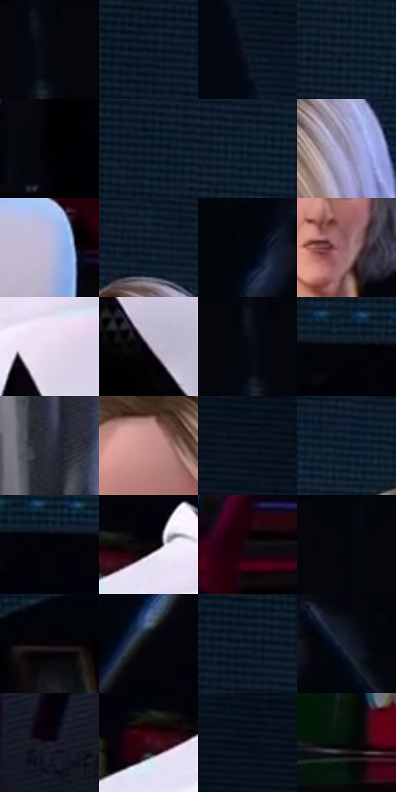

# 电影参考 451

- 状态：常规／活跃；来源世界：miles-home。
- 视角：low-angle；景别：medium；场景：portrait。
- 时段：interior-time-unknown（外观依据，中置信度；具体时间／晨昏未知）；光照：dark-interior。
- 材质候选：skin, hair, fabric, metal, glass（帧级，不是像素分割）。
- 明暗组：very-dark；L* P5/P50/P95：0.56919 / 6.85546 / 77.03933。
- 资格门禁：无附加门禁。
- 原截图 SHA-256：`f4586df5d812613fef05ac0d868957d44e3ba780da181f49849ddc913e87df38`；尺寸：2880 × 1208。
- sRGB 像素 SHA-256：`d36384d35f4212688f0f127f482e644fcb27972f1121d44533d6fde88f15d006`。

## 观察与迁移

暗室面部与展柜，局部亮边不能取代动画形体。

白衣受冷暖环境色，前方女孩较突出、后方长者仍可读；主次不等于删去后方人物。

10  /  451  /  展柜与反射：白衣受冷暖环境色，前方女孩较突出、后方长者仍可读；主次不等于删去后方人物。

本公开版保存32个128×128原像素色卡上下文；图集格子并非原场景相邻位置。原rect、图集tile和像素SHA见 `data/palette-crops.json`。上下文不足时不得批准替色，不能以小样推断完整构图。

## 实测色卡

颜色比例分母为保留采样像素，不是材料面积；全部 32 色参与全库匹配。表内四舍五入仅用于阅读，原精度在 JSON。

| ID | HEX | Lab | 原图 xy | 像素数 | 比例 | 明度角色 |
| --- | --- | --- | --- | ---: | ---: | --- |
| 451-S01 | #04060D | [1.672073, 0.486332, -2.931371] | [2232, 28] | 19579 | 10.126406% | deep-shadow |
| 451-S02 | #091522 | [6.411934, -0.215077, -10.495332] | [48, 44] | 10530 | 5.446195% | deep-shadow |
| 451-S03 | #0F1826 | [8.081549, 0.925724, -10.894716] | [1484, 68] | 9083 | 4.697796% | deep-shadow |
| 451-S04 | #182538 | [14.415894, 0.970748, -14.022374] | [416, 104] | 8444 | 4.367300% | deep-shadow |
| 451-S05 | #020102 | [0.352269, 0.400526, -0.286252] | [2724, 820] | 8028 | 4.152142% | deep-shadow |
| 451-S06 | #091727 | [7.382378, 0.340316, -12.763994] | [312, 28] | 7912 | 4.092146% | deep-shadow |
| 451-S07 | #132030 | [11.855887, 0.06592, -12.334255] | [448, 32] | 7185 | 3.716136% | deep-shadow |
| 451-S08 | #86849F | [56.161567, 6.46893, -14.07927] | [1112, 212] | 7050 | 3.646313% | midtone |
| 451-S09 | #B9B9D9 | [76.082344, 6.389908, -16.005996] | [1320, 888] | 7014 | 3.627693% | light |
| 451-S10 | #0F1E30 | [10.873716, 0.414671, -13.887741] | [1060, 32] | 6665 | 3.447188% | deep-shadow |
| 451-S11 | #03040A | [1.157106, 0.572694, -2.362548] | [2576, 60] | 6529 | 3.376848% | deep-shadow |
| 451-S12 | #91646A | [47.204223, 19.077365, 3.959086] | [2188, 564] | 6354 | 3.286336% | midtone |
| 451-S13 | #E6D9EB | [88.183365, 7.649102, -7.192185] | [832, 864] | 6042 | 3.124968% | highlight |
| 451-S14 | #58505E | [35.242526, 6.287354, -6.953152] | [896, 1056] | 6019 | 3.113072% | shadow |
| 451-S15 | #060A13 | [2.735153, 0.546539, -4.702965] | [2212, 60] | 5447 | 2.817229% | deep-shadow |
| 451-S16 | #01020A | [0.648333, 0.850816, -3.119461] | [260, 576] | 5403 | 2.794472% | deep-shadow |
| 451-S17 | #323343 | [21.766208, 3.750977, -10.09364] | [2244, 1096] | 5345 | 2.764474% | shadow |
| 451-S18 | #C6908D | [64.865173, 20.011881, 9.678454] | [948, 240] | 5263 | 2.722063% | light |
| 451-S19 | #060E1C | [3.943715, 1.093165, -9.613078] | [1768, 28] | 5227 | 2.703444% | deep-shadow |
| 451-S20 | #0A1A2C | [8.866445, 0.482967, -14.140158] | [832, 28] | 5225 | 2.702409% | deep-shadow |
| 451-S21 | #020206 | [0.627494, 0.55614, -1.513628] | [296, 588] | 5170 | 2.673963% | deep-shadow |
| 451-S22 | #0D060D | [2.212002, 2.907772, -2.078183] | [776, 764] | 5148 | 2.662584% | deep-shadow |
| 451-S23 | #190C15 | [4.731362, 6.958597, -2.93042] | [1404, 1132] | 5147 | 2.662067% | deep-shadow |
| 451-S24 | #00040A | [0.98218, -0.211804, -2.638963] | [2376, 28] | 4589 | 2.373465% | deep-shadow |
| 451-S25 | #050106 | [0.606343, 1.741199, -1.523531] | [140, 636] | 3940 | 2.037798% | deep-shadow |
| 451-S26 | #08050A | [1.644728, 1.47963, -1.615537] | [2576, 564] | 3892 | 2.012972% | deep-shadow |
| 451-S27 | #121D2C | [10.476662, 0.43784, -11.582701] | [56, 68] | 3885 | 2.009351% | deep-shadow |
| 451-S28 | #0C101B | [4.768008, 1.350214, -7.563494] | [2692, 36] | 3538 | 1.829880% | deep-shadow |
| 451-S29 | #221E2B | [12.241214, 5.334121, -8.010096] | [2464, 988] | 3161 | 1.634893% | deep-shadow |
| 451-S30 | #3B0B1A | [10.878053, 24.668456, 3.027292] | [712, 788] | 2895 | 1.497316% | deep-shadow |
| 451-S31 | #030914 | [2.395656, 0.384007, -5.868279] | [1920, 56] | 1918 | 0.992004% | deep-shadow |
| 451-S32 | #040C08 | [2.766547, -2.69349, 0.809227] | [1864, 1112] | 1719 | 0.889080% | deep-shadow |

## 色阶与空间分布

- 采样 ROI：`[0.01, 0.02, 0.98, 0.94]`；步长：4；样本数：193346。
- 排除区：`[]`。
- 深暗、暗、中、亮、高光五段计数：`[151990, 9194, 12873, 12038, 7251]`。
- RGB 各 256 箱、L* 100 箱、13×5 色相明度表和 3×3 空间统计全部保存在 [总数据](../film-library.json)。
- [可视化档案](../../references/library.html)按需绘制直方图，不存 2,094 张重复图表图片。

## 纹理特征占比

**这是分块图像特征的面积占比，不是波点／排线／丝网／错版的精确语义覆盖率。** 窗格、发丝、织物也会产生方向或周期特征。
原图 ROI 像素 3104134；已测块覆盖 3104134（100.0000%）；未测 0。

| 特征 | 块覆盖像素 | 占已测面积 | 阈值敏感范围 |
| --- | ---: | ---: | --- |
| low-contrast | 177280 | 5.7111% | 4.2184% ~ 9.7522% |
| directional-structure | 1791488 | 57.7130% | 23.9619% ~ 73.2092% |
| periodic-structure | 1118982 | 36.0481% | 22.5724% ~ 65.3994% |
| mixed-detail | 16384 | 0.5278% | 0.0000% ~ 0.8866% |

阈值敏感范围不是统计置信区间。逐块坐标、尺度、对比、方向一致性、频谱集中度、频率与角度见 [全量特征记录](../texture-features.jsonl)，以帧号定位。
四种印刷层的真实像素覆盖仍标为 `null`，不能填 0，也不能拿上表代替。不得据这些代理测量删除唯一证据。

[测量方法与保留策略](../../references/library-retention.md) · [分类索引](../archive/README.md)
